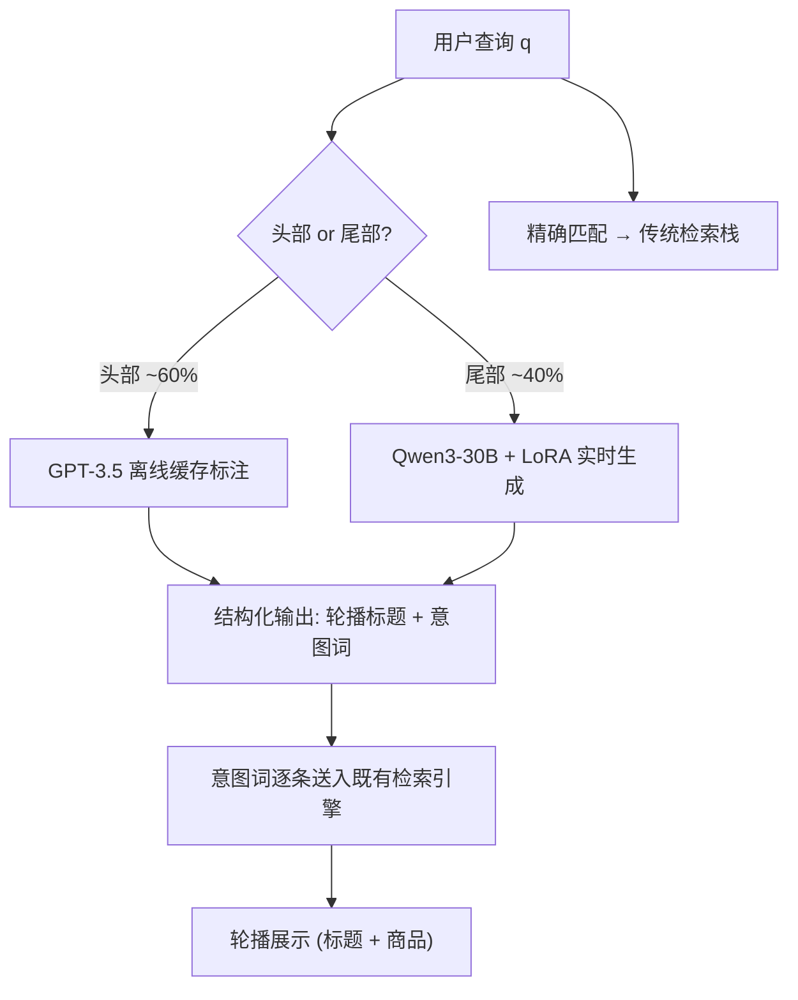
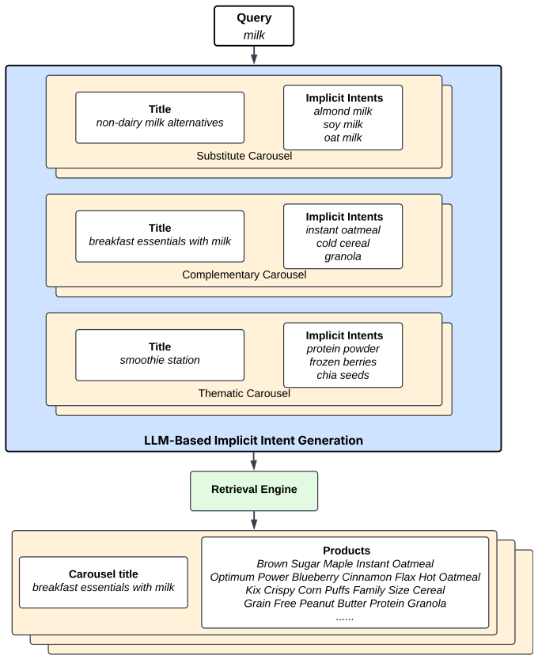

# Improving Item Discoverability in e-Commerce Search via Related Intent Generation (通过相关意图生成提升电商搜索的商品可发现性)

- **会议/期刊**: KDD 2026 Workshop on Two-sided Marketplace Optimization (TSMO)
- **作者与机构**: Ji Xin, Xiao Xiao, Ishan Bhatt, Vinesh Gudla, Trace Levinson, Raochuan Fan, Shishir Kumar Prasad, Prakash Putta, Tejaswi Tenneti（Instacart）
- **推荐链路定位**: 召回（查询侧召回扩展 / 意图生成）
- **研究方向**: 大语言模型推荐 / 冷启动与长尾推荐
- **论文原文**: [https://arxiv.org/abs/2607.27172v1](https://arxiv.org/abs/2607.27172v1)
- **开源代码**: 暂未开源

## TL;DR (1分钟核心速览)

传统电商搜索以"精确匹配"为优化目标，在杂货场景下严重压制了替代品、互补品与主题关联商品的曝光。本文提出 **discovery-augmented search** 任务，用 LLM 生成"隐式意图"（轮播标题 + 意图词列表）来扩展召回：头部查询用闭源 GPT-3.5 缓存标注，尾部查询用 LoRA 微调 + 教师蒸馏的 Qwen3-30B 实时生成。评估采用"会话购买预测 + 人工校验的 LLM-as-a-judge"双轨协议，在头部查询上 F1 从 0.173 提升至 0.184（+6.4%），尾部查询从零覆盖到 F1 0.179，系统覆盖流量从约 60% 扩至 80%，推理成本仅为教师模型的 30%。

## Background & Motivation (背景与核心矛盾)

- **主流范式**: 搜索系统围绕 ad hoc 检索构建，query rewriting / expansion 主要解决词汇不匹配（同义、拼写、改写），优化目标始终锚定在**显式意图**的精确匹配上。
- **前人局限**: (1) 传统扩展方法无法表达"用户没说出来但真正想要"的替代/互补/主题关系，导致大量可满足长尾需求的商品目录被系统性低曝光；(2) 协同购买图（co-purchase graph）类方法依赖历史共现信号，对尾部查询、新兴供给和低频主题意图（如"smoothie station"）信号稀疏，且与搜索索引解耦、缺乏查询条件化逻辑。
- **核心洞察 (Key Insight)**: 语言模型可以**直接从查询本身推理**出互补与主题关系，天然覆盖共购图稀疏的长尾查询；同时，生成与检索解耦后，LLM 只负责高层语义推理，商品落地仍由既有检索引擎保证，避免幻觉直接污染结果。
- **本文切入点**: 将"可发现性"作为搜索的一等目标，用意图条件化的召回扩展（intent-conditioned recall expansion）在保持相关性的前提下扩大候选集，并把成本-质量权衡拆解为"头部缓存闭源 LLM + 尾部蒸馏 SLM"的两级架构。

## Method (核心方法设计)

### 1. 整体框架 (Overall Architecture)

系统采用 **generate-then-retrieve** 范式：给定查询 $q$，生成器输出$C$个轮播（生产环境$C=9$），每个轮播含一个自然语言标题$t_i$与$K=5$个意图词$e_i=(e_{i,1},\dots,e_{i,K})$；每个意图词再逐条送入既有检索引擎落地为商品列表，与标题共同构成展示轮播。精确匹配商品仍由传统检索栈处理，二者互不干扰。生成侧分两级：头部约 1 万高频查询（覆盖约 60% 流量）由 GPT-3.5 Turbo 离线标注并缓存；尾部查询由 LoRA 微调的 Qwen3-30B-Instruct 实时生成，将覆盖提升至约 80%；剩余约 20% 极长尾（单字符、混语种、错拼严重）直接回退纯检索、不展示轮播。

<figure class="paper-figure" markdown="span">
  <figcaption>图1：隐式意图生成流程概览。展示了查询 milk 的示例输出。</figcaption>
</figure>

### 2. 关键设计拆解 (Key Designs)

1. **三类隐式意图的任务形式化**：痛点在于 query expansion 只产出单一改写查询、item-item 推荐又脱离查询条件。本文将输出定义为结构化轮播集合 $\{(t_i, e_i)\}_{i=1}^{C}$，并把意图显式限定为 **substitute**（如 milk → non-dairy milk）、**complementary**（如 milk → instant oatmeal）、**thematic**（如 milk → smoothie station）三类。这一约束把开放式生成收敛为可评估、可检索的离散意图词，使生成结果天然对齐倒排索引的查询接口，无需改造检索栈。

2. **教师-学生蒸馏与上下文缺口修补**：尾部查询若直接调用强模型成本不可接受。作者用 GPT-5.1 作为教师，对 2 万条头尾均衡采样的查询做标注，并在 prompt 中注入离线特征库的品牌、属性、概念标签与近期购买历史，配合 few-shot 教会模型"有上下文用上下文、无上下文靠内在知识"。学生 Qwen3-30B 用 LoRA（rank=8、lr=1e-4、batch 65536）微调 1 个 epoch，损失为标准 next-token 交叉熵：
   $$\mathcal{L}_{\text{SLM}} = -\sum_{t}\log p_\theta(y_t \mid y_{<t}, q, \text{ctx})$$
   关键工程细节是：教师训练时见过富元数据，而学生在请求时拿不到该 payload，会造成**静默质量退化**；作者在蒸馏集中混入一定比例"剥离元数据"的样本，迫使学生不依赖上下文载荷，这是本文最具迁移价值的部署经验。

3. **训练目标、负采样与推理效率**：本文不涉及对比学习或负采样，训练信号完全来自教师输出的 JSON 序列（监督式蒸馏）。推理侧的核心收益来自架构而非模型压缩：头部走缓存零在线开销，尾部 SLM 实时生成，整体以约 **30% 的教师推理成本**覆盖 80% 流量；解码温度 $T=1.0$ 是在留出集上按 Carousel Coherence 指标扫参选定的——高温提升意图多样性但会让同查询下多个标题主题漂移。

## Experimental Setup & Evaluation Protocol (实验设置与评估协议)

- **数据集与预处理**: 本文不使用公开 benchmark，而是自建两套评估资源：

| 数据集 | 规模/构成 | 构造方式 | 说明 |
| :--- | :---: | :---: | :--- |
| 蒸馏训练集 | 20k 查询（头/尾 50:50） | GPT-5.1 教师标注，70/30 划分 | 富元数据 few-shot prompt |
| 端到端发现评估集 | 历史搜索会话派生 | 会话内共购 + 位置衰减 | 排除精确匹配与 top-10 结果 |
| LLM 评审校验集 | 50 条 (query, title, intent) 元组 | 3 名专家多数投票 | 校验 judge 与人类一致性 |

- **数据划分与防穿越 (Splitting Strategy)**: 评估查询取自 30% 验证集，与训练集无重叠；端到端评估集按**会话级**聚合，对会话内第 $n$次购买施加位置衰减权重$w(n)=1/\log_2(2+n)$，商品映射到高层品类（如 Mild Gouda Cheese → cheese）以降低稀疏性。
- **排名评测协议 (Ranking Protocol)**: 非传统 Full-Ranking 或 Sampled Ranking，而是**品类级购买预测**——检索商品的高层品类若落在该会话加权购买品类集合内即判为 relevant，计算 Precision / Recall / F1。该协议刻意排除精确匹配与 top-10 已曝光商品，以隔离"用户想要但系统没给"的隐式需求。
- **对比基线与超参设置**: 基线为线上系统 Prod.（GPT-3.5 缓存，仅覆盖头部）、教师 GPT-5.1、学生 Qwen3-30B；生成质量侧用 GPT-5 作 judge，对标题（Relevance/Quality/Safety/Coherence）与意图（Relevance/Diversity/Novelty）打二元通过/不通过。

## Key Experimental Results (实验关键数据)

### 1. 主实验对比 (Main Results)

端到端购买预测（表 2）：

| Model | Head P | Head R | Head F1 | Tail P | Tail R | Tail F1 |
| :--- | :---: | :---: | :---: | :---: | :---: | :---: |
| Prod. (GPT-3.5 缓存) | 0.130 | 0.260 | 0.173 | — | — | — |
| GPT-5.1 (教师) | 0.124 | **0.426** | **0.192** | 0.108 | 0.379 | 0.168 |
| Qwen3-30B (学生) | 0.117 | 0.433 | 0.184 | **0.117** | **0.383** | **0.179** |
| Improv. (学生 vs Prod.) | — | — | +6.4% | — | 新增覆盖 | 新增覆盖 |

LLM-as-a-judge 生成质量（表 4，节选）：

| 查询段 | Model | Title Rel. | Title Coh. | Intent Rel. | Intent Div. | Intent Nov. |
| :--- | :--- | :---: | :---: | :---: | :---: | :---: |
| Head | Prod. | 0.941 | 0.964 | 0.911 | 0.917 | 0.853 |
| Head | GPT-5.1 | **0.967** | **0.977** | **0.966** | **0.968** | 0.898 |
| Head | Qwen3 | 0.938 | 0.918 | 0.930 | 0.894 | **0.911** |
| Tail | GPT-5.1 | **0.933** | **0.933** | **0.965** | **0.977** | 0.868 |
| Tail | Qwen3 | 0.889 | 0.903 | 0.930 | 0.887 | **0.888** |

### 2. 消融实验 (Ablation Study)

原文未提供严格意义的模块消融，但给出了等价的分级对照与人工对齐校验：

| 配置 | 覆盖流量 | 相对成本 | Head F1 | Tail F1 | 说明 |
| :--- | :---: | :---: | :---: | :---: | :--- |
| 仅 Prod.（无 SLM） | ~60% | 1.0× | 0.173 | — | 尾部无轮播 |
| + 教师 GPT-5.1 全量 | ~100% | ~3.3× | 0.192 | 0.168 | 成本不可接受 |
| + 学生 Qwen3（本文） | ~80% | ~0.3× | 0.184 | 0.179 | 尾部反超教师 |
| 学生 w/o 元数据剥离样本 | ~80% | ~0.3× | — | 静默退化 | 上下文缺口失效模式 |

LLM judge 与人类专家对齐（表 3）：Title Relevance F1 0.67、Intent Relevance F1 0.77、Intent Novelty F1 0.84，精确率分别达 0.84/0.87/0.95。

### 3. 关键实验发现 (Key Findings)

1. **召回扩展的收益主要来自 Recall 而非 Precision**：头部查询上学生模型 Recall 从 0.260 跃至 0.433（+66.5%），而 Precision 从 0.130 降至 0.117；F1 仍净增 6.4%，说明在发现型场景中"多召回、略降准"是划算的交易，但这也意味着该方案不适合直接套用到精排目标。
2. **蒸馏学生在尾部反超教师**：尾部 F1 上 Qwen3 为 0.179 vs GPT-5.1 的 0.168，且 Intent Novelty 更高（0.888 vs 0.868）。作者归因于蒸馏数据中混入的元数据剥离样本与 LoRA 对领域分布的适配，使小模型在稀疏查询上更"敢"生成非平凡意图；但需注意教师与 judge 同属 GPT 家族，该结论存在同源偏置风险。
3. **意图新颖性直接转化为下游召回**：定性案例中，Prod. 对 cranberry juice 只产出同品类果汁（orange/apple/grape juice），而 Qwen3 生成 "Office hydration station" 并带出 snack containers、coffee pods 等非显式互补品。这一语义跃迁与端到端 Recall 的提升方向一致，构成"生成质量—检索效用"的因果链证据。

## Highlights & Limitations (亮点、对比与审稿批判)

- **与代表作对比 (vs. Prior Work)**: 相比经典 query expansion，本文扩展的是**意图空间**而非词汇空间，输出是可检索的离散意图词而非改写查询；相比 co-purchase graph 类互补推荐，本文从查询直接推理关系，不依赖共现密度，因而在尾部与新兴供给上具备天然优势，且与图信号可叠加而非互斥；相比通用 LLM4Rec 的指令微调路线，本文的核心贡献是把"成本-覆盖"曲线工程化，用缓存 + 蒸馏把 LLM 挡在用户热路径之外。
- **可迁移亮点**: (1) **生成与检索解耦**——LLM 只产出意图词，落地交给既有索引，使缓存、回退、灰度发布全部可行，幻觉词最多导致空轮播而非错误结果；(2) **蒸馏时混入元数据剥离样本**，是解决"教师见过富特征、学生线上拿不到"这一普遍性上下文缺口的简洁手段，可直接迁移到任何 LLM 蒸馏到在线小模型的场景。
- **审稿级局限批判**: (1) **评估存在双重偏置**——端到端指标来自被现有系统塑造的日志，虽排除精确匹配与 top-10 以缓解反事实偏置但未消除；同时教师（GPT-5.1）与 judge（GPT-5）同源，可能系统性偏袒教师风格输出，作者自己也承认需跨家族 judge 审计。(2) **缺少关键对照与线上验证**——未与 item-item 共购图、经典 query rewriting 做头对头比较，因而无法量化 LLM 意图生成的边际价值；全文无大规模 A/B，对 basket size、长尾供给曝光等商业指标的影响仍是开放问题。此外，幻觉品牌名目前仅靠"检索为空则轮播不展示"被动兜底，缺少生成前的品牌词表校验。

## Rating (四维评分)

- **方法创新性 (Novelty)**: ⭐⭐⭐⭐ （核心机制与方法设计具备明确创新性，理论与实验动机支撑充分）
- **评估协议与实验扎实度 (Protocol & Experiments)**: ⭐⭐⭐ （主流公开数据集评测完整，包含多基线对比与消融实验验证）
- **写作与数学规范度 (Clarity & Rigor)**: ⭐⭐⭐⭐⭐ （问题形式化定义清晰，核心模块数学推导与架构阐述严谨易读）
- **工业落地与复现价值 (Industrial & Practical Value)**: ⭐⭐⭐⭐⭐ （兼顾推荐效果增益与训练/推理效率，具备实际场景迁移参考价值）
