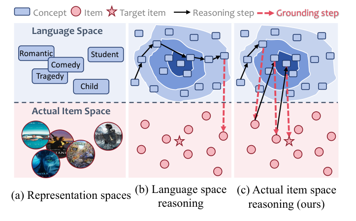
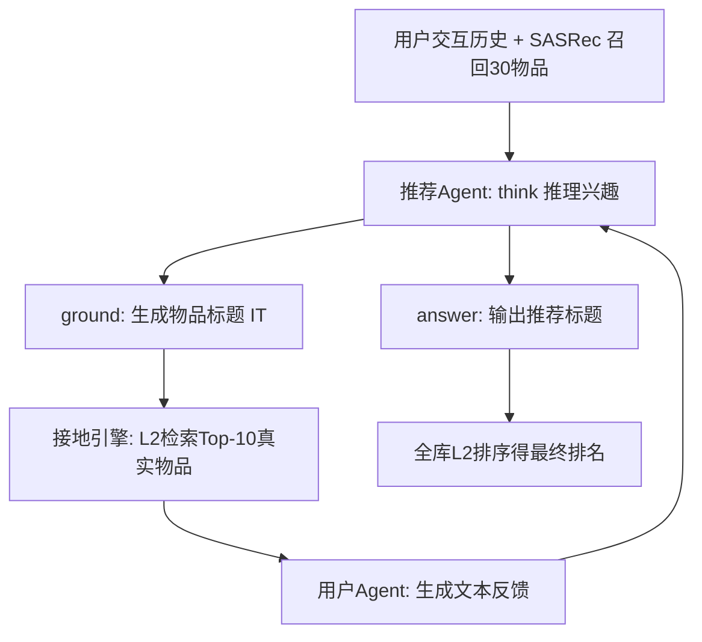
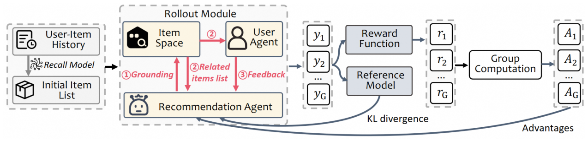

# MGFRec: Towards Reinforced Reasoning Recommendation with Multiple Groundings and Feedback (面向多轮接地与反馈的强化推理推荐)

- **会议/期刊**: KDD 2026
- **作者与机构**: Shihao Cai, Chongming Gao, Haoyan Liu, Wentao Shi, Jianshan Sun, Ruiming Tang, Fuli Feng (USTC / HFUT / 快手)
- **推荐链路定位**: 端到端生成式（LLM 直接生成推荐物品标题，再映射回全库排序）
- **研究方向**: 大语言模型推荐 / 对话推荐与智能体仿真
- **论文原文**: [https://arxiv.org/abs/2510.22888v2](https://arxiv.org/abs/2510.22888v2)
- **开源代码**: [https://github.com/Alibaba-NLP/DeepResearch](https://github.com/Alibaba-NLP/DeepResearch)

## TL;DR (1分钟核心速览)

现有 LLM 推理推荐（如 R²ec、LatentR3）只在**语言空间**内做长链推理，仅在最后一步映射到真实物品库，导致过度解读用户兴趣、生成不存在物品，且推理过程缺乏中间反馈信号。本文提出 MGFRec：把单步 grounding 扩展为**多轮 grounding**，每轮生成物品标题后检索真实物品列表，并由一个**用户 Agent** 给出文本反馈，再用 GRPO 以 NDCG 型结果奖励训练。在三个 Amazon 数据集、Full-Ranking 协议下，H@5 相对最强基线 R²ec 在 Books 上提升约 8.8%，并显著改善长尾物品曝光。

## Background & Motivation (背景与核心矛盾)

- **主流范式**: 基于 RL 的推理推荐（R²ec、LatentR3）让 LLM 先生成用户兴趣推理链，再输出物品；BIGRec 则用 bi-step grounding 把语言空间对齐到物品空间。
- **前人局限**: 其一，推理全程封闭在语言空间，模型可自由构造"浪漫悲剧片""学生向儿童片"等概念，最终映射时偏离真实物品（图 1b）；其二，推理过程无中间反馈，只能依赖最终结果奖励，样本效率低。
- **核心洞察 (Key Insight)**: 若在推理中途反复"落地"到真实物品库，搜索空间会被逐步收窄，且每次落地都天然提供了可被用户反馈评价的实体锚点（图 1c）。
- **本文切入点**: 将 grounding 从一次性动作改为**可重复调用的工具**，并配一个模拟用户 Agent 在每轮接地后给出文本反馈，形成"推理—接地—反馈"闭环。

<figure class="paper-figure" markdown="span">
  <figcaption>图1：语言空间与实际物品空间中推理的比较。语言空间包含所有可能的构造，可能导致推荐偏离目标物品。相比之下，在实际物品空间中反复进行接地有助于将推理引导至目标物品。</figcaption>
</figure>

## Method (核心方法设计)

### 1. 整体框架 (Overall Architecture)

输入为用户最近 20 条交互历史，先用 SASRec 召回 30 个初始物品作为物品空间的"先验感知"。推荐 Agent 以 `think / ground / answer` 三类动作组织输出：在 `<think>` 内推理用户兴趣并生成候选物品标题 $IT$，在 `<ground>` 中调用接地引擎检索真实物品，引擎返回的 `<item_list>` 与用户 Agent 的 `<feedback>` 一并回注上下文，循环至 Agent 判定信息充足后在 `<answer>` 输出推荐标题。最终按 BIGRec 方式计算生成标题与全库物品嵌入的 L2 距离完成全库排序。训练用 GRPO，仅结果奖励 + 格式奖励。

<figure class="paper-figure" markdown="span">
  <figcaption>图2：MGFRec 框架。对于每个输入，MGFRec 在多个迭代循环中运行：①推荐智能体首先执行推理，随后在物品空间上执行接地操作。②接地操作向推荐智能体和用户智能体返回相关物品列表。③用户智能体向推荐智能体提供反馈。该循环持续进行，直到推荐智能体确定无需更多信息并输出最终推荐结果。</figcaption>
</figure>

### 2. 关键设计拆解 (Key Designs)

1. **多轮接地 (Multiple Groundings)**：痛点在于单步接地一旦检索偏斜便无补救机会。本文将接地建模为可反复调用的函数 $f_G(IT)=\mathcal{L}_R$，其中相关度按$D_j=\lVert \mathrm{emb}(I_j)-\mathrm{emb}(IT)\rVert_2$ 排序取 Top-10。每轮接地相当于在物品空间中做一次"软剪枝"，使真实目标物品在后续轮次中排名逐步前移（图 5 验证平均排名从约 1560 降至约 1505），物理直觉是**用检索结果反向约束语言生成**。

2. **用户 Agent 反馈 (User Agent Feedback)**：接地只暴露物品、不表达偏好，故引入以交互历史初始化的用户 Agent，形式化为 $f_U([I_1,\dots,I_n], IT, \mathcal{L}_R)=F$，输出"肯定/否定/改进建议"三类文本反馈。它充当**步级过程监督器**，使结果奖励之外多了一层稠密信号，同时避免额外训练 critic 模型。

3. **GRPO 训练与损失掩码**：目标为
$$\mathcal{J}^*_{GRPO}(\theta)=\mathbb{E}\Big[\tfrac{1}{G}\sum_{i=1}^{G}\min\big(\rho_i A_i,\ \mathrm{clip}(\rho_i,1-\epsilon,1+\epsilon)A_i\big)-\beta \mathbb{D}_{KL}\big(\pi_\theta\|\pi_{ref}\big)\Big]$$
其中 $\rho_i=\pi_\theta(y_i|x;f_G,f_U)/\pi_{old}(y_i|x;f_G,f_U)$，优势$A_i$由组内奖励标准化得到。奖励为$R_{rec,i}=1/\log_2(1+r_i)$（单相关物品的 NDCG），格式错误则置$-0.5$。关键工程细节：`<item_list>` 与 `<feedback>` 属非 LLM 生成 token，训练时**做 loss masking**，否则会引入策略偏置。负采样策略为**免负采样**（全库排序 + 生成式打分）。

## Experimental Setup & Evaluation Protocol (实验设置与评估协议)

- **数据集与预处理**: Amazon Review 2023，沿用 R²ec 处理流程，交互按时间排序截断至最近 20 条。

| 数据集 | #Users | #Items | #Interactions | 稀疏度/密度 | 特征/场景说明 |
| :--- | :---: | :---: | :---: | :---: | :--- |
| Books | 77,348 | 58,335 | 203,410 | 密度约 4.5e-5 | 图书，长尾极重 |
| Movies and TV | 17,194 | 19,369 | 40,041 | 密度约 1.2e-4 | 影视，序列性强 |
| CDs and Vinyl | 7,701 | 12,024 | 13,435 | 密度约 1.5e-4 | 音乐，最稀疏 |

- **数据划分与防穿越 (Splitting Strategy)**: 按 **8:1:1 比例划分**（非 Leave-One-Out），历史序列按时间排序截断，避免未来交互泄漏。
- **排名评测协议 (Ranking Protocol)**: 无偏 **Full-Ranking（全库未交互物品排序）**，指标为 H@{5,10,20} 与 N@{5,10,20}。
- **对比基线与超参设置**: 传统序列模型 SASRec / GRU4Rec / Caser；非推理 LLM 模型 BIGRec / D³；推理 LLM 模型 LatentR3 / R²ec。骨干为 Qwen2.5-1.5B-Instruction，物品嵌入用 gte-Qwen2-1.5B-instruct，学习率 1e-6，batch 128，最大接地 6 次、每次返回 10 物品，rollout 数 $G=6$；用户 Agent 调用 gpt-4.1-nano API。

## Key Experimental Results (实验关键数据)

### 1. 主实验对比 (Main Results)

| Model | Books H@5 | Books N@5 | Books H@20 | Movies H@5 | Movies N@5 | Movies H@20 | CDs H@5 | CDs N@5 | CDs H@20 |
| :--- | :---: | :---: | :---: | :---: | :---: | :---: | :---: | :---: | :---: |
| SASRec | 0.0095 | 0.0065 | 0.0221 | 0.0075 | 0.0051 | 0.0110 | 0.0030 | 0.0023 | 0.0045 |
| BIGRec | 0.0166 | 0.0125 | 0.0460 | 0.0196 | 0.0147 | 0.0415 | 0.0074 | 0.0052 | 0.0149 |
| D³ | 0.0192 | 0.0143 | 0.0497 | 0.0231 | 0.0152 | 0.0459 | 0.0082 | 0.0064 | 0.0203 |
| LatentR3 | 0.0224 | 0.0163 | 0.0577 | 0.0273 | 0.0159 | 0.0488 | 0.0089 | 0.0067 | 0.0212 |
| R²ec | 0.0430 | 0.0267 | 0.0769 | 0.0284 | 0.0184 | 0.0545 | 0.0094 | 0.0073 | 0.0226 |
| **MGFRec** | **0.0468** | **0.0334** | **0.0801** | **0.0301** | **0.0207** | **0.0577** | **0.0098** | **0.0078** | **0.0234** |
| Improv. vs R²ec | +8.8% | +25.1% | +4.2% | +6.0% | +12.5% | +5.9% | +4.3% | +6.8% | +3.5% |

### 2. 消融实验 (Ablation Study)

| 设置 (Movies 验证集) | H@5 | N@5 | H@10 | N@10 | H@20 | N@20 |
| :--- | :---: | :---: | :---: | :---: | :---: | :---: |
| MGFRec 完整 | **0.0313** | **0.0214** | **0.0436** | **0.0253** | **0.0590** | **0.0298** |
| w/o Multi Grounding | 0.0258 | 0.0156 | 0.0351 | 0.0184 | 0.0466 | 0.0207 |
| w/o Agent Feedback | 0.0281 | 0.0179 | 0.0405 | 0.0216 | 0.0533 | 0.0228 |
| w/o Recall Model | 0.0293 | 0.0192 | 0.0419 | 0.0235 | 0.0560 | 0.0264 |

### 3. 关键实验发现 (Key Findings)

1. **多轮接地是收益主引擎**：移除后 H@5 从 0.0313 跌至 0.0258（-17.6%），跌幅远超移除用户反馈（-10.2%）与召回模型（-6.4%），说明收益主要来自推理过程中对真实物品空间的反复感知，而非初始召回质量。
2. **接地次数与样本难度正相关**：接地频次落在 [5,6] 区间的样本平均难度（真实物品流行度倒数）约 0.65，显著高于 [0,1] 区间的约 0.55，证明模型学会了"难样本多接地"，从而让长尾物品获得更多曝光。
3. **接地次数存在边际递减**：最大接地数从 1 增至 6 时 H@5 持续上升，但 6→9 增益趋平；返回物品数在 10 时最优，过少（5）不足以感知物品空间、过多（40）则冗余上下文挤占 LLM 窗口。

## Highlights & Limitations (亮点、对比与审稿批判)

- **与代表作对比 (vs. Prior Work)**: BIGRec 只做一次性 bi-step grounding，无推理链也无反馈；R²ec 有显式推理但全程封闭在语言空间、仅末端映射；LatentR3 用隐式推理省成本但同样缺乏物品空间交互。MGFRec 的本质差异是把 grounding 变成**推理过程中的可重复工具调用**，并配步级用户反馈。
- **可迁移亮点**: ① 将"检索工具调用 + loss masking"范式迁移到任何生成式推荐的语义 ID 解码环节；② 用 LLM 模拟用户 Agent 提供步级过程奖励，可低成本替代人工标注的 process reward model。
- **审稿级局限批判**: ① 用户 Agent 依赖 gpt-4.1-nano 外部 API，训练期高频调用带来成本与可复现性风险，且模拟反馈与真实用户分布存在偏差；② 多轮接地使响应长度随训练持续增长（图 6b），推理延迟与最大接地数强耦合，论文未给出在线 QPS 或时延数据；③ 仅在 1.5B 骨干与三个 Amazon 类目上验证，未讨论更大模型或跨域迁移。

## Rating (四维评分)

- **方法创新性 (Novelty)**: ⭐⭐⭐⭐ （把 grounding 从单步升级为多轮工具调用并耦合用户 Agent 反馈，思路清晰但组件均为已有范式的组合）
- **评估协议与实验扎实度 (Protocol & Experiments)**: ⭐⭐⭐⭐ （Full-Ranking 无偏协议 + 三个数据集 + 完整消融与超参分析，但缺显著性检验与线上验证）
- **写作与数学规范度 (Clarity & Rigor)**: ⭐⭐⭐⭐ （动作模板、奖励与 GRPO 目标定义完整，loss masking 细节交代到位，公式推导偏引用式）
- **工业落地与复现价值 (Industrial & Practical Value)**: ⭐⭐⭐ （开源代码可复现，但多轮接地 + 外部用户 Agent 的推理开销对线上部署构成实质门槛）
