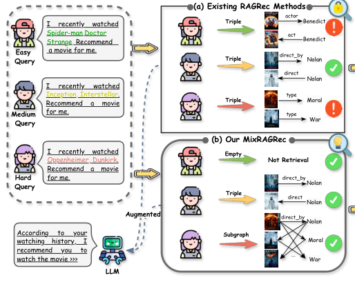
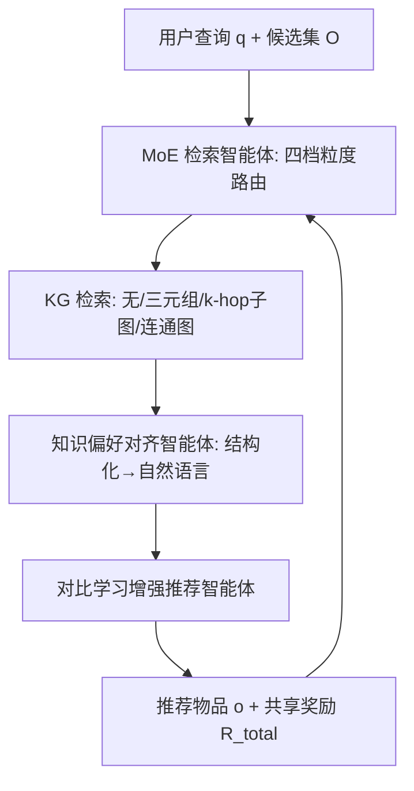
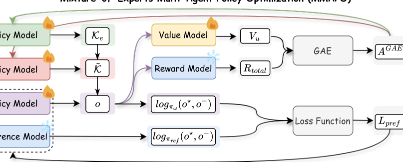

# Mixture-of-Experts Knowledge Graph Retrieval-Augmented Generation for Multi-Agent LLM-based Recommendation (面向多智能体 LLM 推荐的专家混合知识图谱检索增强生成)

- **会议/期刊**: KDD 2026 (Research Track)
- **作者与机构**: Shijie Wang, Chengyi Liu, Yujuan Ding, Shanru Lin, See-Kiong Ng, Xu Xin, Wenqi Fan（香港理工大学、新加坡国立大学）
- **推荐链路定位**: 端到端生成式（LLM 生成式推荐 + 检索增强）
- **研究方向**: 大语言模型推荐 / 图神经网络与知识图谱推荐
- **论文原文**: [https://arxiv.org/abs/2605.28175v2](https://arxiv.org/abs/2605.28175v2)
- **开源代码**: [https://github.com/Sjay-Wang/MixRAGRec](https://github.com/Sjay-Wang/MixRAGRec)

## TL;DR (1分钟核心速览)

LLM 推荐依赖参数化知识，易幻觉且知识过时，KG-RAG 是主流补救方案，但现有方法对所有查询采用**固定检索粒度**：简单查询过度检索引入噪声与开销，复杂查询检索不足丢失多跳关系；且图结构序列化为文本会损失结构信息、检索粒度选择缺乏直接监督。本文提出 MixRAGRec，用 MoE 检索智能体在「无检索 / 三元组 / k-hop 子图 / 连通图」四档粒度间按查询路由，知识对齐智能体将结构化知识改写为 LLM 友好文本，推荐智能体用对比偏好反馈训练，并以 MMAPO 统一优化三智能体。在 20 候选池协议下，LLaMA3-8B 骨干上 Accuracy 相对提升 5.8%–20.4%，且端到端时延低于 K-RagRec。

## Background & Motivation (背景与核心矛盾)

- **主流范式**: LLM 推荐通过指令微调（TALLRec）或强化学习（Rec-r1）适配推荐任务；为缓解幻觉与知识滞后，KG-RAG 从外部知识图谱检索结构化知识注入 LLM（KAPING、G-retriever、K-RagRec）。
- **前人局限**: 其一，现有 KG-RAG 采用 one-size-fits-all 检索粒度，简单查询（如"看过蜘蛛侠、奇异博士，推荐电影"）被灌入冗余子图，复杂查询（如"喜欢诺兰导演的作品"）却只拿到孤立三元组，缺失多跳关系；其二，图结构直接序列化为文本会引入噪声并丢失拓扑结构，且检索粒度选择只能从最终推荐结果间接推断，端到端优化易收敛到固定粒度偏好。
- **核心洞察 (Key Insight)**: 查询复杂度与所需 KG 知识粒度存在强相关——简单查询少量事实即可区分目标物品，冷启动/复杂查询则依赖高阶关系上下文。因此检索粒度本身应作为可学习的离散决策，并与下游推荐效用、检索成本联合优化。
- **本文切入点**: 将检索粒度选择建模为 MoE 路由策略，用多智能体 RL 在共享奖励（推荐收益 + 边际信息增益）下联合训练检索、对齐、推荐三个智能体。

<figure class="paper-figure" markdown="span">
  <figcaption>图 1：现有 RAGRec 方法与本文提出的 MixRAGRec 方法的示意图。(a) 现有 RAGRec 方法对所有查询采用相同的 KG 检索粒度，导致过度检索带来的噪声或检索不足带来的知识缺失；(b) 本文的 MixRAGRec 将不同复杂度的查询路由到合适的检索粒度，改善效用与成本的权衡。</figcaption>
</figure>

## Method (核心方法设计)

### 1. 整体框架 (Overall Architecture)

给定用户查询 $q$（含历史交互与意图描述）与候选集 $\mathcal{O}$，MoE 检索智能体先从四档专家中选择一个执行 KG 检索得到结构化知识 $\mathcal{K}_e$；知识偏好对齐智能体将 $\mathcal{K}_e$ 经模板化草稿 $\text{Temp}(\mathcal{K}_e)$ 改写为 LLM 友好的自然语言片段 $\tilde{\mathcal{K}}$；推荐智能体以 $(q, \tilde{\mathcal{K}}, \mathcal{O})$ 为条件生成推荐。三智能体通过 MMAPO 联合训练：检索与对齐用 GAE 优势估计的 PPO 式裁剪更新，推荐用对比偏好优化，共享奖励同时计入推荐正确性与检索边际信息增益。

<figure class="paper-figure" markdown="span">
  <figcaption>图 2：MixRAGRec 的概览，它由三个智能体组成：(1) 专家混合检索智能体选择一个检索专家以获取结构化知识，(2) 知识偏好对齐智能体将检索到的 KG 知识转换为 LLM 友好的表示，(3) 对比学习增强的推荐智能体生成推荐。专家混合多智能体策略优化（MMAPO）在共享目标下联合优化这些智能体。</figcaption>
</figure>

### 2. 关键设计拆解 (Key Designs)

1. **MoE 多粒度检索智能体（查询感知的粒度路由）**：痛点是一刀切检索导致效用-成本失衡。四个专家分别为：Expert 1 直接生成（$\mathcal{K}_1=\varnothing$）；Expert 2 按查询-三元组余弦相似度取 Top-$M$ 三元组；Expert 3 先取 Top-$M$ 种子实体再展开 $k$-hop 邻域子图；Expert 4 在种子集上跑 Personalized PageRank 取 Top-$M$ 实体，再以边代价 $\text{cost}(e)=1-\cos(z_q, z_{r(e)})$ 用 Kruskal 算法求最小生成树得到连通子图。直觉是：把"检索多少"变成离散动作，让策略网络按查询复杂度自适应选择，简单查询零成本、复杂查询才付高价。

2. **知识偏好对齐智能体（结构-语义桥接）**：痛点是图结构直接序列化引入噪声、丢失结构。先用关系感知模板将三元组/子图线性化为稳定草稿（如"{head} has {relation} {tail}"），再由对齐策略 $\tilde{\mathcal{K}}=\text{Align}_\psi(q, \text{Temp}(\mathcal{K}))$ 生成精炼知识片段。该智能体以 LLM 生成动作参与 RL 轨迹，其价值头 $V_\psi(c_t)$ 定义在生成上下文上，使下游推荐奖励能回传到"如何表述知识"这一决策。

3. **MMAPO 统一优化与对比偏好训练**：痛点是三智能体耦合导致粒度选择无法从原始回报中解耦。共享奖励为
$$R_{\text{total}} = R_{\text{rec}} + \alpha \cdot R_{\text{MIG}},\quad R_{\text{MIG}} = D_{\text{KL}}(P_{\text{expert}} \| P_{\text{base}}) - \eta \cdot C(e)$$
其中 $R_{\text{rec}}$ 在命中目标时取模型置信度、否则 $-0.1$；$R_{\text{MIG}}$ 以 Expert 1 分布为基线度量检索带来的信息增益并惩罚成本 $C(e)$。检索与对齐用 GAE 优势 $A_t^{\text{GAE}}=\sum_l (\gamma\lambda)^l \delta_{t+l}$ 加 PPO 裁剪更新；推荐智能体用硬负采样（按当前策略取 Top-$N$ 竞争负例）的对比偏好损失
$$\mathcal{L}_{\text{pref}} = -\log\sigma\!\Big(\beta\big[\log\tfrac{\pi_\omega(o^\star|x)}{\pi_{\text{ref}}(o^\star|x)} - \log\tfrac{\pi_\omega(o^-|x)}{\pi_{\text{ref}}(o^-|x)}\big]\Big)$$
负采样为策略内 Hard Negative（$N=10$），无需全库负采样；推理时仅需一次专家路由 + 一次对齐生成，开销远低于逐物品检索的 K-RagRec。

## Experimental Setup & Evaluation Protocol (实验设置与评估协议)

- **数据集与预处理**: 三个真实数据集，KG 由 DBpedia 构建为物品中心图：

| 数据集 | #Users | #Items | #Interactions | KG 实体/关系/三元组 | 场景说明 |
| :--- | :---: | :---: | :---: | :---: | :--- |
| MovieLens-1M | 6,040 | 3,883 | 1,000,209 | 24,840 / 168 / 64,688 | 电影，KG 覆盖 3,253 物品 |
| MovieLens-20M | 138,287 | 27,278 | 20,000,263 | 72,673 / 223 / 272,173 | 大规模电影，KG 覆盖 24,700 物品 |
| LFM-1K | 992 | 107,528 | 19,150,868 | 180,457 / 312 / 516,604 | 音乐，KG 覆盖 33,736 物品 |

- **数据划分与防穿越 (Splitting Strategy)**: 采用**最近交互预测**协议——取用户最近一次交互为目标物品，其前 10 次交互作为上下文，属时间序切分，无未来信息泄漏。
- **排名评测协议 (Ranking Protocol)**: **Sampled Ranking**——候选池 = 目标物品 + 19 个干扰项（正负比 1:19），报告 Accuracy 与 Recall@3/5；仅输出单一选项的推理式基线只报 Accuracy。
- **对比基线与超参设置**: 基线覆盖 Zero-shot（GPT-4o、Gemini-2.0-Flash、Deepseek-r1、LLaMA3-8B、Mistral-7B）、LLM 微调推荐（TALLRec、Rec-r1）、KG-RAG（KG-Text、KAPING、G-retriever、K-RagRec）。骨干为 LLaMA3-8B 与 Mistral-7B，LoRA rank 16；检索/对齐策略学习率 $3\times10^{-4}$、$\gamma=0.99$、$\lambda=0.95$、裁剪系数 0.2；偏好温度 $\beta=0.2$、硬负例 $N=10$；MIG 权重 $\alpha=0.2$、成本惩罚 $\eta=0.005$、检索预算 $M=3$；KG 索引编码器为 all-MiniLM-L6-v2。

## Key Experimental Results (实验关键数据)

### 1. 主实验对比 (Main Results)

LLaMA3-8B 骨干（Accuracy / Recall@3 / Recall@5）：

| 方法 | ML-1M Acc | ML-1M R@3 | ML-1M R@5 | ML-20M Acc | ML-20M R@3 | ML-20M R@5 | LFM-1K Acc | LFM-1K R@3 | LFM-1K R@5 |
| :--- | :---: | :---: | :---: | :---: | :---: | :---: | :---: | :---: | :---: |
| GPT-4o (zero-shot) | 0.420 | N/A | N/A | 0.524 | N/A | N/A | 0.685 | N/A | N/A |
| TALLRec | 0.391 | 0.663 | 0.779 | 0.521 | 0.781 | 0.868 | 0.699 | 0.848 | 0.891 |
| Rec-r1 | 0.402 | 0.558 | 0.634 | 0.594 | 0.761 | 0.815 | 0.872 | 0.926 | 0.938 |
| KG-Text | 0.234 | N/A | N/A | 0.301 | N/A | N/A | 0.545 | N/A | N/A |
| KAPING | 0.232 | N/A | N/A | 0.274 | N/A | N/A | 0.530 | N/A | N/A |
| G-retriever | 0.395 | 0.648 | 0.743 | 0.491 | 0.722 | 0.801 | 0.690 | 0.825 | 0.860 |
| K-RagRec | 0.454 | 0.659 | 0.707 | 0.578 | 0.720 | 0.755 | 0.845 | 0.886 | 0.906 |
| **MixRAGRec** | **0.504** | **0.798** | **0.882** | **0.676** | **0.900** | **0.940** | **0.934** | **0.990** | **0.992** |
| Improv.% | +11.0% | +20.4% | +13.2% | +13.8% | +15.2% | +8.3% | +7.1% | +6.9% | +5.8% |

Mistral-7B 骨干下 MixRAGRec 同样全面最优（ML-1M Acc 0.518、LFM-1K Acc 0.912），相对提升 5.3%–18.3%。

### 2. 消融实验 (Ablation Study)

LLaMA3-8B，ML-1M / LFM-1K（图 4 数值趋势）：

| 变体 | ML-1M Acc | ML-1M R@3 | LFM-1K Acc | LFM-1K R@3 |
| :--- | :---: | :---: | :---: | :---: |
| w/o MoESel（随机选专家） | 下降 | 下降 | 下降 | 下降 |
| w/o Align（仅模板序列化） | 显著下降 | 显著下降 | **降幅最大** | **降幅最大** |
| w/o HardNeg（随机负例） | 下降 | 下降 | 下降 | 下降 |
| w/o PrefOpt（去对比偏好） | 下降 | 下降 | 下降 | 下降 |
| w/o MMAPO（去 MIG、独立优化） | 下降 | 下降 | 下降 | 下降 |
| **MixRAGRec** | **0.504** | **0.798** | **0.934** | **0.990** |

### 3. 关键实验发现 (Key Findings)

1. **对齐智能体是最大贡献源**：移除 Align 后 LFM-1K 降幅居五变体之首，说明图结构→自然语言的改写质量比"检索什么"更直接决定知识可用性；而 KG-Text/KAPING 这类直接文本注入甚至不如强 LLM 微调基线（ML-1M Acc 0.234/0.232 vs. TALLRec 0.391），印证结构信息保留的必要性。
2. **粒度路由带来"高精度 + 低时延"双赢**：ML-1M 上 MixRAGRec 检索耗时仅 0.063s、端到端 1.563s，低于 K-RagRec 的 2.867s/3.776s，却取得最高 Acc 0.504；单专家对比显示 Expert 2→4 精度从 0.488 升至 0.499 但耗时从 0.066s 升至 0.374s，策略学会了"只在收益足够时才调用昂贵专家"。
3. **冷启动场景路由行为显著偏移**：冷启动下 Expert 3/4 被选中比例达 37.9%/58.7%（常规 LFM-1K 下 Expert 1–3 各约 30%、Expert 4 仅 13.0%），对应冷启动 Acc 0.501 vs. K-RagRec 0.392，证明策略确实按查询难度自适应而非塌缩到固定粒度；MIG 权重 $\alpha=0.2$ 时 Recall@3/5 最优且检索时间显著下降，$\alpha=0$ 则退化为长时延、排序质量更差的固定偏好。

## Highlights, Limitations & Rating (亮点、对比与审稿评价)

- **与代表作对比 (vs. Prior Work)**: 相比 K-RagRec 的固定多跳子图检索，本文把粒度选择变为可学习离散动作；相比 G-retriever 的查询级统一子图构建，本文引入成本感知的 MIG 奖励；相比 TALLRec/Rec-r1 的纯参数化微调，本文以外部 KG 接地缓解知识滞后，且推理时延更低。
- **可迁移亮点**: (1) 将"检索预算/粒度"建模为带 KL 信息增益 + 成本惩罚的 RL 动作，可直接迁移到任意 RAG 推荐管线；(2) 用模板草稿 + 对齐策略的两段式结构-文本桥接，可复用于表格、序列等其他结构化知识的 LLM 注入。
- **审稿级局限批判**: (1) 评测采用 1:19 采样候选池而非全库 Full-Ranking，Accuracy 绝对值偏高，真实全库排序下的收益幅度待验证；(2) 三智能体 RL 训练需维护多个价值网络与参考模型，超参（$\alpha$、$\eta$、$N$、$M$）敏感且训练成本高，工业部署的稳定性与可复现性存疑。
- **四维评分**: 创新性 ⭐⭐⭐⭐ | 实验扎实度 ⭐⭐⭐⭐ | 方法清晰度 ⭐⭐⭐⭐ | 落地价值 ⭐⭐⭐⭐

