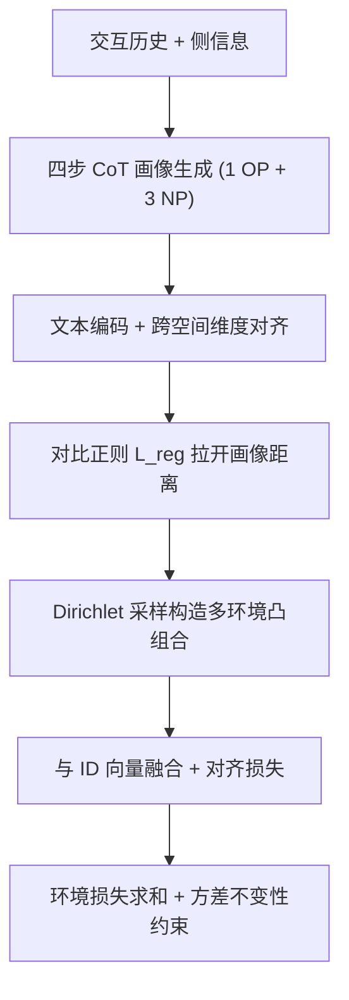
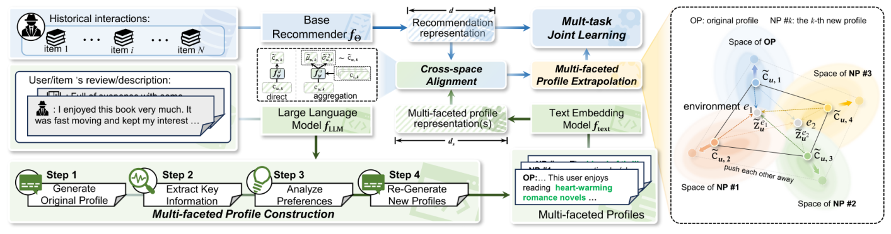

# ProEx: A Unified Framework Leveraging Large Language Model with Profile Extrapolation for Recommendation (基于画像外推的大语言模型统一推荐框架)

- **会议/期刊**: KDD 2026 (First Cycle)
- **作者与机构**: Yi Zhang, Yiwen Zhang, Yu Wang (安徽大学); Tong Chen, Hongzhi Yin (昆士兰大学)
- **推荐链路定位**: 召回（通用隐式反馈 Top-N 推荐，模型无关增强层）
- **研究方向**: 大语言模型推荐 / 自监督与去噪
- **论文原文**: [https://arxiv.org/abs/2512.00679v2](https://arxiv.org/abs/2512.00679v2)
- **开源代码**: [https://github.com/BlueGhostYi/ProRec](https://github.com/BlueGhostYi/ProRec)

## TL;DR (1分钟核心速览)

LLM 画像增强推荐的主流做法是"一人一画像"，但单实例画像既无法覆盖用户多面意图，又因 LLM 幻觉/流行度偏置而引入噪声，且画像质量无法直接评估。ProEx 用四步 CoT 推理为每个用户/物品生成 1 个原始画像 + 3 个低相似度新画像，经跨空间对齐后以 Dirichlet 采样构造多个"环境"做凸组合，通过最小化环境间方差提取偏好不变量，并用对比正则进一步外推。在 Amazon-Book/Yelp/Steam 上以 Full-Ranking 评测，对 LightGCN 的 Recall@20 分别提升 8.65%/13.05%/9.27%，对 6 个基模型平均提升超 5%。

## Background & Motivation (背景与核心矛盾)

- **主流范式**: 不微调 LLM，而是把 LLM 当作即插即用的语义先验源——将交互历史与侧信息压缩成文本画像，再映射为语义向量与 ID 协同向量做跨空间对齐（KAR、RLMRec、DMRec 一脉）。
- **前人局限**: 其一，单画像无法刻画用户行为的多面性（同一用户可能同时偏好灵性与悬疑），表征坍缩在流行度中心；其二，LLM 输出本身不稳定，稀疏交互下会产出"无法判断该用户其他类型偏好"这类无意义画像，而画像质量又缺乏可直接优化的监督信号，误差会被下游模型继承放大。
- **核心洞察 (Key Insight)**: 作者在语言空间做定量分析发现，原始画像（OP）密集聚在中心区域，而强制低相似度重写的新画像（NP）显著向外扩散——这天然构成"画像外推"；但图 4(b) 显示单独使用某个 NP（如 NP #2）反而使 Mult-VAE 性能下降，说明多样性必须配合"哪些信息该保留"的筛选机制。
- **本文切入点**: 既然无法判断哪个画像可信，就让多个画像在随机混合的"环境"中互相投票，保留跨环境不变的那部分语义。

## Method (核心方法设计)

### 1. 整体框架 (Overall Architecture)

离线阶段用 GPT-3.5-turbo 对每个用户/物品执行四步 CoT 得到画像集合 $\mathcal{P}_u=\{s_{u,1},\dots,s_{u,K}\}$（$K=4$），经 `text-embedding-ada-002` 编码为高维语义向量后用映射函数压到协同空间维度；在线训练时，每个 batch 内先对$K$个画像施加对比正则拉开距离，再从 Dirichlet 分布采样$E$组混合系数构造多个环境表征，与基模型 ID 向量逐元素相加融合，各环境分别计算推荐损失与对齐损失，最终以"环境损失之和 + 环境间方差惩罚"联合优化。推理阶段不再采样，直接对$K$ 个画像表征做均值池化后融合。

<figure class="paper-figure" markdown="span">
  <figcaption>图2：所提出的ProEx的信息流。</figcaption>
</figure>

### 2. 关键设计拆解 (Key Designs)

1. **四步 CoT 多面画像构建（解决"单画像坍缩"）**：痛点是一次性提示只会改写措辞而不引入新信息。ProEx 将生成拆为 $\mathcal{P}_u=\mathcal{F}_4^{\pi_4}\circ\mathcal{F}_3^{\pi_3}\circ\mathcal{F}_2^{\pi_2}\circ\mathcal{F}_1^{\pi_1}(x_u,r_u)$：先出原始画像，再抽取正/负向偏好证据，再推理潜在偏好，最后在"措辞与表达须完全不同于 OP"的约束下生成$K-1$ 个新画像。图 7 的案例显示，无 CoT 时新画像只是 OP 的同义改写，有 CoT 时才引入灵性、悬疑、小镇温情等互补面向。

2. **环境混合与不变性提取（解决"画像质量不可评估"）**：既然无法挑出好画像，就让每个环境 $e$用一组 Dirichlet 采样系数做凸组合$\tilde{\boldsymbol{c}}_u^{e}=\sum_{k}\vartheta_k^{e}\tilde{\boldsymbol{c}}_{u,k}$，$\sum_k \vartheta_k^{e}=1$，保证混合表征始终落在$K$ 个画像张成的凸包内。总目标为
$$\mathcal{L}_{\text{ProEx}}=\sum_{e\in\mathcal{E}}\mathcal{L}^{e}+\lambda_2\mathcal{L}_{\text{reg}}+\lambda_3\mathrm{Var}_{e\in\mathcal{E}}(\mathcal{L}^{e}),$$
其中方差项迫使不同混合比例下损失一致，等价于提取"无论怎么混都不变"的偏好内核，从而把噪声画像的影响摊薄。生成式基模型则对均值与方差分别做同样混合，并以反向 KL 对齐到 VAE 后验。

3. **对比正则与训练/推理开销**：$\mathcal{L}_{\text{reg}}=\sum_{k}\log\big(1+\exp(1/\tau)\sum_{k'\neq k}\exp(\tilde{\boldsymbol{c}}_{u,k}^{\top}\tilde{\boldsymbol{c}}_{u,k'}/\tau)\big)$，$\tau=0.2$，持续扩大画像两两距离以撑开凸包。训练无需负采样改造（沿用各基模型原生损失：BPR 或重构误差），画像生成是一次性离线开销；图 5 显示 ProEx 每 epoch 仅比基模型略慢，但因收敛更快，达到同等 Recall@20 所需总时间反而更少。

## Experimental Setup & Evaluation Protocol (实验设置与评估协议)

- **数据集与预处理**: 三个公开数据集，未额外做 k-core 过滤（沿用 RLMRec 提供版本）：

| 数据集 | #Users | #Items | #Interactions | 画像总数 | 场景说明 |
| :--- | :---: | :---: | :---: | :---: | :--- |
| Amazon-Book | 11,000 | 9,332 | 200,860 | 81,328 | 图书，含标题/评论 |
| Yelp | 11,091 | 11,010 | 277,535 | 88,404 | 本地商户 |
| Steam | 23,310 | 5,237 | 525,922 | 114,188 | 游戏平台 |

- **数据划分与防穿越 (Splitting Strategy)**: 按 3:1:1 比例划分训练/验证/测试，早停依据验证集 Recall@20（连续 20 epoch 不升则停）。
- **排名评测协议 (Ranking Protocol)**: 无偏 `Full-Ranking`，对每个用户在全库未交互物品上排序，报告 Recall@{10,20} 与 NDCG@{10,20}；10 个随机种子取均值并报告 $p$ 值（均远小于 0.05）。
- **对比基线与超参设置**: 判别式基模型 GCCF / LightGCN / SimGCL，生成式基模型 Mult-VAE / L-DiffRec / CVGA；LLM 增强基线 CARec、KAR、LLMRec、RLMRec-C/G、AlphaRec(+)、DMRec。判别式 batch size 4096、生成式 1024，LightGCN 嵌入维度统一 32，LLM 统一 GPT-3.5-turbo + ada-002 以保证公平。

## Key Experimental Results (实验关键数据)

### 1. 主实验对比 (Main Results)

与 LLM 增强基线对比（LightGCN 为底座，$d=32$）：

| 方法 | Amazon-Book R@20 | N@20 | Yelp R@20 | N@20 | Steam R@20 | N@20 |
| :--- | :---: | :---: | :---: | :---: | :---: | :---: |
| CARec | 0.1391 | 0.0854 | 0.1130 | 0.0714 | 0.1384 | 0.0880 |
| KAR | 0.1416 | 0.0863 | 0.1194 | 0.0756 | 0.1353 | 0.0854 |
| LLMRec | 0.1469 | 0.0855 | 0.1203 | 0.0751 | 0.1431 | 0.0901 |
| RLMRec-C | 0.1483 | 0.0903 | 0.1230 | 0.0776 | 0.1421 | 0.0902 |
| AlphaRec* | 0.1421 | 0.0835 | 0.1213 | 0.0752 | 0.1420 | 0.0898 |
| **ProEx** | **0.1533** | **0.0940** | **0.1308** | **0.0826** | **0.1473** | **0.0939** |
| Improv. vs 最强基线 | +3.37% | +4.10% | +6.34% | +6.44% | +2.79% | +3.53% |

模型无关性验证（节选 Recall@20，括号内为相对基模型提升）：

| 基模型 | Amazon-Book | Yelp | Steam |
| :--- | :---: | :---: | :---: |
| GCCF → +ProEx | 0.1343 → **0.1443** (+7.45%) | 0.1084 → **0.1201** (+10.79%) | 0.1313 → **0.1361** (+3.66%) |
| LightGCN → +ProEx | 0.1411 → **0.1533** (+8.65%) | 0.1157 → **0.1308** (+13.05%) | 0.1348 → **0.1473** (+9.27%) |
| SimGCL → +ProEx | 0.1512 → **0.1574** (+3.92%) | 0.1254 → **0.1331** (+7.03%) | 0.1436 → **0.1483** (+3.27%) |
| Mult-VAE → +ProEx | 0.1472 → **0.1596** (+8.42%) | 0.1189 → **0.1289** (+8.41%) | 0.1452 → **0.1548** (+6.61%) |
| L-DiffRec → +ProEx | 0.1495 → **0.1593** (+6.56%) | 0.1177 → **0.1254** (+6.54%) | 0.1395 → **0.1494** (+7.10%) |
| CVGA → +ProEx | 0.1522 → **0.1660** (+9.07%) | 0.1249 → **0.1339** (+7.17%) | 0.1339 → **0.1554** (+16.03%) |

### 2. 消融实验 (Ablation Study)

Amazon-Book 上相对完整 ProEx 的性能变化（图 6，数值为相对比值，>1 表示优于变体）：

| 变体 | LightGCN R@20 | LightGCN N@20 | Mult-VAE R@20 | Mult-VAE N@20 |
| :--- | :---: | :---: | :---: | :---: |
| w/o inv（去环境方差项） | 最低 | 最低 | 最低 | 最低 |
| w/o reg（去对比正则） | 次低 | 次低 | 次低 | 次低 |
| w/o align（去跨空间对齐） | 中等下降 | 中等下降 | 下降更明显 | 下降更明显 |
| w/o mixing（均值池化替代环境混合） | 小幅下降 | 小幅下降 | 小幅下降 | 小幅下降 |
| w/o CoT（直接重生成画像） | 小幅下降 | 小幅下降 | 小幅下降 | 小幅下降 |
| **ProEx** | **1.000** | **1.000** | **1.000** | **1.000** |

### 3. 关键实验发现 (Key Findings)

1. **不变性约束与对比正则是两大主引擎**：去掉环境方差项或对比正则的降幅最大，说明"多画像"本身不带来收益，收益来自"拉开距离 + 跨环境一致性筛选"这一对组合算子；而 w/o mixing 的降幅较小，表明凸组合的价值主要在于提供随机化环境而非融合算子本身。
2. **生成式基模型受益更稳定、判别式受益更猛**：生成式模型编码器维度约 200，与 LLM 语义向量维度更接近，对齐损失小，六个基模型上提升普遍在 6%–8%；判别式模型 $d=32$ 时维度压缩更剧烈，但 LightGCN 仍拿到 8.65%–13.05% 的提升，说明对齐损失虽带来语义损耗，语义先验的净收益依然为正。
3. **画像数量与环境数存在明显甜点且与模型类型相关**：$K=4\sim5$时两个基模型均最优，$K$ 继续增大反而因噪声与开销上升而退化；环境数上 LightGCN 偏好 2–3 个，Mult-VAE 可容纳更多。此外表 5 显示本地可部署的 SFR-Embedding-Mistral（0.1515/0.1580）接近 ada-002，而 LLaMA3-8B 的 4096 维表征反而最差，说明 ProEx 不依赖闭源大模型，但对文本编码器的语义质量敏感。

## Highlights & Limitations (亮点、对比与审稿批判)

- **与代表作对比 (vs. Prior Work)**: RLMRec 与 KAR 同样做"LLM 语义空间 ↔ 协同空间"对齐，但都只用一个画像/一段语义描述，本质是单点语义注入；DMRec 把语义分布引入生成式推荐，却仍以单画像构造先验。ProEx 的差异在于把"画像不可评估"这一困境转化为"多环境不变性"的可优化目标，用随机凸组合替代了对画像质量的显式判别，这是与三者最本质的分野。
- **可迁移亮点**: 其一，"Dirichlet 采样构造环境 + 环境间损失方差惩罚"是一套与基模型解耦的通用去噪插件，可直接套用到任何带辅助语义信号的召回/精排模型；其二，四步 CoT 中"强制措辞与表达完全不同于原始画像"的低相似度约束，是低成本提升 LLM 生成多样性的实用 prompt 技巧。
- **审稿级局限批判**: 其一，画像生成依赖 GPT-3.5-turbo 离线批量调用，论文未报告画像构建的 token 成本与总耗时，对百万级用户的实际工业部署缺乏可行性论证；其二，环境数 $E$、画像数$K$、$\lambda_2,\lambda_3$三个超参均需按基模型类型分别调优（LightGCN 与 Mult-VAE 的最优区间明显不同），且$K$ 增大即退化，说明方法对超参较敏感，缺少自适应设定机制；其三，实验仅在三个中等规模数据集上做离线 Full-Ranking，无线上 A/B 或冷启动分桶验证，"缓解流行度偏置"的主张缺乏直接的分层证据。

## Rating (四维评分)

- **方法创新性 (Novelty)**: ⭐⭐⭐⭐ （把不变性学习引入 LLM 画像融合，"环境凸组合 + 方差惩罚"绕开了画像质量不可评估的死结，思路干净且有图 4 的分布证据支撑）
- **评估协议与实验扎实度 (Protocol & Experiments)**: ⭐⭐⭐⭐ （6 个基模型 × 3 数据集 × Full-Ranking × 10 种子 + $p$ 值 + 完整消融与超参分析，但缺少冷启动/长尾分桶与线上验证）
- **写作与数学规范度 (Clarity & Rigor)**: ⭐⭐⭐⭐ （公式推导与算法伪代码完整，判别式/生成式两条分支交代清楚；但 Eq. 11 的对齐损失符号略显紧凑，环境方差项的理论解释停留在直觉层面）
- **工业落地与复现价值 (Industrial & Practical Value)**: ⭐⭐⭐⭐ （代码已开源、模型无关可直接插拔、推理仅需均值池化无额外延迟；扣分在于画像离线生成的 LLM 调用成本未量化）

