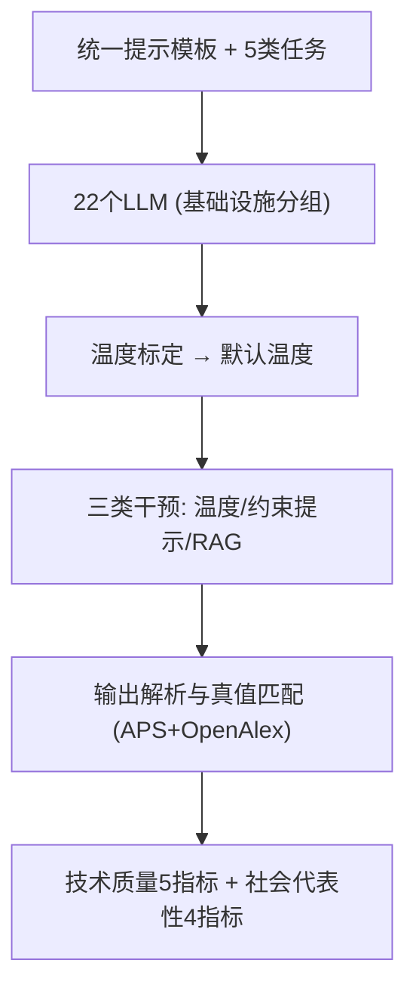
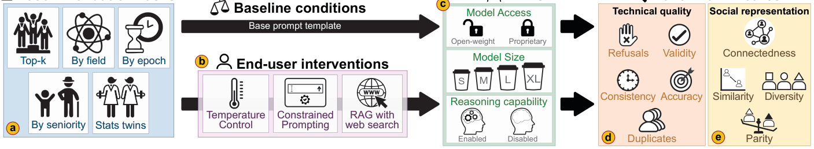

# Whose Name Comes Up? II: Benchmarking and Intervention-Based Auditing of LLM-Based Scholar Recommendation (谁的名字被提及？II：基于基准与干预的 LLM 学者推荐审计)

- **会议/期刊**: KDD 2026 (V.2)
- **作者与机构**: Lisette Espín-Noboa (Complexity Science Hub Vienna), Gonzalo Gabriel Méndez (UPV / Inria)
- **推荐链路定位**: 端到端生成式（LLM 直接生成学者名单）
- **研究方向**: 大语言模型推荐 / 去偏公平与可信评测
- **论文原文**: [arXiv:2602.08873v2](https://arxiv.org/abs/2602.08873v2)
- **开源代码**: [appeler/ethnicolr](https://github.com/appeler/ethnicolr)（数据与可视化工具见 Zenodo DOI）

## TL;DR (1分钟核心速览)

现有 LLM 学者推荐审计只在单一默认配置下评估输出，无法区分失败（拒答、幻觉、覆盖不均）源于模型本身还是部署决策。本文提出 LLMScholarBench，在物理领域 5 类任务、22 个 LLM 上联合审计基础设施条件（访问方式/规模/推理能力）与三类推理期干预（温度、代表性约束提示、RAG 联网检索），用 9 个指标分技术质量与社会代表性两轴度量。核心结论：**没有任何干预能同时提升事实性与代表性**——温度升高损害有效性与一致性，约束提示以事实性换多样性，RAG 提升技术质量却收窄性别均衡，干预只是重排权衡前沿而非带来一致增益。

## Background & Motivation (背景与核心矛盾)

- **主流范式**: 传统专家发现依赖文献计量数据库检索排序；LLM 时代转向由提示直接生成学者名单，用户通过温度、提示约束、RAG 等推理期手段调控输出。
- **前人局限**: ① 既有审计（Barolo et al.、Liu et al.）只覆盖少数模型、固定提示与默认温度，把失败归因于"模型选择"，忽略了部署期干预这一混淆变量；② 传统检索系统与 LLM 生成系统各自继承并放大可见性偏差（早期学者、全球南方、少数群体被低估），但生成式系统的偏差会随推理配置漂移，静态审计无法刻画。
- **核心洞察 (Key Insight)**: 模型表现不是固定属性而是**配置依赖**的——同一模型在不同温度/提示/RAG 下排名会重排，因此审计必须把"基础设施"与"终端用户干预"放在同一受控框架下联合测量。
- **本文切入点**: 构建可复现基准，将评估拆为技术质量（拒答、有效性、重复、一致性、事实性）与社会代表性（连通性、文献计量相似性、人口多样性、均衡性）两轴九指标，系统扫描 22 个模型 × 3 类干预。

## Method (核心方法设计)

### 1. 整体框架 (Overall Architecture)

LLMScholarBench 以统一零样本提示模板（任务描述 + 分步指令 + JSON 输出格式）驱动 22 个 LLM 完成 5 类学者推荐任务；每个"模型–任务–参数"配置在 31 天内每日两次重复查询（≥62 次），先做逐模型温度标定选出兼顾事实性与有效性的默认温度，再在此基线上施加三类干预；所有输出经七类标签解析（valid/verbose/fixed/skipped/refused/API error/invalid），仅保留 valid 与 verbose 进入九指标计算，指标以 APS 文献库为真值参照。

<figure class="paper-figure" markdown="span">
  <figcaption>图1：LLMScholarBench 概览。我们在五项任务（a）、三种终端用户干预（b）以及 22 个在访问类型、规模和推理能力上各异的 LLM（c）上评估基于 LLM 的学者推荐。模型输出从两个维度进行评估：技术质量（拒绝、有效性、重复、一致性、准确性；d）和社会代表性（连通性、文献计量相似性、人口多样性与均衡性；e），从而实现对性能权衡的系统分析。</figcaption>
</figure>

### 2. 关键设计拆解 (Key Designs)

1. **双轴九指标评估协议（把"能不能答"与"答得公不公"解耦）**：痛点在于单一准确率掩盖了拒答与代表性偏差。本文定义技术质量轴：拒答率 $\text{Refusal}=\frac{1}{M}\sum_{j=1}^{M}r_j$、有效性$\text{Validity}=\frac{1}{N}\sum_{i=1}^{N}v_i$（配置级"至少一次成功"）、列表内重复率$\text{Duplicates}_i=1-|U_i|/|L_i|$、时间一致性（相邻有效响应的 Jaccard 均值）与事实性$\text{Fact}_i=|\hat{U}_i|/|U_i|$；社会代表性轴用共作者子图归一化熵补定义连通性$\text{Connectedness}_i=1-\text{NormEntropy}_i$、PCA 降维后作者画像余弦相似性、归一化 Shannon 熵多样性$\text{Div}^{(a)}_i$与对总体分布的总变差距离均衡性$\text{Parity}^{(a)}_i=1-\text{TV}^{(a)}_i$。直觉：把"可用性"与"分布公平"分开度量，才能暴露二者此消彼长的结构性张力。
2. **三类推理期干预的受控施加（模拟真实终端用户可及手段）**：温度干预在 $t\in\{0,0.25,\dots,2.0\}$ 上扫描以刻画随机性对稳定性的侵蚀；代表性约束提示仅在 top-100 任务上施加（性别/族裔/声望/泛多样性四类约束），因短列表无法稳定测量分布差异；RAG 仅在 gemini 系列上开启原生联网检索，刻意复刻聊天界面的真实用法。该设计使"部署决策"成为可操纵自变量，从而把失败归因从模型架构中剥离出来。
3. **温度标定与统计口径**：每个模型先在 7 个温度值上各采 3 次，选"事实性均值最大且有效性高"的温度作为后续默认值（如 gemini-2.5-pro 因技术限制用 $t=1.0$替代 0.75，经验证不改变结论）；二元指标用 Wilson 区间、其余用 Student-$t$区间报告 95% CI。此标定避免了默认$t=0$ 引入的不可控不确定性，是跨模型可比的前提。

## Experimental Setup & Evaluation Protocol (实验设置与评估协议)

- **数据集与真值库**: 以美国物理学会 (APS) 1893 年以来的出版物为真值库 $\mathcal{D}$，并用 OpenAlex 补充全球文献计量指标与作者消歧；感知性别用 gender-guesser（F1≈0.95）、族裔用 demographicx/ethnicolr（F1≈0.84）从姓名推断；声望按发表/引用分位数划为 low/mid/high/elite 四档。

| 维度 | 配置 | 说明 |
| :--- | :--- | :--- |
| 任务族 | 5 类 × 每类≥2 变体 | top-5/top-100、CMMP/PER 领域、1950s/2000s 年代、早期/资深、twins-real/fake |
| 模型 | 22 个 LLM | 8B–671B，开源/闭源、标准/推理型 |
| 查询规模 | 每配置 ≥62 次 | 31 天 × 每日 2 次，最多 3 次重试 |
| 指标 | 9 个 | 技术质量 5 + 社会代表性 4 |

- **数据划分与防穿越**: 非传统训练/测试划分，而是**时间重复采样协议**——同一配置跨 31 天重复查询以测时间一致性；真值匹配采用全名优先、同名视为事实性以抑制假阴性。
- **排名评测协议**: 属**生成式名单审计**而非全库排序；事实性以 APS 库实体匹配为准，任务级准确率额外校验领域/年代/资历条件是否满足。
- **对比基线与超参**: 基线为"无干预默认配置"，干预组与之做配对差值比较；温度网格 7 档，约束提示 4 类，RAG 对比 gemini-2.5-flash/pro 开/关。

## Key Experimental Results (实验关键数据)

### 1. 主实验对比 (Main Results)

原文主结果为分组聚合的九指标对比（图 2–图 6），下表提炼基础设施分组的关键方向性结论（↑越高越好，↓越低越好）：

| 分组 | Refusal↓ | Validity↑ | Consistency↑ | Factuality↑ | Connectedness | Diversity(gender)↑ | Parity(gender)↑ |
| :--- | :---: | :---: | :---: | :---: | :---: | :---: | :---: |
| 开源权重 | 较高 | **较高** | 较低 | 较低 | 较低 | 较低 | 较低 |
| 闭源专有 | 较低 | 较低 | **较高** | **较高** | **较高** | **较高** | **较高** |
| Small (<10B) | 较低 | 较低 | **较高** | 与 XL 相当 | 较低 | 较高 | **较高** |
| Extra Large (≥400B) | **较高** | **较高** | 较低 | 较高 | **较高** | 较低 | 较低 |
| 推理禁用 | 较低 | **较高** | 相当 | 较低 | 略低 | 相当 | 略低 |
| 推理启用 | 较高 | 较低 | 相当 | **较高** | 略高 | 相当 | 略高 |

干预效果（相对无干预基线的变化方向）：

| 干预 | Validity | Factuality | Consistency | Diversity | Parity |
| :--- | :---: | :---: | :---: | :---: | :---: |
| 温度↑ | ↓（开源降幅更大） | ↓ | ↓ | 基本不变 | 基本不变 |
| 性别均衡约束提示 | ↓ | ↓ | ↓ | **↑** | 变化很小 |
| 仅女性约束提示 | ↓ | **↓↓** | ↓ | 族裔多样性↑ | 性别/族裔均衡↓ |
| RAG (gemini) | ↓（flash 更明显） | 持平/略↑ | ↓ | ↓ | ↓ |

### 2. 消融实验 (Ablation Study)

本文以"干预组合"替代传统模块消融，对比 CP、RAG 与 CP+RAG 相对基线的增量：

| 配置 | ΔTechnicals | ΔFactuality | ΔConsistency | ΔDiversity | ΔParity |
| :--- | :---: | :---: | :---: | :---: | :---: |
| CP (多样性引导) | ↓ | ↓ | 略↑ | **↑** | **↑** |
| RAG | ↓ | ≈0（flash 略↑） | ↓ | ↓ | ↓ |
| CP + RAG | ↓↓ | ↓↓ | 模型相关 | ↑（弱于 CP） | ↑（弱于 CP） |

### 3. 关键实验发现 (Key Findings)

1. **规模收益递减且方向分裂**：拒答率与有效性随模型规模上升，重复率随规模下降，但事实性、相似性、多样性并不单调增长——小模型在事实性上可与 XL 持平，且性别均衡性反而更高，说明"堆参数"只改善格式合规与网络连通性，不改善代表性。
2. **干预是零和的再分配而非帕累托改进**：约束提示是唯一能实质改变多样性的手段，但性别均衡提示同时压低事实性与相似性；仅女性提示造成事实性、相似性、性别与族裔均衡四项齐跌，却意外抬高族裔多样性——约束方向与副作用高度不对称。
3. **RAG 收窄曝光面**：RAG 在 gemini 上事实性持平或微升、重复近零，但性别与族裔多样性下降、均衡性走低，且与 CP 叠加时反而削弱 CP 的代表性增益并额外损失技术质量——联网可见性作为学术声望代理本身有偏，RAG 把这种偏置带入推荐。

## Highlights & Limitations (亮点、对比与审稿批判)

- **与代表作对比 (vs. Prior Work)**: 相比 Barolo et al. 仅审计少数模型、固定提示与单一维度，本文将模型数扩至 22、任务扩至 5 族、指标扩至 9 项，并把推理期干预提升为一等公民；相比 Liu et al. 的单学者识别审计，本文聚焦"推荐名单"的分布性质而非个体是否被认出。
- **可迁移亮点**: ① "配置依赖排名"的审计范式可直接迁移到 LLM 招聘、审稿人指派等人物推荐场景；② 用共作者子图归一化熵度量名单连通性、用总变差距离度量分布均衡性，是可复用的代表性度量工具。
- **审稿级局限批判**: ① 基础设施分组与对齐策略、训练数据、解码默认值相互混淆，作者自认只能给出"操作性规律"而非因果结论；② 事实性依赖姓名实体消歧，同名即判真会高估事实性，且"存在性"不等于"相关性"；③ 仅在物理学单一领域实例化，RAG 仅覆盖 gemini 两型号，跨领域与跨检索架构的外推性存疑。

## Rating (四维评分)

- **方法创新性 (Novelty)**: ⭐⭐⭐⭐ （首个把基础设施与推理期干预联合纳入同一审计框架的学者推荐基准，双轴九指标设计有方法论价值，但单点技术新颖度有限）
- **评估协议与实验扎实度 (Protocol & Experiments)**: ⭐⭐⭐⭐⭐ （22 模型 × 5 任务 × 31 天重复采样、逐模型温度标定、95% CI 与 Wilson 区间，审计规模与严谨度在同类工作中突出）
- **写作与数学规范度 (Clarity & Rigor)**: ⭐⭐⭐⭐ （九指标公式定义清晰、方向性标注明确，但主文以聚合图为主、缺少逐模型数值表，定量细节下沉至附录）
- **工业落地与复现价值 (Industrial & Practical Value)**: ⭐⭐⭐⭐ （代码、数据与交互式可视化工具全部开源，模块化架构易换领域；但审计成本高、结论偏诊断性，直接落地需配合知识图谱等模型侧改造）
