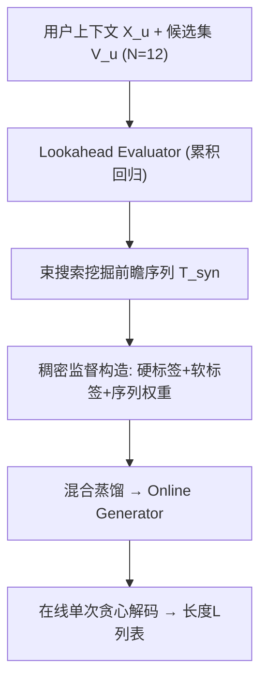
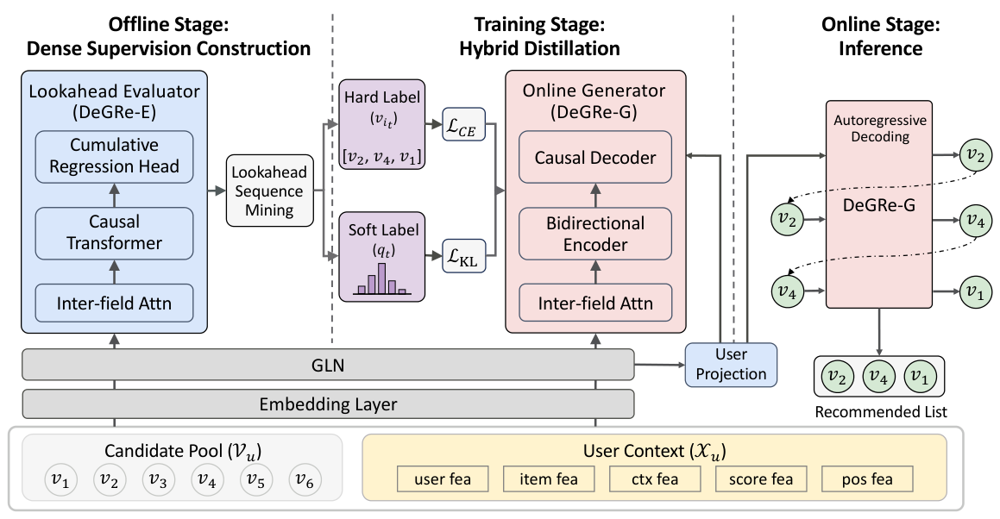

# DeGRe: Dense-supervised Generative Reranking for Recommendation (稠密监督生成式重排)

- **会议/期刊**: KDD 2026 (ADS Track, Oral; Best Paper Award Honorable Mention)
- **作者与机构**: Chaotian Song, Jingyao Zhang, Chenghao Chen, Zisen Sang, Dehai Zhao, Guodong Cao, Boxi Wu, Deng Cai, Jia Jia（浙江大学软件学院 / 阿里巴巴淘天集团淘宝闪购）
- **推荐链路定位**: 重排（Reranking）
- **研究方向**: 多任务学习与列表级重排 / 生成式推荐
- **论文原文**: [https://arxiv.org/abs/2605.25749v2](https://arxiv.org/abs/2605.25749v2)
- **开源代码**: 暂未开源

## TL;DR (1分钟核心速览)

生成式重排面临两大痛点：**启发式标签偏差**（把点击项强行置顶，忽略列表内因果依赖）与**信用分配难题**（列表级稀疏后验奖励无法指导中间生成步）。DeGRe 提出离线-在线解耦框架：离线用基于累积回归的 Lookahead Evaluator 配合束搜索在未曝光空间主动挖掘高价值前瞻序列，构造硬标签+软标签+序列权重的稠密监督，再混合蒸馏进轻量 Online Generator；在线仅需单次贪心解码。在 ML-1M / Taobao Ad / Taobao Flash Shopping 上 HR@1% 分别达 89.10% / 71.06% / 88.72%，较 SOTA 绝对提升 29.90% / 28.95% / 53.19%，线上 A/B 测试 GMV +3.75%、延迟仅 +14.8ms。

## Background & Motivation (背景与核心矛盾)

- **主流范式**: 重排位于多级推荐链路末端，需建模列表内物品上下文关联以最大化整体效用。早期单阶段方法（DLCM/PRM）先打分再贪心排序，受"评估先于重排"局限易陷局部最优；两阶段 generator-evaluator 范式（如 PRM+采样重排）存在目标不一致与高延迟；近期转向端到端生成式重排（GReF 的 OMTP、NLGR/GoalRank 的奖励引导）。
- **前人局限**: ① **启发式标签偏差**——MLE 类方法（GReF）用"点击项置顶"等规则构造标签，隐含假设点击项价值恒高于未点击项，模型拟合的是有偏数据分布而非真实全局最优，且无法挖掘未曝光空间的高价值序列；② **信用分配难题**——奖励类方法（NLGR/GoalRank）仅用列表级后验标量（整体 CTR/GMV），无法归因到自回归生成的每一步局部决策，优化方向模糊、性能天花板受限。
- **核心洞察 (Key Insight)**: 排列空间虽指数级（P(12,6)≈6.6×10⁵），但可将昂贵的空间探索**完全卸载到离线阶段**；且累积回归天然适合估计任意长度子序列的渐进价值，从而为每一步生成提供稠密信号。
- **本文切入点**: 离线用束搜索+累积回归评估器挖掘前瞻最优序列并蒸馏为稠密监督，在线生成器内化"前瞻规划"能力后单次贪心解码即可逼近全局最优。

## Method (核心方法设计)

### 1. 整体框架 (Overall Architecture)

DeGRe 采用离线-在线解耦的三阶段闭环。**离线阶段**：Lookahead Evaluator（DeGRe-E，因果 Transformer + 累积回归头）对候选集任意子序列估计期望累积价值，并以束宽 $B$ 引导束搜索，在未曝光空间挖掘高价值前瞻序列集 $\mathcal{T}_{syn}$。**训练阶段**：将评估器逐步价值估计转化为硬标签（目标决策）、软标签（候选空间细粒度价值分布）与序列权重，通过混合蒸馏损失注入轻量 Online Generator（DeGRe-G，双向编码器 + 用户引导因果解码器 + 候选约束指针式解码）。**在线阶段**：评估器不部署，生成器仅执行一次贪心解码输出列表，规避两阶段范式的额外开销。

<figure class="paper-figure" markdown="span">
  <figcaption>图2：DeGRe 的整体框架。在离线阶段，Lookahead Evaluator 通过前瞻序列挖掘构建稠密监督信号。在训练阶段，Online Generator 通过混合蒸馏内化前瞻规划能力。在在线阶段，模型通过单次贪心解码实现高效推理。</figcaption>
</figure>

### 2. 关键设计拆解 (Key Designs)

1. **累积回归评估器（Cumulative Regression Evaluator）**：痛点在于传统列表级评估器只给完整列表打分，无法指导中间步。DeGRe-E 将离散价值 $V$（如累计点击数）建模为序数二分类分布，预测 $P(V\ge k \mid l_{1:t}) = \sigma(f_k(l_{1:t}))$，期望价值由概率求和直接导出：
$$\hat{V}(l_{1:t}) = \sum_{k=1}^{t} P(V \ge k \mid l_{1:t})$$
训练用下三角掩码的有序 BCE 损失（$k \le t$ 约束累计值不超过步数）。直觉：把标量回归拆成一组有序二分类，既保留分布形状又天然支持任意长度子序列的渐进估值。

2. **稠密监督构造（Dense Supervision Construction）**：针对启发式标签偏差，用评估器引导束搜索（每步对剩余候选扩展、按 $\hat{V}([l_{<t};v])$ 保留 Top-$B$）得到前瞻序列集。对每条序列每步构造：**硬标签** $v_{i_t}$（评估器选中的目标决策）+ **软标签** $q_t(v_i) = \text{softmax}_{v_i}(\hat{V}([l_{<t};v_i]))$（保留次优候选的细粒度排序信息）+ **序列权重** $w_l = \text{softmax}_{l}(\hat{V}(l)/\tau_w)$（按前瞻价值重塑监督强度）。直觉：硬标签提供确定性模仿目标，软标签作为局部正则器让生成器感知候选间相对优劣，权重让梯度聚焦高置信序列。

3. **混合蒸馏目标与推理效率**：总损失为
$$\mathcal{L}_{Gen} = \sum_{l \in \mathcal{T}_{syn}} w_l \sum_{t=1}^{L} \left[ \mathcal{L}_{CE}(v_{i_t}, P_{\theta,t}) + \alpha \mathcal{L}_{KL}(q_t \| P_{\theta,t}) \right]$$
其中 CE 项做前瞻模仿、KL 项做价值对齐（$\alpha=0.01$）。生成器采用候选约束解码 $P_\theta(v_i|l_{<t}) = \text{softmax}(h_t^{dec} m_i^\top)$，输出严格限定在候选集内且不重复；解码起点由用户表征线性投影 $e_{start} = W_p e_{user} + b_p$ 初始化（替代静态 `<BOS>`，增强首项个性化）。**免负采样**（候选集内 softmax 即隐式负样本），在线仅一次贪心解码，$L<10$ 时开销可控。

## Experimental Setup & Evaluation Protocol (实验设置与评估协议)

- **数据集与预处理**:

| 数据集 | #Users | #Items | #Interactions | 稀疏度/密度 | 特征/场景说明 |
| :--- | :---: | :---: | :---: | :---: | :--- |
| ML-1M | 6,040 | 3,706 | 1,000,209 | 密度≈4.5% | 评分≥5 转隐式正样本 |
| Taobao Ad | 1,141,729 | 99,815 | 26,557,961 | 密度≈0.023% | 展示广告，按交互切列表并混入负样本 |
| Taobao Flash Shopping | 3,511,657 | 1,753,654 | 167,911,273 | 密度≈0.0027% | 工业级，每请求 12 候选/6 曝光，含点击+转化标签 |

- **数据划分与防穿越 (Splitting Strategy)**: 统一采用 `Leave-One-Out`，每个用户最后一个 session 作测试集，其余训练，严格遵循时间因果。
- **排名评测协议 (Ranking Protocol)**: 生成器用 **Monte Carlo 采样 HR@K%**（$K\in\{1,3,10\}$）——将生成列表与 10,000 条随机对比集 $S_u$ 比较，衡量排列空间优化能力；评估器用 **R-AUC**（连续值域排序一致性）、**PCOC**（校准比）、**RMSE**（绝对误差）。所有生成器基线由统一外部评估器打分以保证公平。
- **对比基线与超参设置**: 生成器基线 NAR4Rec / GReF / NLGR-G / GoalRank；评估器基线 DeepFM / PIER / NLGR-E。Embedding 维度 $d=16$，评估器 $N_E=6$ 层、生成器 $N_G=4$ 层，Adam 学习率 $5\times10^{-4}$，batch 1024，$\alpha=0.01$，重排设定 12 选 6，5 次随机种子取均值。

## Key Experimental Results (实验关键数据)

### 1. 主实验对比 (Main Results)

**生成器性能（统一外部评估器）**：

| Model | ML-1M HR@1% | ML-1M HR@10% | Taobao Ad HR@1% | Taobao Ad HR@10% | Flash HR@1% | Flash HR@10% |
| :--- | :---: | :---: | :---: | :---: | :---: | :---: |
| NAR4Rec | 0.1866 | 0.4271 | 0.0966 | 0.3378 | 0.1342 | 0.4150 |
| GReF | 0.1926 | 0.4368 | 0.1013 | 0.3647 | 0.1618 | 0.4564 |
| NLGR-G | 0.1656 | 0.5224 | 0.0916 | 0.4028 | 0.1225 | 0.4645 |
| GoalRank | 0.5920 | 0.9386 | 0.4211 | 0.8501 | 0.3553 | 0.8164 |
| DeGRe-G (B=1) | 0.7486 | 0.9874 | 0.5222 | 0.9458 | 0.6947 | 0.9639 |
| **DeGRe-G (B=8)** | **0.8910** | **0.9934** | **0.7106** | **0.9833** | **0.8872** | **0.9962** |
| **Improv.% (vs SOTA)** | **+29.90%** | +5.84% | **+28.95%** | +15.67% | **+53.19%** | +11.44% |

**评估器性能（Taobao Flash Shopping）**：

| Metric | DeepFM | PIER | NLGR-E | **DeGRe-E** |
| :--- | :---: | :---: | :---: | :---: |
| R-AUC↑ | 0.6979 | 0.7041 | 0.7036 | **0.7090** |
| PCOC→1 | 1.0392 | 0.9132 | 0.8828 | **0.9932** |
| RMSE↓ | 0.4985 | 0.4966 | 0.4973 | **0.4946** |

### 2. 消融实验 (Ablation Study)

| Variant (Flash, B=2) | HR@1% | HR@10% |
| :--- | :---: | :---: |
| DeGRe (B=2) | **0.7910** | **0.9852** |
| w/o Soft Label | 0.7896 | 0.9856 |
| w/o Seq Weighting | 0.7856 | 0.9846 |
| w/o Hard Label | 0.2107 | 0.5631 |
| Exposure Only | 0.1577 | 0.4353 |

### 3. 关键实验发现 (Key Findings)

1. **前瞻序列挖掘是性能根基**：移除硬标签后 HR@1% 暴跌 58.03%（0.7910→0.2107），仅略高于纯曝光训练（0.1577），证明束搜索挖掘的高价值序列是 DeGRe 的核心贡献，而非网络结构本身。
2. **软标签与序列权重是"锦上添花"而非"雪中送炭"**：移除后 HR@1% 仅降 0.14% / 0.54%，说明细粒度分布信息与价值加权主要起正则与梯度聚焦作用；超参分析显示 $\alpha$ 过大（>0.01）会过度平滑分布反而损害主任务，$\tau_w$ 呈倒 U 型，需中等温度平衡区分度与稳定性。
3. **离线探索宽度带来边际递减收益**：束宽 $B$ 从 1→2→4→8，HR@1% 依次为 69.5%→79.1%→84.4%→88.7%，验证更宽搜索挖到更优前瞻序列，但增益递减，工业上可按算力预算折中；线上 A/B 中 DeGRe 较 PRM 再提升 ORDER +1.0%、GMV +2.99%，且新用户仍获 GMV +2.72%、支付宝场景 GMV +4.14%，跨用户群与跨场景鲁棒。

## Highlights, Limitations & Rating (亮点、对比与审稿评价)

- **与代表作对比 (vs. Prior Work)**: 相比 GReF（MLE 拟合启发式标签，无法探索未曝光空间），DeGRe 用评估器主动挖掘前瞻序列消除标签偏差；相比 NLGR/GoalRank（列表级稀疏奖励，信用分配模糊），DeGRe 用累积回归提供逐步稠密价值信号；相比两阶段 generator-evaluator（目标不一致+双模型在线部署），DeGRe 离线蒸馏后在线仅需单模型单次贪心解码，延迟仅 +14.8ms。
- **可迁移亮点**: ① "累积回归 + 束搜索构造稠密监督"可迁移到任何序列决策任务（如多轮对话策略、组合优化）；② 用户表征初始化解码起点替代静态 `<BOS>`，是低成本提升首项个性化的通用技巧。
- **审稿级局限批判**: ① 离线束搜索开销随 $B$ 与候选规模增长，论文仅给出 Top-$K$ 预截断与批并行，未量化大规模候选（N≫12）下的离线成本；② 评估器与生成器共享特征处理架构但层数不同，蒸馏效果对架构对齐的敏感度未做消融；③ 公开数据集仅 ML-1M 与 Taobao Ad，缺乏更多跨域基准验证泛化性。
- **四维评分**: 创新性 ⭐⭐⭐⭐ | 实验扎实度 ⭐⭐⭐⭐⭐ | 方法清晰度 ⭐⭐⭐⭐ | 落地价值 ⭐⭐⭐⭐⭐

