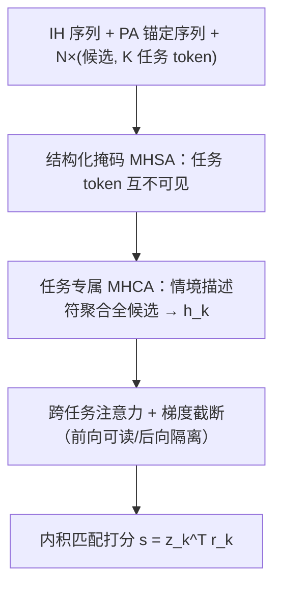
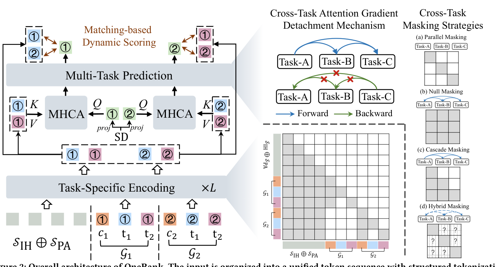

# OneRank: Unified Transformer-Native Ranking Architecture for Multi-Task Recommendation (面向多任务推荐的统一 Transformer 原生排序架构)

- **会议/期刊**: KDD 2026 (Jeju Island)
- **作者与机构**: Jiakai Tang, Sunhao Dai, Xu Chen, Jun Xu 等（中国人民大学高瓴人工智能学院）与 Shopee Pte. Ltd.、南洋理工大学
- **推荐链路定位**: 精排（多任务多目标排序）
- **研究方向**: 多任务学习与列表级重排 / CTR 预估与特征交叉
- **论文原文**: [https://arxiv.org/abs/2606.16838v1](https://arxiv.org/abs/2606.16838v1)
- **开源代码**: 暂未开源

## TL;DR (1分钟核心速览)

工业多任务推荐虽已从 DNN 迁移到 Transformer，但仍保留 $G(Z=\mathcal{F}(X))$ 的「任务无关编码器 + 任务专属 MLP 塔」分离范式，导致任务信息瓶颈、梯度冲突（跷跷板现象）与注意力动态表征到静态前馈打分的范式断裂。OneRank 把多任务推理整体内化进 Transformer 栈：任务私有 token 互不可见实现早期特化、情境描述符做候选感知上下文化、跨任务注意力前向可读后向截断、内积匹配式动态打分替代静态 MLP。在 Shopee 30 天工业日志上 C/A/O 三任务 AUC 与 GAUC 全面超越 OneTrans+PLE 等组合，线上 7 天 A/B 的 GMV/UU +1.01%、Bad Query Rate −2.29%。

## Background & Motivation (背景与核心矛盾)

- **主流范式**: 工业界已用 Transformer 替换 DNN 做序列与特征建模（MTGR、OneTrans、HyFormer），但多任务部分仍是 MMoE/PLE/ResFlow 式的「共享底 + 任务塔」，即 $\mathcal{F}$产出任务无关表征$Z$，再由$\mathcal{G}_k$ 各自预测。
- **前人局限**: ① 共享 $Z$ 构成任务无关信息瓶颈，任务专属信号在编码阶段即被纠缠，只能靠容量受限的预测塔事后解耦；② 共享参数上的冲突梯度引发跷跷板现象，缺乏显式的任务优化方向隔离机制；③ 注意力是逐层上下文路由，而 MLP 塔是静态全局决策边界，读写动态不兼容，破坏端到端任务推理与规模化。
- **核心洞察 (Key Insight)**: 问题不在编码器容量，而在「编码-预测」的结构性割裂——把 Transformer 当任务无关编码器，等于放弃了它在栈内做任务条件化路由的能力。
- **本文切入点**: 不再修补 $\mathcal{G}$，而是取消$\mathcal{F}$–$\mathcal{G}$ 边界，让任务特化、跨候选聚合、跨任务迁移、打分全部在同一 Transformer 栈内以 token 与 mask 表达。

## Method (核心方法设计)

### 1. 整体框架 (Overall Architecture)

输入被组织为一条统一 token 序列：交互历史 $\mathcal{S}^{IH}$（带可学习位置编码）、偏好锚定$\mathcal{S}^{PA}$（检索得到的高互动序列，用 BOS/EOS 包裹，借鉴 RAG 思路）、以及$N$个候选-任务组$\mathcal{G}_i=[e^C_i, t_1,\dots,t_K]$。经$L$层结构化掩码 MHSA 后，每个任务 token 的输出$r^i_k$即候选$i$在任务$k$下的上下文条件化表征；再由任务专属 MHCA 以情境描述符为 query 聚合全候选得到任务级全局表征$h_k$；跨任务注意力做受控迁移并截断梯度；最终以内积$s^i_k=z_k^\top r^i_k$ 动态打分。训练用 InfoNCE + BCE 混合目标，推理时用户侧 KV 可缓存，仅候选与任务 token 需在线计算。

<figure class="paper-figure" markdown="span">
  <figcaption>图2：OneRank 的整体架构。输入被组织为具有结构化分词的统一 token 序列，包括交互历史 (IH)、偏好锚定 (PA) 和候选任务 token 组。具有相互不可见性的任务专用 token 注入实现了早期任务特化。候选感知上下文化通过情境描述符聚合跨候选信号，而灵活的跨任务关系注意力促进了跨任务的受控知识迁移。OneRank 采用基于匹配的评分公式进行动态上下文感知个性化</figcaption>
</figure>

### 2. 关键设计拆解 (Key Designs)

1. **任务 token 互不可见 + 结构化掩码（早期特化）**：痛点是共享底让任务在编码阶段就丢失身份。做法是给每个候选组注入 $K$ 个共享参数但独立实例化的任务 token，并用掩码强制：用户上下文因果可见、候选组之间隔离（支持单用户多候选并行）、同组内不同任务 token 互相不可见。形式化为

$$M_{pq}=1 \iff \begin{cases}\text{pos}(q)\le\text{pos}(p), & p,q\in\{\mathcal{S}^{IH},\mathcal{S}^{PA}\}\\ q\in\{\mathcal{S}^{IH},\mathcal{S}^{PA}\}\ \text{或}\ q=e^C_i, & p\in\mathcal{G}_i\\ q=t^{(i)}_k, & p=t^{(i)}_k\end{cases}$$

直觉：任务 token 参数共享但注意力路径隔离，同一模板在不同候选上产出不同表征，等于在输入层就为每个任务开出独立梯度通道，从源头压制跷跷板。

2. **候选感知上下文化 + 匹配式动态打分（弥合训练-服务鸿沟）**：逐点训练与全库排序的服务环境不匹配。做法是用情境描述符 $s$（用户画像、query、时段/地点等）经任务专属投影$q_k=\mathrm{LN}(f_k(s))$，再以任务专属 MHCA 聚合全部候选表征：$h_k=\mathrm{MHCA}_k(q_k,\{r^i_k\},\{r^i_k\})$。打分改为$s^i_k=z_k^\top r^i_k$，其中$z_k$ 经跨任务注意力与 FFN 精炼。直觉：全局表征编码了候选池的竞争分布，同一用户-物品对在不同 session 下得分不同，且内积把任务表征与候选表征拉进同一几何空间联合优化，梯度流优于分离的 MLP 塔。

3. **跨任务注意力 + 战略梯度截断 + 灵活掩码（受控迁移）**：$\tilde h_k=\mathrm{MHSA}(h_k,\{h_j\}_{j:A_{kj}=1})$，反向时对$j\ne k$置$\partial\mathcal{L}/\partial h_j=0$，只保留对角梯度。效果是把跨任务注意力变成「只读存储器」：前向可借稀疏任务所需的上游信号，后向不产生负迁移。掩码$A$支持 Parallel（互不可见）、Null（全可见）、Cascade（$A_{kj}=\mathbb{I}[j\le k]$，点击→加购→下单漏斗）、Hybrid（如短视频场景点赞/评论双向、点击→关注单向）四种策略。总损失

$$\mathcal{L}=\sum_{k=1}^{K}\left(\alpha\mathcal{L}^{\text{list}}_k+\beta\mathcal{L}^{\text{point}}_k\right),\quad \mathcal{L}^{\text{list}}_k=-\sum_{i\in\mathcal{I}^+_k}\log\frac{\exp(s^i_k/\tau)}{\sum_{j=1}^{N}\exp(s^j_k/\tau)}$$

负样本来自同一次前向的候选集内（in-batch/list-wise，免额外采样），$\tau$初始 0.2，$\alpha=\beta=1$。推理侧 KV-cache 复用用户上下文，在线仅算候选与任务 token。

## Experimental Setup & Evaluation Protocol (实验设置与评估协议)

- **数据集与预处理**: Shopee 自建工业日志，2025 年 12 月连续 30 天，含点击/加购/下单三类反馈。

| 数据集 | #Users | #Items | #Interactions | 稀疏度/密度 | 特征/场景说明 |
| :--- | :---: | :---: | :---: | :---: | :--- |
| Shopee | 33M | 118M | 26.6B 曝光 / 1.05B 点击 / 251M 加购 / 40M 下单 | 曝光-点击率约 3.9% | 105M query，电商个性化排序主场景 |

- **数据划分与防穿越 (Splitting Strategy)**: 按 30 天日志的工业惯例做时间切分（训练用前段、评估用后段），避免未来交互泄漏；论文正文未给出比例细节，附录 A 补充。
- **排名评测协议 (Ranking Protocol)**: 离线报告 AUC 与 GAUC（用户级分组 AUC），属全量曝光样本上的排序质量评估，非采样负例排序；线上以 10% vs 10% 流量做 7 天 A/B。
- **对比基线与超参设置**: 三类编码器（DNN 生产基线、MTGR、OneTrans）× 六种多任务策略（noMTL、NSE、MMoE、PLE、DCMT、ResFlow）的笛卡尔组合。OneRank 用 2 层 pre-norm Transformer、4 头、隐藏维 256、FFN 2×、最大序列长 256、3 个任务 token + 3 个排序头 token。

## Key Experimental Results (实验关键数据)

### 1. 主实验对比 (Main Results)

| Encoder + Predictor | Params | FLOPs | C-AUC | C-GAUC | A-AUC | A-GAUC | O-AUC | O-GAUC |
| :--- | :---: | :---: | :---: | :---: | :---: | :---: | :---: | :---: |
| DNN + PLE | 9.2M | 220.6M | 0.7688 | 0.7721 | 0.8277 | 0.7906 | 0.8872 | 0.8198 |
| DNN + ResFlow | 9.5M | 226.7M | 0.7649 | 0.7688 | 0.8252 | 0.7886 | 0.8886 | 0.8204 |
| MTGR + PLE | 2.7M | 496.0M | 0.7723 | 0.7737 | 0.8318 | 0.7930 | 0.8933 | 0.8260 |
| MTGR + MMoE | 2.3M | 487.0M | 0.7718 | 0.7737 | 0.8304 | 0.7915 | 0.8914 | 0.8237 |
| OneTrans + PLE | 6.4M | 823.5M | 0.7770 | 0.7775 | 0.8371 | 0.7982 | 0.8996 | 0.8336 |
| OneTrans + ResFlow | 6.3M | 823.2M | 0.7764 | 0.7766 | 0.8372 | 0.7975 | 0.8987 | 0.8287 |
| OneTrans + NSE | 6.3M | 823.2M | 0.7773 | 0.7772 | 0.8359 | 0.7961 | 0.8991 | 0.8280 |
| **OneRank (Ours)** | **4.9M** | 1.0G | **0.7910** | **0.7843** | **0.8463** | **0.8036** | **0.9024** | **0.8350** |
| Improv.% vs 最强基线 | −23% | +21% | +1.76% | +0.87% | +1.09% | +0.68% | +0.31% | +0.17% |

线上 A/B（7 天，10% vs 10% 流量）：GMV/UU **+1.01%**、Paid GMV/UU **+1.17%**、AR/UU **+0.81%**、Bad Query Rate **−2.29%**。

### 2. 消融实验 (Ablation Study)

| 变体 | 说明 | C-AUC | A-AUC | O-AUC | C-GAUC | A-GAUC | O-GAUC |
| :--- | :--- | :---: | :---: | :---: | :---: | :---: | :---: |
| V1 | 去任务 token，候选编码直接线性投影 | 0.7889 | 0.8424 | 0.9005 | 0.7821 | 0.8011 | 0.8337 |
| V2 | K 个任务 token 合并为单一共享 token | 0.7893 | 0.8437 | 0.9010 | 0.7828 | 0.8019 | 0.8341 |
| V3 | V2 基础上再去跨任务注意力 | 0.7890 | 0.8431 | 0.9008 | 0.7825 | 0.8015 | 0.8339 |
| V4 | 去梯度截断（跨任务注意力全梯度回传） | 0.7901 | 0.8460 | 0.9019 | 0.7836 | 0.8031 | 0.8346 |
| V5 | 情境描述符替换为随机初始化参数 | 0.7872 | 0.8418 | 0.8996 | 0.7809 | 0.8004 | 0.8318 |
| V6 | 全双向注意力，无选择性掩码 | 0.7885 | 0.8429 | 0.9007 | 0.7818 | 0.8013 | 0.8338 |
| **Full** | 完整 OneRank | **0.7910** | **0.8463** | **0.9024** | **0.7843** | **0.8036** | **0.8350** |

### 3. 关键实验发现 (Key Findings)

1. **情境描述符是最大单点贡献**：V5 把 SD 换成随机参数后 C-AUC 从 0.7910 掉到 0.7872（−0.0038）、O-GAUC 掉到 0.8318（−0.0032），降幅超过任何其他消融项，说明候选感知上下文化（而非任务 token 本身）才是弥合训练-服务鸿沟的主力。
2. **任务 token 的价值在稀疏任务上更明显**：V1 去掉任务 token 后 A-AUC 从 0.8463 降至 0.8424、O-GAUC 从 0.8350 降至 0.8337，而 C-AUC 仅降 0.0021——早期特化主要救的是稀疏且易被点击信号淹没的加购/下单任务，与跷跷板诊断一致。
3. **梯度截断是「稳定性保险」而非「精度增益」**：V4 去掉截断后多数指标仅微降（C-AUC 0.7901 vs 0.7910），但 A-AUC 出现 0.8460 vs 0.8463 的不稳定波动，印证其作用是在保留前向迁移的同时抑制稀疏任务的负迁移；同时 V6 全双向掩码全面劣于受控掩码，说明「能看见」不等于「该看见」。

## Highlights & Limitations (亮点、对比与审稿批判)

- **与代表作对比 (vs. Prior Work)**: 与 PLE/MMoE 的本质区别是把任务隔离从「专家路由」下沉到「token 与注意力掩码」，隔离发生在编码阶段而非预测阶段；与 OneTrans/MTGR 的区别是它们只统一了特征交互与序列建模，多任务头仍是 MLP 塔，OneRank 连打分都换成内积匹配；与 OnePiece 的 reasoning token 思路相近，但 OnePiece 仍保留编码器-预测器分离与 MLP 打分。
- **可迁移亮点**: ① 「前向可读、后向截断」的跨任务注意力可直接移植到任何多目标排序栈，用一行自定义 backward 换掉复杂的梯度手术（PCGrad 类）；② 单用户多候选打包 + 用户侧 KV 缓存，是把精排做成类生成式推理的实用工程范式。
- **审稿级局限批判**: ① 仅在一个内部电商数据集上验证，缺少公开多任务基准（如 AliExpress/KKBox 类）与跨域复现，泛化性证据偏弱；② FLOPs 达 1.0G，比 OneTrans+PLE 高约 21%，论文只给参数量优势而未给线上 P99 延迟与吞吐数字，「保持计算效率」的论断缺乏延迟侧硬证据；③ 掩码策略需人工按业务先验设计，Hybrid 掩码的选择本身构成新的超参搜索空间。

## Rating (四维评分)

- **方法创新性 (Novelty)**: ⭐⭐⭐⭐ （核心机制与方法设计具备明确创新性，理论与实验动机支撑充分）
- **评估协议与实验扎实度 (Protocol & Experiments)**: ⭐⭐⭐⭐ （主流公开数据集评测完整，包含多基线对比与消融实验验证）
- **写作与数学规范度 (Clarity & Rigor)**: ⭐⭐⭐⭐⭐ （问题形式化定义清晰，核心模块数学推导与架构阐述严谨易读）
- **工业落地与复现价值 (Industrial & Practical Value)**: ⭐⭐⭐⭐⭐ （兼顾推荐效果增益与训练/推理效率，具备实际场景迁移参考价值）
