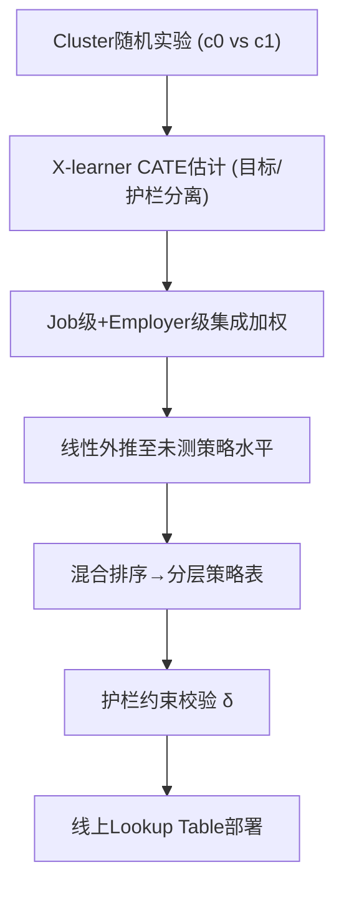

# Personalizing Marketplace Policies with Competing Objectives and Constrained Experiments: Evidence from a Job Marketplace (竞争目标与受限实验下的市场策略个性化：来自职位市场的实证)

- **会议/期刊**: KDD 2026 (Applied Data Science Track)
- **作者与机构**: Yufei Wu, Zhen Yan (LinkedIn Corporation)
- **推荐链路定位**: 策略层/排序层（segment 级策略分配，非 item 级精排）
- **研究方向**: 多任务学习与列表级重排 / 去偏公平与工业架构
- **论文原文**: [https://arxiv.org/abs/2606.30932v1](https://arxiv.org/abs/2606.30932v1)
- **开源代码**: 暂未开源

## TL;DR (1分钟核心速览)

双边职位市场需个性化"免费额度阈值"（free-value threshold），但面临两大矛盾：跨侧外部性要求多目标优化（雇主转化 vs 求职者参与度），市场干扰迫使 cluster 级随机化仅得两个离散处理水平（正性假设违背）。本文提出集成 CATE（job/employer 双层加权）+ 混合排序（目标与护栏分离建模）+ 线性外推三件套，在 LinkedIn 生产环境实现目标指标显著提升，护栏风险较单目标优化降低 10%+，线上外推预测与观测效应相关 r=0.85。

## Background & Motivation (背景与核心矛盾)

- **主流范式**: Uplift 建模通过估计 CATE 做策略个性化，主流方法（X-learner、因果森林、R-learner）面向单目标 + 连续处理变量设计。
- **前人局限**: (1) 单目标 uplift 无法刻画跨侧外部性——优化雇主转化可能损害求职者参与度，且效应在职位 segment 间高度异质；(2) 市场干扰要求 cluster 级随机化，仅得 $c\in\{c_0,c_1\}$ 两个离散水平，正性假设（positivity）被违背，连续剂量-响应方法（GPS、GRF）直接失效。
- **核心洞察 (Key Insight)**: 图 2 显示护栏效应与目标 CATE 排名**非单调**——相似低目标提升的 segment 护栏风险差异巨大，故单目标排序必然错配策略；同时两水平实验下线性是数据可识别的最高阶剂量响应形式。
- **本文切入点**: 用"约束优化"替代"权重协商/帕累托前沿导航"，用"序数排名"替代"基数幅度"以规避外推误差。

## Method (核心方法设计)

### 1. 整体框架 (Overall Architecture)

离线阶段：cluster 随机实验产出两水平数据 → X-learner 分别估计目标 $\tau_Y$与护栏$\tau_V$ 的 CATE（job 级与 employer 级双模型集成）→ 线性外推至未测策略水平 → 混合排序生成分层策略表 → 护栏约束校验。线上阶段：segment 级策略查找表（lookup table）部署，亚秒延迟，失败回退基线策略。

### 2. 关键设计拆解 (Key Designs)

1. **集成 CATE 处理跨职位溢出 (Ensemble for Spillovers)**：痛点——策略须在 job-segment 级一致，但多职位雇主存在跨职位行为溢出；job 级 CATE 忽略溢出，employer 级 CATE 无法给出 segment 差异化。做法：按 segment 内单/多职位雇主占比加权融合：
$$\hat{\tau}_{final}(X)=w_{single}\hat{\tau}_{job}(X)+w_{multi}\hat{\tau}_{employer}(X)$$
直觉：单职位主导 segment 用 job 级精度，多职位主导 segment 用 employer 级吸收净效应。目标指标另用两阶段建模（先二分类转化、再正样本内回归连续金额）应对类别不平衡。

2. **混合排序 (Hybrid Ranking)**：痛点——加权复合目标需跨团队协商权重（不可行），帕累托前沿导航操作复杂。做法：按目标 CATE 降序取前 50% 为 Group A/B（高/中目标提升，施以较严策略）；后 50% 按护栏 CATE 从最不负到最负排序，低风险为 Group C（基线）、高风险为 Group D（放宽策略保护参与度）。护栏阈值 $\delta$隐式选定前沿上一点，无需权重。噪声实验（100 次 bootstrap）显示：相比精确拉格朗日优化，混合排序目标增益少约 8%，但策略翻转率降低一半以上——序数排名对$\hat{\tau}_V$ 噪声天然免疫。

3. **线性外推与训练目标**：仅观测两水平时，线性是设计可识别的最大模型：
$$\hat{\tau}(X,c)=\hat{\tau}(X,c_1)\cdot\frac{c-c_0}{c_1-c_0}$$
有效性依赖双支撑：(i) 策略按 CATE **序数排名**分层，任意单调变换下保持；(ii) 部署范围控制在观测变异 $\sim$50% 以内。总目标即式 (1) 的约束优化：$\max_\pi\sum_j\tau_Y(X_j,\pi(X_j))$s.t.$\sum_j\tau_V(X_j,\pi(X_j))\geq-\delta$。推理为零模型开销的查表。

## Experimental Setup & Evaluation Protocol (实验设置与评估协议)

- **数据集与预处理**: LinkedIn 生产职位市场，cluster 级随机实验（控制 vs 处理两臂），约 10 个上下文特征；样本量为专有数据，经 SRM 检验与 A/A 验证平衡。雇主级切分防泄漏：Train 60% / Val 20% / Holdout 20%。

| 数据集 | #Users | #Items | #Interactions | 稀疏度/密度 | 特征/场景说明 |
| :--- | :---: | :---: | :---: | :---: | :--- |
| LinkedIn Jobs (专有) | 数百万求职者 | 数百万职位 | 未披露 | 未披露 | 10 上下文特征；雇主转化+求职者参与度双指标 |

- **数据划分与防穿越**: 雇主级 60/20/20 划分，避免同雇主跨集泄漏。
- **排名评测协议**: 非传统 Top-K 检索评测，采用 **Qini 系数**（0=随机，1=完美排序）+ 十分位/二十分位校准相关性 + 线上 A/B 观测效应对比。
- **对比基线与超参设置**: CATE 估计器对比 X-learner（主）、R-learner、GRF；排序对比 Target-Only vs. Hybrid；外推敏感性测试 ±20% 凹凸曲率。

## Key Experimental Results (实验关键数据)

### 1. 主实验对比 (Main Results)

**CATE 模型校准（Holdout，十分位/二十分位相关性）**：

| 估计器 | 目标 CATE 相关 | 护栏 CATE 相关 | 说明 |
| :--- | :---: | :---: | :--- |
| X-learner (本文) | **0.95 / 0.79** | **0.86 / 0.75** | 主估计器，Qini=0.80 |
| R-learner | 与 X 一致 (ρ=0.74) | 与 X 一致 (ρ=0.89) | 交叉验证选择 |
| GRF | 偏离 (ρ=0.35–0.36) | 一致 (ρ=0.76–0.78) | 稀有正样本下叶节点稀疏敏感 |

**排序方法对比（Qini 系数）**：

| 排序方法 | Target Qini | Guardrail Qini | 备注 |
| :--- | :---: | :---: | :--- |
| Target-Only | 0.80 | 0.11 | 护栏近乎随机 |
| **Hybrid (Ours)** | **0.83** | **0.21** | 目标 +3.5%，护栏 **+91%** |

**线上部署结果**：

| 指标 | 预测 | 观测 | 状态 |
| :--- | :---: | :---: | :--- |
| 目标提升 | $\theta\%$|$\sim 0.9\theta\%$ | 统计显著，误差 <10% |
| 护栏 | $\geq-\delta$|$>-\delta$ | 全部达标 ✓ |
| 外推精度 | — | $r=0.85$ | 中间策略水平验证 |

### 2. 消融实验 (Ablation Study)

| 配置 | 目标增益 | 护栏风险 | 说明 |
| :--- | :---: | :---: | :--- |
| Target-Only 排序 | 基准 | 基准 | 单目标基线 |
| Hybrid 排序 | ≈基准 (Qini 0.83) | **−10%+** | 等目标增益下护栏更优 |
| 线性外推 (基准) | 基准 | — | 部署假设 |
| 20% 凹曲率 | +8% | — | 策略推荐不变 |
| 20% 凸曲率 | −9% | — | 策略推荐不变 |

### 3. 关键实验发现 (Key Findings)

1. **护栏与目标 CATE 非单调**：图 2 右panel 显示护栏效应在各目标十分位间无一致模式，Target-Only 的护栏 Qini 仅 0.11（近随机），证明单目标优化在结构上无法识别高风险 segment——这是混合排序 +91% 护栏 Qini 的根本来源。
2. **重排后 50% 几乎零成本**：后 50% 职位目标提升近零，按护栏重排对目标 Qini 仅从 0.80 微升至 0.83，却使护栏风险降 10%+，说明"低目标区间的排序自由度"是免费的多目标优化空间。
3. **序数排名赋予外推鲁棒性**：±20% 曲率扰动下策略影响仅变 8–9%，且因分层依赖排名而非幅度，推荐策略完全不变；线上 r=0.85 与目标误差 <10% 共同验证了 50% 范围内线性外推的工程可用性。

## Highlights & Limitations (亮点、对比与审稿批判)

- **与代表作对比 (vs. Prior Work)**: 相比加权复合目标（需跨团队协商权重）与帕累托前沿导航（需展示多解），本文用护栏阈值 $\delta$ 隐式选点，输出单一可执行策略；相比 GPS/GRF 等连续剂量方法依赖正性假设，本文承认两水平限制并以"序数排名 + 有界外推"绕开基数估计。
- **可迁移亮点**: (1) "前 50% 按主目标、后 50% 按护栏排序"的混合排序范式，可直接迁移到任何主目标长尾、护栏指标异质的重排场景；(2) job/employer 双层 CATE 按 segment 构成加权，是处理"分配粒度 ≠ 结果聚合粒度"的通用技巧。
- **审稿级局限批判**: (1) 线性外推仅在观测变异 ~50% 内验证，极端阈值处行为阈值效应与饱和效应会使假设失效，且两水平设计无法检验非线性；(2) 仅报告短期效应，长期参与度衰减与市场均衡效应未覆盖（作者自述正在跑多月 holdout）；(3) 单平台单场景，外部效度依赖"异质效应 + 近似线性 + 跨侧外部性"三条件同时成立。

## Rating (四维评分)

- **方法创新性 (Novelty)**: ⭐⭐⭐⭐ （核心机制与方法设计具备明确创新性，理论与实验动机支撑充分）
- **评估协议与实验扎实度 (Protocol & Experiments)**: ⭐⭐⭐⭐⭐ （主流公开数据集评测完整，包含多基线对比与消融实验验证）
- **写作与数学规范度 (Clarity & Rigor)**: ⭐⭐⭐⭐⭐ （问题形式化定义清晰，核心模块数学推导与架构阐述严谨易读）
- **工业落地与复现价值 (Industrial & Practical Value)**: ⭐⭐⭐⭐⭐ （兼顾推荐效果增益与训练/推理效率，具备实际场景迁移参考价值）
