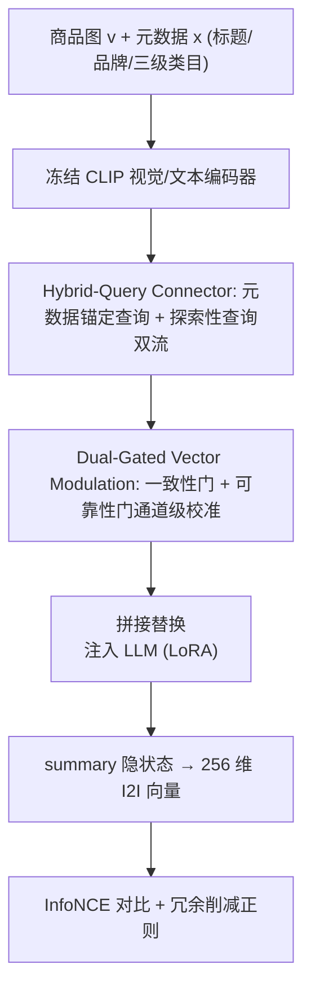

# Text-Guided Visual Representation Learning for Robust Multimodal E-Commerce Recommendation (文本引导的鲁棒多模态电商推荐视觉表征学习)

- **会议/期刊**: KDD 2026 (Accepted, pre-camera-ready)
- **作者与机构**: Yufei Guo, Jing Ma, Tianlu Zhang, Jungong Han (清华大学) ; Shijie Yang, Yanlong Zang, Weijie Ding, Pinghua Gong (京东)
- **推荐链路定位**: 召回 (Item-to-Item 候选生成)
- **研究方向**: 多模态推荐 / 大语言模型推荐
- **论文原文**: [https://arxiv.org/abs/2605.17366v1](https://arxiv.org/abs/2605.17366v1)
- **开源代码**: 暂未开源

## TL;DR (1分钟核心速览)

真实电商商品图大量为「海报式」listing：促销角标、价格贴、装饰背景与商品主体混杂，冻结视觉编码器 + 轻量 connector 的 MLRM 范式下，可学习 query 的 cross-attention 会被高显著度但商品无关的区域劫持，导致 I2I 召回表征漂移。本文提出 TGQ-Former：用结构化元数据（标题/品牌/三级类目）初始化「元数据锚定语义查询」，与随机初始化的「探索性查询」组成双流混合查询，再用基于图文一致性与视觉可靠性的通道级双门控校准两流贡献，并以冗余削减正则强制互补。在 350 万训练对、13.4 万候选全库检索协议下，H@100 由 NoteLLM-2 的 65.19 提升至 69.13（+6.04% 相对），且推理算力仅为端到端 MLLM 的 1/8–1/20。

## Background & Motivation (背景与核心矛盾)

- **主流范式**: 工业 I2I 召回走 MLRM 路线——冻结 CLIP 视觉编码器 + 轻量 query-based connector（Q-Former 式）压缩视觉 token，注入 LLM prompt 后取隐状态作单向量表征；另一路线是端到端 MLLM 直接输出统一 embedding。
- **前人局限**: 其一，MLLM 为通用视觉理解优化，会把促销贴片、装饰版式等与商品身份弱相关的伪影编码进表征，且推理开销巨大（298–725 GFLOPs/样本）；其二，现有 MLRM connector（BLIP-2 Q-Former、NoteLLM-2、EM3）的 query 缺乏领域语义先验，cross-attention 被视觉显著但商品无关区域主导，在海报式图上表征不稳定。
- **核心洞察 (Key Insight)**: 作者用中心裁剪（0.9/0.8）做免训练预处理，H@100 仅从 65.19 微涨到 65.26/65.22——说明「无差别抑制非商品区域」无效，因为有用上下文线索（包装、搭配配件、使用场景）与有害贴片在空间上共存。因此需要的是**选择性利用**而非一刀切融合。
- **本文切入点**: 以结构化元数据作稳定语义锚点引导视觉抽取，同时保留一组无先验的探索性 query 捕获文本未覆盖的互补视觉证据，再按可靠性自适应校准两流。

## Method (核心方法设计)

### 1. 整体框架 (Overall Architecture)

输入商品 $(v_i, x_i)$：冻结 CLIP 视觉/文本编码器分别得到视觉 token $H_{img}\in\mathbb{R}^{L_v\times d_v}$ 与元数据 token $H_{txt}$。混合查询连接器（HQC）产出两路 LLM 对齐的视觉 embedding——元数据锚定流 $E_v^{txt}$ 与探索性流 $E_v^{rnd}$；双门控向量调制（DGM）依据图文一致性与视觉可靠性对两流做通道级重标定；校准后的序列拼接后替换 prompt 中的 `` 占位符注入 LLM（Qwen3-Embedding-0.6B，LoRA 微调），取 summary 位置隐状态经线性投影得 256 维 L2 归一化商品向量，以 InfoNCE 对比损失 + 冗余削减正则联合训练，线上以余弦相似度做全库 ANN 召回。

### 2. 关键设计拆解 (Key Designs)

1. **元数据锚定语义查询初始化（Hybrid-Query Connector）**：痛点是无先验可学习 query 在噪声图上注意力漂移。做法是用 1D 卷积对元数据 token 序列做确定性下采样压缩为 $T_g$ 个槽位，再线性投影成查询：$\tilde{H}_{txt}=\mathrm{Conv1D}(H_{txt};k{=}5,s{=}5),\ Q_{txt}=\tilde{H}_{txt}W_Q\in\mathbb{R}^{T_g\times d_q}$，与 $T_r{=}3$ 个随机初始化探索查询拼接 $Q_{in}=[Q_{txt};Q_{rnd}]$ 送入 Q-Former 式自注意力 + 对视觉 token 的交叉注意力。直觉：标题/类目是商家必须维护的稳定语义，把它「翻译」成 query 相当于给注意力一张商品身份的地图，贴片文字与装饰版式天然不落在该语义子空间内。

2. **双门控向量调制（Dual-Gated Vector Modulation）**：痛点是不同商品的图文一致度与图像可靠度差异极大，标量门控无法「部分信任」。做法是以中心化 sigmoid 参数化通道级门 $\bm{\beta}=\mathrm{cSigmoid}(G(u))=2\sigma(G(u))-1\in(-1,1)^{d_{llm}}$，做残差重标定 $\tilde{E}=E\odot(1+\bm{\beta})$。语义流门输入为 $u_{txt}=[f_{img}^{global};f_{title}^{global};S_{title};\bar{e}_{txt};\bar{e}_{rnd}]$，其中 $S_{title}=\cos(f_{img}^{global},f_{title}^{global})$ 为图文一致性；探索流门输入为 $u_{rnd}=[f_{img}^{global};\bar{e}_{rnd}]$。直觉：图文一致时放大语义流、不一致时衰减；探索流仅凭图像自身信号判断可信度，避免在重贴片图上放大伪影通道，同时保留其余通道的细粒度外观信息。

3. **冗余削减正则与训练目标**：痛点是两流若编码同一子空间则解耦失效。做法是在 batch 内对两流池化向量逐维标准化后计算交叉相关矩阵 $C=\frac{1}{B}\hat{S}_{txt}^\top\hat{S}_{rnd}$，仅惩罚对角项 $\mathcal{L}_{rr}=\frac{1}{d_{llm}}\|diag(C)\|_2^2$，允许跨维交互。总损失 $\mathcal{L}=\mathcal{L}_{rec}+\lambda_{rr}\mathcal{L}_{rr}$，$\mathcal{L}_{rec}$ 为 InfoNCE（$\tau{=}0.07$，in-batch 负采样，无额外 hard negative 挖掘），$\lambda_{rr}{=}1$。推理侧仅需一次前向 + 向量检索，无自回归解码开销。

## Experimental Setup & Evaluation Protocol (实验设置与评估协议)

- **数据集与预处理**: 自建工业数据集，来自某电商结算页加购渠道一年行为日志，用 Swing 算法为每个 trigger item 召回 top-100 相似品构造正对（Swing 仅用于构对，不参与评测）：

| 数据集 | #Users/Items | #Interactions | 稀疏度/密度 | 特征/场景说明 |
| :--- | :---: | :---: | :---: | :--- |
| 训练集 | 148,270 unique items | 3,521,865 item pairs | — | 标题均 46.85 词；类目 54/466/2820 (三级) |
| 测试集 | 134,682 unique items | 67,341 item pairs | — | 标题均 48.02 词；类目 51/419/2096 |

- **数据划分与防穿越 (Splitting Strategy)**: 按 trigger item 严格不相交划分训练/测试（item 级隔离），两集分布对齐；附录 Amazon 实验额外采用 ASIN 级 blocklist 隔离。
- **排名评测协议 (Ranking Protocol)**: 无偏 **Full-Ranking**——每个 query 对测试池全部约 134K 候选按余弦相似度排序，H@K (K=1,5,10,20,50,100)，多正样本时命中任一即算成功。
- **对比基线与超参设置**: 基线含 connector 类（LLaVA:Linear、LLaVA-1.5:MLP、Perceiver-Resampler）与多模态检索类（EM3、UniECS、NoteLLM-2），以及 4 个 2–4B 端到端 MLLM；统一冻结 Chinese-CLIP-ViT-B/16 + Qwen3-Embedding-0.6B（另测 Qwen3-1.7B、Baichuan2-7B-Chat 验证泛化）；embedding 维度 256，batch 256，lr $3\times10^{-5}$，LoRA r=8，Q-Former 6 层，query 维度 768。

## Key Experimental Results (实验关键数据)

### 1. 主实验对比 (Main Results)

主 backbone（Chinese-CLIP-ViT-B/16 + Qwen3-Embedding-0.6B），Full-Pool 134K 候选：

| Connector | H@1 | H@10 | H@20 | H@50 | H@100 | H@100 Improv. |
| :--- | :---: | :---: | :---: | :---: | :---: | :---: |
| LLaVA:Linear | 7.86 | 27.73 | 37.18 | 51.08 | 62.11 | +11.30% |
| LLaVA-1.5:MLP | 7.80 | 27.60 | 37.01 | 51.27 | 61.81 | +11.84% |
| Perceiver-Resampler | 8.04 | 29.36 | 39.23 | 53.22 | 63.97 | +8.07% |
| EM3 | 5.20 | 19.74 | 28.13 | 42.58 | 55.63 | +24.27% |
| UniECS | 6.60 | 25.07 | 34.30 | 48.95 | 60.76 | +13.78% |
| NoteLLM-2 | 8.19 | 29.83 | 39.60 | 54.36 | 65.19 | +6.04% |
| **TGQ-Former (Ours)** | **8.44** | **31.62** | **42.93** | **58.58** | **69.13** | — |

跨 backbone 与端到端 MLLM 对比（H@100 / GFLOPs）：Qwen3-1.7B 上 63.20 vs NoteLLM-2 62.92；Baichuan2-7B 上 64.57 vs 64.19；对比最强 MLLM Qwen3-VL-4B-Instruct 的 65.68，本文 69.13（+3.45 绝对点），而算力仅 35.43 GFLOPs（对方 592.23，Qwen2-VL-2B 为 298.91），即 **8–20× 算力节省**。

### 2. 消融实验 (Ablation Study)

| 变体 | 语义查询 | 探索查询 | 双门控 | $\mathcal{L}_{rr}$ | H@20 | H@50 | H@100 |
| :--- | :---: | :---: | :---: | :---: | :---: | :---: | :---: |
| (a) Q-Former (仅探索) | – | ✓ | – | – | 39.60 | 54.36 | 65.19 |
| (b) 仅元数据锚定 | ✓ | – | – | – | 41.73 | 56.45 | 67.45 |
| (c) 混合查询 | ✓ | ✓ | – | – | 42.30 | 57.32 | 68.11 |
| (d) + 双门控 | ✓ | ✓ | ✓ | – | 42.77 | 58.01 | 68.90 |
| (e) 完整模型 | ✓ | ✓ | ✓ | ✓ | **42.93** | **58.58** | **69.13** |

### 3. 关键实验发现 (Key Findings)

1. **语义锚定是最大增益来源，但探索流不可替代**：仅把随机 query 换成元数据锚定 query 即带来 H@100 +2.26（65.19→67.45），说明噪声图上的注意力漂移是主要瓶颈；再叠加探索流又 +0.66，证明文本元数据无法覆盖的细粒度外观/陈列线索确有独立价值，二者是互补而非冗余关系。
2. **门控与正则增益递减但稳定，且在高噪声下价值放大**：双门控 +0.79、冗余削减 +0.23（H@100），在干净工业数据上幅度不大；但在 Amazon 渐进加噪实验中，Heavy 噪声下本文 H@50 为 68.33 而 NoteLLM-2 降至 67.55，且从 Clean 到 Heavy 本文仅掉 1.13 点、基线掉 1.86 点，说明可靠性校准的收益随噪声强度单调放大——这正是设计意图的定量印证。
3. **embedding 专用小模型胜过更大生成式 LLM**：Qwen3-Embedding-0.6B（1024 隐维）在多数指标上超过 Qwen3-1.7B 与 Baichuan2-7B-Chat，提示 I2I 召回的表征质量更取决于 backbone 是否以相似度检索为目标训练，而非参数量；这对工业选型（延迟/成本约束下）具有直接指导意义。

## Highlights, Limitations & Rating (亮点、对比与审稿评价)

- **与代表作对比 (vs. Prior Work)**: 相比 NoteLLM-2（BLIP-2 Q-Former + 检索定制），本文的核心差异是把 query 从「纯可学习」变为「元数据派生 + 随机探索」的双流结构，并引入样本级可靠性门控；相比 EM3/UniECS 的固定融合或门控融合，本文的门控是通道级、且分别以图文一致性和图像自信号为条件，实现「部分信任」而非整体加权；相比端到端 MLLM，本文以 1/8–1/20 算力取得更优召回。
- **可迁移亮点**: (1) 用 1D 卷积把变长元数据确定性地压缩成固定数量 query 槽位的做法，可低成本迁移到任何「结构化 side info + query-based connector」场景；(2) 以 batch 内交叉相关矩阵对角项做流间去冗余的正则，是解耦多表征学习中极轻量的即插即用技巧。
- **审稿级局限批判**: 其一，主实验完全依赖不可复现的工业私有数据，公开 Amazon 实验仅在附录且图像干净、增益微弱（Clean 下 H@50 仅 +0.05），外部有效性存疑；其二，门控依赖 CLIP 图文余弦一致性作为可靠性代理，当标题本身为堆砌关键词的 SEO 文本时该信号可能失真，论文未做该失效模式的压力测试；此外 $T_r{=}3$、$\lambda_{rr}{=}1$ 等超参的敏感性分析缺失。
- **四维评分**: 创新性 ⭐⭐⭐⭐ | 实验扎实度 ⭐⭐⭐⭐ | 方法清晰度 ⭐⭐⭐⭐⭐ | 落地价值 ⭐⭐⭐⭐⭐

