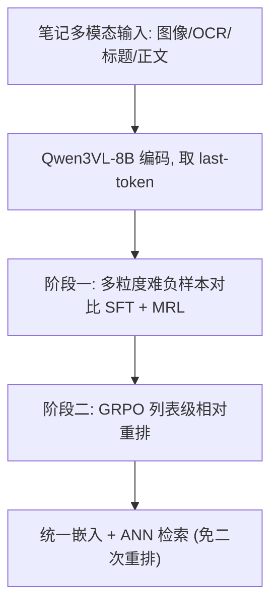
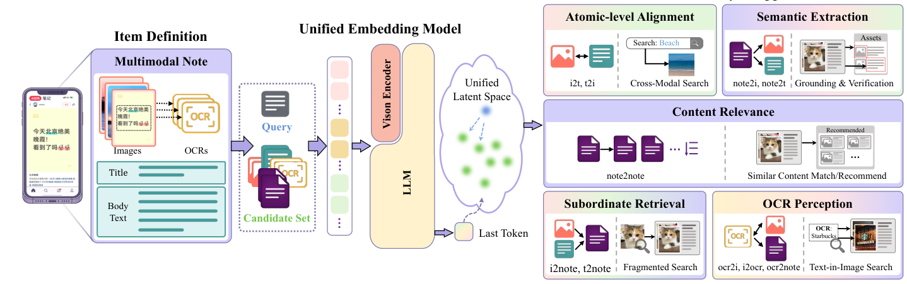

# UniNote: A Unified Embedding Model for Multimodal Representation and Ranking (面向多模态表征与排序的统一嵌入模型)

- **会议/期刊**: KDD 2026 (Ads Track)
- **作者与机构**: Jinghan Zhao, Wenwei Jin, Anqi Li, Jintao Tong, Luya Mo, Jiawei Li, Bin Li, Yao Hu（小红书 / 上海交大 / 华中科大 / 北理工）
- **推荐链路定位**: 召回（I2I 向量检索）+ 单塔内嵌重排（免二次生成式重排）
- **研究方向**: 多模态推荐 / 生成式推荐（MLLM 嵌入）
- **论文原文**: [arXiv:2605.29287v2](https://arxiv.org/abs/2605.29287v2)
- **开源代码**: 暂未开源

## TL;DR (1分钟核心速览)

小红书笔记（图文/视频/OCR 混合）的 I2I 检索面临三重矛盾：双塔 CLIP 类模型丢失局部细粒度、MLLM 嵌入存在"局部→全局"粒度错配、工业"先召回再重排"两段式管线算力昂贵且优化的是用户兴趣而非内容相关性。UniNote 以 Qwen3VL-8B 为底座，用 last-token 作统一嵌入，先做**多粒度难负样本对比 SFT（JS 散度软标签对齐）**，再用 **GRPO 做列表级相对重排**，把排序能力压进单一嵌入向量。在 10 类 I2I 任务上全面 SOTA（如 I2Note R@1 从 41.2 提升至 93.7），线上 A/B 以 1/9.2 存储算力保持 85.6%–93.6% 召回。

## Background & Motivation (背景与核心矛盾)

- **主流范式**: 工业 I2I 检索普遍采用 CLIP 类双塔做粗召回，再用生成式 MLLM 重排器（UniME-V2、Qwen3VL-Embedding）做二段精排。
- **前人局限一（结构割裂）**: 双塔独立编码各模态，晚交互机制无法捕捉"一张图 ↔ 整篇笔记"的细粒度局部-全局对应，Subordinate Retrieval 与 Semantic Extraction 任务显著掉点。
- **前人局限二（粒度错配 + 管线低效）**: MLLM 嵌入擅长全局语义描述，却缺少层级结构来支持"局部输入检索整篇"；且重排依赖独立生成模型，形成算力瓶颈，NoteLLM-2 类模型优化点击/点赞兴趣而非客观内容相关性。
- **核心洞察 (Key Insight)**: 若能让**同一个嵌入向量的余弦相似度本身携带"相关性梯度"**，则召回与重排可在一次前向中完成，无需生成式重排器。
- **本文切入点**: 用对比 SFT 建立统一语义空间，再用 RL 的列表级奖励把"排序一致性"直接写进嵌入空间几何。

## Method (核心方法设计)

### 1. 整体框架 (Overall Architecture)

输入为一条笔记 $\mathcal{N}=\{\{I_i\}_{i=1}^m,\{OCR_i\}_{i=1}^m,T_{title},T_{body}\}$（视频按图像序列处理），经 Qwen3VL-8B 编码后取 **last-token 隐状态**作为统一嵌入。阶段一用五类元任务（原子对齐、从属检索、语义抽取、OCR 感知、内容相关性）构造正负样本对，以 MLLM 软标签分布为教师做 JS 散度对齐，并叠加 MRL 多维度嵌套损失；阶段二在 Note2Note 数据上用 GRPO 采样 top-$G$ 候选，按四级奖励计算组内优势，直接优化嵌入相似度的排序质量。推理时仅需一次嵌入 + ANN 检索。

<figure class="paper-figure" markdown="span">
  <figcaption>图 1：我们提出 UniNote，一个专为 I2I 检索设计的统一检索-排序框架，能够将多种模态输入编码到具有跨模态对齐（任务：原子级对齐、OCR 感知）、局部化检索（任务：语义抽取、从属检索）和相关度感知排序（任务：内容相关性）能力的统一空间中。</figcaption>
</figure>

### 2. 关键设计拆解 (Key Designs)

1. **多粒度难负样本挖掘与软标签 JS 对齐**：随机负样本语义跨度过大、易含假负例，梯度信息量低。本文先用参考编码器 $\phi$在相似度区间内筛难负例$\mathcal{P}'=\{c\in\mathcal{P}\mid\tau_{min}\le sim(\phi(q),\phi(c))\le\tau_{max}\}$；对复合候选（如 I2Note）改用 MaxSim 细化软分$s'(q,c^-)=\max_{e\in c^-}sim(q,e)$；再叠加规则式反事实负例$(I_i,\mathcal{N}\setminus\{I_i\})$，强制模型区分"同篇笔记的兄弟图"与"真正正例"。目标为对称 JS 散度：
$$\mathcal{L}_{SFT}=\sum_{k\in\mathcal{K}}\mathcal{D}_{JS}\big(P^{(k)}\parallel Q\big),\quad \mathcal{D}_{JS}=\tfrac12 KL(P\parallel Q)+\tfrac12 KL(Q\parallel P)$$
其中 $Q$为 MLLM 软标签分布、$P$为嵌入余弦分布，$\mathcal{K}=\{64,512,1024,4096\}$ 为 MRL 嵌套维度。软标签保留了"难负例有多难"的连续信息，比 one-hot 对比损失更平滑。

2. **GRPO 列表级相对重排奖励**：对比损失只保证正例排前，无法约束"多个相关笔记之间的相对次序"。本文把 top-$G$检索结果视为 GRPO 的组采样，设计四级奖励——无关笔记惩罚（越靠前罚越重）、基础相关奖励$R_{base}$、绝对位置奖励$R_{abs}(i,p_i)=1-|p_i-where(V,p_i)|/G$、相对次序奖励（一致对比例）：
$$R_{rel}(i,P)=mean\big(\mathbb{I}[(p_i-p_j)(where(V,p_i)-where(V,p_j))>0]\big)$$
组内优势 $A_i=(r_i-mean(r))/(std(r)+\epsilon)$ 代入 GRPO 损失，并加 KL 约束到参考策略。直觉上，这把"排序评价指标"直接变成可微策略梯度信号，使相似度差值单调对应相关性差值。

3. **训练目标与推理效率**：总损失为 $\mathcal{L}_{SFT}$与$\mathcal{L}_{GRPO}$ 两阶段串行；负采样采用"全局难负例 + 规则反事实负例"混合，非 in-batch 免负采样。推理端单次嵌入即可同时服务召回与排序，配合 MRL 可在 512 维近似满维性能，显著降低向量库存储与 ANN 开销。

## Experimental Setup & Evaluation Protocol (实验设置与评估协议)

- **数据集与预处理**: 小红书真实笔记数据，评测集含 66k 笔记、50w+ 条目，覆盖图像、文本、OCR 三模态；文本缺失处由 Qwen3VL-8B-Instruct 生成描述补齐。

| 数据集 | #Queries | #Targets | 模态 | 场景说明 |
| :--- | :---: | :---: | :---: | :--- |
| Atomic Alignment (I2T/T2I) | 50w / 48w | 48w / 50w | 图-文 | 基础跨模态对齐 |
| Subordinate Retrieval (I2Note/T2Note) | 50w / 48w | 13w | 局部→全局 | 单图/文本检索整篇笔记 |
| Semantic Extraction (Note2I/Note2T) | 6.6w | 6.6w | 全局→局部 | 笔记反查组成元素 |
| OCR Perception (OCR2Note/I2OCR/OCR2I) | 18w–20w | 13w–20w | 图-OCR | 图内文字检索 |
| Content Relevance (Note2Note) | 3.7w | 37w | 笔记-笔记 | 多正例相关性排序 |

- **数据划分与防穿越 (Splitting Strategy)**: 采用**离线固定评测集划分**（非 Leave-One-Out），训练/评测样本按笔记 ID 隔离，难负例挖掘所用参考编码器与评测目标库分离以防泄漏。
- **排名评测协议 (Ranking Protocol)**: 采用 **Full-Ranking 全库排序**（各任务候选库即全量目标集，非采样负例），指标为 R@1/5/10；Note2Note 因多正例改用 R*@K，并补充 P@K。
- **对比基线与超参设置**: 基线为 RzenEmbedding 与 Qwen3VL-Embedding-8B（均为通用检索 SOTA）；底座 Qwen3VL-8B-Instruct，GRPO 用 Adam 优化，8×H800 训练；MRL 维度 $\{64,512,1024,4096\}$。

## Key Experimental Results (实验关键数据)

### 1. 主实验对比 (Main Results)

| 任务 | 检索类型 | RzenEmbed R@1/R@10 | Qwen3VL-Emb R@1/R@10 | UniNote R@1/R@10 |
| :--- | :---: | :---: | :---: | :---: |
| 原子对齐 | I2T | 63.6 / 87.1 | 56.0 / 81.6 | **75.2 / 92.9** |
| 原子对齐 | T2I | 69.5 / 90.2 | 52.9 / 78.4 | **74.0 / 92.0** |
| 从属检索 | I2Note | 37.9 / 65.5 | 41.2 / 67.4 | **93.7 / 100** |
| 从属检索 | T2Note | 32.2 / 59.8 | 39.6 / 68.5 | **53.1 / 77.3** |
| 语义抽取 | Note2I | 51.2 / 73.6 | 64.3 / 85.3 | **90.2 / 92.7** |
| 语义抽取 | Note2T | 43.1 / 67.4 | 44.6 / 69.3 | **64.2 / 87.7** |
| OCR 感知 | OCR2Note | 33.2 / 60.6 | 37.7 / 66.4 | **62.1 / 84.5** |
| OCR 感知 | I2OCR | 70.4 / 86.9 | **79.0 / 93.3** | 53.5 / 69.9 |
| OCR 感知 | OCR2I | 55.8 / 75.5 | 64.3 / 82.5 | **82.8 / 92.5** |
| 内容相关性 | Note2Note (R*) | 15.8 / 98.6 | 15.9 / 99.4 | **15.9 / 99.5** |

UniNote 在 10 类任务中 9 类最优，I2Note R@1 相对提升 **+127%**（41.2→93.7），OCR2Note R@1 提升 **+64.7%**；唯一失手的 I2OCR 说明其 OCR→图方向能力被牺牲（见局限）。

### 2. 消融实验 (Ablation Study)

| 配置 | 原子对齐 R@1 | 从属检索 R@1 | 语义抽取 R@1 | OCR 感知 R@1 | 总 R@1 |
| :--- | :---: | :---: | :---: | :---: | :---: |
| rand 随机负例 | 57.6 | 66.2 | 62.6 | 42.8 | 57.3 |
| UniNote (w/o Rule) | 71.9 | 74.1 | 73.9 | 47.0 | 66.7 |
| **UniNote 完整** | **74.6** | **76.4** | **77.2** | **66.1** | **73.6** |

| RL 模块 | R@1 | R@5 | R@10 | P@1 | P@5 | P@10 |
| :--- | :---: | :---: | :---: | :---: | :---: | :---: |
| w/o RL | 15.7 | 77.9 | 97.9 | 91.7 | 92.6 | 61.8 |
| **UniNote** | **15.9** | **79.3** | **99.5** | **96.0** | **96.0** | **64.5** |

### 3. 关键实验发现 (Key Findings)

1. **难负例质量是最大杠杆**：从随机负例到全局难负例再到规则反事实负例，总 R@1 依次为 57.3→66.7→73.6，OCR 感知任务提升最猛（42.8→66.1，+23.3），说明"同篇兄弟图"这类高重叠负例正是细粒度判别力的来源。
2. **RL 阶段主要提升排序精度而非召回上限**：Note2Note 上 R@5 仅 +1.4 但 P@5 +3.4、P@1 +4.3，验证 GRPO 奖励确实在"已召回的候选内部"重排，而非扩大召回面。
3. **MRL 512 维近似满维**：多数任务在 512 维已逼近 4096 维性能，64 维仍保留约 70% 能力，为线上按成本弹性选维提供依据；线上 A/B 中单次嵌入即覆盖 Note2Image/Video/Text 三任务，召回保持 85.6%/91.2%/93.6%，而基线 I2I 方案需 9.2 倍存储算力。

## Highlights & Limitations (亮点、对比与审稿批判)

- **与代表作对比 (vs. Prior Work)**: 相比 CLIP/双塔系（RzenEmbed），UniNote 用单塔 MLLM 消除晚交互的局部信息损失；相比 UniME-V2/Qwen3VL-Embedding 的"嵌入 + 独立生成式重排"两段式，UniNote 把重排压进同一向量空间，省去一次生成前向；相比 TaoSearchEmb 的黑盒单奖励 Retrieval-GRPO，其四级奖励显式编码了绝对位置与相对次序的单调一致性约束。
- **可迁移亮点**: ①"规则式反事实负例"（从复合体中剔除目标元素构造负例）可直接迁移到电商图文详情页、短视频封面-视频等局部-全局检索；②把排序指标拆成"命中奖励 + 位置奖励 + 一致对奖励"的奖励分解范式，可复用到任何 embedding-based rerank 场景。
- **审稿级局限批判**: ①I2OCR 从 79.0 掉到 53.5，说明统一空间存在任务间负迁移，OCR 双向对称性未被约束；②评测为平台内部离线集 + 单周线上 A/B，缺乏公开基准复现，且 GRPO 的 $C_{pen}$、$R_{base}$、$G$ 等奖励超参敏感度未做分析；③8B 底座单次前向的在线延迟与吞吐未给出量化数字，"免重排"的端到端成本优势缺少与两段式管线的直接时延对比。

## Rating (四维评分)

- **方法创新性 (Novelty)**: ⭐⭐⭐⭐ （把列表级排序奖励经 GRPO 注入嵌入几何，实现召回-重排单塔统一，思路清晰且工业味足，但各组件均为已有技术的组合式创新）
- **评估协议与实验扎实度 (Protocol & Experiments)**: ⭐⭐⭐⭐ （10 类任务 + Full-Ranking + 消融完整，但缺公开数据集复现与奖励超参敏感性分析）
- **写作与数学规范度 (Clarity & Rigor)**: ⭐⭐⭐⭐ （任务分类表与奖励公式定义清楚，但部分符号如 $where(V,p_i)$ 表述偏工程化，MRL 与 RL 的交互未展开）
- **工业落地与复现价值 (Industrial & Practical Value)**: ⭐⭐⭐⭐⭐ （已在小红书双模式上线，MRL 弹性维度 + 9.2 倍算力节省，落地证据充分；可惜未开源）
