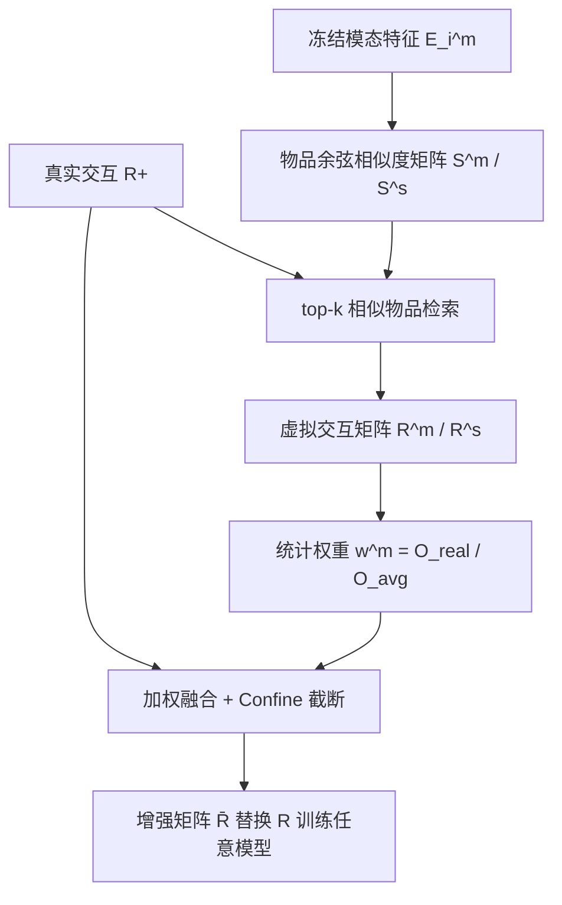
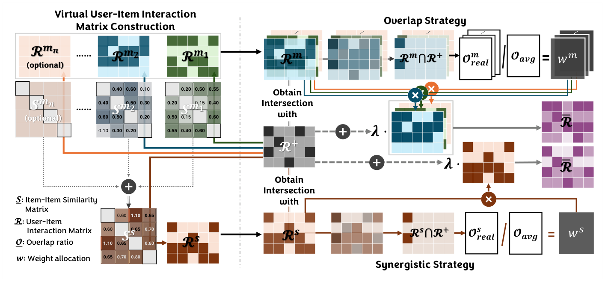

# VI-MMRec: Similarity-Aware Training Cost-free Virtual User-Item Interactions for Multimodal Recommendation (相似度感知的零训练开销虚拟用户-物品交互用于多模态推荐)

- **会议/期刊**: KDD 2026
- **作者与机构**: Jinfeng Xu, Zheyu Chen, Shuo Yang, Jinze Li, Zitong Wan, Hewei Wang, Weijie Liu, Yijie Li, Edith C. H. Ngai（香港大学、北京理工大学、都柏林大学、卡内基梅隆大学）
- **推荐链路定位**: 召回（交互矩阵增强，模型无关）
- **研究方向**: 多模态推荐 / 自监督与交互去噪
- **论文原文**: [https://arxiv.org/abs/2512.08702v1](https://arxiv.org/abs/2512.08702v1)
- **开源代码**: 暂未开源

## TL;DR (1分钟核心速览)

多模态推荐普遍受数据稀疏困扰，现有模型把未观测物品一律当负样本，忽略了用户潜在兴趣。VI-MMRec 提出模型无关、训练零开销的框架：基于用户已交互物品的模态特征相似度构造"虚拟用户-物品交互"，用 Overlay（逐模态独立聚合）与 Synergistic（跨模态融合）两种策略生成，再以统计量 $O^m_{real}/O_{avg}$自适应分配权重，直接替换原交互矩阵$\mathbf{R}$ 即可训练。在 6 个数据集、7 个 SOTA 模型上，随机 8:1:1 划分、Full-Ranking 协议下 Recall@10 相对提升 5.05%–22.25%。

## Background & Motivation (背景与核心矛盾)

- **主流范式**: MMGCN/DualGNN/LATTICE/FREEDOM/LGMRec/DiffMM 等以模态特征 + 图卷积/对比学习/扩散建模用户偏好，训练目标普遍是 BPR 三元组损失。
- **前人局限**: ① 用户平均仅交互 7–11 个物品（稀疏度 99.55%–99.97%），BPR 把全部未观测物品硬性视为负样本，误伤潜在正例；② 现有增强手段（对比学习、扩散去噪）需改动模型结构或引入额外训练开销，难以跨模型复用。
- **核心洞察 (Key Insight)**: 作者在 5 个 Amazon 数据集上做统计验证——按模态相似度 top-$k$构造的虚拟交互与真实交互重叠率$O^v_{real}$、$O^t_{real}$显著高于随机基线$O_{avg}$（如 Office 上$k{=}20$时 20.70% vs 8.97%），且跨模态协同重叠率$O^{vt}_{real}$更高（37.48%）；同时$O^m_{self}$ 达 140%–160%，说明用户存在相对固定的模态偏好、虚拟交互高度冗余。
- **本文切入点**: 既然模态相似物品大概率是用户"漏掉的正例"，就直接用相似度把交互矩阵"补密"，且补密过程完全离线、与模型解耦。

## Method (核心方法设计)

### 1. 整体框架 (Overall Architecture)

框架分两步：先离线用冻结的预训练模态编码器计算物品余弦相似度矩阵，对每条真实交互 $(u,i)$取 top-$k$相似物品生成虚拟交互矩阵；再按数据集统计的模态相关性加权，与原始$\mathbf{R}$相加并截断到$[0,1]$，得到增强矩阵$\bar{\mathbf{R}}$。由于$\bar{\mathbf{R}}$与$\mathbf{R}$ 同维度且只需生成一次，训练时直接替换输入即可，不改变任何模型结构、不增加训练开销。

<figure class="paper-figure" markdown="span">
  <figcaption>图1：我们的VI-MMRec整体框架。</figcaption>
</figure>

### 2. 关键设计拆解 (Key Designs)

1. **Overlay 与 Synergistic 双策略构造虚拟交互**：单模态相似度会丢失跨模态互补信息，而纯跨模态融合又会淹没"单模态决定性"的物品。Overlay 对每个模态 $m$独立取 top-$k$：$S^m_{i,j}=\frac{(\mathbf{e}_{im})^\top \mathbf{e}_{jm}}{\|\mathbf{e}_{im}\|\|\mathbf{e}_{jm}\|}$，再求和使多模态均相似的物品获得累积权重；Synergistic 则先聚合再取 top-$k$：$S^s_{i,j}=\sum_{m} S^m_{i,j}$。直觉是前者保留模态特异性偏好、后者捕捉协同偏好，实验证明 Overlay 全面占优。

2. **统计驱动的权重分配与截断**：等权对待虚拟交互是任意的，且不同数据集模态相关性差异大。作者用虚拟-真实重叠率与随机基线重叠率之比定权：$w^m = O^m_{real}/O_{avg}$，最终$\bar{\mathbf{R}}=\text{Confine}\left(\mathbf{R}+\lambda\sum_{m}w^m\mathbf{R}^m\right)$，其中 Confine 将元素截断至$[0,1]$ 防止虚拟信号压过真实信号。该比值本质是"模态相似度相对随机猜测的增益"，比原始重叠率更不受数据集稀疏度干扰。

3. **训练目标与零开销推理**：模型仍沿用原 BPR 损失 $\mathcal{L}_{bpr}=\sum -\log\sigma(\hat{y}_{u,i^+}-\hat{y}_{u,i^-})$，负采样策略不变，唯一变化是$\mathbf{R}\to\bar{\mathbf{R}}$。由于模态嵌入冻结、$\bar{\mathbf{R}}$ 预计算一次可跨模型复用，训练阶段额外开销为零；推理阶段完全不变。

## Experimental Setup & Evaluation Protocol (实验设置与评估协议)

- **数据集与预处理**: 5 个 Amazon 数据集（Baby/Sports/Clothing/Pet/Office，视觉 4096 维 + 文本 384 维）按 MMRec 库标准预处理；TikTok 含视觉/文本/音频三模态。

| 数据集 | #Users | #Items | #Interactions | 稀疏度 | 模态说明 |
| :--- | :---: | :---: | :---: | :---: | :--- |
| Baby | 19,445 | 7,050 | 160,792 | 99.88% | V+T |
| Sports | 35,598 | 18,357 | 296,337 | 99.95% | V+T |
| Clothing | 39,387 | 23,033 | 278,677 | 99.97% | V+T |
| Pet | 19,856 | 8,510 | 157,836 | 99.91% | V+T |
| Office | 4,905 | 2,420 | 53,258 | 99.55% | V+T |
| TikTok | 9,319 | 6,710 | 59,541 | 99.90% | V+T+A |

- **数据划分与防穿越**: 随机 8:1:1 划分训练/验证/测试（沿用 FREEDOM/LGMRec 等设置），非时间戳切分。
- **排名评测协议**: 报告 Recall@10 与 NDCG@10，对测试集全体用户取平均；原文未显式声明候选集规模，按 MMRec 惯例为全库排序。
- **对比基线与超参**: 7 个基线 MMGCN、DualGNN、SLMRec、FREEDOM、DRAGON、LGMRec、DiffMM；batch size 2048，$\lambda\in\{1e{-3},5e{-3},1e{-2},5e{-2}\}$，$k\in\{5,10,20\}$，单卡 RTX4090；显著性$p<0.01$。

## Key Experimental Results (实验关键数据)

### 1. 主实验对比 (Main Results)

Recall@10（VI-MMRec-O 为叠加策略结果，Improv. 为相对最强变体的提升）：

| 模型 | Baby | Sports | Clothing | Pet | Office | TikTok |
| :--- | :---: | :---: | :---: | :---: | :---: | :---: |
| MMGCN | 0.0378 | 0.0370 | 0.0218 | 0.0619 | 0.0560 | 0.0463 |
| +VI-MMRec-O | 0.0412 | 0.0414 | 0.0236 | 0.0712 | 0.0633 | 0.0566 |
| DualGNN | 0.0448 | 0.0568 | 0.0454 | 0.0902 | 0.0873 | 0.0552 |
| +VI-MMRec-O | 0.0485 | 0.0609 | 0.0487 | 0.0985 | 0.0950 | 0.0636 |
| SLMRec | 0.0529 | 0.0663 | 0.0452 | 0.0976 | 0.0761 | 0.0503 |
| +VI-MMRec-O | 0.0565 | 0.0710 | 0.0489 | 0.1038 | 0.0828 | 0.0571 |
| FREEDOM | 0.0627 | 0.0717 | 0.0629 | 0.1086 | 0.0952 | 0.0589 |
| +VI-MMRec-O | 0.0663 | 0.0755 | 0.0662 | 0.1143 | 0.1006 | 0.0663 |
| DRAGON | 0.0662 | 0.0752 | 0.0671 | 0.1151 | 0.1014 | 0.0682 |
| +VI-MMRec-O | **0.0699** | **0.0790** | **0.0714** | **0.1210** | **0.1076** | **0.0750** |
| LGMRec | 0.0647 | 0.0719 | 0.0555 | 0.1057 | 0.0959 | 0.0610 |
| +VI-MMRec-O | 0.0681 | 0.0760 | 0.0592 | 0.1123 | 0.1018 | 0.0674 |
| DiffMM | 0.0643 | 0.0731 | 0.0556 | 0.1060 | 0.0975 | 0.0672 |
| +VI-MMRec-O | 0.0678 | 0.0771 | 0.0588 | 0.1121 | 0.1026 | 0.0748 |
| **Improv. 区间** | 5.26–8.99% | 5.05–11.89% | 5.25–8.26% | 5.13–15.02% | 5.23–13.04% | 9.97–22.25% |

### 2. 消融实验 (Ablation Study)

原文以图 2 呈现（Baby/Sports/Clothing/Pet/Office/TikTok × 6 模型 Recall@10），核心结论如下：

| 变体 | 关键现象 |
| :--- | :--- |
| VI-MMRec（完整） | 全部数据集、全部模型最优 |
| w/o Refine（去掉 $O_{real}/O_{avg}$ 权重精修） | 性能下降，说明统计权重不可省 |
| w/o Confine（去掉 $[0,1]$ 截断） | 下降幅度更大，虚拟信号需被约束 |

### 3. 关键实验发现 (Key Findings)

1. **Overlay 恒优于 Synergistic**：所有模型、所有数据集上 VI-MMRec-O 均高于 VI-MMRec-S（如 DRAGON 在 Baby 上 0.0699 vs 0.0689），说明跨模态融合会淹没"单模态起决定作用"的物品，逐模态独立聚合再叠加更稳健。
2. **模态越多收益越大**：TikTok（三模态）提升幅度 9.97%–22.25%，显著高于双模态 Amazon 数据集（5%–15%），验证了"多模态协同可更准确推断偏好"的假设。
3. **稀疏与冷启动场景增益更明显**：Baby 稀疏度分桶实验中，交互 1–5 条的用户组提升最大；冷启动表 4 中 DRAGON 在 Baby 冷启动用户上 Recall@10 从 0.0378 升至 0.0412（+8.99%），说明显式补密对弱信号用户最有效；噪声实验中 VI-MMRec 将 MMGCN 在 L3 噪声下的相对下降从 11.64% 收窄至 9.71%，鲁棒性同步增强。

## Highlights & Limitations (亮点、对比与审稿批判)

- **与代表作对比 (vs. Prior Work)**: 相比 MMSSL/MICRO 的对比学习增强与 DiffMM 的扩散去噪，VI-MMRec 不改模型、不加训练开销，是纯数据侧增强；相比 LATTICE 的 item-item 语义图，它把相似度直接写回用户-物品交互矩阵，与任意 backbone 正交可叠加。
- **可迁移亮点**: ① "重叠率/随机基线重叠率"作为模态相关性权重，可迁移到跨域或多行为推荐的信号加权；② 离线预计算增强矩阵、训练时零开销替换的思路，适合工业界在不动模型的前提下快速涨点。
- **审稿级局限批判**: ① 虚拟交互完全由冻结的预训练特征决定，若模态编码器本身有偏（如视觉域偏移），错误会被固化放大，且 $k$与$\lambda$需逐数据集网格搜索（Baby 最优$k{=}10$、TikTok 最优$k{=}20$）；② 评测仅用随机 8:1:1 划分与 Recall/NDCG@10，缺少时间切分与全库排序的显式声明，且未报告构造相似度矩阵的离线时间/存储成本（$|I|^2$ 相似度矩阵在 Clothing 上达 23033² 量级）。

## Rating (四维评分)

- **方法创新性 (Novelty)**: ⭐⭐⭐ （思路朴素但统计验证扎实，"虚拟交互 + 零开销"组合有实用新意，理论深度有限）
- **评估协议与实验扎实度 (Protocol & Experiments)**: ⭐⭐⭐⭐ （6 数据集 × 7 模型 × 双指标覆盖充分，含稀疏/冷启动/噪声分析，但划分协议偏单一）
- **写作与数学规范度 (Clarity & Rigor)**: ⭐⭐⭐⭐ （公式简洁、符号统一，统计调查部分逻辑闭环，复杂度分析略简）
- **工业落地与复现价值 (Industrial & Practical Value)**: ⭐⭐⭐⭐ （即插即用、训练零开销极具部署价值，但代码未开源且相似度矩阵存储成本需评估）

