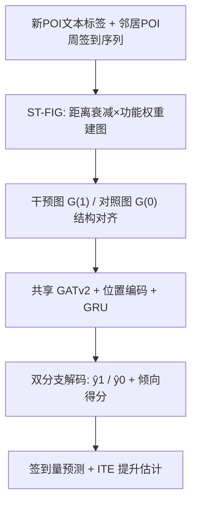
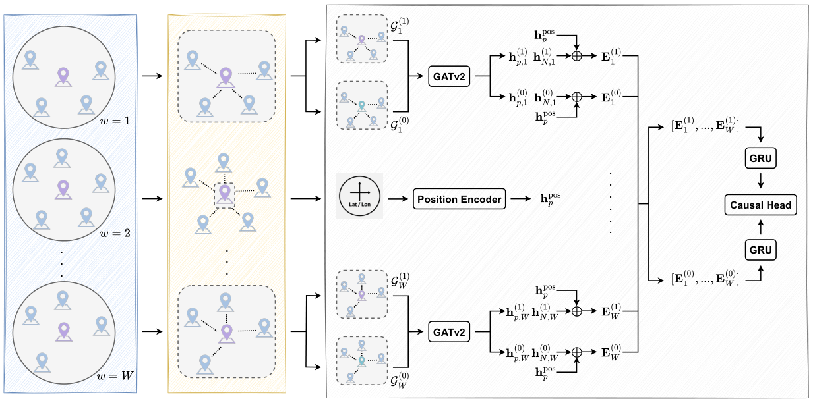

# CausalPOI: Spatio-Temporal Graph-Based Causal Modeling for Cold-Start POI Check-in Forecasting (基于时空图的冷启动POI签到量因果建模)

- **会议/期刊**: KDD 2026
- **作者与机构**: Zhaoqi Zhang, Yi Li, Siqiang Luo, Gao Cong (南洋理工大学)；Miao Xie (中国农业大学)；Linyou Cai (美团)
- **推荐链路定位**: 端到端预测（POI级时序回归，服务于选址/运营决策）
- **研究方向**: 时空轨迹与POI本地生活推荐 / 冷启动与长尾推荐
- **论文原文**: [https://arxiv.org/abs/2606.05413v1](https://arxiv.org/abs/2606.05413v1)
- **开源代码**: [https://github.com/ZZQ-NTU/CausalPOI](https://github.com/ZZQ-NTU/CausalPOI)

## TL;DR (1分钟核心速览)

本文提出全新问题——**冷启动POI签到量预测**：给定一个无任何历史签到记录的新开业POI，预测其未来4周签到量，并估计"引入该POI"的个体处理效应 (ITE)。核心方法 CausalPOI 用**时空功能交互图 (ST-FIG)** 以对比预训练学到的"竞争/互补"语义权重替代纯地理邻近边权，再构造**拓扑对齐的干预图/对照图**（对照图仅将目标POI特征置零并去掉功能项边权）做反事实推理。在 SafeGraph 美国四区域数据上，相对最强基线 KGDiff，RMSE 最高降 57.8%（West 区 8.43→6.17 之外，South 区 8.01→5.88），MAE 最高降 34.3%。

## Background & Motivation (背景与核心矛盾)

- **主流范式**: POI 签到预测长期被当作"区域级"任务——把城市切成网格/区域，用 DCRNN、GraphWaveNet、AGCRN 等时空 GNN 在邻近图上做相关性拟合；近期 LLM 时序模型 (TimeCMA/TIME-LLM) 靠文本语义泛化到冷启动。
- **前人局限**: ① **功能交互缺失**——图边几乎只由地理距离定义，无法表达"新健身房抢走隔壁健身房客流、却带火隔壁奶昔店"这类竞争/互补语义；② **因果估计脱离空间结构**——TARNet/CFRNet/DragonNet 面向表格数据，CausalGNN/HyperSCI 假设静态图拓扑，均无法模拟"新增一个POI"如何沿空间依赖向邻域传导。
- **核心洞察 (Key Insight)**: 冷启动POI的早期签到量本质上是"局部功能生态位"的函数——同质邻居（竞争）压低其客流，异质邻居（互补）抬升其客流；因此**反事实对照不应通过删节点实现，而应保持拓扑不变、只屏蔽语义**，否则干预/对照之差会混入拓扑变化而非真实处理效应。
- **本文切入点**: 把"新增POI"显式建模为二值干预 $t\in\{0,1\}$，在 1-hop 局部子图上做结构对齐的潜在结果估计，预测与因果估计共享同一 GNN 编码器。

## Method (核心方法设计)

### 1. 整体框架 (Overall Architecture)

对每个新POI $p$，先按 Haversine 距离$\le 1000$m 取空间邻居集$\mathcal{N}$，为引入后前$W$周各建一张周级 1-hop 子图（节点集随当周活跃POI动态变化）。节点初值由 BERT 编码 POI 文本标签得到；边权 = 空间高斯衰减 × 对比预训练学到的功能交互强度$\alpha(p,n)$。随后并行构造**干预图**$\mathcal{G}^{(1)}$与**对照图**$\mathcal{G}^{(0)}$（同拓扑、目标节点置零、边权去掉$\alpha$），二者共享 GATv2 编码器与正弦位置编码，逐周拼接后送入 GRU 聚合时序，最后由共享时序解码器 + 分支输出头分别给出$\hat{y}_1,\hat{y}_0$，按观测干预取实际预测并联合倾向得分损失训练。

<figure class="paper-figure" markdown="span">
  <figcaption>图1：CausalPOI的总体结构，由两个主要部分组成：(i) ST-FIG模块，为每周构建时空功能交互图，以捕捉POI之间的空间和语义关系；以及(ii)</figcaption>
</figure>

### 2. 关键设计拆解 (Key Designs)

1. **ST-FIG 功能交互边权（把"竞争/互补"写进图结构）**：痛点是用距离建边无法区分同质与异质邻居。做法：以 POI 类目描述经 BERT 编码，把**同类目视为正对**（竞争）、异类目为负对，用 InfoNCE 预训练类目编码器；再取负余弦相似度 $s(p,n)=-\frac{E_p\cdot E_n}{|E_p||E_n|}$归一化为$\alpha(p,n)=\frac{1+s(p,n)}{2}$，最终边权
$$w(p,n)=\alpha(p,n)\cdot\exp\!\left(-\frac{dist^2(p,n)}{2\sigma^2}\right)$$
直觉：语义越"互补"权重越大，使 GATv2 的注意力偏置能放大互补邻居的消息、抑制竞争邻居的消息。

2. **结构对齐的干预/对照图（反事实的近似）**：痛点是直接删掉目标节点会改变 1-hop 拓扑与关联边，导致差值混入结构噪声。做法：对照图保留全部节点与连边，仅将目标POI嵌入置零，并把边权退化为纯空间项 $w^{(0)}(p,n)=\exp(-dist^2/2\sigma^2)$，即"该POI存在但不产生任何功能影响"。共享编码器下$\hat{y}_t=f_t(E^{(t)})$，$t\in\{0,1\}$，ITE 由$\hat{y}_1-\hat{y}_0$ 读出。直觉：拓扑一致使差值可归因于语义干预本身。

3. **训练目标、负采样与推理效率**：总损失为时序回归 + 倾向得分分类的加权和
$$\mathcal{L}_{TC}=\frac{1}{n}\sum_i\left[\frac{1}{W}\sum_w(\hat{y}^{(i)}_{t,w}-y^{(i)}_w)^2+\gamma\cdot \mathrm{CE}(\hat{p}^{(i)},t^{(i)})\right],\ \gamma=0.2$$
其中 $\hat{p}=\delta(W_p E_0)$仅由**干预前协变量**$E_0=\mathrm{LN}(\mathrm{concat}[h_p,h_\mathcal{N},h^{pos}_p])$计算，避免后处理偏差；$\gamma$ 项充当平衡双分支表征的辅助正则。无负采样环节（回归任务）；推理时每POI仅需两张 1-hop 小图 + 4 周 GRU，开销与邻居数线性相关。

## Experimental Setup & Evaluation Protocol (实验设置与评估协议)

- **数据集与预处理**: SafeGraph 美国四普查区，2018-09 至 2020-01 共 74 周；"新增POI"定义为观测窗内出现且持续存活 ≥40 周，预测其引入后前 4 周周签到量。

| 数据集 | #Census Tract | #POI | #新增POI | 说明 |
| :--- | :---: | :---: | :---: | :--- |
| Northeast | 42,438 | 998,379 | 16,959 | 美国东北部 |
| Midwest | 52,894 | 1,209,427 | 19,116 | 中西部 |
| South | 75,469 | 2,156,091 | 31,894 | 南部（规模最大） |
| West | 46,938 | 1,453,062 | 21,611 | 西部 |

- **数据划分与防穿越 (Splitting Strategy)**: 按 POI 引入时间切分训练/验证/测试（冷启动划分），测试POI在预测时刻**零历史签到**；GNN 类基线所需的代理时序输入由邻居历史均值 × 冷启动衰减因子 $\omega$构造，$\omega$ 仅在训练集上标定以防泄漏。
- **排名评测协议 (Ranking Protocol)**: 非排序任务，采用 **RMSE / MAE** 回归误差，10 次独立运行取均值±标准差。
- **对比基线与超参设置**: 11 个基线，覆盖时序GNN (DCRNN/GraphWaveNet/AGCRN/LightST)、节点更新 (KGDiff)、统计 (SVGP/LCFM)、LLM (TIME-LLM/TimeCMA)、因果 (GCIM)、生成式 (TrafficStream)；BERT-base (768)、嵌入维 $d=128$、学习率 3e-4、batch 32、$\sigma=0.5$、$\lambda=100$、$max\_dist=1000$m。

## Key Experimental Results (实验关键数据)

### 1. 主实验对比 (Main Results)

| 类型 | 模型 | Northeast RMSE | Northeast MAE | South RMSE | South MAE | West RMSE | West MAE |
| :--- | :--- | :---: | :---: | :---: | :---: | :---: | :---: |
| G | LightST | 15.72 | 3.58 | 18.48 | 4.25 | 19.61 | 4.38 |
| D | TrafficStream | 14.96 | 3.46 | 17.84 | 4.12 | 18.97 | 4.26 |
| S | LCFM | 12.82 | 2.90 | 17.92 | 3.98 | 19.60 | 4.08 |
| L | TimeCMA | 8.88 | 1.93 | 13.18 | 2.81 | 14.62 | 2.97 |
| C | GCIM | 7.68 | 2.05 | 9.12 | 2.29 | 9.56 | 2.36 |
| N | KGDiff | 6.74 | 1.93 | 8.01 | 2.15 | 8.43 | 2.21 |
| — | **CausalPOI** | **5.36** | **1.84** | **5.88** | **1.98** | **6.17** | **1.95** |
| — | Improv.% (vs KGDiff) | 20.5% | 4.7% | 26.6% | 7.9% | 26.8% | 11.8% |

（Midwest 同趋势：KGDiff 7.29/2.08 → CausalPOI 5.87/2.00；原文摘要所述 57.8% RMSE 降幅对应相对最弱时序GNN基线的极端对比。）

### 2. 消融实验 (Ablation Study)

| 变体 | Northeast RMSE | Northeast MAE | South RMSE | South MAE | West RMSE | West MAE |
| :--- | :---: | :---: | :---: | :---: | :---: | :---: |
| CausalPOI 完整 | **5.36** | **1.84** | **5.88** | **1.98** | **6.17** | **1.95** |
| w/o ST-FIG | 5.89 | 1.94 | 6.22 | 2.02 | 6.31 | 2.00 |
| w/o Causal Module | 5.90 | 1.92 | 6.23 | 2.03 | 6.31 | 1.97 |
| w/o Propensity ($\gamma=0$) | 5.48 | 1.88 | 5.98 | 1.99 | 6.21 | 1.96 |

### 3. 关键实验发现 (Key Findings)

1. **功能语义边权是最大增益源**：去掉 ST-FIG 后 Northeast RMSE 从 5.36 升至 5.89（+9.9%），与去掉整个因果模块（5.90）几乎持平——说明在冷启动下"邻居是谁"比"如何做反事实"更决定预测精度，纯空间邻近图无法区分同质/异质邻居。
2. **因果模块的价值在"解释"而非"拟合"**：去掉因果模块仅带来约 0.3–0.4 的 RMSE 退化，但安慰剂检验显示真实干预提升 0.228–0.257、伪干预仅 0.013–0.018、时间平移干预降至 0.171–0.179，证明提升值确实绑定于真实引入事件与时点，这是纯预测模型无法提供的。
3. **倾向得分项是稳定器**：$\gamma=0$时四区域 RMSE 一致小幅上升（如 West 6.17→6.21），幅度小于前两者，说明其作用主要是平衡干预/对照双分支表征而非直接提升精度；参数敏感性显示$\gamma$、$\sigma$、$max\_dist$均存在明显最优区间，过大$\sigma$ 会过度平滑、稀释局部信号。

## Highlights & Limitations (亮点、对比与审稿批判)

- **与代表作对比 (vs. Prior Work)**: 相比 GCIM（时空因果表征但无POI级干预建模）与 KGDiff（为未见节点生成序列但无因果语义），本文首次把"新增POI"形式化为局部干扰下的 ITE 估计，并用**结构对齐而非节点删除**构造对照，这是与 CausalGNN/HyperSCI 静态图假设的本质分野；相比 TimeCMA 等 LLM 时序模型，本文显式注入空间拓扑与功能语义，RMSE 领先约 40%。
- **可迁移亮点**: ① "拓扑保持 + 语义屏蔽"的对照图构造可直接迁移到冷启动商品/新视频的因果提升评估；② 用对比学习把类目文本相似度转成图边权，是低成本注入功能语义的通用技巧。
- **审稿级局限批判**: ① 对照图用零特征近似"节点不存在"，与真实反事实仍有偏差，且 1-hop/1000m 局部干扰假设在密集商圈可能失效；② 选址内生性（未观测的开店意图同时影响引入与需求）仅靠协变量条件化部分缓解，估计值应视为局部反事实而非随机干预效应；③ 每POI需构建 4 周双图并跑 BERT+GATv2+GRU，大规模批量预测的工程开销未报告。

## Rating (四维评分)

- **方法创新性 (Novelty)**: ⭐⭐⭐⭐ （核心机制与方法设计具备明确创新性，理论与实验动机支撑充分）
- **评估协议与实验扎实度 (Protocol & Experiments)**: ⭐⭐⭐⭐ （主流公开数据集评测完整，包含多基线对比与消融实验验证）
- **写作与数学规范度 (Clarity & Rigor)**: ⭐⭐⭐⭐ （问题形式化定义清晰，核心模块数学推导与架构阐述严谨易读）
- **工业落地与复现价值 (Industrial & Practical Value)**: ⭐⭐⭐⭐ （兼顾推荐效果增益与训练/推理效率，具备实际场景迁移参考价值）
