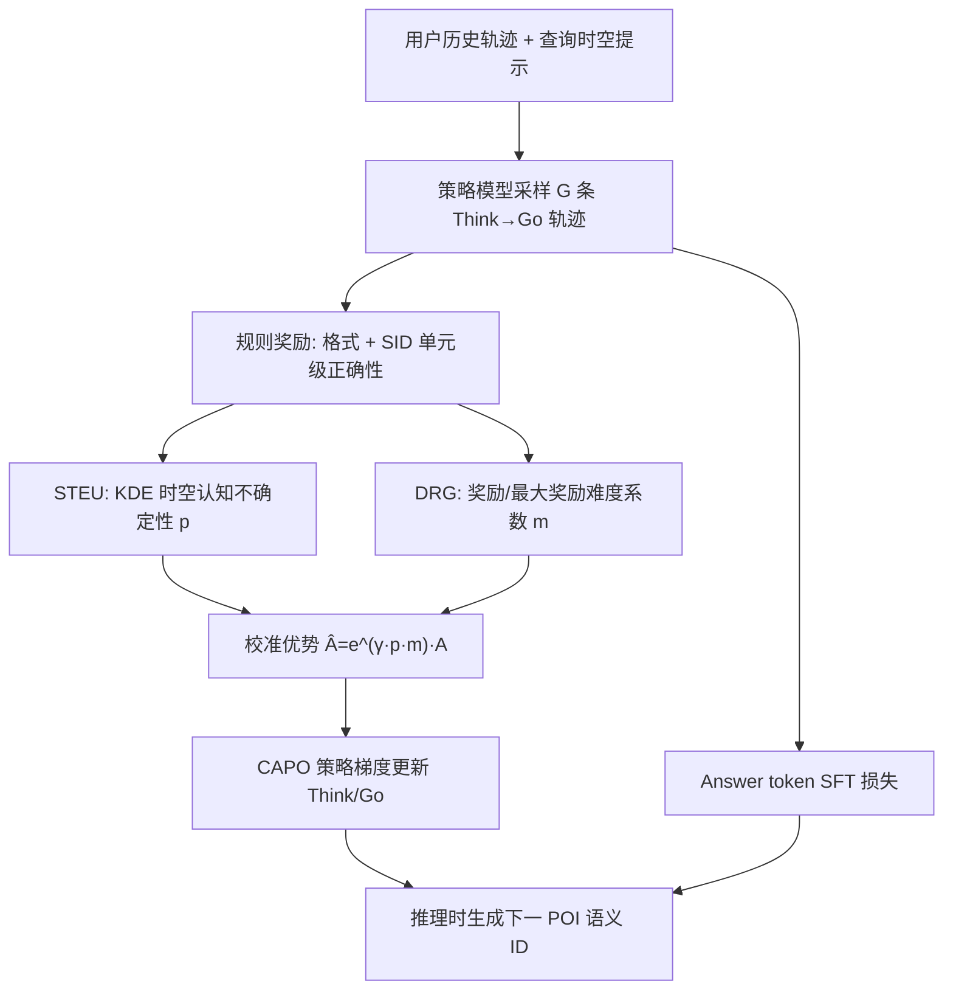
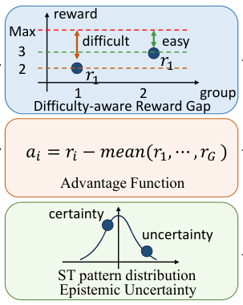

# Think2Go: Generative Next POI Recommendation with LLM Reasoning (基于LLM推理的生成式下一兴趣点推荐)

- **会议/期刊**: KDD 2026 (Research Track, Oral)
- **作者与机构**: Zhuang Zhuang, Heng Qi 等（大连理工大学）；Shanshan Feng（武汉大学）；Hangwei Qian（A*STAR CFAR/IHPC）；Mingqi Yang（华南理工）
- **推荐链路定位**: 端到端生成式（Next-POI 直接生成语义 ID）
- **研究方向**: 时空轨迹与 POI 本地生活推荐 / 生成式推荐与离散语义 ID
- **论文原文**: [https://arxiv.org/abs/2607.28997v1](https://arxiv.org/abs/2607.28997v1)
- **开源代码**: [https://doi.org/10.5281/zenodo.18206701](https://doi.org/10.5281/zenodo.18206701)

## TL;DR (1分钟核心速览)

现有 LLM 生成式 Next-POI 方法（如 GNPR）把语义 ID 训练与模型解耦，导致模型对 SID 理解不足、稀疏场景泛化差；Refine-POI 虽引入 GRPO 推理，却对所有 prompt 一视同仁地做优势归一化，忽视时空规律难度差异。Think2Go 将 SFT 与 RL 推理统一进 `Think→Go→Self-Correct→Answer` 单架构，并用 KDE 时空认知不确定性（STEU）与难度感知奖励差（DRG）联合校准优势函数。在 NYC/TKY/CA 三数据集上 Acc@1 较 GNPR 提升 6.33%/5.78%/7.49%，跨域迁移全面领先。

## Background & Motivation (背景与核心矛盾)

- **主流范式**: 早期 Markov/RNN/注意力（STAN、ROTAN）与 GNN（STHGCN）建模时空转移；近期转向 LLM 生成式，用 RQ-VAE 语义 ID 让 LLM 直接生成下一 POI 的 SID 序列。
- **前人局限**: ① GNPR 等把 SID 训练与 LLM 微调解耦，模型对 SID 语义理解不完整，稀疏 POI 与跨域场景泛化差；② Refine-POI 用标准 GRPO，组内均值中心化使"易样本 [4.5,4.5,3.5]"与"难样本 [2.5,2.5,1.5]"得到相同优势 [0.33,0.33,−0.67]，更新强度与任务难度脱钩。
- **核心洞察 (Key Insight)**: POI 预测的难度本质由"查询与用户历史时空周期规律的对齐程度"决定——偏离习惯时段/常去区域的查询认知不确定性高，应给予更大探索激励；同时奖励绝对幅度携带难度信号，不应被标准化抹平。
- **本文切入点**: 用 KDE 量化 prompt 级认知不确定性、用奖励/最大奖励比量化模型级难度，二者共同缩放优势，形成隐式课程学习。

## Method (核心方法设计)

### 1. 整体框架 (Overall Architecture)

模型基于 decoder-only 骨干 + LoRA，旧策略先对每个 prompt 采样 $G$条轨迹，输出结构为 `Think`（推理）→`Go`（预测 SID）→`Self-Correct`（自纠错桥接）→`Answer`（监督答案）。其中 Think/Go token 走策略梯度（CAPO），Answer token 走标准 next-token SFT，总损失$\mathcal{L}=\mathcal{L}_{SFT}+\alpha\mathcal{L}_{CAPO}$。奖励由渐进式格式奖励（部分格式 0.5、完整 `</think><answer>` 且长度 >300 token 得 1.0）与按 SID 语义单元分解的细粒度正确性奖励（每单元$3/L$）构成，缓解稀疏奖励冷启动。

<figure class="paper-figure" markdown="span">
  <figcaption>图2：Think2Go 的整体框架，对 Think→Go token 序列执行迭代策略优化，而 Answer token 通过 SFT 训练。为增强迭代策略学习，我们提出了难度感知优势加权估计器，通过奖励差距反映推理难度，以及基于核密度估计的空间-时间认知不确定性（STEU）估计器以捕捉认知不确定性。二者共同细化集中式优势函数，从而实现更精确的策略梯度更新。</figcaption>
</figure>

### 2. 关键设计拆解 (Key Designs)

1. **时空认知不确定性 STEU（prompt 级自适应探索）**：痛点是对所有 prompt 等权更新，难样本激励不足。对查询时刻与历史签到时刻做 24 小时环形高斯核、对查询坐标与历史坐标做测地距离高斯核，分别平均得置信度，再取 $p=\beta(1-p_{temporal})+(1-\beta)(1-p_{spatial})$。$p$ 越大表示查询越偏离用户习惯时空分布，优势被放大以鼓励探索——物理直觉是"越反常的目的地越需要推理而非记忆"。

2. **难度感知奖励差 DRG（模型级更新幅度校准）**：痛点是组内标准化丢失奖励绝对强度。定义 $m=1-\frac{R_{max}-R}{R_{max}}$，使易样本系数约 [1.0,1.0,0.778]、难样本约 [0.556,0.556,0.333]，从而对错误/低奖励预测施加更保守更新，保持推理 token 高熵、抑制熵坍缩。

3. **训练目标、负采样与推理效率**：最终优势 $\hat{A}_t^i=e^{(\gamma\cdot p\cdot m)}\cdot A_t^i$，其中$A_t^i=R_i-\text{mean}(\{R_i\})$（去掉 Dr.GRPO 指出的方差项偏差），并叠加 token 级熵奖励$e_t^i$。无需负采样（生成式全库隐式竞争）；推理时仅需一次自回归解码，test-time 计算深度可调，但长 CoT 带来额外延迟。

## Experimental Setup & Evaluation Protocol (实验设置与评估协议)

- **数据集与预处理**: 沿用 GNPR 协议——过滤交互 <10 的 POI 与签到 <10 的冷用户，并剔除测试集中未在训练集出现的用户/POI。

| 数据集 | #Users | #POIs | #Categories | 平均签到 | 场景说明 |
| :--- | :---: | :---: | :---: | :---: | :--- |
| NYC | 1,083 | 5,135 | 209 | 136 | Foursquare 纽约 2012.04–2013.02 |
| TKY | 2,293 | 7,873 | 190 | 195 | Foursquare 东京同期 |
| CA | 6,592 | 14,027 | 301 | 53 | Gowalla 加州/内华达 2009.02–2010.10 |

- **数据划分与防穿越 (Splitting Strategy)**: 按用户时间排序后 `80%/10%/10%` 比例划分训练/验证/测试，每用户最后一次签到作答案、之前历史构造输入序列，严格时间序防穿越。
- **排名评测协议 (Ranking Protocol)**: 生成式 `Full-Ranking`（直接生成 SID，与全库 POI 隐式竞争），报告 Acc@1/5/10 与 MRR；无采样负例比设置。
- **对比基线与超参设置**: 传统 PRME/LSTM/PLSPL，序列 STAN/TPG/ROTAN，图 GETNext/STHGCN，LLM LLM-Mob/LLM4POI/GNPR，推理 Refine-POI；组大小 $G$、$\alpha,\beta,\gamma,\sigma$ 为超参，未报告显著性检验细节。

## Key Experimental Results (实验关键数据)

### 1. 主实验对比 (Main Results)

| Model | NYC Acc@1 | NYC Acc@10 | NYC MRR | TKY Acc@1 | TKY MRR | CA Acc@1 | CA MRR |
| :--- | :---: | :---: | :---: | :---: | :---: | :---: | :---: |
| STHGCN | 0.2734 | 0.6244 | 0.3915 | 0.2950 | 0.3986 | 0.1730 | 0.2558 |
| ROTAN | 0.3106 | 0.6131 | 0.4104 | 0.2458 | 0.3475 | 0.2199 | 0.2931 |
| LLM4POI | 0.3372 | – | – | 0.3035 | – | 0.2065 | – |
| Refine-POI | 0.3469 | 0.6627 | 0.4520 | 0.3160 | 0.4020 | 0.2174 | 0.2903 |
| GNPR | 0.3618 | – | – | 0.3062 | – | 0.2403 | – |
| **Think2Go** | **0.3847** | **0.6835** | **0.4663** | **0.3239** | **0.4147** | **0.2583** | **0.3167** |
| Improv. vs GNPR | +6.33% | – | – | +5.78% | – | +7.49% | – |

### 2. 消融实验 (Ablation Study, Acc@1)

| 变体 | NYC | TKY | CA |
| :--- | :---: | :---: | :---: |
| Think2Go | **0.3847** | **0.3239** | **0.2583** |
| w/o Reasoning Tokens | 0.3674 (↓4.5%) | 0.3103 (↓4.2%) | 0.2478 (↓4.07%) |
| w/o STEU | 0.3763 (↓2.18%) | 0.3161 (↓2.41%) | 0.2503 (↓3.1%) |
| w/o DRG | 0.3744 (↓2.68%) | 0.3147 (↓2.84%) | 0.2489 (↓3.64%) |
| w/o Token Entropy Bonus | 0.3823 (↓0.62%) | 0.3207 (↓0.99%) | 0.2561 (↓0.85%) |

### 3. 关键实验发现 (Key Findings)

1. **推理 token 是最大增益源**：去掉 Think/Go 推理段后 Acc@1 掉 4.07–4.5%，降幅超过 STEU（2.2–3.1%）与 DRG（2.7–3.6%），说明"先想后推"的 test-time 计算扩展是主引擎，两个校准器是放大器。
2. **SID 语义理解被推理显著激活**：在 10 选 1 的 SID→类别预测任务上，Think2Go 达 0.3024/0.2673/0.1722，较纯 SFT 的 GNPR 相对提升 58.96%/61.15%/31.36%，直接证明解耦训练导致的 SID 理解缺陷可被 RL 推理弥补。
3. **跨域泛化更稳**：六组源→目标迁移（如 NYC→CA 0.2484 vs GNPR 0.2297、CA→TKY 0.3042 vs 0.2869）全面领先，且训练曲线显示 DRG 使熵在 400 步后维持高位、Acc@1 与奖励持续高于 Refine-POI，验证其抗熵坍缩与抗过拟合噪声的能力。

## Highlights & Limitations (亮点、对比与审稿批判)

- **与代表作对比 (vs. Prior Work)**: 与 GNPR 的本质差异在于 SID 不再"先训后用"而是与推理联合优化；与 Refine-POI 的差异在于把 GRPO 的等权优势替换为 prompt 级（STEU）+ 模型级（DRG）双重校准，且用 Self-Correct token 桥接 SFT 与 RL，避免两阶段灾难遗忘。
- **可迁移亮点**: ① 用 KDE 在用户历史分布上量化"查询反常度"作为探索权重，可迁移到任何有时空/周期先验的序列推荐；② 奖励/最大奖励比的难度缩放是极轻量的 GRPO 改进，几乎零额外开销即可缓解熵坍缩。
- **审稿级局限批判**: ① 推理需生成数百 token 的 CoT，线上 POI 推荐的延迟与算力成本未做量化，工业落地存疑；② 主实验仅报 Acc@1/5/10 与 MRR，未给显著性检验，且 GNPR/LLM4POI 缺 Acc@5/10 导致对比不完整；③ STEU 的核带宽 $\sigma$与$\beta,\gamma$ 敏感度未做系统分析。

## Rating (四维评分)

- **方法创新性 (Novelty)**: ⭐⭐⭐⭐ （核心机制与方法设计具备明确创新性，理论与实验动机支撑充分）
- **评估协议与实验扎实度 (Protocol & Experiments)**: ⭐⭐⭐⭐ （主流公开数据集评测完整，包含多基线对比与消融实验验证）
- **写作与数学规范度 (Clarity & Rigor)**: ⭐⭐⭐⭐ （问题形式化定义清晰，核心模块数学推导与架构阐述严谨易读）
- **工业落地与复现价值 (Industrial & Practical Value)**: ⭐⭐⭐ （兼顾推荐效果增益与训练/推理效率，具备实际场景迁移参考价值）
