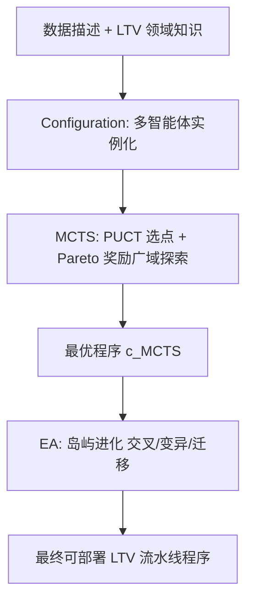
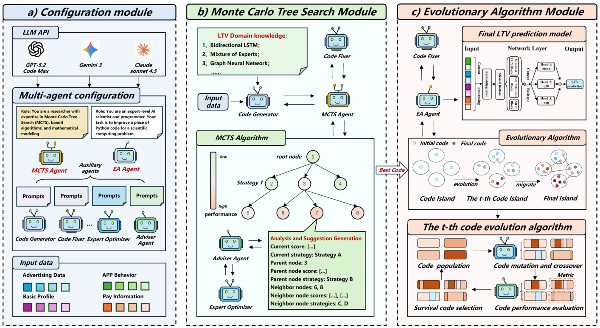

# AgentLTV: An Agent-Based Unified Search-and-Evolution Framework for Automated Lifetime Value Prediction (基于智能体的统一搜索-进化框架用于自动化生命周期价值预测)

- **会议/期刊**: KDD 2026 (ADS Track, submitted)
- **作者与机构**: Chaowei Wu, Huazhu Chen, Congde Yuan, Qirui Yang, Guoqing Song, Yue Gao, Li Luo, Frank Youhua Chen, Mengzhuo Guo（四川大学、哈工大、中山大学、香港城大、VIVO、湘潭大学）
- **推荐链路定位**: 精排（用户价值/LTV 预估，服务于出价与流量分配）
- **研究方向**: 强化学习与动态探索推荐 / 大语言模型推荐
- **论文原文**: [https://arxiv.org/abs/2602.21634v1](https://arxiv.org/abs/2602.21634v1)
- **开源代码**: [https://github.com/wuchaowei123/AgentLTV](https://github.com/wuchaowei123/AgentLTV)

## TL;DR (1分钟核心速览)

LTV 建模长期依赖人工堆叠场景定制流水线（特征工程、目标设计、调参），成本高且难迁移，且主流 ZILN 类损失无法显式处理负 LTV。本文提出 AgentLTV，把每个候选方案视为**可执行流水线程序**，由 LLM 多智能体完成代码生成/执行/修复，两阶段决策：MCTS 阶段用 PUCT + Pareto 多指标奖励做广域结构探索，EA 阶段用岛屿进化（交叉/变异/迁移）精炼最优程序。在 80 万级手游工业数据与 Kaggle Acquire Valued Shoppers 公开集上，相对最强基线平均 ER 降 41.26%、Norm GINI 升 15.44%、Spearman 升 40.97%、RMSE 降 47.82%，并已在线部署。

## Background & Motivation (背景与核心矛盾)

- **主流范式**: LTV 预测历经概率模型（Pareto/NBD、BTYD）→ 树模型两阶段（购买倾向 + 金额）→ 深度模型（ZILN 损失、小波/GRU/GAT、多子分布 OptDist、分层 ZIMoL 等），工业界普遍为每个场景定制复杂流水线。
- **前人局限**: ① 现有方法多基于 ZILN 等零膨胀对数正态假设，**无法显式建模负 LTV**（广告曝光有成本无点击、短现激励大于贡献时真实 LTV 为负），破坏建模假设；② 模型高度场景定制、pipeline 沉重，新场景下易过拟合旧模式、**难以迁移复用**，人工迭代成本极高。
- **核心洞察 (Key Insight)**: 单纯 LLM 代码生成陷入两难——挖深上下文会继承过拟合风险，只用宽泛上下文则生成的流水线与 LTV 任务错位；而 LTV 建模的收益主要来自**少数高影响结构决策**（模型族、关键设计），深层微调收益递减且噪声大。
- **本文切入点**: 不做单一模型，而是把"建模"本身变成对程序空间的搜索——MCTS 负责广度定位结构，EA 负责深度精炼，执行反馈（真实指标）作为唯一 ground truth 闭环。

## Method (核心方法设计)

### 1. 整体框架 (Overall Architecture)

AgentLTV 由三个紧耦合模块构成。**Configuration 模块**用角色化 prompt 与多 LLM API（Claude-Sonnet-4.5 / GPT-5.2 / Gemini-3-Pro）实例化决策智能体（MCTS Agent、EA Agent）与辅助智能体（Code Generator、Code Fixer、Adviser Agent、Expert Optimizer），所有智能体遵循统一流水线接口（数据加载/训练/评估/日志），保证候选程序可比。**MCTS 模块**以领域知识初始化 K 个多样化根程序，按 PUCT 选点、LLM 驱动扩展、执行修复后回传多指标奖励，在固定预算（100 个可执行节点）内输出最优程序 $c_{\text{MCTS}}$。**EA 模块**以 $c_{\text{MCTS}}$ 为种子初始化 4 个岛屿，经选择-交叉-变异-周期迁移进化 T 代（再生成 100 个可行程序），全局选出最终可部署流水线。

<figure class="paper-figure" markdown="span">
  <figcaption>图2：AgentLTV概览。(a) 配置模块实例化LLM驱动的智能体与执行接口。(b) MCTS模块在代码生成器生成初始节点算法后，通过PUCT引导的扩展对LTV流水线程序进行广泛探索。(c) EA模块基于先前的最优算法，使用基于岛屿的进化方法（包括交叉、变异和迁移）对最佳MCTS程序进行细化。</figcaption>
</figure>

### 2. 关键设计拆解 (Key Designs)

1. **Pareto 感知的多指标 MCTS 奖励（解决单标量奖励无法兼顾排序与误差）**：标准 MCTS 用单一标量更新节点值，而 LTV 需同时优化 ER/RMSE（误差）与 GINI/Spearman（排序）。本文将节点值改为多指标加权 + Pareto 前沿指示 + 拥挤距离多样性项：
$$R(c)=\sum_i w_i\cdot\text{norm}(o_i(c))+\beta\cdot\mathbb{I}_{\text{Pareto}}(c)+\gamma\cdot d_{\text{crowd}}(c)$$
选点用 PUCT：$c^*=\arg\max_{c}\left(Q(c)+c_{\text{puct}}\cdot\frac{P(c)\sqrt{N(u)}}{1+N(c)}\right)$，其中先验 $P(c)$ 由 Adviser Agent 提建议、Expert Optimizer 按 LTV 知识打分重加权得到。直觉：Pareto 项防止搜索被单一指标带偏，拥挤距离项维持候选多样性，避免早熟收敛到某一模型族。

2. **岛屿式进化精炼（解决 MCTS 深层扩展收益递减/噪声大）**：MCTS 呈"宽而浅"形态，最优程序出现在深度 3，说明结构决策已定、细粒度改动收益递减。EA 以 $c_{\text{MCTS}}$ 变异出 K 个岛屿种群，每代按精英比例 $\rho$ 选精英 $E_k^{(t)}$，由 Adviser + Expert Optimizer 生成结构化 prompt 指导交叉/变异（特征增广、架构精炼、超参调优、损失替换），每 $\tau$ 代做跨岛迁移共享高适应度构件，最终 $c^*=\arg\max_{c\in\cup_k P_k^{(T)}}F(c)$。直觉：多岛 + 迁移在"利用最优结构"与"保持探索多样性"间取得平衡。

3. **执行闭环与负 LTV 处理**：Code Fixer 负责实例化、训练、评估与**迭代修复**，不可执行程序直接淘汰（"种群死亡"），确保每个候选都有可靠指标；搜索空间不预设模型族，因此自动发现含时序卷积 + 注意力分支、**负值感知输出设计与校准**的流水线，从机制上绕开 ZILN 的负值假设缺陷。总目标即最大化上述 Pareto 奖励下的程序适应度，无传统负采样概念（回归任务），推理开销为单次前向，与普通深度模型一致。

## Experimental Setup & Evaluation Protocol (实验设置与评估协议)

- **数据集与预处理**:

| 数据集 | #Samples | 正/负样本 | 平均 LTV | 特征/场景说明 |
| :--- | :---: | :---: | :---: | :--- |
| 工业手游 Period 1 | 426,412 | 188,047 / 146,686 | 23.810 | 132 维：用户属性 + 广告属性 + 游戏行为；预测安装后 7 天→未来 60 天累计收入 |
| 工业手游 Period 2 | 382,081 | 171,554 / 132,201 | 25.323 | 同上，跨季度验证迁移性 |
| Kaggle Acquire Valued Shoppers | 1,797,813 | — | 797.358 (std 6452.4) | 首购统计 + 品类/品牌/规格等类别属性；预测首购后 12 个月总消费 |

- **数据划分与防穿越 (Splitting Strategy)**: 工业数据按两个季度分别做 **8:1:1 比例划分**（train/val/test），标签为安装后 60 天真实收入（含负值）；公开集沿用 ZILN 协议，取首购于 2012-03-01 至 2012-07-01 的用户、Top-20 公司，8:1:1 划分。
- **排名评测协议 (Ranking Protocol)**: 回归任务，采用**全测试集直接打分**（非采样排序），报告 ER、Norm GINI、Spearman、RMSE 四指标；线上另用**分桶同区间比例（Same-interval ratio）**与**桶内 MAE** 做排序一致性与校准诊断。
- **对比基线与超参设置**: 9 个基线覆盖三类——CTR 经典（Wide&Deep、DeepFM、DCN、GateNet）、LTV 专用（ZILN、Kuaishou、TSUR、OptDist、USE-LTV、Hi-LTV）；MCTS 预算 100 个可执行节点，EA 4 岛、再生成 100 个可行程序；实验在双 A100 + 128GB 服务器完成。

## Key Experimental Results (实验关键数据)

### 1. 主实验对比 (Main Results)

工业数据 Period 1（Period 2 趋势一致，此处列 P1 核心列）：

| Model | ER ↓ | Norm GINI ↑ | Spearman ↑ | RMSE ↓ |
| :--- | :---: | :---: | :---: | :---: |
| Wide&Deep | 2.225 | 0.623 | 0.101 | 264.92 |
| DeepFM | 1.602 | 0.409 | 0.186 | 264.48 |
| ZILN | 1.492 | 0.310 | 0.323 | 261.83 |
| DCN | 2.625 | 0.602 | 0.030 | 284.11 |
| GateNet | 1.949 | 0.661 | 0.147 | 257.24 |
| Kuaishou | 1.894 | 0.681 | 0.523 | 261.69 |
| TSUR | 0.922 | 0.670 | 0.680 | 223.95 |
| OptDist | 1.418 | 0.775 | 0.515 | 258.03 |
| USE-LTV | 1.461 | 0.732 | 0.483 | 261.27 |
| Hi-LTV | 1.355 | 0.813 | 0.574 | 256.69 |
| **AgentLTV** | **0.705** | **0.963** | **0.832** | **133.58** |
| Improv.% (vs 最强基线) | ↓41.26% (均值) | ↑15.44% (均值) | ↑40.97% (均值) | ↓47.82% (均值) |

公开集 Kaggle：AgentLTV 取得 ER 0.479、Norm GINI 0.732、Spearman 0.649、RMSE 3646.85，全面优于 Hi-LTV（ER 0.898）、ZILN（ER 0.504, RMSE 4879.94）等，RMSE 相对最优基线降约 20%+。

### 2. 消融实验 (Ablation Study)

| 变体 | ER ↓ | Norm GINI ↑ | Spearman ↑ | RMSE ↓ |
| :--- | :---: | :---: | :---: | :---: |
| w/o MCTS | 1.030 | 0.778 | 0.633 | 273.42 |
| w/o EA | 0.670 | 0.958 | 0.823 | 185.95 |
| **AgentLTV (full)** | **0.594** | **0.962** | **0.817** | **141.09** |

### 3. 关键实验发现 (Key Findings)

1. **MCTS 是排序指标的命门，EA 是误差指标的补刀**：去掉 MCTS 后 Spearman 从 0.817 暴跌至 0.633、RMSE 从 141 升至 273，说明广域结构探索决定能否找到场景适配的排序结构；去掉 EA 后 ER 从 0.594 升至 0.670、RMSE 升至 186，说明进化精炼主要贡献数值校准与误差收敛。
2. **搜索形态"宽而浅"且最优解在深度 3**：133 个 MCTS 节点中最佳程序出现在第 3 层，验证 LTV 建模收益集中于少数高影响结构决策（模型族 + 关键设计），深层扩展收益递减——这直接支撑了"MCTS 定位结构、EA 精炼细节"的分工设计。
3. **线上分桶诊断显示高价值与负 LTV 段收益最大**：2025 年 7 月真实流量上，AgentLTV 在高价值桶与负 LTV 桶的同区间比例领先所有基线、桶内 MAE 多数桶更低，说明自动发现的负值感知输出与校准机制在真实分布尾部（最影响出价决策的区段）确实生效。

## Highlights, Limitations & Rating (亮点、对比与审稿评价)

- **与代表作对比 (vs. Prior Work)**: 与 ZILN/Hi-LTV 等"人工设计单一模型族"路线本质不同——本文不预设模型结构，把建模变成程序空间搜索，因而能自动绕开 ZILN 的负值假设缺陷；与 FunSearch/AlphaEvolve 等 LLM 进化代码搜索相比，本文额外引入 MCTS 解决"缺乏稳定初始程序"的冷启动难题，并用 Pareto 多指标奖励适配 LTV 的多目标评估。
- **可迁移亮点**: ① Pareto + 拥挤距离的多指标 MCTS 奖励可直接迁移到任何多目标（排序 + 校准）的推荐预估任务；② "MCTS 广探索定结构 + EA 岛屿进化精炼"的两阶段范式，可复用于特征交叉网络、多任务网络等结构化建模的自动设计。
- **审稿级局限批判**: ① 搜索成本高——依赖多个商用 LLM API 与双 A100，133 + 116 次程序执行的总开销未量化，中小团队复现门槛高；② 评估仅两个数据集（一个私有、一个公开），且公开集上相对 GateNet/TSUR 的 ER 提升幅度很小（0.479 vs 0.479/0.480），泛化证据偏弱；③ 对 LLM 版本、prompt 设计与领域知识库高度敏感，稳定性与可复现性存疑。
- **四维评分**: 创新性 ⭐⭐⭐⭐ | 实验扎实度 ⭐⭐⭐⭐ | 方法清晰度 ⭐⭐⭐⭐ | 落地价值 ⭐⭐⭐⭐⭐

