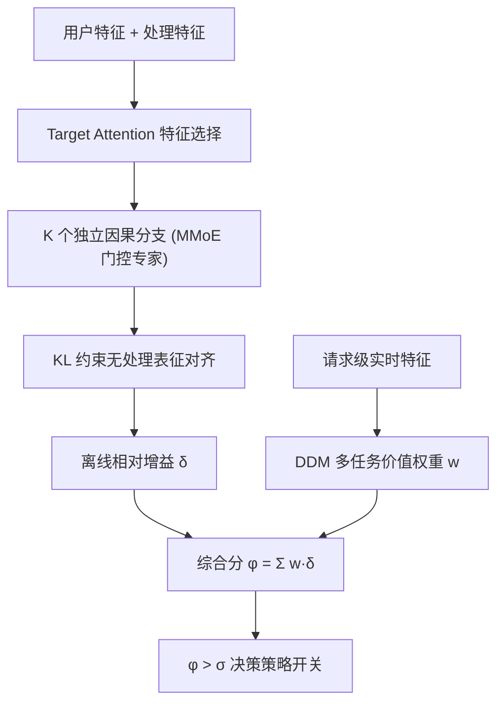
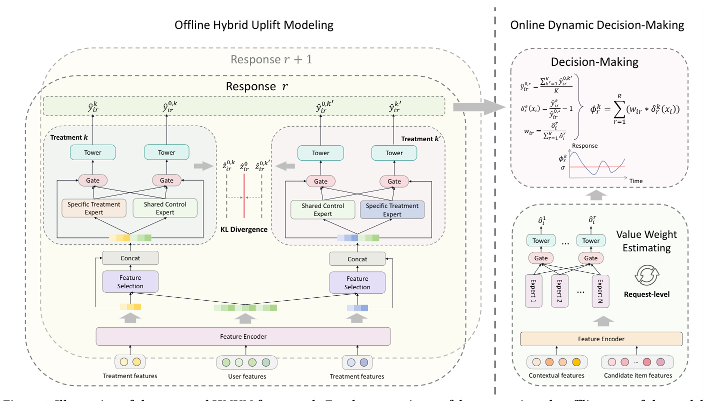

# Heterogeneous Multi-treatment Uplift Modeling for Trade-off Optimization in Short-Video Recommendation (短视频推荐中面向权衡优化的异构多处理增益建模)

- **会议/期刊**: KDD 2026
- **作者与机构**: Chenhao Zhai, Chang Meng, Xueliang Wang, Shuchang Liu, Xiaolong Hu, Shisong Tang, Xiaoqiang Feng (快手科技); Xiu Li (清华大学深圳国际研究生院)
- **推荐链路定位**: 重排 (Ranking / Edge Rerank 两阶段策略开关决策)
- **研究方向**: 强化学习与动态探索推荐 / 多任务学习与列表级重排
- **论文原文**: [https://arxiv.org/abs/2511.18997v2](https://arxiv.org/abs/2511.18997v2)
- **开源代码**: 暂未开源（作者声明计划释放代码与工业数据集）

## TL;DR (1分钟核心速览)

短视频推荐中多个打分策略（消费侧 vs 商业化侧）互为"异构处理"，对同一用户响应常呈互斥甚至负增益（downlift），且传统固定权重无法个性化权衡多响应。本文提出 HMUM：离线 HUM 用"共享控制专家 + 各处理独立分支 + KL 约束"同时捕获处理间协同与个体因果效应，在线 DDM 用多任务网络实时预测各响应价值权重，聚合为综合分 $\phi_i^k$ 决定策略开关。在 Criteo/Lazada/快手工业集上 QINI/AUUC 全面领先，线上 Ranking 阶段 APP 使用时长 +0.044%、Edge Rerank 阶段 +0.073%，已全量部署服务数亿用户。

## Background & Motivation (背景与核心矛盾)

- **主流范式**: 工业短视频系统在精排/重排后串联多个"策略打分器"（如消费时长打分器 $t_1$、商业化观看打分器$t_2$），用统计修正因子调参，本质是启发式而非因果建模。
- **前人局限一**: 联合建模类（M3TN、EFIN）把多处理塞进单模型共享梯度，适合同质处理（同范围不同强度），但短视频策略是**异构且互斥**的，强行共享引发严重梯度冲突，工业集上甚至出现负增益（如 M3TN 在 Treatment 2 的 APP 时长 QINI 为 $-17.74$）。
- **前人局限二**: 单处理建模类（DESCN、CDUM）只学某一策略因果效应，丢失策略间协同；且多响应权衡普遍用**全局固定权重**，缺乏个性化，导致决策偏置。
- **核心洞察 (Key Insight)**: 多处理应"分而治之再联合约束"——各处理独立分支保个体效应，共享无处理表征 + KL 对齐保协同一致性；多响应权重应由用户实时特征驱动而非全局常数。
- **本文切入点**: 将权衡优化重构为"离线多处理增益估计 + 在线个性化权重决策"两段式因果框架。

## Method (核心方法设计)

### 1. 整体框架 (Overall Architecture)

离线 HUM 先做特征选择：用处理嵌入 $e_{t_i}$作 query 对无处理特征做 target attention，抽取出与第$k$个处理相关的特征子集$f_i^k$；随后$K$个独立分支各自经 MMoE 式门控专家塔输出处理响应$\hat{y}_{ir}^k$与无处理响应$\hat{y}_{ir}^{0,k'}$，分支间用 KL 散度约束无处理门控表征$z_{ir}^{0,k'}$向均值对齐以捕获协同。在线 DDM 以请求级上下文与候选特征为输入、以曝光样本类型占比为标签训练多任务网络，实时输出价值权重$w_{ir}$，与离线相对增益$\delta_r^k(x_i)$加权聚合得综合分$\phi_i^k$，超过阈值$\sigma$ 即开启/增强该策略。

<figure class="paper-figure" markdown="span">
  <figcaption>图1：所提出的HMUM框架示意图。为便于演示，模型的离线部分以两个响应和两个处理为例。</figcaption>
</figure>

### 2. 关键设计拆解 (Key Designs)

1. **混合增益建模 (HUM) —— 个体效应与协同效应的解耦统一**：痛点在于联合建模梯度冲突、独立建模丢失协同。HUM 让每个处理 $k$拥有专属分支输出$\hat{y}_{ir}^k$，同时所有分支共享"无处理专家"但各自产生门控$z_{ir}^{0,k'}$，用 KL 项把这些无处理表征拉向跨分支均值$\bar{z}_{ir}^0$。直觉：无处理状态是同一客观事实，各分支对其估计应一致，强制对齐即隐式传递协同信息而不污染处理专属梯度。核心损失（$k=0$ 分支）：
$$\mathcal{L}=\frac{1}{N}\sum_{i=1}^{N}\sum_{k'=1}^{K}\left[(y_{ir}^k-\hat{y}_{ir}^{0,k'})^2+D_{\mathrm{KL}}\!\left(z_{ir}^{0,k'}\,\Big\|\,\frac{1}{K}\sum_{k'=1}^{K}z_{ir}^{0,k'}\right)\right]$$
2. **相对增益归一化 (Pre-processing)**：不同响应量纲差异巨大（时长 vs 播放数），直接加权会被大数值响应主导。DDM 先用跨分支均值 $\hat{y}_{ir}^{0,*}=\frac{1}{K}\sum_{k'}\hat{y}_{ir}^{0,k'}$作无处理基准（满足 min-max 夹逼约束），再定义无量纲相对增益$\delta_r^k(x_i)=\hat{y}_{ir}^k/\hat{y}_{ir}^{0,*}-1$，使多响应可在同一尺度上加权。
3. **在线动态权重与决策 (DDM)**：以请求级候选特征池化拼接 $e_{s_i}^*$输入 MMoE，标签为各响应类型曝光占比$o_i^r=V_r/V$，输出经比例归一$w_{ir}=\hat{o}_i^r/\sum_r\hat{o}_i^r$，最终$\phi_i^k=\sum_{r=1}^{R}w_{ir}\cdot\delta_r^k(x_i)$，$\phi_i^k>\sigma$则启用策略$k$。训练用 MSE，离线 HUM 按样本实际处理做 mask 只训对应塔，推理时迭代替换处理特征即可得全处理响应，无额外负采样。

## Experimental Setup & Evaluation Protocol (实验设置与评估协议)

- **数据集与预处理**:

| 数据集 | #Instances | 特征/处理 | 标签/场景说明 |
| :--- | :---: | :---: | :--- |
| Criteo | ~14M | 12 特征 + 处理指示 | visit/conversion，取 visit 为标签 |
| Lazada | 未披露 | 83 特征 + 处理指示 | 优惠券发放，训练集含处理偏置、测试集为 RCT 无偏用户 |
| 快手工业集 | ~6M | 用户属性 + 7/30 天消费/商业特征 | APP 使用时长、播放数；$t_1$消费打分器、$t_2$ 商业化打分器 |

- **数据划分与防穿越**: Criteo 按 8:1:1 随机划分；Lazada 用含偏置数据训练、RCT 无偏用户测试（防处理偏置穿越）；工业集 8:2 划分，特征取 RCT 前 14 天、标签取 RCT 期间反馈。
- **排名评测协议**: 增益排序指标 normalized AUUC 与 QINI（scikit-uplift 实现），工业集连续标签先归一化并修正完美增益曲线；非全库排序，属增益曲线排序评估。
- **对比基线与超参**: 元学习 S/T-Learner、BNN、TARNet、CFRNet、CEVAE、GANITE、DragonNet、FlexTENet、SNet、EUEN、DESCN、EFIN；工业集额外对比多处理 M3TN 并将 S/T-Learner、TARNet 扩展为多处理版。基线与本模型共享相同嵌入初始化，训练中不做超参调优以保证公平。

## Key Experimental Results (实验关键数据)

### 1. 主实验对比 (Main Results)

工业集（异构多处理，QINI/AUUC $\times 10^{-4}$）：

| 模型 | 时长-T1 QINI | 时长-T2 QINI | 播放-T1 QINI | 播放-T2 QINI |
| :--- | :---: | :---: | :---: | :---: |
| S-Learner | 8.81 | -11.01 | 13.37 | 10.28 |
| T-Learner | 8.69 | -22.14 | 5.62 | 10.88 |
| TARNet | 7.07 | 13.18 | -0.24 | 7.61 |
| EFIN | 10.68 | -5.30 | -8.07 | 10.97 |
| M3TN | 13.04 | -17.74 | 1.25 | 24.40 |
| HUM w/o KL | 10.87 | 14.59 | 5.00 | 15.56 |
| **HUM (本文)** | **14.55** | **19.90** | **15.87** | **25.44** |

单处理公开集（QINI/AUUC）：

| 模型 | Lazada QINI | Lazada AUUC | Criteo QINI | Criteo AUUC |
| :--- | :---: | :---: | :---: | :---: |
| SNet | 0.0238 | 0.0034 | 0.0843 | 0.0331 |
| FlexTENet | 0.0185 | 0.0026 | 0.0924 | 0.0363 |
| CFRNet | 0.0231 | 0.0033 | 0.0901 | 0.0354 |
| **HUM (本文)** | **0.0278** | **0.0039** | **0.0933** | **0.0366** |

线上 A/B（快手，相对提升）：

| 阶段 | APP 时长 | 人均 APP 时长 | 播放数 |
| :--- | :---: | :---: | :---: |
| Ranking (13 天) | +0.044% | +0.055% | +0.007% |
| Edge Rerank (8 天) | +0.073% | +0.072% | +0.002% |

### 2. 消融实验 (Ablation Study)

| 变体 | 时长-T1 QINI | 时长-T2 QINI | 播放-T1 QINI | 播放-T2 QINI |
| :--- | :---: | :---: | :---: | :---: |
| HUM w/o KL | 10.87 | 14.59 | 5.00 | 15.56 |
| HUM 完整 | **14.55** | **19.90** | **15.87** | **25.44** |

线上策略消融（Edge Rerank，相对变化）：

| 变体 | APP 时长 | 人均 APP 时长 | 播放数 |
| :--- | :---: | :---: | :---: |
| 仅 $s_1$ 全量 | +0.125% | +0.085% | -0.227% |
| 仅 $s_2$ 全量 | -0.094% | -0.078% | +0.151% |
| $s_1$&$s_2$ 全量乘性 | -0.044% | -0.056% | +0.091% |
| **HMUM 个性化** | **+0.073%** | **+0.072%** | **+0.002%** |

### 3. 关键实验发现 (Key Findings)

1. **异构处理下联合建模会"负迁移"**：M3TN 在时长-T2 上 QINI 跌至 $-17.74$、EFIN 在播放-T1 上为$-8.07$，而 HUM 对应为$19.90$与$15.87$，证明独立分支 + KL 协同约束能消除梯度冲突带来的 downlift。
2. **KL 约束是协同效应的关键开关**：去掉 KL 后四个处理-响应组合 QINI 分别下降 $3.68/5.31/10.87/9.88$（$\times10^{-4}$），说明无处理表征对齐对跨分支信息传递贡献显著，而非可有可无的正则。
3. **全量统一策略必然牺牲一侧指标，个性化才破局**：线上仅 $s_1$使播放数$-0.227\%$、仅$s_2$使时长$-0.094\%$、乘性组合仍双负；HMUM 按用户实时权重决策后时长$+0.073\%$且播放$+0.002\%$，实现双指标同向正增益。

## Highlights & Limitations (亮点、对比与审稿批判)

- **与代表作对比 (vs. Prior Work)**: 相比 M3TN/EFIN 的"全共享联合建模"，HUM 用分支隔离 + KL 对齐兼顾个体与协同；相比 DESCN/CDUM 的"单处理因果"，HUM 原生支持异构多处理；相比固定权重多目标，DDM 把权重从全局常数变为请求级个性化预测。
- **可迁移亮点**: (1) "共享无处理专家 + 分支专属门控 + KL 向均值对齐"可作为任何多策略/多场景因果建模的通用骨架；(2) 用曝光样本类型占比作在线权重弱标签，无需人工标注即可训练个性化权衡网络。
- **审稿级局限批判**: (1) 离线 HUM 需 RCT 数据采集，日常无法持续获得无偏标签，模型随时间漂移的更新机制未讨论；(2) 线上增益幅度较小（$+0.04\%\sim+0.07\%$），且 DDM 权重标签由"排名百分位比较"启发式构造，其与真实长期价值的因果一致性缺乏验证；阈值$\sigma$ 的敏感性分析亦缺失。

## Rating (四维评分)

- **方法创新性 (Novelty)**: ⭐⭐⭐⭐ （异构多处理"分支隔离 + KL 协同对齐"的混合范式在 uplift 领域属清晰增量，但单点技术均为已有组件组合）
- **评估协议与实验扎实度 (Protocol & Experiments)**: ⭐⭐⭐⭐⭐ （两个公开集 + 工业集 + 双阶段线上 A/B + 策略级消融，RCT 无偏测试集设计严谨）
- **写作与数学规范度 (Clarity & Rigor)**: ⭐⭐⭐⭐ （公式与符号定义完整、mask 训练细节交代清楚，但部分符号如 $z$与$g$ 混用、DDM 标签构造的因果合理性论证偏薄）
- **工业落地与复现价值 (Industrial & Practical Value)**: ⭐⭐⭐⭐⭐ （已在快手 Ranking 与 Edge Rerank 双阶段全量部署服务数亿用户，离线日级预计算 + 在线请求级推理的工程拆分极具参考价值）
