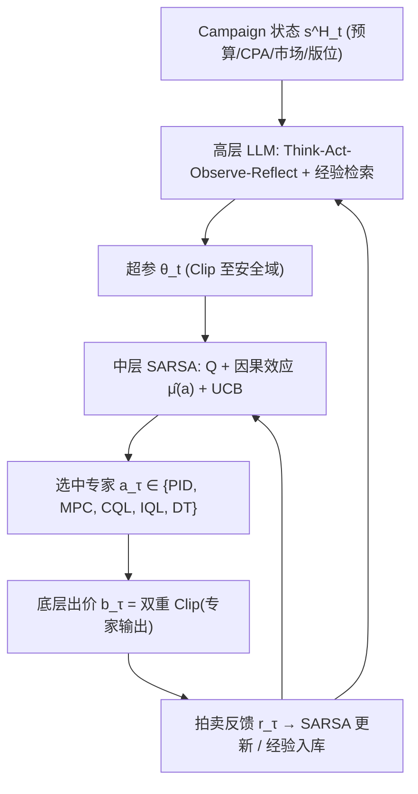
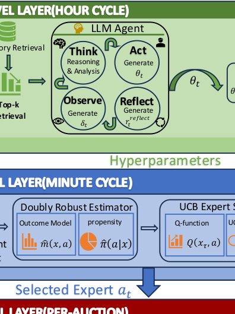

# HOBA: Hierarchical On-Policy Bidding Agents for Adaptive Online Advertising (面向自适应在线广告的分层同策略出价智能体)

- **会议/期刊**: KDD 2026 (Ads Track)
- **作者与机构**: Ji Wu, Yunshan Peng, Wentao Bai, Yunke Bai, Wenzheng Shu, Jinan Pang (通讯), Yanxiang Zeng, Xialong Liu — 快手科技
- **推荐链路定位**: 精排（出价/预算控制环节，非 CTR 打分）
- **研究方向**: 强化学习与动态探索推荐 / 对话推荐与智能体仿真
- **论文原文**: [https://arxiv.org/abs/2607.24779v1](https://arxiv.org/abs/2607.24779v1)
- **开源代码**: 暂未开源

## TL;DR (1分钟核心速览)

在线广告自动出价长期困于「安全-自适应」两难：on-policy RL 探索一次就可能几分钟烧穿预算，off-policy RL 又因分布漂移导致动作坍缩；同时出价上下界、预算 pacing 等超参需逐广告主人工调。HOBA 把出价拆成三层时间尺度——LLM 小时级推理超参、SARSA 分钟级在 5–10 个离线专家间做离散选择、专家池逐次拍卖执行——**把在线学习限制在离散专家选择而非连续出价优化**。在 AuctionNet Standard/Sparse 全预算档位取得 +3.0%~+12.1% 的 score 提升，线上 4,982 个广告主 A/B 中目标成本达成率 +3.6%、转化价值 +8.1%。

## Background & Motivation (背景与核心矛盾)

- **主流范式**: 工业界以离线训练的专家控制器（PID、MPC、CQL/IQL、Decision Transformer）作为出价器，参数部署后固定。
- **前人局限**: ① 专家参数冻结，市场非平稳（竞对策略、流量结构漂移）下无法在线响应，重训成本高；② 出价上下界、pacing 速率、探索系数需逐 campaign 人工调参，贝叶斯优化需数百次整日评估，规模化不可行。
- **核心洞察 (Key Insight)**: 直接在线学连续出价策略风险不可控（一次坏出价即耗尽日预算），但**「选哪个已验证专家」是一个只有 5–10 个动作的离散决策**——探索空间被天然压缩，安全性与自适应可以兼得。
- **本文切入点**: 用时间尺度分层把「定约束（LLM）→ 选专家（SARSA）→ 执行出价（专家池）」解耦，在线学习只发生在中层。

## Method (核心方法设计)

### 1. 整体框架 (Overall Architecture)

三层异步运行、共享式 (1) 的全局约束目标：高层 LLM 智能体以 1 小时为周期，将 campaign 状态（预算、CPA、市场、版位、历史统计）模板化为自然语言，经 Think-Act-Observe-Reflect 循环与历史经验检索生成超参 $\boldsymbol{\theta}_t$（出价上下界、响应模式、pacing 目标、探索系数），并硬裁剪至安全域；中层 SARSA 智能体每 2 分钟基于上下文 $x_\tau$ 在专家池中选一个专家，Q 值叠加因果效应与 UCB 探索项；底层专家池逐次拍卖执行出价，经双重裁剪保证满足高层约束。在线参数更新仅限中层 Q 网络，专家权重全程冻结。

<figure class="paper-figure" markdown="span">
  <figcaption>图1：HOBA 三层架构概览。高层 LLM 智能体（小时周期）通过 Think-Act-Observe-Reflect 生成超参数 𝜽𝑡；中层 SARSA 智能体（分钟周期）通过因果调整选择专家模型 𝑎𝜏；底层专家池（每次拍卖）以固定策略执行出价 𝑏𝜏。在线学习仅限于中层选择，从而确保安全适应。</figcaption>
</figure>

### 2. 关键设计拆解 (Key Designs)

1. **LLM 超参推理 + 经验记忆（把「调参」变成可解释的上下文推理）**：痛点在于超参需逐 campaign 人工调且不可解释。LLM 从记忆库 $\mathcal{D}_{mem}$ 按余弦相似度检索 top-$k$ 经验 $M_t$，先产出根因分析 $a^{think}_t$，再生成 $\boldsymbol{\theta}_t$，执行一小时后计算预测偏差 $\boldsymbol{\delta}_t$ 并自评质量分 $s_{quality}=w_1 s_{obj}+w_2 s_{acc}+w_3 s_{risk}+w_4 s_{eff}$，将 $(s^H_i,\boldsymbol{\theta}_i,o_i,r^{reflect}_i,z_i)$ 写回记忆库。有效性直觉：小时级周期天然限制了错误超参的暴露窗口，且 JSON schema + 域约束 + 回退重试三重校验把 LLM 随机性挡在出价执行之外。

2. **因果去偏的 SARSA 专家选择（核心增量）**：历史日志中专家总在「有利上下文」被选中，朴素 Q-learning 会把选择偏差误当专家能力。作者用双稳健估计器估计 $\hat{\mu}(a)=\frac{1}{N}\sum_i[\hat{m}(x_i,a)+\frac{\mathbb{I}(a_i=a)}{\hat{\pi}(a|x_i)}(r_i-\hat{m}(x_i,a))]$（XGBoost 结果模型 + 逻辑回归倾向模型，倾向裁剪 $\geq 0.05$），选择动作为
$$a_\tau=\arg\max_{a}\Big[Q(x_\tau,a)+\hat{\mu}(a)+\theta^{explore}_t\cdot\beta\sqrt{\tfrac{\log\tau}{N_\tau(a)+1}}\Big]$$
随后按 SARSA 做同策略更新 $\phi_{a_\tau}\leftarrow\phi_{a_\tau}-\alpha\nabla(Q(x_\tau,a_\tau)-[r_\tau+\gamma Q(x_{\tau+1},a_{\tau+1})])^2$。为何用 SARSA 而非 DQN：非平稳市场中 max 算子导致 Q 过估与频繁切换，同策略更新更稳（消融中切换频率 3.4/hr vs. 5.8/hr）。

3. **奖励塑形、双重裁剪与推理开销**：$r_\tau=value_\tau-\lambda\cdot cost_\tau-\mu\cdot\mathbb{I}[a_\tau\neq a_{\tau-1}]-\eta\cdot|spend\_rate_\tau-target\_rate_\tau|$（$\mu=0.1,\eta=0.05$），切换惩罚抑制抖动、pacing 惩罚守住 CPA。最终出价 $b_\tau=\text{Clip}(\text{Clip}(\tilde{b}_\tau, q_{lower}\cdot CPA, q_{upper}\cdot CPA), b_{\tau-1}\pm\Delta_t)$，第一层守高层战略界、第二层限波动（约 ±20%），保证任何专家输出都不越界。无负采样概念（非检索任务）；在线 P99 延迟 38ms（LLM 摊销 15ms + SARSA 2ms + 专家 21ms），满足 <100ms 约束。

## Experimental Setup & Evaluation Protocol (实验设置与评估协议)

- **数据集与预处理**: 采用阿里 AuctionNet 基准的两个变体，各含 500,000 条轨迹 / 10,000 episodes，每 episode 48 个离散时间步：

| 数据集 | #Episodes | #Trajectories | 步长 | 稀疏度/场景说明 |
| :--- | :---: | :---: | :---: | :--- |
| AuctionNet-Standard | 10,000 | 500,000 | 48 | 完整出价轨迹，反馈丰富 |
| AuctionNet-Sparse | 10,000 | 500,000 | 48 | 转化密度低，长程信用分配困难 |

- **数据划分与防穿越 (Splitting Strategy)**: 采用**智能体替换协议**——将 48 个时间步的智能体依次替换为候选策略，每个替换配置独立执行 30 次试验取 top-5 均值，规避训练/测试轨迹泄漏。
- **排名评测协议 (Ranking Protocol)**: 非检索式排序，采用 AuctionNet 官方 score $=\sum_i (o_i v_i)\cdot\min\{(C/CPA)^\beta,1\}$，$\beta=2$，联合优化转化价值与 CPA 达标度；预算档位 50%/75%/100%/125%/150% 五档全测。
- **对比基线与超参设置**: 规则类 PID、MPC；离线 RL 类 BCQ、CQL、IQL、DT；进阶类 HRL-Bid、BO+SARSA。HOBA 中层状态 64 维，$\alpha=0.01,\gamma=0.95,\beta=2.0$，高层 GPT-4o（temp 0.7，top-$k=3$ 检索，阈值 0.7），显著性 $p<0.05$。

## Key Experimental Results (实验关键数据)

### 1. 主实验对比 (Main Results)

| 数据集 | 预算 | IQL | DT | BO+SARSA | **HOBA** | Improv. |
| :--- | :---: | :---: | :---: | :---: | :---: | :---: |
| Standard | 50% | 195.4 | 191.8 | 206.3 | **212.5** | +3.0% |
| Standard | 100% | 305.8 | 300.2 | 323.1 | **338.2** | +4.7% |
| Standard | 150% | 422.6 | 414.9 | 446.8 | **465.1** | +4.1% |
| Sparse | 50% | 16.4 | 16.0 | 17.5 | **19.2** | +9.7% |
| Sparse | 100% | 25.5 | 24.9 | 27.2 | **30.5** | +12.1% |
| Sparse | 150% | 35.2 | 34.4 | 37.5 | **41.3** | +10.1% |

（PID/MPC/BCQ/CQL 全档位均低于上表所列，如 Standard 100% 下分别为 240.2/261.8/269.4/295.6。）

### 2. 消融实验 (Ablation Study)

| 变体 | Score | 变化 |
| :--- | :---: | :---: |
| HOBA (Full) | **338.2** | – |
| SARSA → Random | 280.3 | -17.1% |
| w/o SARSA Selection | 302.0 | -10.7% |
| w/o High-Level LLM | 314.2 | -7.1% |
| LLM → Rule-based | 315.1 | -6.8% |
| SARSA → DQN | 316.6 | -6.4% |
| Causal → Naive Avg. | 316.8 | -6.3% |
| w/o Causal Adjustment | 321.6 | -4.9% |
| LLM → Learned MLP | 322.0 | -4.8% |
| w/o Memory Retrieval | 326.0 | -3.6% |
| w/o Dynamic Experts | 329.7 | -2.5% |

### 3. 关键实验发现 (Key Findings)

1. **专家选择是最大杠杆，且无单一专家通吃**：移除 SARSA 选择掉 10.7%，退化为随机选择掉 17.1%，说明最好的单一离线专家（IQL, 305.8）在分布漂移下也显著劣于动态选择（338.2），验证了「离散选择」这一设计假设本身。
2. **稀疏场景收益翻倍，因果去偏不可省**：Sparse 下提升 +9.7%~+12.1% 远高于 Standard 的 +3.0%~+4.7%；去掉双稳健估计掉 4.9%，说明转化信号稀缺时，历史选择偏差对 Q 值的污染被放大，去偏是稀疏场景增益的主要来源。
3. **同策略优于异策略，LLM 优于规则/MLP**：SARSA→DQN 掉 6.4% 且切换频率从 3.4/hr 升至 5.8/hr，印证 max 算子在非平稳市场的过估问题；LLM→规则掉 6.8%、→MLP 掉 4.8%，说明收益来自上下文推理而非单纯参数映射。线上 Phase 2（4,982 campaigns）目标成本达成率 90.0%→93.2%（+3.6%），转化价值 $18.50M→$20.00M（+8.1%），冷启动 623 个 campaign 的 ROI 提升 +4.9%（高于 warm-start 均值 48%）。

## Highlights, Limitations & Rating (亮点、对比与审稿评价)

- **与代表作对比 (vs. Prior Work)**: 相比 HRL-Bid 的固定 manager-worker 架构，HOBA 的 manager 由 LLM 承担并具备经验记忆与反思闭环，且三层各自有独立观测空间与决策周期；相比 BO+SARSA，用 LLM 上下文推理替代 50 次离线策略评估，把调参成本降 96%；相比 CQL/IQL/DT 等纯离线 RL，不改动专家本身，只在其上做安全的选择层，规避了动作坍缩。
- **可迁移亮点**: ①「在线学习只学离散选择、连续动作交给冻结专家」这一安全范式可直接迁移到推荐系统的混排策略切换、多目标融合权重选择；②双稳健估计 + UCB 的组合可作为离线日志上做策略选择的通用去偏模板。
- **审稿级局限批判**: ① 高层依赖 GPT-4o 外部 API，成本与可用性受第三方制约，且 LLM 决策的方差虽被 Clip 兜底但未被理论刻画；② 因果模型（XGBoost + 逻辑回归）每日重训于近 7 天数据，在极稀疏 campaign（<3 转化/天，占 2.8%）上估计失效，只能回退保守策略，冷启动泛化仍靠经验而非原理保证；③ 消融显示动态专家仅贡献 2.5%，其「保险」价值缺乏针对性压力测试支撑。
- **四维评分**: 创新性 ⭐⭐⭐⭐ | 实验扎实度 ⭐⭐⭐⭐⭐ | 方法清晰度 ⭐⭐⭐⭐ | 落地价值 ⭐⭐⭐⭐⭐

