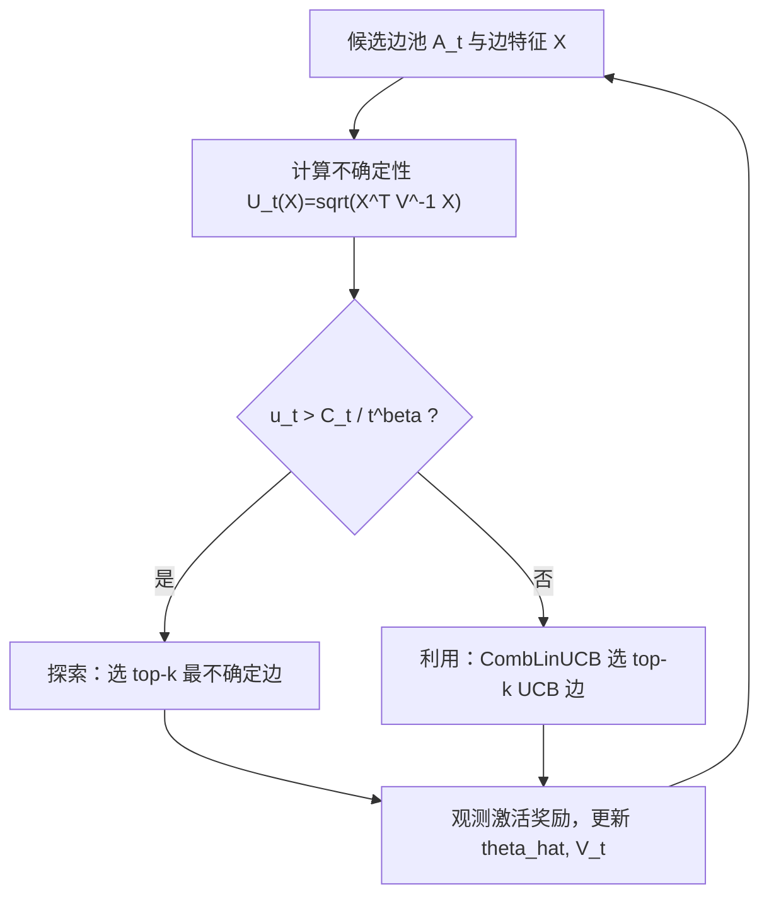
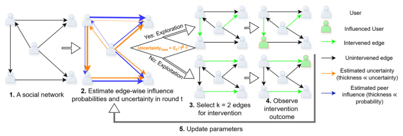

# Learning Peer Influence Probabilities with Linear Contextual Bandits (基于线性上下文 Bandit 的同伴影响力概率学习)

- **会议/期刊**: KDD 2026 (V.2)
- **作者与机构**: Ahmed Sayeed Faruk, Mohammad Shahverdikondori, Elena Zheleva (University of Illinois Chicago / EPFL)
- **推荐链路定位**: 召回/干预选择（每轮从候选边池中选 top-$k$ 边做曝光干预）
- **研究方向**: 强化学习与动态探索推荐 / 社交与群组推荐
- **论文原文**: [https://arxiv.org/abs/2510.19119v2](https://arxiv.org/abs/2510.19119v2)
- **开源代码**: [https://doi.org/10.5281/zenodo.20500085](https://doi.org/10.5281/zenodo.20500085)

## TL;DR (1分钟核心速览)

社交平台需要估计"谁影响了谁"的异质同伴影响力概率，但静态数据只能捕捉同质性与混淆带来的相关性，而标准 CMAB 只优化累积遗憾、把探索偏向高影响力边，导致全图概率估计误差大。本文把该任务建模为**双目标线性上下文 Bandit**，证明 Regret 与 RMSE 存在根本性权衡（$\text{Regret}_T\in O(T^{2\beta})$则$\text{RMSE}_T\in\Omega(T^{-\beta})$），并提出 InfluenceCB：以不确定性阈值$C/t^{\beta}$在"探索高不确定边"与"利用高奖励边"间切换。在半合成网络数据上，$\beta=0.5$ 时 RMSE 较 LinUCB 降低 59.8%–64.9%，代价是遗憾上升。

## Background & Motivation (背景与核心矛盾)

- **主流范式**: 影响力概率估计分两派——离线从级联/似然推断（易混入同质性与混淆偏差），或在线 Bandit 学习（有干预反馈但目标单一）。
- **前人局限**: ① 静态方法只能学到"推荐与行为的相关性"，无法识别真实因果影响；② CMAB 类方法（LinUCB、Takemura et al.）只最小化累积遗憾，探索被高影响力边吸走，低影响力边长期欠采样，全图 RMSE 高；③ 纯随机探索的在线学习虽能降 RMSE，却浪费干预预算且无遗憾保证。
- **核心洞察 (Key Insight)**: 遗憾最小化要求聚焦高奖励边，RMSE 最小化要求覆盖低奖励/高不确定边——二者在组合动作空间（每轮选 $k$ 条边、同时观测多条边反馈）下**不可兼得**，存在可刻画的帕累托前沿。
- **本文切入点**: 不追求单一最优策略，而是设计一个由参数 $\beta$ 控制的算法，让实践者在帕累托前沿上按业务需求取点。

## Method (核心方法设计)

### 1. 整体框架 (Overall Architecture)

每轮智能体观测候选边池 $\mathcal{A}_t$（全网采样或某节点邻居），对每条边计算不确定性$U_t(X)=\sqrt{X^\top V_{t-1}^{-1}X}$；若最大不确定性$u_t$超过动态阈值$C_t/t^{\beta}$，进入**不确定性引导探索**（选 top-$k$最不确定边），否则进入**奖励引导利用**（调用 CombLinUCB 等线性 CMAB 子程序选 top-$k$UCB 边）；观测二元激活奖励后更新$\hat{\theta}_t$与$V_t$。阈值$C_t$ 由 Algorithm 2 依据目标（RMSE 或 Regret）自适应调整。

<figure class="paper-figure" markdown="span">
  <figcaption>图1：InfluenceCB 框架的工作流程。</figcaption>
</figure>

### 2. 关键设计拆解 (Key Designs)

1. **双目标权衡的理论刻画（Regret–RMSE 下界）**：痛点在于此前无人证明"估计全图概率"与"最小化遗憾"是否可兼得。作者在固定动作池设定下证明：对任意 $M>k$，存在实例使$\text{Regret}_T\in O(T^{2\beta})$时必有$\text{RMSE}_T\in\Omega(T^{-\beta})$，$\beta\le 1/2$且由遗憾下界$\beta\ge 1/4$。直觉：遗憾最优（$\beta=1/4$）迫使 RMSE 退化为$T^{-1/4}$；RMSE 最优（$\beta=1/2$）则遗憾线性增长。这为"可调前沿"提供了必要性依据。
2. **不确定性阈值切换机制（InfluenceCB 核心算子）**：标准 CMAB 无第二目标，故引入阈值门控。当 $u_t>C_t/t^{\beta}$时强制探索最不确定的$k$条边，保证每条边不确定性以$O(T^{-\beta})$衰减，从而$\text{RMSE}_T\in\tilde{O}(T^{-\beta})$；否则交由 CombLinUCB 保证$\text{Regret}_T\in\tilde{O}(T^{2\beta})$。$C$越大越偏利用（遗憾降、RMSE 升），$\beta$ 决定前沿上的位置。
3. **训练目标、负采样与推理效率**：无显式损失函数，采用岭回归闭式更新 $V_t=\lambda I+\sum_{s\le t}\sum_{r=1}^{k}X_{s,r}X_{s,r}^\top$、$\hat{\theta}_t=V_t^{-1}\sum r_{s,r}X_{s,r}$；奖励为伯努利激活（免负采样）。每轮复杂度$O(|\mathcal{A}_t|d^2)$，仅与候选池规模相关而非全图规模，$d=256$ 时单轮开销可控。

## Experimental Setup & Evaluation Protocol (实验设置与评估协议)

- **数据集与预处理**: 三个真实属性网络，边特征 = 两端节点 SVD 属性（64 维）+ GraphSAGE 结构嵌入（64 维）拼接，共 256 维；真值概率由线性模型 $p=\sigma(w^\top X)$ 合成（另设非线性误设实验）。

| 数据集 | #Users | #Edges | 属性维度 | 场景说明 |
| :--- | :---: | :---: | :---: | :--- |
| BlogCatalog | 5,196 | 343,486 | 8,189 | 博客社交关注网络 |
| Flickr | 7,575 | 479,476 | 12,047 | 照片分享关注网络 |
| Hateful | 100,386 | 2,194,979 | 1,036 | Twitter 转发关系网络 |

- **数据划分与防穿越**: 反事实模拟——每轮按算法所选 top-$k$实现事实奖励，未选中的最优 top-$k$ 为反事实；另随机留出 500 条边专用于 RMSE 无偏评估。
- **排名评测协议**: 每轮从全网随机采样 200 条边构成候选池（network-based），或取某随机节点邻居池（neighbor-based）；$k\in\{5,10,15,20,25\}$，主表$k=5$，10 次重复取均值。指标含$\text{Regret}_T$、$\text{RMSE}_T$、ECE、NDCG@$k$。
- **对比基线与超参**: 静态（Random/Similarity/Ridge/GraphSAGE/NCNC/ContextGNN）、在线（SGD-Explore/SGD-Exploit）、Bandit（LinUCB $\alpha=2.0$、EENet、GNB、Takemura et al.）；$\beta\in\{0.25,0.5\}$，消融固定$C\in\{1,3,5,7,9\}$。

## Key Experimental Results (实验关键数据)

### 1. 主实验对比 (Main Results)

$k=5$、network-based 设定（越低越好）：

| 方法 | Flickr Regret | Flickr RMSE | BlogCatalog Regret | BlogCatalog RMSE | Hateful Regret | Hateful RMSE |
| :--- | :---: | :---: | :---: | :---: | :---: | :---: |
| Random | 5428 | 0.3296 | 5419 | 0.3018 | 73226 | 0.2981 |
| Link Pred. (Ridge) | 5090 | 0.1066 | 6426 | 0.1810 | 42384 | 0.1848 |
| ContextGNN | 4650 | 0.2550 | 4800 | 0.2250 | 40500 | 0.3950 |
| LinUCB | 2165 | 0.0632 | 1275 | 0.0993 | 5979 | 0.0156 |
| GNB | 1314 | 0.0719 | 1586 | 0.0945 | 8669 | 0.0417 |
| Takemura et al. | **952** | 0.0681 | **912** | 0.0990 | **2829** | 0.0267 |
| SGD-Exploit | 822 | 0.1006 | 1015 | 0.1007 | 9441 | 0.0924 |
| InfluenceCB(0.25, Regret) | 2083 | 0.0659 | 1202 | 0.1006 | 5917 | 0.0160 |
| InfluenceCB(0.25, RMSE) | 2686 | 0.0414 | 1372 | 0.0605 | 13179 | 0.0092 |
| InfluenceCB(0.50, Regret) | 4443 | 0.0254 | 1994 | 0.0500 | 46561 | 0.0062 |
| InfluenceCB(0.50, RMSE) | 6271 | **0.0222** | 3719 | **0.0354** | 74399 | **0.0061** |

相对 LinUCB：Flickr 上 $(0.25,\text{RMSE})$降 RMSE **34.5%**（遗憾 +24.1%）；$(0.50,\text{RMSE})$ 降 RMSE **64.9%**（遗憾 +189.7%）；BlogCatalog 上分别降 **39.1%** / **64.4%**；Hateful 上降 **41.0%** / **60.9%**。

### 2. 消融实验 (Ablation Study)

固定 $C$扫描（$\beta=0.25$，$C$ 从 1→9）：

| 配置 | Flickr Regret | Flickr RMSE | BlogCatalog Regret | BlogCatalog RMSE |
| :--- | :---: | :---: | :---: | :---: |
| $C=1$ | 高 | **最低** | 高 | **最低** |
| $C=3$ | **最低** | 中 | **最低** | 中 |
| $C=9$ | 降 53.7% | 升 142.1% | 降 57.5% | 升 136.7% |
| 去掉探索（=LinUCB） | 2165 | 0.0632 | 1275 | 0.0993 | 

$\beta=0.5$时$C=9$遗憾最低、$C=5$RMSE 最低；$C$ 从 1→9 使 Flickr/BlogCatalog 遗憾降 37.6%/60.2%、RMSE 升 21.2%/34.7%。

### 3. 关键实验发现 (Key Findings)

1. **权衡真实存在且可调**：$\beta$从 0.25 升到 0.5，Flickr RMSE 从 0.0659 骤降至 0.0254（降 61%），但遗憾从 2083 涨到 4443（翻倍），与 Theorem 4.2 的$T^{2\beta}$vs$T^{-\beta}$ 预测方向一致。
2. **静态与纯探索基线全面落后**：所有静态模型 RMSE 在 0.10–0.50 区间，远高于 InfluenceCB(0.5) 的 0.022–0.035；SGD-Explore 虽 RMSE 尚可（0.077–0.123）但遗憾高达 5425+，验证"随机探索浪费预算"。
3. **$k$与$C$的敏感性有方向性**：$\beta=0.5$时$k$增大使 RMSE 收益递减而遗憾代价上升，权衡在小$k$最优；$\beta=0.25$时对$k$ 不敏感，说明低遗憾模式更鲁棒，便于部署时按预算选点。

## Highlights & Limitations (亮点、对比与审稿批判)

- **与代表作对比 (vs. Prior Work)**: 相比 Takemura et al.（只追紧遗憾界，RMSE 0.068/0.099/0.027 且无估计目标）与 LinUCB（遗憾尚可但 RMSE 高），本文首次把"全图概率估计"作为独立第二目标并给出下界；相比静态 ContextGNN/NCNC，本文用在线干预获得因果性而非相关性。
- **可迁移亮点**: ① "不确定性阈值门控 + 任意 CMAB 子程序"的插件式结构，可直接套到冷启动物品探索、跨域边选择等双目标场景；② 用 $\beta$ 单参数在帕累托前沿取点的思路，适合线上按 A/B 预算动态调参。
- **审稿级局限批判**: ① 理论仅在固定动作池、固定 $C$下成立，自适应$C_t$与变动池只给出常数因子论证，缺完整证明；② 实验全为半合成（线性真值），真实扩散中的多邻居累积暴露/网络干扰未建模，且$d=256$下每轮$O(|\mathcal{A}_t|d^2)$ 在百万边图上仍需近似。

## Rating (四维评分)

- **方法创新性 (Novelty)**: ⭐⭐⭐⭐ （首次将影响力概率学习形式化为双目标 Bandit 并给出 Regret–RMSE 不可兼得的下界，理论贡献扎实）
- **评估协议与实验扎实度 (Protocol & Experiments)**: ⭐⭐⭐ （三数据集 + 反事实模拟 + 留出边无偏评估较规范，但全为半合成、缺真实 A/B 与显著性检验）
- **写作与数学规范度 (Clarity & Rigor)**: ⭐⭐⭐⭐ （定理、证明草图与算法伪码完整，权衡直觉解释清晰；自适应部分理论留白略遗憾）
- **工业落地与复现价值 (Industrial & Practical Value)**: ⭐⭐⭐⭐ （代码已开源，插件式结构易接入现有 Bandit 系统，复杂度仅依赖候选池规模，适合病毒营销/社交推荐干预）

