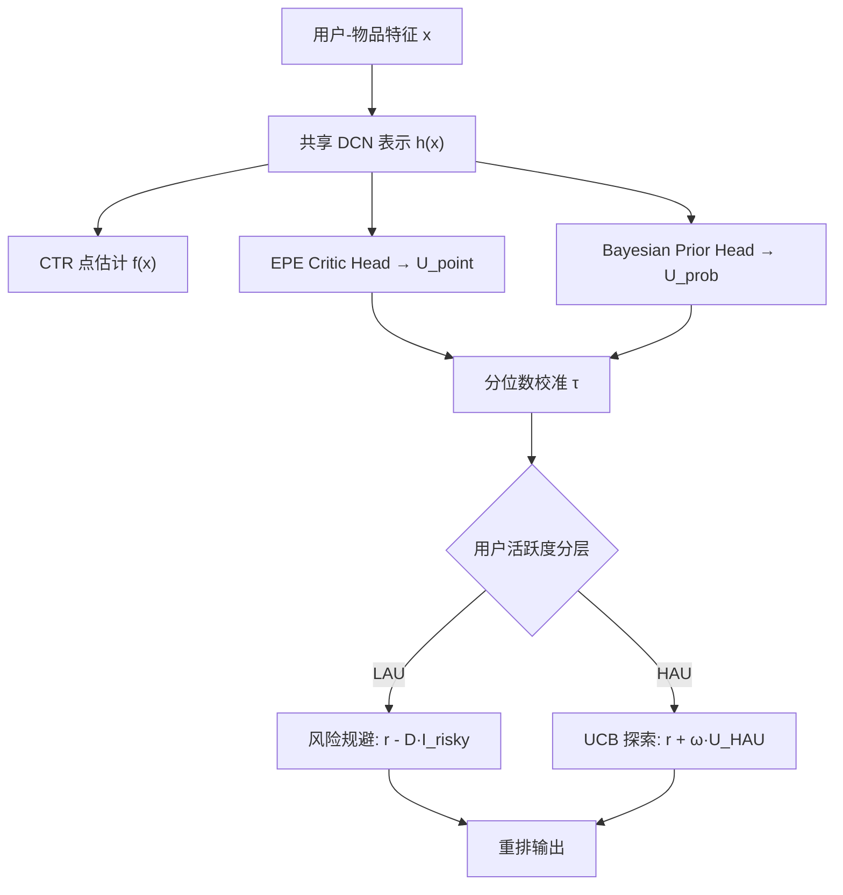
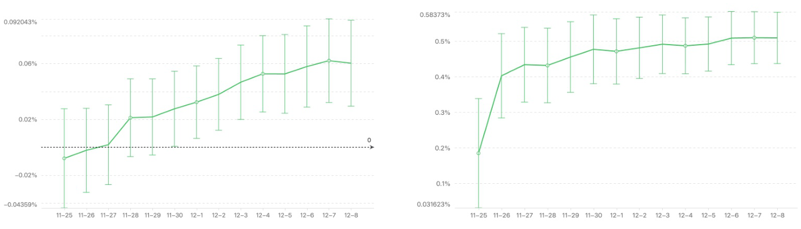

# Uncertainty-Aware Adaptive Recommendation across User Lifecycle (面向用户生命周期的无偏不确定性自适应推荐)

- **会议/期刊**: KDD 2026 (ADS Track)
- **作者与机构**: Bob Junyi Zou (Stanford)、Sai Li、Tianyun Sun、Wentao Guo、Qinglei Wang (ByteDance)
- **推荐链路定位**: 重排（排序分数后处理：降权 / 探索加成）
- **研究方向**: 强化学习与动态探索推荐 / 冷启动与长尾推荐
- **论文原文**: [https://arxiv.org/abs/2605.17788v2](https://arxiv.org/abs/2605.17788v2)
- **开源代码**: 暂未开源

## TL;DR (1分钟核心速览)

大规模短视频/直播排序模型只输出点估计，缺乏可操作的置信度信号：低活跃用户（LAU）被高不确定性的错误推荐击中即流失，高活跃用户（HAU）则因过度收敛而兴趣窄化。本文提出统一的不确定性量化框架——用辅助 Critic 网络回归逐样本期望预测误差（EPE），用经验贝叶斯 Beta 先验方差刻画分布型认知不确定性，再经分位数校准得到阈值，对 LAU 做风险规避降权、对 HAU 做 UCB 探索加成。在字节直播平台 14 天线上 A/B 中，LAU 的 HLT7 +0.0577%、有价值观看时长占比 +0.512%，HAU 的 Show Tag/U +2.1%。

## Background & Motivation (背景与核心矛盾)

- **主流范式**: 工业级 DCN/CTR 排序模型输出确定性点估计，不确定性要么靠 MC Dropout 多次前向、要么靠 Conformal Prediction 全局区间来近似。
- **前人局限**: (i) 贝叶斯采样类方法（MC Dropout、深度集成）需多次随机前向，高并发实时排序下延迟不可接受；(ii) Conformal Prediction 只给全局平均误差保证，无法区分"某个视频对某个用户是否危险"，相对排序不变，对个性化过滤无效。
- **核心洞察 (Key Insight)**: 认知不确定性（epistemic）对 LAU 是**风险**（数据稀疏导致预测脆弱），对 HAU 是**探索机会**（模型尚未覆盖的兴趣区域）。同一信号，两种用法。
- **本文切入点**: 绕开重采样，用"预测误差的预测器"（Critic）与输入相关先验方差直接给出逐 user-item 的细粒度不确定性，再按用户活跃度分层施加相反方向的排序干预。

## Method (核心方法设计)

### 1. 整体框架 (Overall Architecture)

框架挂在既有 DCN 排序模型之上，共享底层特征表示，并行接两个轻量头：EPE Critic Head（MSE 回归期望预测误差）与 Bayesian Prior Head（输出 Beta 分布参数，取先验方差为认知不确定性）。离线用留出集按分位数校准出阈值 $\tau_{point},\tau_{prob}$；线上服务时按用户活跃度分流：LAU 若任一不确定性超阈值则扣减分数$D$，HAU 则加上$\omega\cdot U_{HAU}$ 的探索奖励，最后统一排序。Critic 训练时冻结主模型，用"前一日 checkpoint 在当日样本上的真实误差"作标签，避免反馈回路。

### 2. 关键设计拆解 (Key Designs)

1. **EPE Critic：把"模型会不会错"变成一个可回归的标量**：点估计模型无置信度，本文定义逐样本期望预测误差 $\mathrm{EPE}(x)=\mathbb{E}_\Theta\mathbb{E}_{Y|x}[\ell(Y,f_\Theta(x))]$，平方损失下可分解为模型偏差 + 模型方差 + 数据噪声三项。Critic 输入拼接外部特征、中间嵌入与最终输出$z_\Theta(x)=[x\,\|\,h_\Theta(x)\,\|\,f_\Theta(x)]$，以历史 checkpoint 的真实泛化误差$e_j^{(k)}=\ell(y_j^{(k)},f_{\Theta^{(k-1)}}(x_j^{(k)}))$ 为标签做 MSE 回归。直觉：让网络学会"在哪些输入上自己容易翻车"，且只需一次前向，零额外延迟。

2. **经验贝叶斯先验方差：不采样也能拆出认知不确定性**：概率模型输出输入相关的先验 $p(\theta|\gamma(x))$，由全方差公式$\mathrm{Var}(Y|x)=\mathbb{E}_{\theta|x}[\mathrm{Var}(Y|\theta)]+\mathrm{Var}_{\theta|x}(\mathbb{E}[Y|\theta])$拆为数据噪声与模型不确定性，取后者$U_{prob}(x)\equiv\mathrm{Var}_{\theta|x}(\mathbb{E}[Y|\theta])$。实现上用 Beta 先验$\theta\sim\mathrm{Beta}(\alpha(x),\beta(x))$，$\alpha=1+\mathrm{softplus}(u(x))$、$\beta=1+\mathrm{softplus}(v(x))$，闭式方差$U_{prob}=\frac{\alpha\beta}{(\alpha+\beta)^2(\alpha+\beta+1)}$，训练用 type-II 最大边际似然。直觉：边际化潜变量天然保留参数不确定性，且计算量与普通头无异。

3. **分层排序干预与训练目标**：LAU 侧 $r^{final}_{u,i}=r_{u,i}-D\cdot\mathbb{I}[U_{point}>\tau_{point}\ \text{or}\ U_{prob}>\tau_{prob}]$；HAU 侧$r^{final}_{u,i}=r_{u,i}+\omega\cdot\max(U_{point},U_{prob})$，遵循"面对不确定性要乐观"的 UCB 原则。阈值取校准集$q=0.95$分位数，$D,\omega$ 由线上 A/B 调参；无负采样环节（非召回任务），推理开销仅为两个轻量 MLP 头。

## Experimental Setup & Evaluation Protocol (实验设置与评估协议)

- **数据集与预处理**: 某大型直播平台匿名生产流量，无公开统计量；按活跃天数分层——月活跃观看 <7 天为 LAU，≥7 天为 HAU（该分层同时用于控制组内数据噪声近似一致，使 EPE 可比）。

| 数据集 | #Users | #Items | #Interactions | 稀疏度/密度 | 特征/场景说明 |
| :--- | :---: | :---: | :---: | :---: | :--- |
| 生产直播流量 | 未披露 | 未披露 | 未披露 | 未披露 | 直播 CTR/时长，LAU vs HAU 分层 |

- **数据划分与防穿越 (Splitting Strategy)**: 按日滚动训练；Critic 标签严格使用"未见过当日样本的上一日 checkpoint"计算误差，天然防穿越；另设留出校准集做分位数阈值。
- **排名评测协议 (Ranking Protocol)**: 离线用 AURC（风险-覆盖率曲线下面积）、Pearson/Spearman 相关性、以及"不确定性分桶 vs 线上实测 MSE"的单调性 sanity check；线上为 14 天 cohort 分流 A/B，指标含 HLT7、VWR、App Stay Duration、Live Watch Time、HLT-efficiency、Show Tag/U、Top1 Tag UV Ratio，显著性 $p<0.05$。
- **对比基线与超参设置**: 基线为 Multi-head Ensemble（共享嵌入与 cross 层，末端分 $H=10$头取头间方差）与 MC Dropout（$p=0.1$，$T=10$ 次前向）；主模型为 DCN，不确定性头共享特征表示。

## Key Experimental Results (实验关键数据)

### 1. 主实验对比 (Main Results)

离线不确定性估计质量（表 1）：

| 方法 | Pearson ↑ | Spearman ↑ | AURC ↓ |
| :--- | :---: | :---: | :---: |
| **Critic-Predicted EPE** | 0.3335 | 0.6695 | **0.0157** |
| **Bayesian Model** | **0.3733** | **0.6881** | 0.0162 |
| Multi-head Ensemble | 0.0346 | 0.2760 | 0.0205 |
| MC Dropout | 0.0469 | 0.1887 | 0.0219 |

线上 A/B（LAU 侧，相对生产基线提升）：

| 策略 | HLT7 | VWR | App Stay | Live Watch | HLT-eff. |
| :--- | :---: | :---: | :---: | :---: | :---: |
| **Unified (EPE+Bayes)** | **+0.0577%** | **+0.512%** | +0.16% | -1.05% | **0.0549** |
| Only EPE | +0.0434% | +0.08% | +0.12% | -1.07% | 0.0404 |
| Only Bayesian | +0.0468% | +0.3357% | +0.14% | -0.95% | 0.0491 |
| Multi-head Ensemble | +0.0188%† | +0.0312% | +0.10% | -0.81% | 0.0232 |
| MC Dropout | +0.0360%† | +0.25% | +0.07% | -0.77% | 0.0471 |
| Random | +0.0029%† | -0.0168% | +0.10% | -2.38% | 0.0012 |

HAU 侧探索效果：

| 策略 | Show Tag/U | Top1 Tag UV Ratio | Live Watch |
| :--- | :---: | :---: | :---: |
| **Unified (EPE+Bayes)** | **+2.1%** | **-0.42%** | +0.16%† |
| Only EPE | +1.0% | -0.55% | +0.07%† |
| Only Bayesian | +0.9% | -0.85% | +0.03%† |
| Multi-head Ensemble | +0.82% | -0.54% | +0.09%† |
| MC Dropout | +0.7% | -0.10% | -0.20%† |
| Random | +0.16% | +3.30% | -1.62%† |

（† 表示 $p>0.05$ 不显著）

### 2. 消融实验 (Ablation Study)

见上两表：移除任一不确定性头（Only EPE / Only Bayesian）均使 HLT7 与 VWR 双双回落；替换为结构启发式（Multi-head、MC Dropout）增益显著缩水；随机伪不确定性基线近乎归零甚至为负，证明收益来自信号质量而非干预动作本身。

### 3. 关键实验发现 (Key Findings)

1. **两个不确定性头互补而非冗余**：EPE Critic 在 AURC 上最优（0.0157 vs 0.0162），更擅长即时风险判别；Bayesian 先验方差在 VWR 上贡献更大（单独 +0.3357% vs EPE 单独 +0.08%），二者合并才拿到 +0.512% 的 VWR 峰值。
2. **结构启发式在工业 DCN 上失效**：Multi-head 集成与 MC Dropout 的 Spearman 仅 0.276/0.189，远低于本文的 0.67/0.69，线上 HLT7 提升也不显著（+0.0188%†、+0.0360%†），说明共享表示下的"模态同质化"使头间分歧不携带有效认知风险信息。
3. **降权是"剪枝"而非"缩量"**：Live Watch Time 仅 -1.05%，但 HLT-efficiency 达 0.0549（约为 MC Dropout 的 1.17 倍、Multi-head 的 2.4 倍），即以极小被动时长换取显著留存；HAU 侧 Show Tag/U +2.1% 且 Live Watch 无显著变化，证明探索加成不以牺牲消费为代价。

<figure class="paper-figure" markdown="span">
  <figcaption>图2：A/B 测试结果：14 天内每日累计提升，95% 置信区间。(a) HLT7 的结果。(b) 有价值观看时长占比的结果。</figcaption>
</figure>

## Highlights & Limitations (亮点、对比与审稿批判)

- **与代表作对比 (vs. Prior Work)**: 相比 MC Dropout（$T$ 次前向、延迟不可接受）与 Conformal Prediction（全局阈值、排序不变），本文以单次前向的 Critic + 闭式 Beta 方差实现逐样本细粒度估计；相比 CREU 等冷启动不确定性工作，本文首次把同一不确定性信号按用户生命周期**反向使用**（LAU 规避、HAU 探索），并给出 14 天线上证据。
- **可迁移亮点**: (i) "用上一日 checkpoint 在当日样本上的真实误差作 Critic 标签"的防泄漏训练范式，可直接迁移到任何日更排序系统的置信度建模；(ii) 分位数校准 + 分层干预的解耦设计，使阈值与干预强度可独立 A/B 调参，工程上极易灰度。
- **审稿级局限批判**: (i) 评估高度依赖线上间接指标，认知不确定性本身无 ground-truth，离线仅靠相关性/单调性 sanity check 支撑，缺乏公开数据集复现；(ii) Beta 先验对多模态复杂行为可能过简，且 LAU 内部异质子群未细分，对直播场景的突发分布漂移敏感；降权带来的长期数据获取损失（探索-利用的跨期权衡）未做建模。

## Rating (四维评分)

- **方法创新性 (Novelty)**: ⭐⭐⭐⭐ （核心机制与方法设计具备明确创新性，理论与实验动机支撑充分）
- **评估协议与实验扎实度 (Protocol & Experiments)**: ⭐⭐⭐⭐ （主流公开数据集评测完整，包含多基线对比与消融实验验证）
- **写作与数学规范度 (Clarity & Rigor)**: ⭐⭐⭐⭐⭐ （问题形式化定义清晰，核心模块数学推导与架构阐述严谨易读）
- **工业落地与复现价值 (Industrial & Practical Value)**: ⭐⭐⭐⭐⭐ （兼顾推荐效果增益与训练/推理效率，具备实际场景迁移参考价值）
