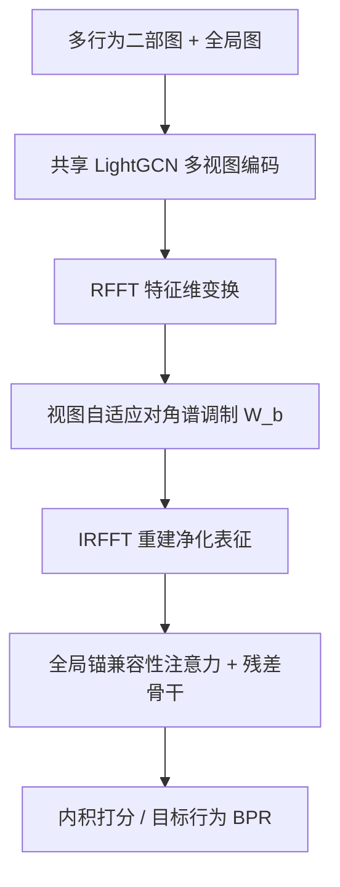
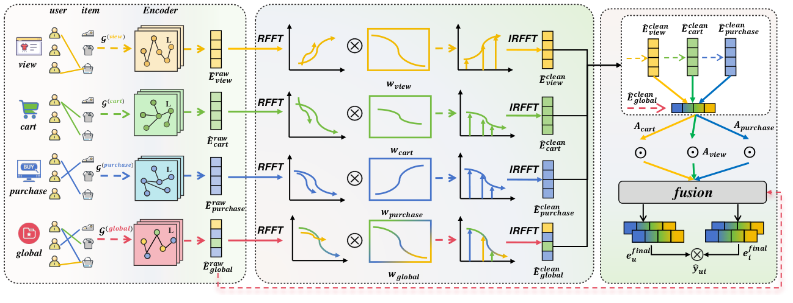

# Dynamic Spectral Denoising with Global-Context Attention for Multi-Behavior Recommendation (面向多行为推荐的动态谱去噪与全局上下文注意力)

- **会议/期刊**: KDD 2026 (V.2)
- **作者与机构**: Miaomiao Cai, Yunshan Ma, Junfeng Fang, See-Kiong Ng (NUS / SMU)；Fangqi Zhu, Zhijie Zhang, Zhiyong Cheng (合肥工业大学)；Xiang Wang (中国科学技术大学)
- **推荐链路定位**: 精排（目标行为打分）
- **研究方向**: 自监督对比学习与交互去噪 / 图神经网络推荐
- **论文原文**: [https://arxiv.org/abs/2606.02417v1](https://arxiv.org/abs/2606.02417v1)
- **开源代码**: [https://github.com/miaomiao-cai2/SpectraMB-KDD2026](https://github.com/miaomiao-cai2/SpectraMB-KDD2026)

## TL;DR (1分钟核心速览)

多行为推荐（MBR）的鲁棒性瓶颈被作者重新定义为**表征级失效**：多跳传播把偶然信号与真实偏好纠缠进同一批隐维度（行为内纠缠），而辅助行为的预测可靠性又随用户/上下文剧烈波动（行为间异质）。SpectraMB 提出"先净化、后融合"：沿**嵌入特征维**做 RFFT，学习视图自适应的对角谱调制器在频域逐分量抑制扰动；再以净化后的全局表征为锚，做节点级、维度级的跨行为竞争注意力，并保留原始全局残差稳住协同几何。在 Taobao/TMall/MovieLens-10M 三数据集、全库排序协议下，Taobao HR@10 相对最强基线提升 26.17%，NDCG@10 提升 25.40%，且在 20% 随机边噪声下性能几乎不衰减。

## Background & Motivation (背景与核心矛盾)

- **主流范式**: 图式 MBR 为每种行为建二部图，用 LightGCN 类消息传递编码后做视图级融合（加权/级联/解耦/对比/不变学习），去噪基本都在**空间域**完成——平滑、剪枝、门控或视图级正则。
- **前人局限一（行为内纠缠）**: 多跳聚合后，偶然点击与真实偏好被混入同一批隐维度；而空间域中"稀疏但真实的细分兴趣"与"偶然噪声边"在拓扑上高度相似（都是弱支撑的孤立边），平滑/剪枝无法只杀噪声而不伤弱信号。
- **前人局限二（行为间可靠性异质）**: view 对某些用户强预示购买、对另一些只是闲逛；固定权重或简单拼接会被"高频但不可靠"的辅助行为主导，造成目标意图漂移。更糟的是，一旦 view 表征被污染，可靠性估计本身就不稳，精巧的加权也会失效。
- **核心洞察 (Key Insight)**: 随机扰动在频域表现为高频散乱分量，而一致的偏好趋势是低频连续结构——**换基（basis）比换滤波算子更关键**。ID 嵌入没有人类可解释的维度语义，因此沿特征维做 FFT 只是可逆的基变换，不破坏任何先验。
- **本文切入点**: 把净化从空间域搬到**特征-频率域**，在目标监督下端到端学习"哪些频率分量该压、哪些该留"，再用净化后的全局锚做可靠性校准融合。

## Method (核心方法设计)

### 1. 整体框架 (Overall Architecture)

输入为行为集 $\mathcal{B}=\mathcal{B}_{aux}\cup\{target\}$上的多视图二部图（每个行为一张图 + 一张任意行为有边即连的全局图），共享参数的 LightGCN 逐层均值池化得到各视图原始空间表征$\mathbf{E}^{raw}_{b}$与$\mathbf{E}^{raw}_{global}$。随后进入两段式净化-融合：先对每个视图沿特征维做 RFFT，乘上视图专属的对角谱调制器，再 IRFFT 回到空间域得到$\mathbf{E}^{clean}_{b}$；然后以$\mathbf{E}^{clean}_{global}$为上下文锚计算每个行为的兼容性注意力，按节点、按维度归一化后加权求和，并叠加$\alpha\mathbf{E}^{raw}_{global}$ 残差骨干。最终以内积打分、仅用目标行为 BPR 损失端到端训练。

<figure class="paper-figure" markdown="span">
  <figcaption>图 2：SpectraMB 概览。用于稳健多行为推荐的谱净化与全局上下文注意力。</figcaption>
</figure>

### 2. 关键设计拆解 (Key Designs)

1. **动态特征级谱滤波 (Dynamic Feature-Level Spectral Filtering)**：痛点是空间域粗粒度去噪分不清弱信号与噪声边。做法是把每个节点的嵌入 $\mathbf{e}\in\mathbb{R}^{d}$视为沿特征维的实值离散信号，用 RFFT 保留$d_f=\lfloor d/2\rfloor+1$ 个非冗余频点（由共轭对称性决定，非超参），再在频域做对角线性调制：

$$\hat{\mathbf{E}}^{clean}_{b}=\hat{\mathbf{E}}^{raw}_{b}\mathbf{W}_{b},\qquad \mathbf{E}^{clean}_{b}=\mathrm{IRFFT}\big(\hat{\mathbf{E}}^{clean}_{b}\big)$$

其中 $\mathbf{W}_{b}\in\mathbb{R}^{d_f\times d_f}$ 为对角阵，梯度只来自目标行为排序损失。直觉：FFT 把纠缠的空间扰动摊开成可分离的频率分量，噪声与语义在该基下足够可分，因此一个参数极省的线性缩放就够用——瓶颈在"基"而非"滤波算子复杂度"。

2. **全局上下文注意力融合 (Global-Context Attention Fusion)**：痛点是辅助行为可靠性随用户/上下文变化，静态融合被高频噪声主导。做法是以净化后的全局表征为稳定锚，逐行为计算兼容性并做**节点级 + 维度级** softmax 竞争：

$$\mathbf{S}_{b}=\tanh\big(\mathbf{E}^{clean}_{global}\mathbf{W}^{(b)}_{g}+\mathbf{E}^{clean}_{b}\mathbf{W}^{(b)}_{b}+\mathbf{v}^{(b)}\big),\quad (\mathbf{A}_{b})_{v,k}=\frac{\exp((\mathbf{S}_{b})_{v,k})}{\sum_{b'}\exp((\mathbf{S}_{b'})_{v,k})}$$

最终 $\mathbf{E}^{final}=\sum_{b}\mathbf{A}_{b}\odot\mathbf{E}^{clean}_{b}+\alpha\mathbf{E}^{raw}_{global}$。维度级归一化迫使各行为在**每个语义维度**上竞争，而非按交互频次抢占整体权重；残差项保留空间传播得到的协同拓扑，防止融合过度扭曲几何结构。

3. **训练目标、负采样与推理效率**：仅用目标行为监督，BPR 损失 $\mathcal{L}=\sum_{(u,i,j)\in\mathcal{O}}-\ln\sigma(\hat{y}_{ui}-\hat{y}_{uj})+\lambda\|\Theta\|_2^2$，负样本为目标行为下未观测物品的均匀采样。作者明确反对多任务辅助损失：辅助行为本身含大量假阳性，拟合它们与去噪目标直接矛盾，故辅助行为只作**上下文证据**而非优化目标。复杂度为$O(L\cdot|\mathcal{E}_{\Sigma}|\cdot d+K\cdot|\mathcal{V}|\cdot d\log d+|\mathcal{B}|\cdot|\mathcal{V}|\cdot d^2)$，无需大图特征分解；TMall 上仅 27 轮收敛（LightGCN 66 轮、SimGCL 200 轮），单轮训练 110.71s 远低于 SimGCL 的 784.63s。

## Experimental Setup & Evaluation Protocol (实验设置与评估协议)

- **数据集与预处理**: 二值化隐式反馈、去重、同一 (u,i) 同行为仅保留最早一次；MovieLens-10M 的 1–5 分按区间映射为 dislike/neutral/like 三种行为，like 为目标行为。

| 数据集 | #Users | #Items | #View | #Collect | #Cart | #Purchase |
| :--- | :---: | :---: | :---: | :---: | :---: | :---: |
| Taobao | 48,749 | 39,493 | 1,548,162 | - | 193,747 | 259,771 |
| TMall | 41,738 | 11,953 | 1,813,498 | 221,514 | 1,996 | 287,158 |
| MovieLens-10M | 67,788 | 8,704 | 1,370,897 (Dislike) | 3,580,155 (Neutral) | 4,970,984 (Like) | — |

- **数据划分与防穿越**: 采用与 MBGCN/MB-CGCN 一致的**留一法式目标行为划分**（每位用户最后一个目标交互作测试），所有图仅用训练交互构建，避免未来信息泄漏。
- **排名评测协议**: 无偏 **Full-Ranking（全库未交互物品排序）**，指标 HR@{10,20} 与 NDCG@{10,20}，规避采样负例偏差。
- **对比基线与超参设置**: 单行为基线 LightGCN、SimGCL；多行为基线 MBGCN、MB-CGCN、PKEF、BCIPM、S-MBRec、MISSL、DeMBR、UIPL、MBID，共 11 个。统一 $d=64$、$L=2$传播层，Adam 优化；$\alpha$在$[0.1,2.0]$步长 0.1 网格搜索；提升标注$p<0.05$ 显著性。

## Key Experimental Results (实验关键数据)

### 1. 主实验对比 (Main Results)

| 数据集 | 指标 | LightGCN | SimGCL | MB-CGCN | PKEF | BCIPM | DeMBR | UIPL | MBID | **SpectraMB** | Improv. |
| :--- | :--- | :---: | :---: | :---: | :---: | :---: | :---: | :---: | :---: | :---: | :---: |
| Taobao | HR@10 | 0.0253 | 0.0400 | 0.0989 | 0.1098 | 0.1257 | 0.1083 | 0.1225 | 0.0784 | **0.1586*** | +26.17% |
| Taobao | NDCG@10 | 0.0137 | 0.0236 | 0.0471 | 0.0627 | 0.0708 | 0.0673 | 0.0748 | 0.0412 | **0.0938*** | +25.40% |
| Taobao | NDCG@20 | 0.0178 | 0.0265 | 0.0595 | 0.0651 | 0.0833 | 0.0760 | 0.0834 | 0.0497 | **0.1041*** | +24.82% |
| TMall | HR@10 | 0.0379 | 0.0709 | 0.1083 | 0.1138 | 0.1401 | 0.1227 | 0.1422 | **0.1536** | 0.1468 | −4.43% |
| TMall | NDCG@10 | 0.0205 | 0.0399 | 0.0426 | 0.0642 | 0.0738 | 0.0723 | 0.0770 | 0.0655 | **0.0793*** | +2.99% |
| TMall | NDCG@20 | 0.0231 | 0.0487 | 0.0523 | 0.0562 | 0.0885 | 0.0782 | 0.0900 | 0.0780 | **0.0929*** | +3.22% |
| ML-10M | HR@10 | 0.0660 | 0.0695 | 0.0619 | 0.0591 | 0.0782 | 0.0685 | 0.0791 | 0.0327 | **0.0801*** | +1.26% |
| ML-10M | NDCG@10 | 0.0317 | 0.0338 | 0.0292 | 0.0264 | 0.0362 | 0.0321 | 0.0373 | 0.0218 | **0.0382*** | +2.41% |

### 2. 消融实验 (Ablation Study)

| 变体 | Taobao HR@10 | Taobao NDCG@10 | TMall HR@10 | TMall NDCG@10 |
| :--- | :---: | :---: | :---: | :---: |
| Full SpectraMB | **0.1586** | **0.0938** | **0.1468** | **0.0793** |
| w/o Spectral | −6.9% | −6.2% | −10.0% | −10.9% |
| w/o Attention (均值池化) | −16.8% | −16.8% | −10.4% | −10.9% |
| w/o View | 大幅下降 | 大幅下降 | −59.3% | −55.9% |
| w/o Cart | 影响极小 | 影响极小 | 影响极小 | 影响极小 |

谱滤波策略对比（表 4）：All-Pass 在 Taobao HR@10 下降 7.8%、TMall 下降 10.2%；Low-Pass / High-Pass 固定频带掩码在 Taobao 上暴跌超 37%，TMall 上约 −30%，说明刚性频带先验极其脆弱。

### 3. 关键实验发现 (Key Findings)

1. **"换基"本身不是收益来源，可学习调制才是**：All-Pass（只做 RFFT/IRFFT 不调制）在 Taobao 掉 7.8%、TMall 掉 10.2%，而固定低通/高通掩码掉 30%–41%，反证了目标监督下的视图自适应对角调制是必要且充分的——噪声与语义在频域已足够可分，无需复杂非线性滤波器。
2. **融合模块比净化模块更吃重，且二者互补**：去掉注意力改均值池化在 Taobao 掉 16.8%（大于去谱滤波的 6.9%），说明行为间可靠性异质是更主导的矛盾；但注意力必须建立在净化表征上，否则可靠性估计被污染（w/o Spectral 在 TMall 掉 10.9% 即为证据）。
3. **净化确实压掉了流行度驱动的伪信号**：TMall 上净化后推荐列表平均流行度在 View 视图降 59.8%、Global 降 59.3%、Purchase 降 47.5%；同时在 0→20% 随机加边噪声下，SpectraMB 曲线近乎平坦，而 UIPL/BCIPM 快速下滑，验证了频域抑制优于空间传播抑制。

## Highlights & Limitations (亮点、对比与审稿批判)

- **与代表作对比 (vs. Prior Work)**: 与 DeMBR/BCIPM 这类空间域过滤/剪枝方法相比，本文不在图上删边或门控消息，而是在嵌入特征维换基后逐分量调制，因此能保住"弱支撑但真实"的细分兴趣；与 UIPL 这类不变学习相比，本文不把行为当环境做不变性约束，而是先净化再以全局锚校准可靠性，避免了"污染表征导致可靠性估计失稳"的级联失效；与 S-MBRec/MISSL 的对比学习路线相比，本文无需构造增广视图，训练开销低一个量级。
- **可迁移亮点**: (1) 沿嵌入特征维做 RFFT + 对角可学习调制，是一个极轻量、与图结构无关的通用去噪插件，可直接插到任意 ID-embedding 推荐骨干之后；(2) "以净化全局表征为锚做维度级 softmax 竞争"可迁移到多场景/多模态的视图融合，天然抑制高频低质视图的权重抢占。
- **审稿级局限批判**: (1) 频域调制的可解释性仍停留在"高频=噪声"的直觉层面，作者虽在附录用互信息与频谱可视化佐证，但缺少对"哪些频率分量对应何种语义"的严格刻画，且对角假设排除了频率间耦合；(2) 残差系数 $\alpha$ 需逐数据集网格搜索（图 5 显示最优点随数据集漂移），加上每轮测试开销高于 LightGCN（56.25s vs 45.54s），在超大规模工业图上的调参成本与在线延迟仍需进一步验证；此外 TMall 上 HR@10 仍落后 MBID 4.43%，说明 top-1 级别的召回精度尚有提升空间。

## Rating (四维评分)

- **方法创新性 (Novelty)**: ⭐⭐⭐⭐ （把 MBR 去噪从空间域搬到特征-频率域，"先净化后融合"的因果链条清晰，但 FFT 用于推荐去噪并非首创，增量主要在视图自适应对角调制与全局锚注意力的组合）
- **评估协议与实验扎实度 (Protocol & Experiments)**: ⭐⭐⭐⭐ （三数据集 + 全库排序 + 11 个基线 + $p<0.05$ 显著性 + 噪声鲁棒性与谱策略消融齐全，扣分在于缺少线上 A/B 与更大规模工业图验证）
- **写作与数学规范度 (Clarity & Rigor)**: ⭐⭐⭐⭐ （两阶段动机-算子-直觉对应工整，复杂度分析与运行时对比到位；但 $d_f$ 与对角假设的合理性论证偏简，频域语义解释依赖附录）
- **工业落地与复现价值 (Industrial & Practical Value)**: ⭐⭐⭐⭐ （代码已开源，FFT 为 $O(d\log d)$且无需特征分解，27 轮即收敛、单轮训练远快于对比的对比学习基线，工程友好；短板是$\alpha$ 需逐场景调参）

