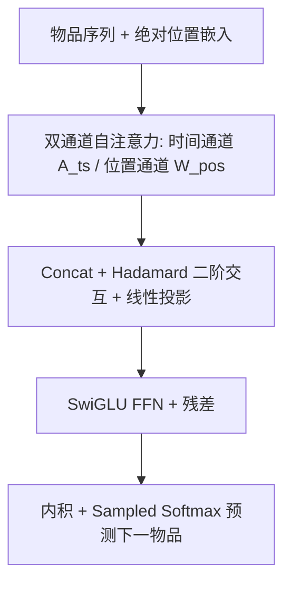
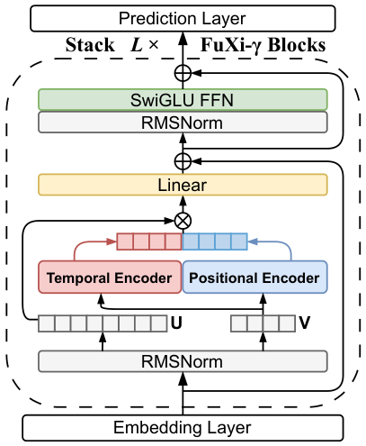

# FuXi-$γ$: Efficient Sequential Recommendation with Exponential-Power Temporal Encoder and Diagonal-Sparse Positional Mechanism (指数幂时间编码与对角稀疏位置机制的高效序列推荐)

- **会议/期刊**: KDD 2026
- **作者与机构**: Dezhi Yi, Wenyang Cui, Wenxuan He, Ye Lu (南开大学)；Wei Guo, Huifeng Guo, Yong Liu, Zhenhua Dong (华为)
- **推荐链路定位**: 精排 / 端到端生成式（decoder-only 自回归 next-item 预测）
- **研究方向**: 序列与会话推荐 / 生成式推荐
- **论文原文**: [https://arxiv.org/abs/2512.12740v1](https://arxiv.org/abs/2512.12740v1)
- **开源代码**: [https://github.com/Yeedzhi/FuXi-gamma](https://github.com/Yeedzhi/FuXi-gamma)

## TL;DR (1分钟核心速览)

生成式序列推荐（HSTU、FuXi-$α$）精度虽高，但时间编码的分桶查表造成$n^2$次非连续访存、位置通道又带来$O(n^2)$稠密注意力，长序列下训练/推理代价陡增。FuXi-$γ$ 用「指数幂连续衰减函数」替代分桶查表，并用 Toeplitz 持久对称性做块级对角稀疏剪枝。在 4 个数据集、Full-Ranking 协议下，8 层配置平均超自回归基线 HR@10 3.79%、NDCG@10 4.46%，训练/推理最高加速 4.74×/6.18×。

## Background & Motivation (背景与核心矛盾)

- **主流范式**: 以 HSTU、FuXi-$α$/$β$ 为代表的 decoder-only 自回归推荐，用「语义 + 时间 + 位置」多通道注意力建模用户兴趣演化。
- **前人局限一（时间编码访存）**: HSTU/FuXi-$α$沿用 T5 式分桶编码，把相对时间间隔 log 变换后离散化为桶索引查表，长度为$n$的序列产生$n^2$次非连续、无结构访存，与 GPU/NPU 并行访存模式根本冲突；FuXi-$β$ 的反比例衰减虽连续，但衰减形态固定不可调，过度偏向近期交互。
- **前人局限二（位置通道冗余）**: 绝对位置嵌入与时间信号已隐含顺序信息，FuXi-$α$/$β$仍额外挂一路$O(n^2)$ 稠密相对位置注意力，长序列下成为第二瓶颈。
- **核心洞察 (Key Insight)**: 用户兴趣衰减与艾宾浩斯遗忘曲线同构——可用「可调指数幂函数」在纯矩阵运算下刻画，既保留短/长期偏好弹性，又天然连续访存；同时位置注意力矩阵是 Toeplitz 矩阵，同一对角线上的块取值完全相同，只需对最左列打分即可覆盖全图。
- **本文切入点**: 用连续可微的指数幂时间编码器换掉分桶查表，再用对角滑动的块级半结构化剪枝砍掉位置通道冗余块。

## Method (核心方法设计)

### 1. 整体框架 (Overall Architecture)

FuXi-$γ$沿用 FuXi-$β$的无 query-key 注意力的 decoder-only 结构：Embedding 层将物品嵌入与可学习绝对位置嵌入相加得$X^0$；堆叠$L$个 FuXi-$γ$Block，每块由「双通道自注意力层 + SwiGLU FFN」组成，双通道分别输出时间注意力矩阵$A_{ts}$与位置矩阵$W_{pos}$，经拼接、Hadamard 二阶交互与线性投影融合；预测层用最终隐状态与物品嵌入矩阵内积 + sampled softmax 输出下一物品分布。训练用采样负样本（$N=128$），推理为全库打分。

<figure class="paper-figure" markdown="span">
  <figcaption>图1：FuXi-𝛾的整体架构。</figcaption>
</figure>

### 2. 关键设计拆解 (Key Designs)

1. **指数幂时间编码器（Exponential-Power Temporal Encoder）**：痛点是不连续访存与衰减形态不可调。作者先一次性预计算相对时间矩阵 $T_{i,j}=|t_i-t_j|$ 并在所有层共享，再用幂函数拉伸、指数函数衰减：

$$A^{i,j}_{ts}=\alpha\cdot\gamma^{|t_i-t_j|^{\beta}},\quad \gamma\in(0,1)$$

其中 $\alpha$为可学习基础兴趣强度，$\beta$控制非线性缩放（避免超长间隔信号被压得过弱），$\gamma$控制衰减速率。全部为标准矩阵幂/指数运算，访存连续；$\gamma$小则偏短期、大则保留长期信号，可按场景（电影/视频 0.8、音乐 0.9）调节。另有一个工程细节：把 int64 的$T$ 预转 float32，消除运行时隐式类型转换，单此一项使时间编码器耗时降 64.82%。

2. **对角稀疏位置机制（Diagonal-Sparse Positional Mechanism）**：痛点是位置通道 $O(n^2)$稠密且与绝对位置/时间信号冗余。做法分三步：(a) 将$W_{pos}$按$s\times s$分块（上三角已被因果掩码置零，padding 不损信息）；(b) 利用 Toeplitz 持久对称性$W^{i,j}_{pos}=W^{i+m,j+m}_{pos}$，同对角线块取值相同，故只需对**最左列**$\lfloor n/s\rfloor$个块求绝对值和作为重要性分数，既保证覆盖全部权重又结构感知；(c) 取分数最低的$k=\lfloor (n/s)\cdot\tau\rfloor$ 个块，沿对角线滑动复制到全图生成稀疏掩码，仅保留块参与位置注意力计算。

3. **训练目标、负采样与推理效率**：总损失为 sampled softmax 交叉熵，负样本均匀采样 $N=128$；无 query-key 投影、无多头扩展、单头注意力，块几乎全为矩阵运算。推理时位置通道仅计算保留块，FLOPs 降约 74.56%，整体推理延迟在 ML-20M 上仅次于 LinRec。

## Experimental Setup & Evaluation Protocol (实验设置与评估协议)

- **数据集与预处理**（沿用 FuXi-$α$/$β$/HSTU 的通用预处理）：

| 数据集 | #Users | #Items | #Interactions | 平均序列长 | 场景说明 |
| :--- | :---: | :---: | :---: | :---: | :--- |
| ML-1M | 6,040 | 3,706 | 1,000,209 | 165.60 | 电影 |
| ML-20M | 138,493 | 26,744 | 20,000,263 | 144.41 | 电影 |
| KuaiRand | 25,634 | 7,550 | 1,432,897 | 55.90 | 短视频 |
| Industrial | 28,927,689 | 476,544 | 1,313,729,225 | 45.41 | 工业音乐 |

- **数据划分与防穿越**: 遵循 FuXi 系列通用做法，按用户序列做 next-item 预测（序列内逐位置预测 $v_{i+1}$），长截断、短 padding 至固定长度$n$。
- **排名评测协议**: 指标为 HR@{10,50}、NDCG@{10,50}、MRR；主表未注明采样负例，按 FuXi 系列惯例为全库候选打分（Full-Ranking）。
- **对比基线与超参**: 覆盖 RNN（GRU4Rec）、Transformer（SASRec、LLaMa、HSTU、FuXi-$α$/$β$）、线性/状态空间（LinRec、FLASH、LRURec、Mamba4Rec）三类；AdamW，lr=0.001，batch=128，dropout=0.2，负样本 128，隐维 50/64/256/256；基础 2 层，扩展 8 层（"-Large"）；显著性为双侧 t 检验$p<0.05$。

## Key Experimental Results (实验关键数据)

### 1. 主实验对比 (Main Results)

8 层配置（"-Large"）下核心结果（节选）：

| Model | ML-1M HR@10 | ML-1M NG@10 | ML-20M HR@10 | ML-20M NG@10 | KuaiRand HR@10 | KuaiRand NG@10 | Infer.(×) |
| :--- | :---: | :---: | :---: | :---: | :---: | :---: | :---: |
| SASRec-Large | 0.0375 | 0.0177 | 0.0414 | 0.0207 | 0.0470 | 0.0251 | 1.12 |
| LLaMa-Large | 0.3259 | 0.1856 | 0.3459 | 0.2020 | 0.1073 | 0.0540 | 1.78 |
| HSTU-Large | 0.3293 | 0.1867 | 0.3405 | 0.1992 | 0.1065 | 0.0535 | 1.79 |
| FuXi-$α$-Large | 0.3321 | 0.1919 | 0.3535 | 0.2095 | 0.1107 | 0.0552 | 2.03 |
| FuXi-$β$-Large | 0.3390 | 0.1945 | 0.3551 | 0.2109 | 0.1079 | 0.0543 | 1.15 |
| **FuXi-$γ$-Large** | **0.3423\*** | **0.1975\*** | **0.3588\*** | **0.2135\*** | **0.1137\*** | **0.0571\*** | **1.00** |
| Improv. vs 次优 | +0.97% | +1.54% | +1.04% | +1.23% | +2.71% | +3.44% | — |

工业音乐数据集（4 层，线上同构）：

| Model | HR@10 | HR@50 | NG@10 | NG@50 | MRR |
| :--- | :---: | :---: | :---: | :---: | :---: |
| SASRec | 0.2954 | 0.5742 | 0.1633 | 0.2256 | 0.1397 |
| HSTU | 0.3831 | 0.6336 | 0.2294 | 0.2855 | 0.1972 |
| FuXi-$α$ | 0.4060 | 0.6483 | 0.2479 | 0.3022 | 0.2137 |
| FuXi-$β$ | 0.4734 | 0.6776 | 0.3174 | 0.3633 | 0.2811 |
| **FuXi-$γ$** | **0.5064\*** | **0.6894\*** | **0.3559\*** | **0.3969\*** | **0.3196\*** |

### 2. 消融实验 (Ablation Study)

| Setting | ML-1M HR@10 | ML-1M NG@10 | ML-20M HR@10 | ML-20M NG@10 | KuaiRand HR@10 | KuaiRand NG@10 |
| :--- | :---: | :---: | :---: | :---: | :---: | :---: |
| FuXi-$γ$ 完整 | **0.3423** | **0.1975** | **0.3588** | **0.2135** | **0.1137** | **0.0571** |
| w/o SwiGLU FFN | 0.3361 | 0.1931 | 0.3496 | 0.2059 | 0.1117 | 0.0570 |
| w/o Positional Encoder | 0.3281 | 0.1865 | 0.3548 | 0.2096 | 0.1113 | 0.0559 |
| w/o Temporal Encoder | 0.3120 | 0.1767 | 0.3248 | 0.1882 | 0.1043 | 0.0521 |

### 3. 关键实验发现 (Key Findings)

1. **时间编码器是绝对主力**：去掉后 ML-1M HR@10 从 0.3423 跌至 0.3120（-8.85%），跌幅远超位置通道（-4.15%）与 SwiGLU（-1.81%）；跨架构兼容性实验中，替换进 HSTU/FuXi-$α$/$β$ 三种主干平均带来 HR@10 +8.82%、NDCG@10 +11.16%，说明增益来自编码器本身而非架构耦合。
2. **位置通道确属冗余但非无用**：剪掉后精度仅小幅下降，印证绝对位置嵌入与时间信号已部分覆盖顺序信息；而 $\tau=60\%$剪枝时 ML-20M 仍保留 98.92% 精度、位置注意力 FLOPs 降 74.56%，KuaiRand 在中等稀疏度下甚至略有提升（$\tau=60\%$ 时 NDCG@10 仅降 0.53%），说明适度剪枝有正则化效应。
3. **长序列是效率优势的放大器**：序列长 1000 时训练相对 LLaMa/HSTU/FuXi-$β$加速 4.74×/4.48×/1.86×，推理加速 6.18×/6.07×/2.24×，FuXi-$α$在该长度直接 OOM；时间编码器单独对比在$n=1000$时相对分桶编码器加速 11.00×、相对 FuXi-$β$ 加速 2.52×，且序列越长剪枝精度损失越小（>98.65% 保留率）。

## Highlights & Limitations (亮点、对比与审稿批判)

- **与代表作对比 (vs. Prior Work)**: 相比 HSTU/FuXi-$α$的分桶查表，本文把离散查表换成连续矩阵幂运算，从「访存模式」层面而非「减少计算量」层面解决瓶颈；相比 FuXi-$β$的固定反比例衰减，本文的$\gamma,\beta$ 可学习、可按域调参（电影 0.8 / 音乐 0.9），且首次把块稀疏语义注意力引入推荐的**位置通道**而非语义通道。
- **可迁移亮点**: (1) Toeplitz 持久对称性 → 只对最左列打分即可覆盖全图，这一「结构先验降采样」技巧可迁移到任何相对位置/相对时间偏置矩阵的稀疏化；(2) int64→float32 预转换这类 dtype 一致性优化在多层重复计算中收益可观（单模块 -64.82% 耗时），值得作为工程 checklist。
- **审稿级局限批判**: (1) 对角稀疏是**训练后**剪枝，掩码不参与训练，块选择依赖单次最左列打分，缺少与训练联合的可微稀疏化对比；(2) 主表未明确 Full-Ranking 与采样评测的边界，且工业数据集仅报告离线指标，缺少线上 A/B 的延迟-收益权衡数据；此外 $\gamma$ 需按域人工调参，跨域自适应能力未验证。

## Rating (四维评分)

- **方法创新性 (Novelty)**: ⭐⭐⭐⭐ （认知遗忘曲线 + Toeplitz 结构先验的组合有新意，但本质是编码器替换与结构化剪枝的工程化整合，理论深度有限）
- **评估协议与实验扎实度 (Protocol & Experiments)**: ⭐⭐⭐⭐ （4 数据集含亿级工业集、2/8 层双配置、跨架构兼容性与效率曲线齐全，但划分协议与 Full-Ranking 细节交代偏简）
- **写作与数学规范度 (Clarity & Rigor)**: ⭐⭐⭐⭐ （核心公式简洁、算法伪代码完整、复杂度与访存分析清晰，部分符号在正文与公式间略有重复定义）
- **工业落地与复现价值 (Industrial & Practical Value)**: ⭐⭐⭐⭐⭐ （代码开源、纯矩阵算子硬件友好、线上同构 4 层模型已验证，长序列加速比显著，落地价值突出）
