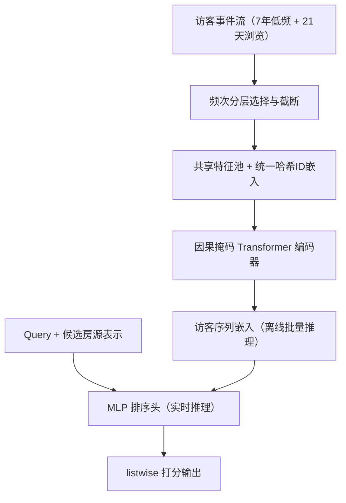
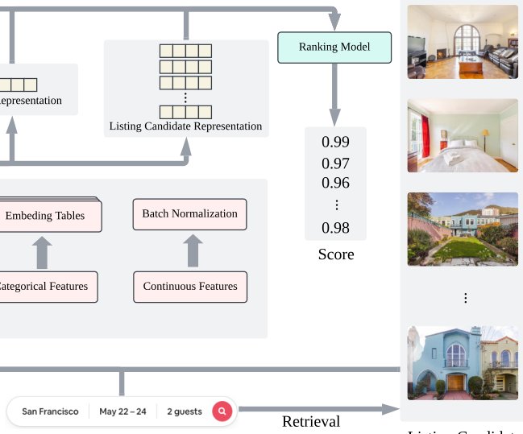

# JourneyFormer: Encoding Airbnb Guest Journey with Sequence Modeling (用序列建模编码 Airbnb 访客旅程)

- **会议/期刊**: KDD 2026
- **作者与机构**: Daochen Zha, Chun How Tan, Xin Liu, Bin Xu, Han Zhao 等（Airbnb 搜索排序团队）
- **推荐链路定位**: 精排（搜索排序 + 促销邮件列表排序）
- **研究方向**: 序列与会话推荐 / 工业架构与评测
- **论文原文**: [https://arxiv.org/abs/2606.19108v1](https://arxiv.org/abs/2606.19108v1)
- **开源代码**: 暂未开源

## TL;DR (1分钟核心速览)

Airbnb 搜索排序长期依赖数百个手工聚合特征，难以刻画"长、探索性强、噪声大"的访客旅程，且预订标签极度稀疏。JourneyFormer 用频次分层策略构造长短期双序列（7年非高频事件 + 21天浏览事件），以统一哈希嵌入表 + 因果掩码 Transformer 编码旅程，配合"搜索批处理"等训练加速策略（吞吐约 4×）。离线 NDCG 相对强基线提升 1.48%，线上 A/B 在两个场景分别取得 Bookers +0.55%、邮件点击 +5.04% 的显著增益。

## Background & Motivation (背景与核心矛盾)

- **主流范式**: 工业搜索排序普遍用人工设计的时序聚合特征（如"过去 N 天预订数/均价"）喂入 MLP；序列建模（SASRec/BERT4Rec 系）在推荐侧已被验证，但多用于无 query 的 next-item 预测。
- **前人局限**: ① 手工特征随迭代膨胀至约 900 维，数据管道维护成本高且语义被聚合抹平；② 社交/内容平台的序列建模假设"高频交互=强意图"，而 Airbnb 的浏览事件 97.8% 是探索性噪声，且用户几乎不会重复预订同一房源，retargeting 式相似推荐天然失效。
- **核心洞察 (Key Insight)**: 低频事件（预订请求、评价、取消、客服工单）虽仅占 2.2%，却携带最干净的意图信号；高频浏览事件只在短窗口内有价值。因此应按**事件频次而非统一窗口**切分长短期序列。
- **本文切入点**: 不做架构军备竞赛，而是把"事件选择—ID 嵌入—标签归因—训练/服务加速"整条生产链路的设计决策讲透，用简单架构换取可落地性。

## Method (核心方法设计)

### 1. 整体框架 (Overall Architecture)

访客旅程被拆为两条序列：长期序列取过去 7 年除浏览外的低频事件（上限 80 条），短期序列取过去 21 天的浏览事件（上限 200 条），合并后按时间戳重排。序列、query、候选房源共享一个特征池（<100 个原始特征，含 ID/类别/连续三类），经投影层映射到事件嵌入空间，由 4 层因果掩码 Transformer 编码，取末位事件嵌入作为访客表示；再与 query、房源表示拼接送入轻量 MLP 打分，listwise 损失端到端训练。服务侧采用"序列模型批量推理 + 排序模型实时推理"的两段式。

<figure class="paper-figure" markdown="span">
  <figcaption>图 2：JourneyFormer 概览。访客序列由长期序列（过去 7 年的事件，排除房源浏览等频繁事件）和短期序列（过去 21 天的频繁事件）组成。访客序列、搜索查询和检索到的房源候选使用共享特征池构建特征表示。随后它们由序列编码器和排序模型处理，生成房源分数。</figcaption>
</figure>

### 2. 关键设计拆解 (Key Designs)

1. **频次分层长短期序列（Frequency-based Event Selection）**：痛点是无差别建模全量事件既昂贵又被浏览噪声淹没。做法是按事件类型频次分配窗口——高频浏览只留 21 天、低频强信号事件回溯 7 年，并按长度分桶截断（80/200）。直觉是"信息密度换时间跨度"：让稀缺的预订/评价信号获得与浏览同等的序列席位，同时把 GPU 显存控制在可训练范围。

2. **统一哈希 ID 嵌入（Unified Embedding）**：痛点是房源/房东/S2Cell ID 基数极高，独立嵌入表参数爆炸。做法是所有 ID 特征共享一张表，每个 ID 用 $m$ 个随机种子哈希取行后拼接：
$$\mathbf{e}_{x_{\text{id}}} = \text{Concat}_{i=1}^{m}\{\text{UnifiedEmb}(\text{Hash}_{s_i}(x_{\text{id}}))\}$$
同等参数预算下比独立表更可扩展且效果更好；S2Cell 采用 0–13 共 14 级层级地理 ID，多粒度输入优于单级（消融中移除 S2Cell 掉点最多）。

3. **训练目标、负采样与推理效率**：采用 listwise softmax 损失，对一次搜索内 $n$ 个候选按预订标签归一化加权：
$$\mathcal{L}_{\text{Ranking}} = -\sum_{i=1}^{n}\frac{y_i}{\sum_{j=1}^{n}y_j}\log\big(\text{Softmax}(z_i)\big)$$
标签归因上，把预订回填到此前 7 天内的搜索（命中即正样本），仅保留含预订的搜索（约占全量 5%），每人每天最多采 4 次搜索。**免负采样**（全候选 listwise）。加速三招：① 搜索批处理——利用因果掩码，同一序列中后续搜索复用前序时间戳的中间嵌入，一次前反向覆盖多次搜索；② 序列长度分桶（4/16/44/88/148/280）缓解 padding 偏斜；③ 稀疏计算——只把非 padding 搜索送入排序头。三者合计带来约 4× 吞吐。

## Experimental Setup & Evaluation Protocol (实验设置与评估协议)

- **数据集与预处理**: 训练集为 1 年含预订的访客序列（约占全量 5%），过滤规则：候选 <4 的搜索剔除、每人每天 ≤4 次搜索、至少含 1 次搜索；最终序列量级 $10^8$，平均每序列 6.9 次搜索，搜索-标签对约 9 亿。

| 数据集 | #Sequences | 平均搜索/序列 | #Search-Label Pairs | 稀疏性说明 |
| :--- | :---: | :---: | :---: | :--- |
| Airbnb 生产日志（1年） | ~$10^8$ | 6.9 | ~9×$10^8$ | 仅保留含预订搜索，正样本极稀疏 |

- **数据划分与防穿越 (Splitting Strategy)**: 全局时间戳切分——以训练数据最后日期为界，取其后 9 天评估；另设最长 1 个月的分布漂移评估。
- **排名评测协议 (Ranking Protocol)**: 离线用预订标签的 NDCG（相对基线的百分比差），每设置训练 3 个模型报均值±标准差；线上为 3 周 A/B，指标为 Bookers、Booked Nights、Views，显著性 $p<0.05$ / $p<0.01$。
- **对比基线与超参设置**: 基线为 Airbnb 线上生产模型（约 900 维手工特征 + MLP，经多年 A/B 严格筛选，属"强基线"）；序列编码器 4 层、$d=128$、post-norm、无 FFN，事件投影 MLP 1024-512-256-128，输出降维至 32；排序头 1024-256-64-1。

## Key Experimental Results (实验关键数据)

### 1. 主实验对比 (Main Results)

| 模型 | 离线 NDCG 相对变化 |
| :--- | :---: |
| Baseline（无序列建模） | 0.00% ± 0.01% |
| JourneyFormer-Long | +0.44% ± 0.01% |
| JourneyFormer-Short | +1.30% ± 0.03% |
| **JourneyFormer-Full** | **+1.48% ± 0.03%** |

线上 A/B（搜索排序，3 周）：

| 模型 | Bookers | Booked Nights | Views |
| :--- | :---: | :---: | :---: |
| JourneyFormer-Long | +0.31%* | +0.28% | +0.38%** |
| **JourneyFormer-Full** | **+0.55%**** | **+0.82%**** | **+0.90%**** |

线上 A/B（促销邮件排序）：JourneyFormer-Full 取得 Bookers +0.16%*、Booked Nights +0.23%*、**Views +5.04%****。

### 2. 消融实验 (Ablation Study)

| 消融设置 | 指标变化 |
| :--- | :---: |
| w/o 搜索批处理 | 训练吞吐 **−75.41%** |
| w/o 序列分桶 | 吞吐 −29.35% |
| w/o 稀疏计算 | 吞吐 −20.54% |
| w/o listing ID 嵌入 | NDCG 下降（约 −0.05%~−0.1%） |
| w/o host ID 嵌入 | NDCG 下降 |
| w/o S2Cell ID 嵌入 | NDCG 下降最大（约 −0.2%） |
| S2Cell 仅 0–6 级 / 仅 7–13 级 / 仅 13 级 | 均掉点，单级最差 |
| 加 FFN（128 / 256 / 128-256-128） | 三种配置均掉点 |
| DIN-style 早融合 | +0.20% NDCG（但训练慢 15%、无法离线预计算） |

### 3. 关键实验发现 (Key Findings)

1. **短期序列是主力，长期序列是补充**：仅短期浏览即贡献 +1.30%，叠加长期后仅增至 +1.48%，说明最终预订多来自近期浏览房源；但线上 Booked Nights 增益（+0.82%）显著高于 Bookers（+0.55%），表明长短期融合更能帮助"犹豫型长住客"收敛决策。
2. **浏览事件是双刃剑**：短期序列长度在 11–20 条时 NDCG 达峰，超过后明显下滑，直接验证了"高频浏览=噪声"的假设，也反向支撑了频次分层选择策略的必要性；长期序列则呈单调递增趋势。
3. **简单架构 + 工程加速优于复杂架构**：加 FFN、加 DIN 式早融合、扩参数均只带来边际离线收益甚至掉点，而三项训练加速策略合计贡献约 4× 吞吐——在 $10^8$ 量级数据下，吞吐即效果。此外模型在训练截止后 1 个月内 NDCG 衰减 <0.1%，无需高频重训。

## Highlights, Limitations & Rating (亮点、对比与审稿评价)

- **与代表作对比 (vs. Prior Work)**: 相比 SASRec/BERT4Rec，本文把 next-item 预测改造为"异构事件序列 + 候选集内 listwise 排序"，并明确弃用双向编码（收益中性但拖慢训练）；相比 DIN 的 target-aware 早融合，本文选择 late-fusion 以换取编码器离线预计算，线上延迟可控；相比 Meta 生成式推荐等 engagement 导向工作，本文直面"稀疏预订标签 + 探索性浏览"的电商特有噪声。
- **可迁移亮点**: ① "按事件频次分配时间窗口"的序列构造法，可直接迁移到任何高频弱信号 + 低频强信号的场景（如电商加购/下单、内容平台的收藏/完播）；② 因果掩码下的"搜索批处理"复用中间嵌入，是序列精排降 FLOPs 的通用技巧。
- **审稿级局限批判**: ① 离线评估仅覆盖含预订的 5% 流量，NDCG 对"非预订客转化"这一核心目标存在系统性偏差，结论高度依赖线上 A/B；② 序列嵌入按天批量刷新，实时性受限，作者自承实时推理离线可涨 5% 但因 retargeting 无法转化为线上收益，说明离线-线上鸿沟仍是黑箱；③ 单平台单业务验证，跨场景泛化性未知。
- **四维评分**: 创新性 ⭐⭐⭐ | 实验扎实度 ⭐⭐⭐⭐⭐ | 方法清晰度 ⭐⭐⭐⭐⭐ | 落地价值 ⭐⭐⭐⭐⭐

