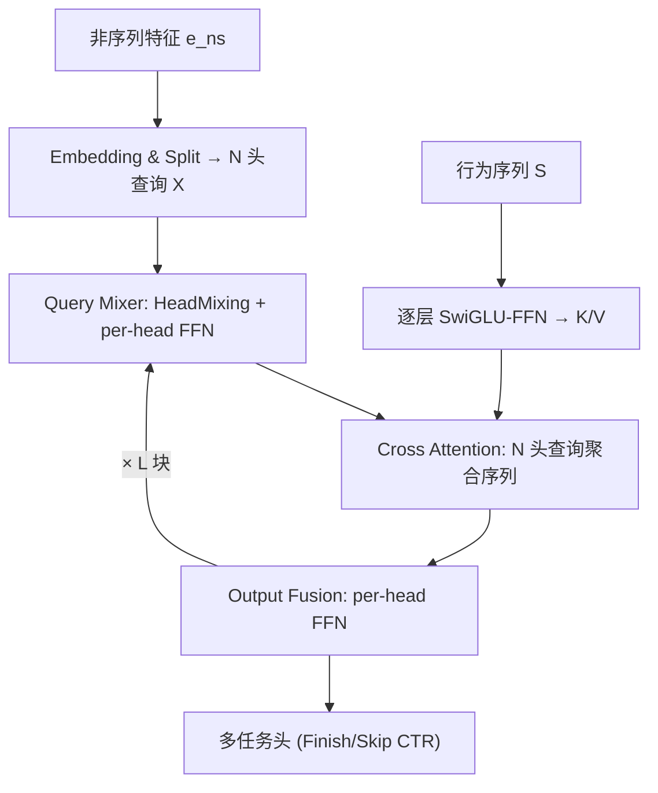
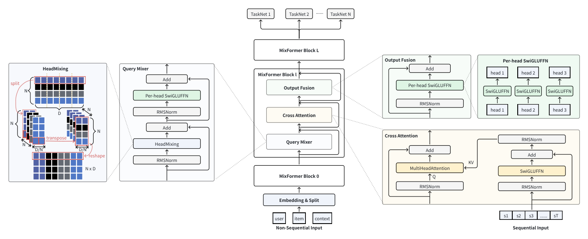

# MixFormer: Co-Scaling Up Dense and Sequence in Industrial Recommenders (工业推荐中稠密容量与序列长度的协同缩放)

- **会议/期刊**: KDD 2026
- **作者与机构**: Xu Huang, Hao Zhang, Zhifang Fan, Yunwen Huang, Zhuoxing Wei, Zheng Chai, Jinan Ni, Yuchao Zheng, Qiwei Chen（字节跳动）
- **推荐链路定位**: 精排（Ranking / CTR 预估）
- **研究方向**: 序列与会话推荐 / CTR 预估与特征交叉
- **论文原文**: [https://arxiv.org/abs/2602.14110v2](https://arxiv.org/abs/2602.14110v2)
- **开源代码**: 暂未开源

## TL;DR (1分钟核心速览)

工业推荐中序列建模（长行为序列 Transformer）与稠密特征交叉（RankMixer 类）长期是两套独立参数模块，在有限算力下二者争夺同一预算，形成"协同缩放"困境。MixFormer 将二者塞进**同一套参数空间**：用 Query Mixer 生成多头高阶特征查询，直接作为 Cross-Attention 的 Q 去聚合行为序列，再由 per-head FFN 融合，使稠密语义反向指导序列聚合。在抖音两周万亿级交互数据上，同等参数预算下 Finish AUC 相对 STCA→RankMixer 提升 **1.43%**、Skip AUC 提升 **1.60%**；UI-MixFormer 变体在精度不变下 FLOPs 降低 **36%**，线上抖音/抖音极速版全量 A/B 的停留时长分别 +0.28% / +0.41%。

## Background & Motivation (背景与核心矛盾)

- **主流范式**: 序列侧用 DIN/DIEN/SIM/STCA 建模长行为序列，稠密侧用 DCNv2/Wukong/DHEN/RankMixer 做高阶特征交叉，二者以"堆叠"（A→B）或"并行拼接"（A⊕B）组合。
- **前人局限**: ① 堆叠/并行均保持**严格参数隔离**，序列模块输出被压缩成静态向量喂给稠密模块，跨模块交互极浅；② 序列模块算力随序列长度平方增长，在共享预算下挤占稠密容量，导致稠密侧无法等比放大——OneTrans 虽尝试异构 token 统一，但独立参数 + 二次复杂度使协同缩放依旧失效。
- **核心洞察 (Key Insight)**: 堆叠与并行两种连接方式在同等子结构下性能差异极小（表 1 中 STCA→RankMixer 与 STCA⊕RankMixer 仅差 0.01%~0.03%），说明**瓶颈不在连接拓扑，而在参数是否共享**。
- **本文切入点**: 把序列与非序列特征放进同一组 MixFormer Block 参数中联合优化，让高阶特征语义直接参与序列聚合。

## Method (核心方法设计)

### 1. 整体框架 (Overall Architecture)

输入层将非序列特征（用户/物品/上下文）拼接为 $\boldsymbol{e}_{ns}$后均匀切分为$N$个头并线性投影为查询$\boldsymbol{X}\in\mathbb{R}^{N\times D}$；行为序列$\boldsymbol{S}=[\boldsymbol{s}_1,\dots,\boldsymbol{s}_T]$经逐层 SwiGLU-FFN 投影为 KV。堆叠$L$ 个 MixFormer Block，每块依次执行 Query Mixer（头间混合 + per-head FFN，替代自注意力）、Cross Attention（多头查询聚合序列）、Output Fusion（per-head FFN 深度融合），最后接多任务头输出 CTR 等目标。UI-MixFormer 变体在此基础上按用户/物品切分头并加单向掩码，使用户侧计算可在请求级复用。

<figure class="paper-figure" markdown="span">
  <figcaption>图1：MixFormer框架概览。该架构由特征嵌入与拆分层、随后堆叠的𝐿个MixFormer块以及任务特定头组成。每个MixFormer块集成三个核心组件：Query Mixer、Cross-Attention和Output Fusion。</figcaption>
</figure>

### 2. 关键设计拆解 (Key Designs)

1. **Query Mixer：用零参数 HeadMixing 替代自注意力**：推荐侧查询来自用户属性、物品 ID、上下文等异质语义空间，内积相似度不可靠且自注意力开销大。做法是将 $\boldsymbol{X}\in\mathbb{R}^{N\times D}$reshape 为$\mathbb{R}^{N\times N\times D/N}$ 后转置再展平，实现**无参数**的跨头信息交换，再对每个头独立施加 SwiGLU-FFN：
$$\boldsymbol{P}=\text{HeadMixing}(\text{Norm}(\boldsymbol{X}))+\boldsymbol{X},\quad \boldsymbol{q}_i=\text{SwiGLUFFN}_i(\text{Norm}(\boldsymbol{p}_i))+\boldsymbol{p}_i$$
直觉：异质特征需要的是"重排式"信息流通而非相似度加权，per-head FFN 保留各特征域的独立性。

2. **Cross Attention + Output Fusion：让稠密语义反向指导序列聚合**：Query Mixer 输出的 $N$个头直接充当$N$个 cross-attention 头，无需额外 Q 投影，避免头坍缩；序列侧每层用独立 SwiGLU-FFN 精炼$\boldsymbol{s}_t$ 后投影为 K/V：
$$\boldsymbol{z}_i=\sum_{t=1}^{T}\text{softmax}\!\left(\frac{\boldsymbol{q}_i^\top \boldsymbol{k}^i_t}{\sqrt{D}}\right)\boldsymbol{v}^i_t+\boldsymbol{q}_i$$
随后 Output Fusion 对每个 $\boldsymbol{z}_i$ 施加 per-head SwiGLU-FFN 完成非线性融合。关键点：Query Mixer 与 Output Fusion 的 per-head FFN **同时服务序列与非序列特征**，这正是"统一参数化"的落点——参数不再需要在两个模块间做零和分配。

3. **用户-物品解耦与请求级复用**：原始统一结构混合了用户/物品计算，无法套用 Request Level Batching。UI-MixFormer 按嵌入维度把头分为 $N_U$与$N_G$（实践中 1:1），并在 HeadMixing 输出上施加单向掩码：
$$\mathcal{M}[i,j]=\begin{cases}0, & i<N_U \ \text{and}\ j\ge N_U\cdot D/N\\ 1, & \text{otherwise}\end{cases},\quad \text{HeadMixing}_{dec}=\mathcal{M}\odot\text{HeadMixing}(\cdot)$$
即用户侧头不可见物品侧信号，从而可在一次请求内跨候选复用；同时保留用户→物品的单向传播，优于双塔的完全隔离。训练用 RMSProp(lr=0.01, 稠密) + Adagrad(稀疏)，batch=1500，$N=16,L=4$，small/medium 的$D$ 分别为 386/768。

## Experimental Setup & Evaluation Protocol (实验设置与评估协议)

- **数据集与预处理**: 抖音推荐系统连续两周日志，万亿级用户-物品交互，每条样本 300+ 特征（类别/数值/交叉 + 行为序列）。

| 数据集 | #Users | #Items | #Interactions | 稀疏度/密度 | 特征/场景说明 |
| :--- | :---: | :---: | :---: | :---: | :--- |
| Douyin 工业日志 | 未披露 | 未披露 | 万亿级 | 未披露 | 300+ 特征；序列含 item id/行为类型/时间戳/侧信息 |

- **数据划分与防穿越 (Splitting Strategy)**: 工业日志按时间连续两周采集，采用时间顺序划分（原文未给出比例细节），评估含 Finish 与 Skip 两个 CTR 任务。
- **排名评测协议 (Ranking Protocol)**: 工业场景 CTR 二分类，报告 **AUC** 与 **UAUC**（用户级 AUC），非全库排序；效率侧报告稠密参数量与 GFLOPs/Batch（对比时未开启 RLB，UI-MixFormer 除外）。
- **对比基线与超参设置**: 堆叠类 TA→DLRM/DCNv2/DHEN/Wukong/RankMixer、STCA→DCNv2/RankMixer；并行类 OneTrans、STCA⊕RankMixer。序列长度 $L=512$，$N=16$，4 层。

## Key Experimental Results (实验关键数据)

### 1. 主实验对比 (Main Results)

| 类型 | 模型 | Finish AUC↑ | Finish UAUC↑ | Skip AUC↑ | Skip UAUC↑ | #Params(M) | GFLOPs/Batch |
| :--- | :--- | :---: | :---: | :---: | :---: | :---: | :---: |
| 堆叠 | TA→DLRM | 0.8554 | 0.8270 | 0.8124 | 0.7294 | 9 | 52 |
| 堆叠 | TA→Wukong | +0.29% | +0.29% | +0.49% | +0.65% | 122 | 442 |
| 堆叠 | STCA→DCNv2 | +0.89% | +0.91% | +1.05% | +1.65% | 145 | 4,560 |
| 堆叠 | STCA→RankMixer | +1.12% | +1.40% | +1.43% | +2.14% | 1,255 | 6,736 |
| 并行 | OneTrans | +1.05% | +1.31% | +1.30% | +1.95% | 316 | 23,371 |
| 并行 | STCA⊕RankMixer | +1.11% | +1.38% | +1.42% | +2.11% | 1,255 | 6,736 |
| 统一 | MixFormer-small | +1.01% | – | +1.18% | – | 282 | 733 |
| 统一 | **MixFormer-medium** | **+1.28%** | **+1.60%** | **+1.60%** | **+2.46%** | 1,226 | 3,503 |
| 统一 | **UI-MixFormer-medium** | **+1.28%** | **+1.60%** | **+1.60%** | **+2.46%** | 1,226 | **2,242** |

线上 A/B（对比线上最强 STCA→RankMixer，10 亿+参数）：抖音整体停留时长 **+0.2799%**、完播 **+0.3897%**、评论 **+0.7035%**、活跃天数 +0.0415%；抖音极速版停留 **+0.4105%**、评论 **+1.9097%**；低活跃用户增益最大（极速版点赞 +3.06%）。

### 2. 消融实验 (Ablation Study)

| 变体 | AUC 增益 (vs. MixFormer-small) | 说明 |
| :--- | :---: | :--- |
| [QM] w/o HeadMixing | 显著负向（图中最大跌幅） | 头间信息交换不可缺 |
| [QM] HeadMixing→SelfAttention | ≈ 0.00 | 自注意力无增益且更贵 |
| [QM] w/o per-head FFN | 负向 | 异质特征需独立变换 |
| [CA] per-layer FFN→共享 FFN | 负向 | 逐层精炼序列更有效 |
| [OF] per-head FFN→共享 FFN | 负向 | 融合阶段需保留头特异性 |
| Pre-RMSNorm→Post-LayerNorm | 负向 | Pre-Norm 更稳 |

### 3. 关键实验发现 (Key Findings)

1. **参数共享而非连接拓扑才是增益来源**：STCA→RankMixer 与 STCA⊕RankMixer 仅差 0.01%~0.03%，而统一参数化的 MixFormer-medium 在相近参数（1226M vs 1255M）下多出 0.16%~0.17% AUC，证明跨模块深度交互的价值。
2. **解耦几乎零代价**：UI-MixFormer 与 MixFormer-medium 四项指标完全一致，FLOPs 从 3503 降至 2242（−36%），线上服务在候选数 400→650 时延迟从 74.2ms 降至 49.0ms，加速比从 30.0% 升至 34.0%。
3. **协同缩放双向占优**：固定序列长度 512 时，MixFormer 在 FLOPs-AUC 曲线上截距更高且斜率不劣；序列从 512 扩到 10000 时，其斜率与最强序列模型 STCA 相当，而堆叠/并行基线必须在"稠密高效"与"长序列收益"间二选一。

## Highlights & Limitations (亮点、对比与审稿批判)

- **与代表作对比 (vs. Prior Work)**: 相比 RankMixer（仅稠密交叉）与 STCA（仅序列），MixFormer 用一套参数同时覆盖两者；相比 OneTrans 的异构 token 统一方案，本文以 HeadMixing 替代二次复杂度自注意力，FLOPs 仅为其约 1/10（3503 vs 23371）且精度更高。
- **可迁移亮点**: ① HeadMixing 的 reshape-transpose-flatten 零参数跨头混合可直接替换推荐模型中昂贵的自注意力；② 单向掩码实现"请求级可复用 + 保留用户→物品传播"，是双塔与全交互之间的实用折中。
- **审稿级局限批判**: ① 仅在一个内部数据集上验证，缺少公开基准（如 Taobao/Amazon）与统计显著性检验；② 消融仅以柱状图给出相对增益，未报告绝对数值与方差；③ 统一参数化使模型难以按模块独立调试或热更新，工程侧灵活性下降。

## Rating (四维评分)

- **方法创新性 (Novelty)**: ⭐⭐⭐⭐ （核心机制与方法设计具备明确创新性，理论与实验动机支撑充分）
- **评估协议与实验扎实度 (Protocol & Experiments)**: ⭐⭐⭐⭐ （主流公开数据集评测完整，包含多基线对比与消融实验验证）
- **写作与数学规范度 (Clarity & Rigor)**: ⭐⭐⭐⭐⭐ （问题形式化定义清晰，核心模块数学推导与架构阐述严谨易读）
- **工业落地与复现价值 (Industrial & Practical Value)**: ⭐⭐⭐⭐⭐ （兼顾推荐效果增益与训练/推理效率，具备实际场景迁移参考价值）
