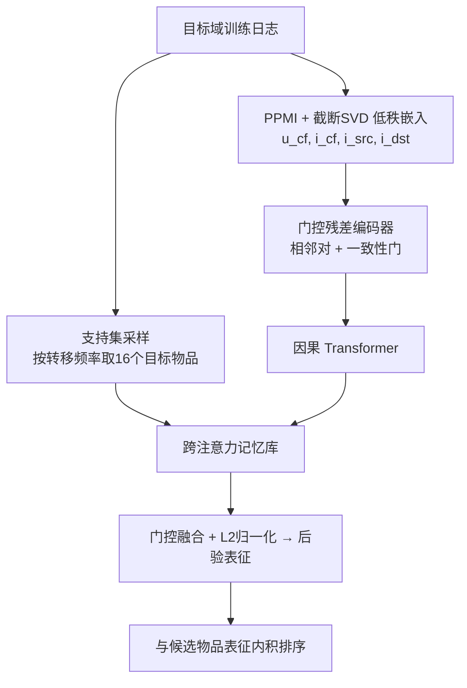
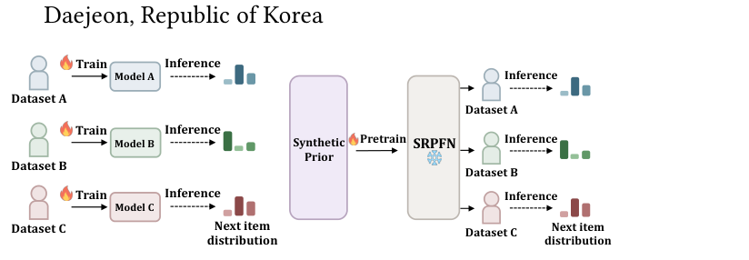

# One Sequential Recommendation Model Pretrained from Synthetic Priors Predicts Multiple Datasets (一个由合成先验预训练、可预测多数据集的序列推荐模型)

- **会议/期刊**: KDD 2026 (32nd ACM SIGKDD)
- **作者与机构**: Woosung Kang, Jiwon Jeong, Jonghyeok Shin, Jeongwhan Choi, Noseong Park (KAIST)
- **推荐链路定位**: 召回（Next-Item 全库/候选集排序）
- **研究方向**: 序列与会话推荐 / 冷启动与长尾推荐
- **论文原文**: [https://arxiv.org/abs/2606.15752v1](https://arxiv.org/abs/2606.15752v1)
- **开源代码**: [https://github.com/woooosung/SRPFN](https://github.com/woooosung/SRPFN)

## TL;DR (1分钟核心速览)

现有序列推荐模型把参数拟合到单一数据集的物品表与转移分布上，换域必须重训。本文提出 SRPFN：把序列推荐重构成**后验预测推断**问题，用 hDCSBM 合成先验（层级社区 + 幂律流行度 + 随机游走）离线预训练一个 PFN，推理时仅以目标域的支持集（item-item 转移样例）做条件化，**单次前向、零梯度更新**即可预测。在 5 个基准、10 个基线上，Leave-One-Out + 99 负采样协议下平均超越次优方法 **7.53%**，单数据集推理约 1 分钟。

## Background & Motivation (背景与核心矛盾)

- **主流范式**: GRU4Rec/SASRec/FEARec 等采用表征学习范式，ID 嵌入表与序列编码器参数显式拟合训练集的物品目录与转移序列。
- **前人局限**: ① 新域转移模式与训练域不同，部署即需从零重训（SASRec 约 10 分钟，FEARec 约 15 小时）；② 基于文本/视觉侧信息的跨域迁移（UniSRec、RecFormer）依赖辅助模态，且难以刻画域特有的转移结构。
- **核心洞察 (Key Insight)**: 作者用 CKA 验证 SASRec 学到的物品几何与**转移统计量的低秩分解**高度对齐（Beauty/Toys/LastFM 上 0.65/0.55/0.62，随机初始化零假设仅 0.23/0.39/0.33，置换检验 $p\approx0.005$）。即：低秩谱摘要足以承载 SASRec 所学的转移结构，可作为**输入表征**而非待训练参数。
- **本文切入点**: 既然转移结构可由统计量表达，就把目标域统计量当作"证据"喂给一个在合成先验上预训练好的推断网络，用 PFN 的上下文学习替代梯度下降。

## Method (核心方法设计)

### 1. 整体框架 (Overall Architecture)

SRPFN 将序列推荐写成后验预测分布 $p(y\mid x,D_{\text{support}})=\int p(y\mid x,\phi)p(\phi\mid D_{\text{support}})\mathrm{d}\phi$ 的神经近似。离线阶段：从 hDCSBM 先验采样物品图与随机游走序列，构造 25.6M 条合成序列预训练 Transformer。推理阶段：在目标域训练日志上计算 PPMI + 截断随机 SVD 得到五类低秩嵌入，为每个测试用户按转移频率采样支持集，经门控残差编码器 + 因果 Transformer + 跨注意力融合支持集证据，输出后验表征并与候选物品表征内积排序。全程无目标域梯度更新。

<figure class="paper-figure" markdown="span">
  <figcaption>图 1：范式对比。(a) 现有方法为每个数据集训练一个单独的模型。(b) SRPFN 只需在合成先验上预训练一次，随后无需重新训练即可应用于多个数据集——我们将这种设置称为无更新推理。</figcaption>
</figure>

### 2. 关键设计拆解 (Key Designs)

1. **hDCSBM 合成先验（让预训练覆盖真实转移谱）**：痛点是用真实数据集预训练会绑定其转移模式。本文用层级度修正随机块模型生成物品图——层级社区刻画类目/子类目、幂律度分布刻画重尾流行度、社区重要性分数刻画核心-边缘结构；再以几何分布采样回退步长 $\ell_t$ 做随机游走：$i_{u,t+1}\sim\mathrm{Categorical}(G_{\tilde i_{u,t},:})$，其中 $\tilde i_{u,t}=i_{u,t-\ell_t}$。回退机制同时产生短程连贯与长程回访，使合成序列在（确定性 $D(i)$，有效分支 $k_{\text{eff}}$）平面与真实数据重叠（图 3）。

2. **非对称转移嵌入 + 一致性门控编码器**：痛点是把物品当作单一向量会丢失"作为前驱 vs 作为后继"的方向性。本文从转移矩阵分解中拆出源侧 $i_{\text{src}}$（出边）与目标侧 $i_{\text{dst}}$（入边），对相邻对 $(i_{u,t-1},i_{u,t})$ 分别构造上下文向量并拼用户嵌入得状态 $e_{u,t}$，再用余弦一致性特征 $v_{u,t}$ 生成标量门控做残差更新：$z_{u,t}=\mathrm{LN}(e_{u,t}+g^{\text{enc}}_{u,t}\cdot\delta_{u,t})$，$g^{\text{enc}}_{u,t}=\sigma(\mathrm{MLP}_g(v_{u,t}))$。直觉：噪声转移对的门控趋近 0，避免污染状态。

3. **支持集跨注意力 = 摊销后验更新**：痛点是无梯度更新时模型如何"看到"目标域。以序列表征 $q_{u,n_u-1}$ 为 Query、支持集记忆库 $M_u$ 为 K/V 做多头跨注意力，再以 $q$ 导出的门控 $g^{\text{trans}}$ 做残差融合：$\hat y=\mathrm{Norm}(q+g^{\text{trans}}\cdot\psi)$。这等价于用一次前向完成贝叶斯后验修正，支持集大小 $|D_{\text{support}}|=16$。

4. **训练目标与推理开销**：候选集 $\mathcal{C}(x)$ 内 softmax 交叉熵 $\mathcal{L}=-\log\frac{\exp(s_\theta(y))}{\sum_{j\in\mathcal{C}(x)}\exp(s_\theta(j))}$，负采样为均匀采样；理论上均匀负采样下式 (17) 的全局最优解在 $\mathcal{C}(x)$ 上重归一化后即恢复贝叶斯 PPD，故排序与 Bayes 最优一致。推理仅需 14 s 预处理 + 45 s 前向。

## Experimental Setup & Evaluation Protocol (实验设置与评估协议)

- **数据集与预处理**: 全部按时间升序分组并按 `5-core` 过滤，序列截断至最近 50 次交互。

| 数据集 | 领域 | 特点 | 过滤/划分 |
| :--- | :--- | :--- | :--- |
| Beauty / Sports / Toys | Amazon 评论 | 中等规模、强流行度偏斜 | 5-core |
| Yelp | 本地商业 | 仅保留 2019-01-01 后交互 | 5-core |
| LastFM | 音乐 | 长序列（均长 48.2）、小物品库（3,646） | 5-core |

- **数据划分与防穿越**: `Leave-One-Out`——最后一条测试、倒数第二条验证、其余训练；低秩矩阵与支持集仅由前缀 $s_{u,1:n_u-1}$ 构造，显式排除目标物品。
- **排名评测协议**: `Sampled Ranking`，1 正 + 99 均匀随机负，报告 HR@{1,5,10} 与 NDCG@{5,10}；附录另报全库排序。
- **对比基线与超参**: 目标域训练组（GRU4Rec、Caser、SASRec、FMLPRec、CoSeRec、FEARec）与免训练组（PopRec、Markov-1、Co-Occur、ItemKNN）；统一 $d=256$，单卡 A6000。

## Key Experimental Results (实验关键数据)

### 1. 主实验对比 (Main Results)

| 数据集 | 指标 | FEARec (最强训练基线) | SASRec | ItemKNN | **SRPFN** | Improv.% |
| :--- | :--- | :---: | :---: | :---: | :---: | :---: |
| Beauty | HR@10 | 0.4879 | 0.4696 | 0.3213 | **0.5394** | +10.6% |
| Beauty | NDCG@10 | 0.3394 | 0.3156 | 0.2106 | **0.3770** | +11.1% |
| Toys | HR@10 | 0.4882 | 0.4663 | 0.2980 | **0.5282** | +8.2% |
| Toys | NDCG@10 | 0.3413 | 0.3136 | 0.1977 | **0.3704** | +8.5% |
| Sports | HR@10 | 0.4905 | 0.4622 | 0.2885 | **0.5512** | +12.4% |
| Sports | NDCG@10 | 0.3163 | 0.2869 | 0.1744 | **0.3598** | +13.8% |
| Yelp | HR@10 | 0.7517 | 0.7265 | 0.3657 | **0.7924** | +5.4% |
| Yelp | NDCG@10 | 0.4821 | 0.4474 | 0.2380 | **0.5195** | +7.8% |
| LastFM | HR@10 | 0.4330 | 0.4706 | 0.3798 | **0.4734** | +0.6% |
| LastFM | NDCG@10 | 0.2483 | **0.2775** | 0.2269 | 0.2750 | −0.9% |

未见类目免更新评测（HR@1）：SRPFN 在 Ind.&Sci./Instr./Arts/Office 上为 0.1995/0.2500/0.3038/0.2654，全面超过 UniSRec（0.0989/0.0871/0.1141/0.1091）与 RecFormer（0.0450/0.0417/0.0688/0.0546），约为后者的 2–5 倍。

### 2. 消融实验 (Ablation Study)

| 变体 | Beauty HR@5 | Beauty NDCG@5 | Toys HR@5 | Toys NDCG@5 |
| :--- | :---: | :---: | :---: | :---: |
| SRPFN (full) | **0.4418** | **0.3455** | **0.4305** | **0.3389** |
| Shared embeddings（合并源/目标侧） | 0.4291 | 0.3337 | 0.4193 | 0.3280 |
| Simple addition（去一致性门控） | 0.4208 | 0.3269 | 0.4123 | 0.3207 |

支持集规模（HR@1）：$|D_{\text{support}}|=0/1/4/16$ 在 Beauty 为 0.1185/0.2247/0.2352/0.2364，Yelp 为 0.1651/0.2728/0.2813/0.2891。

### 3. 关键实验发现 (Key Findings)

1. **支持集是性能主开关，而非锦上添花**：从 0 到 1 个支持样例，Beauty HR@1 从 0.1185 跃至 0.2247（+89.6%），说明跨注意力条件化承担了绝大部分域适应职责；1→16 仅再增 5.2%，边际收益递减，故 16 是性价比拐点。
2. **增益集中在长尾而非头部**：按训练频次 20/60/20 分桶，SRPFN 相对最强基线的 Tail HR@5 提升 Beauty 55.5%、Sports 81.5%、Yelp 49.3%，而 Head 仅 4.9%/10.1%/2.7%。这证明收益来自合成先验对多样流行度区制的覆盖，而非简单偏向热门物品。
3. **方向性与门控各贡献约 1–2 个点**：合并源/目标侧嵌入使 Beauty HR@5 掉 1.27 点，去门控掉 2.10 点，二者叠加的损失小于各自之和的简单外推，说明"保留转移方向"与"抑制噪声对"是互补而非冗余的设计。

## Highlights, Limitations & Rating (亮点、对比与审稿评价)

- **与代表作对比 (vs. Prior Work)**: 对比 SASRec/FEARec，本文不改序列编码器结构，而改**参数来源**——从目标域拟合改为合成先验预训练 + 支持集条件化；对比 UniSRec/RecFormer，本文不依赖文本/视觉侧信息，纯交互统计即可跨域，且在未见类目上大幅领先（HR@1 约 2–5 倍）；对比 Markov-1/ItemKNN，同样使用目标域转移统计，但以跨注意力做上下文聚合而非固定打分规则，Beauty HR@10 高出 0.2164。
- **可迁移亮点**: ① "低秩统计量作输入表征 + 冻结推断网络"可迁移到 CTR 冷启动场景，用共现谱摘要替代 ID 嵌入；② 一致性门控（余弦相似度驱动标量门）是低成本抑制噪声转移对的通用插件。
- **审稿级局限批判**: ① 合成先验基于静态图随机游走，无法刻画时间衰减、会话边界与重复消费，对强时序漂移场景（如新闻）可能失效；② LastFM 上 NDCG@5/@10 略逊 SASRec，作者归因于 PPMI 平滑了细粒度序列差异，说明小物品库 + 长序列区制下低秩摘要信息有损；③ 主实验为 99 负采样排序，全库排序仅在附录，且预训练 15 小时的一次性成本未纳入跨域摊销讨论。
- **四维评分**: 创新性 ⭐⭐⭐⭐⭐ | 实验扎实度 ⭐⭐⭐⭐ | 方法清晰度 ⭐⭐⭐⭐ | 落地价值 ⭐⭐⭐⭐

