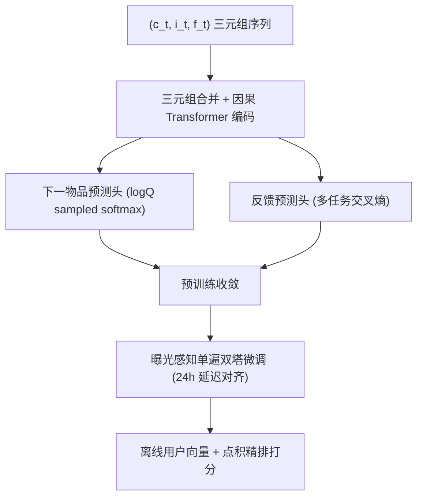
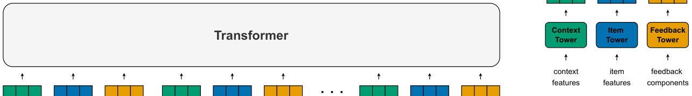

# Scaling Recommender Transformers to One Billion Parameters (将推荐 Transformer 扩展至十亿参数)

- **会议/期刊**: KDD 2026
- **作者与机构**: Kirill Khrylchenko (HSE)、Artem Matveev (Yandex/HSE)、Sergei Makeev (Yandex)、Vladimir Baikalov (ITMO)，工作于 Yandex Music 推荐团队完成
- **推荐链路定位**: 精排（impression-level ranking）+ 离线双塔特征供给
- **研究方向**: 序列与会话推荐 / 生成式推荐
- **论文原文**: [https://arxiv.org/abs/2507.15994v2](https://arxiv.org/abs/2507.15994v2)
- **开源代码**: 暂未开源

## TL;DR (1分钟核心速览)

工业推荐 Transformer 编码器长期停留在百万级参数（HSTU 最大仅 176M），缩放收益不明。ARGUS 把用户历史建模为 $(c_t,i_t,f_t)$ 三元组序列，提出「反馈预测 + 下一物品预测」双头自回归预训练，并设计曝光感知、单遍因果编码的双塔微调以支持离线日更推理。在 300B 交互的工业音乐数据、全局时间切分 + 相邻曝光对 pairwise 准确率协议下，编码器从 3.2M 扩到 1.007B 参数，特征供给场景 uplift 由 +1.35% 升至 +2.66%，线上 A/B 听歌时长 +2.26%、点赞率 +6.37%。

## Background & Motivation (背景与核心矛盾)

- **主流范式**: 工业界分两派——early-fusion 排序器（Wide&Deep/DCN-v2/MaskNet）靠海量 ID embedding 撑参数，稠密编码器仅千万级；序列推荐器（SASRec/PinnerFormer/HSTU）可转双塔做 ANN 召回，但编码器普遍只有 2 层、隐层几百维。
- **前人局限**: 其一，early-fusion 排序器的缩放潜力被 DCN-v2/MaskNet 等强归纳偏置的专用交叉层锁死，Ardalani 等已实证「参数缩放对该架构失效」；其二，序列推荐器虽无结构枷锁，但学界/工业界编码器始终停留在几百万参数，且多数缩放研究用 Leave-One-Out 随机划分，大模型记忆能力会直接导致评估虚高。
- **核心洞察 (Key Insight)**: 作者用 RL 视角重述推荐——生产系统是 logging policy，用户反馈与自然流量是 environment。纯 next-item 预测只模仿 logging policy（且 SASRec 式只取正反馈，把「被曝光概率」与「被喜欢概率」混为一谈），无法学到用户真实偏好；必须显式建模反馈才能逼近 environment。
- **本文切入点**: 把预训练目标拆成「模仿策略」的下一物品预测与「建模环境」的反馈预测两个互补子任务，并证明该分解在 3.2M→1B 参数区间稳定缩放。

## Method (核心方法设计)

### 1. 整体框架 (Overall Architecture)

输入为用户交互序列 $S_T=\{(c_t,i_t,f_t)\}_{t=1}^T$，其中$c_t$含 surface（推荐曝光 vs. 自然搜索/浏览）、设备等上下文，$f_t$为多维反馈。为控制序列长度，作者将三元组合并为单个交互 embedding（序列长度由$3n$降为$n$），编码器每个位置输出一个隐状态$h_t$，再经两个并行头分别做下一物品的 sampled softmax 与反馈的多输出分类。预训练完成后进入微调：单遍因果 Transformer 产出用户状态序列，曝光物品序列按时间戳与模拟 24 小时延迟对齐，点积打分后接 pairwise 排序损失，最终固化为可离线日更的双塔。

<figure class="paper-figure" markdown="span">
  <figcaption>图1：预训练架构概览，将用户的上下文-物品-反馈历史作为输入送入 transformer。两个并行头分别产生下一物品预测和反馈预测。</figcaption>
</figure>

### 2. 关键设计拆解 (Key Designs)

1. **双目标自回归预训练（策略模仿 + 环境建模）**：痛点在于 SASRec 式纯正反馈 next-item 目标混淆了曝光与偏好。本文保留全部交互（含负反馈与自然流量），下一物品项条件于 surface $c_t$，使单模型能区分「复现某推荐位的投放行为」与「学习自然导航偏好」；反馈项则对$K$ 个条件独立的反馈维度做多任务分类：
$$\mathcal{L}_{\text{pre-train}}=\mathcal{L}_{\text{NIP}}+\sum_{k=1}^{K}\text{CE}(f_t^k,l_t^k)$$
直觉上，前者提供海量易学信号稳住表征，后者注入稀疏但高价值的偏好监督，二者互补才让大容量编码器「有东西可学」。

2. **logQ 校正的混合负采样下一物品损失**：全库 softmax 不可行，纯 in-batch 负采样又因热门物品高频出现而系统性高估其概率。本文用 8192 个 in-batch 负例 + 8192 个均匀负例的混合采样，并以 count-min sketch 维护采样概率 $Q(n)$ 做 logQ 校正：
$$\mathcal{L}_{\text{NIP}}=-\log\frac{e^{f(h_{c_t},i_t)}}{e^{f(h_{c_t},i_t)}+\sum_{n\in N}e^{f(h_{c_t},n)-\log Q(n)}}$$
其中 $f(h,i)=\cos(h,i)/\exp(\tau)$，$\tau$可学习并截断于$[0.01,100]$。校正项把「采样偏差」从梯度中除掉，使大模型不会把容量浪费在拟合热门度先验上。

3. **曝光感知单遍双塔微调与训练开销**：预训练域含自然流量，与最终只对推荐曝光打分的任务存在 domain shift；同时实时 target-aware 编码每个候选代价过高。本文只跑一遍因果编码得到用户状态序列，曝光物品按时间戳与 24 小时模拟延迟匹配到对应 $h_t$，打分$\phi_\theta(u,i_t)=\langle h_t,i_t\rangle$，再套 pairwise logistic 损失。这样既保留预训练的简单因果掩码（无需复杂 mask 模拟延迟），又把在线计算压缩为「离线算用户向量 + 线上点积」。训练侧用 64–256 张 A100、单 epoch、backbone 与 head 分离学习率调度。

## Experimental Setup & Evaluation Protocol (实验设置与评估协议)

- **数据集与预处理**: 无公开数据集满足「十亿级参数 + 含曝光与自然流量 + 可上线验证」三条件，作者自建工业音乐平台数据（采样数千万用户一年行为）：

| 数据集 | #Users | #Items | #Interactions | 稀疏度/密度 | 特征/场景说明 |
| :--- | :---: | :---: | :---: | :---: | :--- |
| 工业音乐平台（私有） | 数千万 | 数百万 | >300B | 极稀疏 | ItemID/ArtistID、收听时长、跳过、点赞、surface/设备/推荐设置 |

- **数据划分与防穿越 (Splitting Strategy)**: 严格 `全局时间戳切分`，训练期后一周作为测试集；作者明确批评缩放研究常用的 Leave-One-Out 随机划分会让大模型因记忆未来交互而虚高。
- **排名评测协议 (Ranking Protocol)**: 预训练阶段用归一化熵（相对经验反馈分布 / unigram 物品分布，采样配置与训练一致）；排序阶段用 `相邻曝光对 pairwise 准确率`——仅比较同一用户时间相邻、反馈强度不同的曝光对（跳过 < 高完播 < 点赞），并报告相对生产排序器的 uplift `PAU`。这是受限候选对协议，非 Full-Ranking。
- **对比基线与超参设置**: 同架构族内比较 Mini(3.2M)/Small(18.9M)/Medium(126M)/Large(1.007B)，外加 HSTU(L24 H1024, 176M) 作为 drop-in 编码器替换；下游主基线为千特征 GBDT 生产排序器。统一 130M 参数的三路 ItemID embedding 表（不计入编码器规模），输出维度 512，预训练序列长 512、微调 2048/8192。

## Key Experimental Results (实验关键数据)

### 1. 主实验对比 (Main Results)

| 编码器 | 配置 | #Params | 反馈预测熵↓ | 下一物品熵↓ | 独立排序 PAU | 特征供给 PAU |
| :--- | :--- | :---: | :---: | :---: | :---: | :---: |
| Mini | L4 H256 | 3.2M | 0.5830 | 0.5855 | 0.4777 | +1.35% |
| Small | L6 H512 | 18.9M | 0.5756 (-1.28%) | 0.5707 (-2.51%) | 0.4691 | +1.82% |
| Medium | L10 H1024 | 126.0M | 0.5690 (-2.41%) | 0.5556 (-5.10%) | 0.4502 | +2.32% |
| **Large (ARGUS)** | L20 H2048 | **1.007B** | **0.5631 (-3.43%)** | **0.5436 (-7.15%)** | **0.4372** | **+2.66%** |
| HSTU | L24 H1024 | 176.0M | 0.5684 (-2.51%) | 0.5553 (-5.15%) | 0.4488 | +2.34% |

线上 A/B（相对上一代部署的累计增益）：ARGUS（8192 上下文、126M 编码器）带来 **TLT +2.26%、点赞率 +6.37%**，为平台历史上所有深度学习推荐系统中最优；此前 Offline V1/V2/V3 分别仅 +0.52%/+1.00%/+0.73% TLT。

### 2. 消融实验 (Ablation Study)

| 预训练 | 微调 | 独立排序 PAU | 特征供给 PAU |
| :---: | :---: | :---: | :---: |
| × | 1 年 | -7.72% | +1.17% |
| ✓ | 1 周 | -9.27% | +0.63% |
| ✓ | 1 年 | **-5.33%** | **+2.32%** |

| 微调上下文长度 | 独立排序 PAU | 特征供给 PAU |
| :---: | :---: | :---: |
| 512 | -8.93% | +1.01% |
| 2048 | -5.33% | +2.32% |
| 8192 | **-4.73%** | **+2.77%** |

### 3. 关键实验发现 (Key Findings)

1. **缩放定律在推荐域成立且可量化**：参数从 3.2M 到 1B，下一物品熵单调下降 7.15%、特征供给 uplift 从 +1.35% 升至 +2.66%，图 4 显示对数参数轴上近似线性——这是首次在十亿级推荐编码器上复现 LLM 式缩放趋势。
2. **两阶段缺一不可，且微调不能「小」**：去掉预训练后即使微调一整年也只有 +1.17%；而同一预训练骨干把微调从 1 周拉到 1 年，uplift 从 +0.63% 跃至 +2.32%——与 LLM 微调集远小于预训练集的惯例相反，曝光级排序需要同量级微调数据。
3. **上下文长度与模型规模可互换**：微调上下文 512→2048 带来 +1.31pt uplift，2048→8192 再 +0.45pt，后者增益约等于把编码器从 100M 扩到 1B，说明长历史是比堆参数更便宜的缩放杠杆。

## Highlights & Limitations (亮点、对比与审稿批判)

- **与代表作对比 (vs. Prior Work)**: 相比 HSTU（176M、双管线、实时 target-aware 排序），ARGUS 用统一预训练目标覆盖全部交互（含负反馈），且以离线双塔把服务成本压到点积级别；相比 SASRec/PinnerFormer 的纯正反馈 next-item 目标，本文显式解耦反馈建模，这是缩放能生效的关键；相比 Wukong 的 10B 参数宣称，本文提供了可复现的完整配方与线上验证。
- **可迁移亮点**: ①「策略模仿 + 环境建模」的双头分解可直接移植到短视频、电商等有多维反馈的序列骨干预训练；②24 小时延迟模拟 + 单遍因果编码的双塔微调，是把大编码器塞进日更离线链路的通用工程范式。
- **审稿级局限批判**: 其一，核心数据集私有且无开源代码，缩放曲线的可复现性依赖读者自有十亿级交互；其二，1B 配置仅有离线指标，线上 A/B 只验证了 126M 版本，最大模型的真实收益与推理成本仍是空白；此外 HSTU 对比仅取单一配置，未做等参数量对齐的公平缩放对比。

## Rating (四维评分)

- **方法创新性 (Novelty)**: ⭐⭐⭐⭐ （双目标分解本身不算全新，但用 RL 视角把「模仿 logging policy / 建模 environment」讲透并实证其缩放必要性，是有价值的框架性贡献）
- **评估协议与实验扎实度 (Protocol & Experiments)**: ⭐⭐⭐⭐ （严格全局时间切分 + 相邻曝光对协议 + 真实 A/B，规避了缩放研究常见的泄漏陷阱；扣分在私有数据与 1B 模型缺线上验证）
- **写作与数学规范度 (Clarity & Rigor)**: ⭐⭐⭐⭐ （损失与采样校正公式交代清楚，三元组合并的近似取舍坦诚讨论；缩放定律仅给趋势图未拟合幂律参数，严谨度略欠）
- **工业落地与复现价值 (Industrial & Practical Value)**: ⭐⭐⭐⭐ （离线双塔 + 日更向量使十亿级编码器可落地，A/B 增益为平台历史最佳；但无开源代码，复现门槛高）
