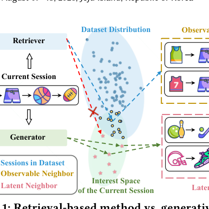
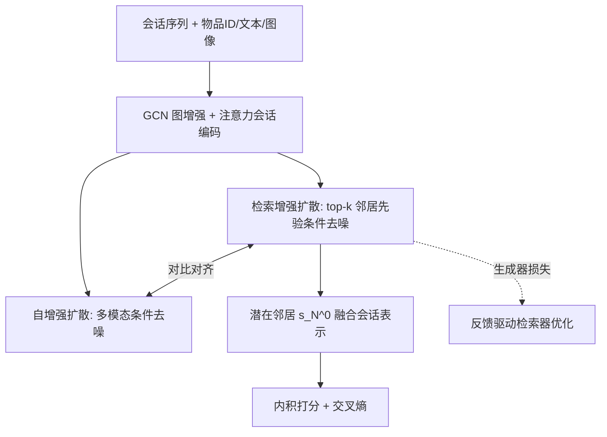
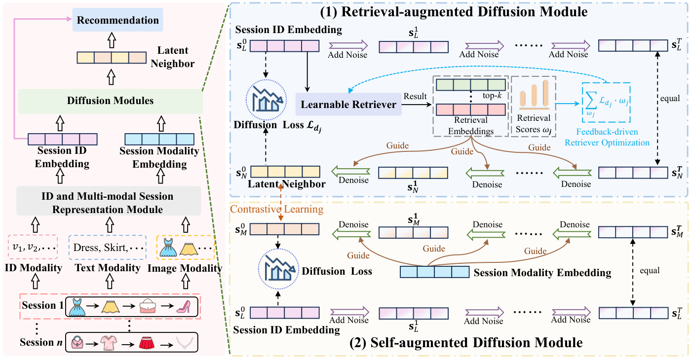

# Unleashing the Potential of Neighbors: Diffusion-based Latent Neighbor Generation for Session-based Recommendation (释放邻居潜力：面向会话推荐的扩散式潜在邻居生成)

- **会议/期刊**: KDD 2026
- **作者与机构**: Yuhan Yang, Jie Zou, Guojia An, Jiwei Wei, Yang Yang, Heng Tao Shen（电子科技大学）
- **推荐链路定位**: 召回（会话级候选增强）
- **研究方向**: 序列与会话推荐 / 生成式推荐
- **论文原文**: [论文原文链接](https://arxiv.org/abs/2601.03903v1)
- **开源代码**: 暂未开源

## TL;DR (1分钟核心速览)

匿名会话推荐（SBR）因会话短、无用户画像而严重稀疏，主流做法是检索历史相似会话（可观测邻居）来增强当前会话，但检索被数据集边界锁死，无法触达“兴趣空间内但未被记录”的邻居。本文提出 DiffSBR，用条件 DDPM 生成**潜在邻居**：检索增强扩散模块以 top-k 检索邻居为先验引导去噪，并用生成器损失反向优化检索器形成闭环；自增强扩散模块以当前会话多模态信号经对比学习注入生成过程。在 4 个 Amazon/Instacart 数据集、P@10/20 与 MRR@10/20 全指标上超越 11 个基线，P@20 相对提升最高 18.45%（Cellphones）。

## Background & Motivation (背景与核心矛盾)

- **主流范式**: SBR 以会话内物品序列建模意图（GRU4Rec/NARM/SR-GNN），近期转向跨会话邻居增强——相似度检索（ICM-SR、DIDN、MSGAT）或共现图（CGL、DIMO），并辅以多模态特征（MMSBR、DIMO）。
- **前人局限**: ① 检索范式只能返回数据集中**已存在**的会话，邻居覆盖被数据集分布截断（图 1 蓝区），兴趣空间中大量语义相关但未记录的邻居不可达；② 多模态信息多用于会话编码或后期融合，从未进入“邻居构造”环节，邻居质量本身未被提升。
- **核心洞察 (Key Insight)**: 邻居的价值上限由“可观测数据”决定，而用户兴趣空间严格大于数据集分布；若把邻居构造从**检索**转为**生成**，即可在兴趣空间内主动探索未观测区域。
- **本文切入点**: 以扩散模型为生成骨干，但纯生成易漂移到语义无关区域，故用“检索先验 + 多模态自信号”双重条件约束生成方向。

<figure class="paper-figure" markdown="span">
  <figcaption>图1：基于检索的方法与生成式方法的对比。蓝色区域表示数据集的分布，绿色区域表示当前会话的完整兴趣空间。基于检索的方法只能访问这些区域交集内与兴趣对齐的邻居，因而受限于已观测数据。相比之下，生成式方法通过探索整个兴趣空间克服了这一限制，能够生成潜在相关但未被观测到的潜在邻居。</figcaption>
</figure>

## Method (核心方法设计)

### 1. 整体框架 (Overall Architecture)

输入会话先经 ID 与多模态两条通道编码：物品 ID 嵌入与“文本标题+GoogLeNet 图像伪标签拼接后过 BERT”的多模态嵌入，分别在共现物品图上做 3 层 GCN 传播并层平均，再以 last-click 物品为 query 做注意力聚合，得到会话表示 $\mathbf{s}^{id}$ 与 $\mathbf{s}^{mo}$。二者分别送入两个扩散模块：检索增强扩散以 top-k 邻居为条件生成潜在邻居 $\mathbf{s}_N^0$；自增强扩散以 $\mathbf{s}^{mo}$ 为条件走另一条去噪路径，两条路径在中间步做对比对齐。最终表示 $\mathbf{s}_f=\rho\mathbf{s}^{id}+(1-\rho)\mathbf{s}_N^0$ 与物品嵌入内积打分，交叉熵训练。

<figure class="paper-figure" markdown="span">
  <figcaption>图2：DiffSBR的整体框架。左侧部分为整体框架，右侧部分表示我们扩散模块的两个主要组件：（1）检索增强扩散模块，在检索到的先验引导下生成潜在邻居；（2）自增强扩散模块，利用会话自身的多模态信息提升潜在邻居的质量。</figcaption>
</figure>

### 2. 关键设计拆解 (Key Designs)

1. **检索增强扩散 + 反馈驱动检索器优化（让生成“有方向”）**：痛点是无条件扩散在兴趣空间中漫游、易生成语义无关邻居。做法是把 top-k 邻居的 softmax 归一化权重 $\omega_j$ 作为条件注入去噪网络，直接预测干净邻居而非噪声：$\mathbf{s}_N^0=f_\theta(\mathbf{s}_L^t,\mathcal{N}_k,t)$，损失 $\mathcal{L}_d=\mathbb{E}\|\mathbf{s}^{id}-f_\theta(\sqrt{\bar\alpha_t}\mathbf{s}_L^0+\sqrt{1-\bar\alpha_t}\boldsymbol{\epsilon},\mathcal{N}_k,t)\|^2$。更关键的是闭环：以“某邻居作条件时的扩散损失 $\mathcal{L}_{d_j}$ 越小则该邻居越有用”为相对监督信号，令 $\mathcal{L}_r=\sum_{\omega_j\in\text{top-}k}\mathcal{L}_{d_j}\cdot\omega_j$，使检索器按生成器偏好重排邻居——把检索从“静态相似”变为“任务对齐”。

2. **自增强扩散 + 跨路径对比（让多模态“进生成”而非“进编码”）**：痛点在于早融合/晚融合/条件融合（EF/LF/CF）都把模态当作静态特征，与去噪过程不对齐。本文让多模态表示 $\mathbf{s}^{mo}$ 作为独立条件驱动第二条去噪链 $f_\psi(\mathbf{s}_L^t,\mathbf{s}^{mo},t)$，再对两条链在步 $t$ 的输出做 InfoNCE 对齐：$\mathcal{L}_m=-\frac{1}{B}\sum_i\log\frac{\exp(\text{sim}(\mathbf{s}_{N,i}^t,\mathbf{s}_{M,i}^t)/\tau)}{\sum_j\exp(\text{sim}(\mathbf{s}_{N,i}^t,\mathbf{s}_{M,j}^t)/\tau)}$。直觉是：模态不直接改写邻居，而是通过对比“拉近”生成分布，避免污染检索先验通道。

3. **训练目标与推理效率**：总损失 $\mathcal{L}=\mathcal{L}_e+\gamma(\mathcal{L}_r+\mathcal{L}_s)+\delta\mathcal{L}_m$，$\mathcal{L}_e$ 为交叉熵；无显式负采样，全库 softmax 训练。推理采用确定性 DDPM：先对 $\mathbf{s}^{id}$ 前向加噪 $T'$ 步，再以检索先验为条件反向去噪 $T'$ 步（方差置零、直接用预测均值），扩散步数 32、截断线性噪声表；每会话仅需一次 top-k 检索 + 32 步 MLP 去噪，开销远低于逐物品生成。

## Experimental Setup & Evaluation Protocol (实验设置与评估协议)

- **数据集与预处理**: 三个 Amazon 类目 + Instacart；按天聚合交互构造会话，Instacart 取最短 20% 交易模拟短会话；沿用 SBR 惯例**移除长度 1 会话与出现少于 5 次的物品（5-core）**。

| 数据集 | #Items | #Interactions | #Sessions | 平均长度 | 模态 |
| :--- | :---: | :---: | :---: | :---: | :--- |
| Cellphones | 9,091 | 123,186 | 40,344 | 3.05 | 文本+图像 |
| Sports | 14,650 | 282,102 | 90,492 | 3.12 | 文本+图像 |
| Grocery | 7,286 | 151,251 | 43,648 | 3.47 | 文本+图像 |
| Instacart | 10,009 | 380,230 | 88,022 | 4.32 | 仅文本 |

- **数据划分与防穿越 (Splitting Strategy)**: 沿用 DIMO 的会话级划分协议（训练/验证/测试按会话切分，测试集取每会话末位物品为标签），属 `Leave-One-Out` 式 next-item 预测。
- **排名评测协议 (Ranking Protocol)**: 采用 `Full-Ranking`（对全物品库打分排序，非采样负例），指标 P@10/20、MRR@10/20；最优基线以 $p<0.05$ 显著性检验标注。
- **对比基线与超参设置**: 11 个基线覆盖四类——纯检索（SKNN）、序列/GNN（NARM、SR-GNN、MSGIFSR、Atten-Mixer）、邻居检索（MSGAT、MGS）、多模态（MMSBR、DIMO）、扩散序列（DiffuRec、DiQDiff）。统一 $d=100$、Adam、lr=0.001、batch=50、GCN 3 层、$\tau=0.3$、扩散步 32；$\gamma\in[6,10]$、$\delta\in\{0.05,0.1\}$ 网格搜索。

## Key Experimental Results (实验关键数据)

### 1. 主实验对比 (Main Results)

| Model | Cellphones P@10 | Cellphones P@20 | Cellphones MRR@20 | Sports P@20 | Grocery P@20 | Instacart P@20 | Instacart MRR@20 |
| :--- | :---: | :---: | :---: | :---: | :---: | :---: | :---: |
| SKNN | 14.31 | 16.48 | 9.06 | 33.98 | 42.40 | 11.79 | 2.41 |
| NARM | 15.42 | 16.80 | 12.53 | 36.67 | 47.14 | 12.19 | 3.25 |
| SR-GNN | 16.36 | 18.11 | 13.09 | 37.69 | 46.24 | 13.00 | 3.64 |
| Atten-Mixer | 19.51 | 22.28 | 14.71 | 39.19 | 49.56 | 11.53 | 3.36 |
| MSGAT | 17.22 | 20.01 | 13.67 | 38.53 | 47.01 | 13.36 | 3.77 |
| MMSBR | 20.59 | 22.82 | 14.13 | 38.29 | 47.89 | 14.37 | 3.84 |
| DIMO | 31.66 | 38.81 | 17.36 | 49.86 | 57.01 | 18.36 | 4.81 |
| DiffuRec | 25.78 | 30.68 | 15.88 | 47.31 | 54.39 | 13.81 | 3.88 |
| DiQDiff | 28.12 | 33.19 | 16.83 | 49.28 | 56.03 | 15.34 | 4.17 |
| **DiffSBR** | **37.28\*** | **45.97\*** | **18.60\*** | **55.83\*** | **62.33\*** | **20.34\*** | **5.57\*** |
| Improv.% | +17.75% | +18.45% | +7.14% | +11.97% | +9.33% | +10.78% | +15.80% |

### 2. 消融实验 (Ablation Study)

| 变体 | Cellphones P@20 | Sports P@20 | Grocery P@20 | Instacart P@20 | Instacart MRR@20 |
| :--- | :---: | :---: | :---: | :---: | :---: |
| w/o RAD（去检索增强扩散） | 显著下降 | 显著下降 | 显著下降 | 显著下降 | 显著下降 |
| w/o FDRQ（去反馈优化检索器） | 下降 | 下降 | 下降 | 下降 | 下降 |
| w/o SAD（去自增强扩散） | 43.19 | 53.90 | 60.70 | 18.55 | 4.97 |
| -EF（早融合替代） | 40.20 | 50.41 | 58.83 | 15.85 | 4.54 |
| -LF（晚融合替代） | 43.56 | 52.69 | 61.07 | 19.15 | 4.77 |
| -CF（条件融合替代） | 39.98 | 51.09 | 59.08 | 17.56 | 4.79 |
| -AF（跨模态注意力替代对比） | 44.19 | 53.82 | 61.40 | 19.89 | 5.30 |
| **DiffSBR** | **45.97** | **55.83** | **62.33** | **20.34** | **5.57** |

### 3. 关键实验发现 (Key Findings)

1. **潜在邻居 > 可观测邻居是核心增益来源**：将同一框架内的邻居替换为纯检索邻居（Observable-Neighbors）后，三个数据集 P@20/MRR@20 全面落后于 Latent-Neighbors；t-SNE 显示潜在邻居更紧贴目标会话、填补稀疏区，而检索邻居分布散乱——直接证明“生成”而非“更强编码”带来收益。
2. **多模态必须“进扩散”而非“进编码”**：w/o SAD 在 Instacart 上 P@20 从 20.34 掉到 18.55（-8.8%），而 EF/CF 等融合替代方案甚至低于 w/o SAD（CF 仅 17.56），说明粗粒度融合会干扰去噪；仅保留对比对齐的完整设计才最优，验证“独立条件链 + 对比拉近”的必要性。
3. **检索先验需“少而准”且与生成器协同**：$k$ 从 1 增至 3 性能上升，超过后回落（Sports 峰值 $k=2$），过多邻居引入噪声；去掉反馈优化（w/o FDRQ）即掉点，说明检索器按生成损失重排比静态相似度更有效。$\gamma$ 最优 7–8、$\delta$ 最优 0.05–0.1，过大则扩散/对比项压制主任务。

## Highlights, Limitations & Rating (亮点、对比与审稿评价)

- **与代表作对比 (vs. Prior Work)**: 对比 DIMO（最强基线，解耦 ID/模态 + 共现图）——DIMO 仍把邻居当静态检索结果，DiffSBR 把邻居变成可生成的隐变量；对比 DiQDiff/DiffuRec（扩散序列推荐）——它们用扩散生成**目标物品或序列表示**，本文首次用扩散生成**邻居**这一中间结构，且引入检索闭环与多模态双条件；对比 MSGAT/MGS——同属邻居检索，但受限于可观测数据边界。
- **可迁移亮点**: ① “生成器损失反传检索器打分”的闭环监督可迁移到 RAG 式召回、图邻居采样等任何“检索-下游”耦合场景；② 用独立条件扩散链 + 跨链对比注入辅助模态，避免辅助信号污染主条件通道，适用于多模态/多源特征融合。
- **审稿级局限批判**: ① 推理需每会话 top-k 检索 + 32 步去噪，且训练含双扩散链与对比损失，工业级低延迟场景成本未评估；② 仅在 4 个中小规模 Amazon/Instacart 数据集验证，无大规模或线上 A/B；③ 潜在邻居缺乏“真值”校验，仅以推荐指标间接证明质量，且 $k$、$\gamma$、$\delta$ 均需逐数据集调参，敏感度较高。
- **四维评分**: 创新性 ⭐⭐⭐⭐ | 实验扎实度 ⭐⭐⭐⭐ | 方法清晰度 ⭐⭐⭐⭐ | 落地价值 ⭐⭐⭐

