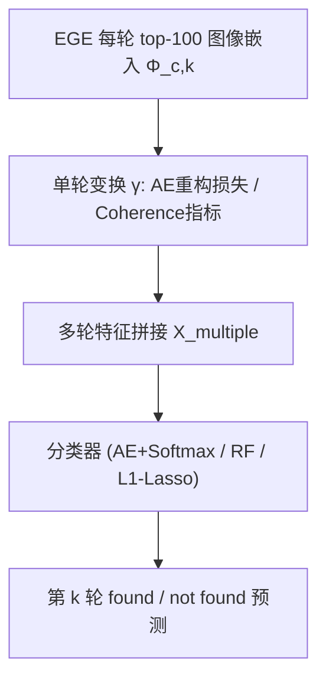
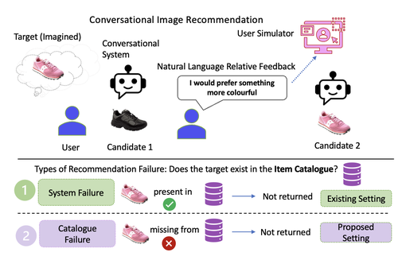

# Failure Prediction in Conversational Recommendation Systems (对话式推荐系统中的失败预测)

- **会议/期刊**: RecSys 2025
- **作者与机构**: Maria Vlachou (University of Glasgow)
- **推荐链路定位**: 重排（对话轮次级失败预警，作用于检索结果之上）
- **研究方向**: 对话推荐与智能体仿真 / 序列与会话推荐
- **论文原文**: [论文原文链接](https://arxiv.org/abs/2507.17976v1)
- **开源代码**: [开源代码仓库链接](https://github.com/mariavlachou/failpred_missing)

## TL;DR (1分钟核心速览)

对话式图像推荐（CRS）默认用户目标必在目录内，但真实场景中目标可能根本不存在（目录失败），用户会无谓地多轮交互直至沮丧。本文借鉴 IR 的 Query Performance Prediction，提出**监督式对话性能预测**任务：用多轮 top-100 检索图像的嵌入表征训练分类器，预测第 $k$轮目标是否被命中。在 Shoes 与 FashionIQ Dresses 上，AE 预测器在基础场景（系统失败）Dresses 全轮次达 1.00 准确率（$p<0.05$），但诱导目录缺失后所有预测器精度普遍下降 10–30 个点，暴露该任务本质更难。

## Background & Motivation (背景与核心矛盾)

- **主流范式**: 对话式图像推荐中，用户每轮对候选图给出相对视觉差异的自然语言 critique，系统（如 EGE）据此更新检索；评估只看"目标是否在固定轮次内被召回"。
- **前人局限**: ① 现有 CRS 评估隐含假设目标物品存在于目录，无法区分"系统没找到"与"目录里根本没有"；② 早期对话性能预测（CPP）仅用打分统计量、且只覆盖单轮或相邻两轮，无法利用多轮语义累积。
- **核心洞察 (Key Insight)**: 图像检索是单向量稠密检索，嵌入中并非所有维度都同等有信息量；多轮 top-100 结果的嵌入分布随对话推进逐步收敛，其"核心流形"与"轮间相关性"本身就是失败信号。
- **本文切入点**: 把失败预测建模为二分类，用 AE 压缩多轮检索嵌入的核心维度，或用 L1 收缩筛掉冗余轮次特征，从而在无相关性标注的条件下预测对话成败。

## Method (核心方法设计)

### 1. 整体框架 (Overall Architecture)

对每个目标物品视为一段独立对话，取 EGE 模型每轮 top-100 检索图像的嵌入 $\Phi_{c,k}$，经单轮变换$\gamma(\cdot)$后拼接为多轮特征$X^{multiple}_{C,k}=[\gamma(\Phi_{c,1}),\dots,\gamma(\Phi_{c,k})]$，送入分类器预测第$k$轮标签（found / not found）。$\gamma$有两种实例化：AE 重构损失（学核心流形）与 coherence 型 QPP 指标（刻画检索项两两语义关系）。训练用前$k-1$轮特征预测第$k$ 轮，逐轮对独立建模。

<figure class="paper-figure" markdown="span">
  <figcaption>图1：上：对话式图像推荐中一次交互的示例。轮次沿水平方向展开（每次交换一个CRS图标），而模拟器被用作产生用户反馈的代理（屏幕中相同的用户图标）。下：可能导致CRS中检索失败的不同情况：系统失败（当前已实现），以及我们提出的目录失败。</figcaption>
</figure>

### 2. 关键设计拆解 (Key Designs)

1. **AE 核心流形预测器**：痛点在于图像嵌入是单向量，无法像文本那样在 token 级挑重要维度。做法是用自编码器压缩再重构 top-100 嵌入，以重构误差作为特征：$\gamma(\Phi_{c,k})=L_{rec}=(h_{w,b}(\Phi_{c,k})-\Phi_{c,k})^2$，再接 softmax 与交叉熵$L_{cls}=-\sum p(\Phi_{c,k})\log q(h_{w,b}(\Phi_{c,k}))$，总损失$L_{total}=L_{rec}+L_{cls}$。直觉：重构得越"顺"的检索集合语义越自洽，越可能命中目标；重构残差大则暗示检索漂移。

2. **L1 收缩多轮 coherence 预测器**：痛点在于不同轮次对引导系统的作用不均等，且轮间特征自相关。做法是在 coherence 指标（AC / WAND / RV / A-pairRatio）拼接特征上做 L1 正则分类 $L_{cls}+\lambda\sum|w_i|$（$\lambda=0.1$），把"不重要轮次"的维度压到零。直觉：等价于自动做轮次级特征选择，在目录缺失、后期反馈变得无信息时尤其抗噪。

3. **训练目标、负采样与推理效率**：无负采样概念（二分类监督），70%/30% 对话划分，逐轮对训练独立分类器；推理仅需一次前向分类，开销远低于重跑检索，可在线作为"是否该提示用户换目标"的触发器。

## Experimental Setup & Evaluation Protocol (实验设置与评估协议)

- **数据集与预处理**: 两数据集均含候选-目标对的相对 critique，各采样 200 个目标物品（每目标一段对话），并用 QPP 检查保证难度分布：

| 数据集 | #Test Images | #Sampled Targets | 稀疏度/密度 | 特征/场景说明 |
| :--- | :---: | :---: | :---: | :--- |
| Shoes | 4658 | 200 | — | 鞋类相对属性 critique |
| FashionIQ Dresses | 2454 | 200 | — | 连衣裙，整体更难 |

- **数据划分与防穿越 (Splitting Strategy)**: 对话级 70% 训练 / 30% 测试；逐轮对（train up to $k-1$，predict$k$）独立划分，严格避免用评估轮特征。
- **排名评测协议 (Ranking Protocol)**: 非排名指标，用**分类准确率**；标签定义为第 $k$ 轮 top-100 是否命中目标（found / not found）。目录失败场景通过抽取 30% "easy items"（原本可命中）并禁止其被检索来诱导，标签改为 not found。
- **对比基线与超参设置**: 基线含 Score-based（Mean/Max/Std 组合）、AC、WAND、A-pairRatio、RV、LogReg；AE 用 Adam、lr=0.01、100 epochs、线性+ReLU 两层；显著性用 McNemar 检验 $p<0.05$。

## Key Experimental Results (实验关键数据)

### 1. 主实验对比 (Main Results)

选取代表性轮次对（Accuracy，加粗最优，`*` 表示相对最佳基线的显著性）：

| 场景 / 数据集 | 轮次对 | Score-based | A-pairRatio | RV | LogReg | AE (ours) | L1-based (ours) |
| :--- | :---: | :---: | :---: | :---: | :---: | :---: | :---: |
| Base / Shoes | 2,3 | 0.80 | 0.70 | 0.65 | 0.78 | **0.93\*** | 0.78 |
| Base / Shoes | 9,10 | 0.88 | 0.88 | 0.87 | 0.87 | 0.79 | **0.88** |
| Base / Dresses | 2,3 | 0.60 | 0.63 | 0.48 | 0.68 | **1.00\*** | 0.68 |
| Base / Dresses | 9,10 | 0.58 | 0.52 | 0.42 | 0.53 | **0.99\*** | 0.53 |
| Missing / Shoes | 5,6 | 0.52 | 0.72 | 0.52 | **0.77\*** | 0.62 | **0.77\*** |
| Missing / Shoes | 9,10 | 0.63 | 0.65 | 0.57 | 0.70 | 0.61 | **0.72\*** |
| Missing / Dresses | 4,5 | 0.58 | 0.48 | 0.50 | 0.57 | **0.68\*** | 0.57 |
| Missing / Dresses | 6,7 | 0.63 | 0.62 | 0.60 | 0.65 | **0.69\*** | 0.65 |

### 2. 消融实验 (Ablation Study)

| 配置 | Shoes Base | Dresses Base | Shoes Missing | Dresses Missing |
| :--- | :---: | :---: | :---: | :---: |
| AE 多轮（完整） | 0.93 (2,3) | 1.00 (2,3) | 0.62 (4,5) | 0.68 (4,5) |
| AE 单轮（仅 $k-1$） | 下降 | 下降 | 明显下降 | 明显下降 |
| AE 仅用 top-1 项 | 0.76 (found@1) | 0.95 | — | — |
| AE 用 top-20 项 | 0.57 | 0.95 | — | — |
| AE 用 top-100 项 | 0.87 | 0.95 | — | — |
| L1 收缩 vs 对应 RF | 持平/略优 | 持平 | 提升（如 0.67 vs 0.50） | 提升 |

### 3. 关键实验发现 (Key Findings)

1. **AE 在基础场景对 Dresses 近乎完美（1.00）**，但对 Shoes 仅早期轮次占优（0.93 vs 0.80），说明 AE 直接作用于嵌入、无需逐 query 数值统计，在"更难但目标存在"的数据上优势最大。
2. **目录缺失使所有预测器精度普遍下滑**：Shoes 从 0.80–0.88 掉到 0.50–0.78，且 Shoes 降幅大于 Dresses——因为 Dresses 本身难、可命中的 easy items 更少，被移除的目标比例实际更小，场景扰动更弱。
3. **多轮优于单轮、全量 top-100 优于 top-1/top-20**（Shoes 0.87 vs 0.76/0.57），证明检索集合的分布信息而非单个 top 项才是失败信号载体；L1 收缩在缺失场景成为最强基线（Shoes 5,6 与 9,10 均 0.77/0.72 且显著），因其自动屏蔽后期无信息轮次。

## Highlights & Limitations (亮点、对比与审稿批判)

- **与代表作对比 (vs. Prior Work)**: 相比早期 CPP [31] 仅用打分统计量且限单/双轮，本文首次引入多轮语义嵌入与监督分类；相比 iQPP [22] 在图像集合上做预检索预测，本文作用于多轮检索结果的嵌入流形；相比 BERT 类 QPP [2,8]，本文不依赖 token 级文本、可泛化到图像。
- **可迁移亮点**: ① "AE 重构残差作为检索自洽性信号"可迁移到任何稠密向量召回的质量监控；② "easy-item 屏蔽"是构造目录缺失/冷启动负例的廉价可控手段。
- **审稿级局限批判**: ① 仅 200 目标、两数据集、模拟器生成反馈，真实用户沮丧度与失败频率未验证；② 目录失败场景标签由人为屏蔽诱导，与真实库存缺失的分布存在偏差，且缺失场景下各预测器差异边际、无稳定赢家。

## Rating (四维评分)

- **方法创新性 (Novelty)**: ⭐⭐⭐⭐ （首次形式化"目录失败"并引入监督式对话性能预测，AE 核心流形视角有新意，但技术组件较常规）
- **评估协议与实验扎实度 (Protocol & Experiments)**: ⭐⭐⭐ （逐轮对划分与 McNemar 检验规范，但样本量小、缺真实用户与线上验证）
- **写作与数学规范度 (Clarity & Rigor)**: ⭐⭐⭐⭐ （任务定义与两场景区分清晰，公式简洁；部分符号如 $\gamma$ 的多实例化略松散）
- **工业落地与复现价值 (Industrial & Practical Value)**: ⭐⭐⭐⭐ （推理仅一次分类前向、代码已开源，可直接作为对话系统"劝退/换目标"触发器）

