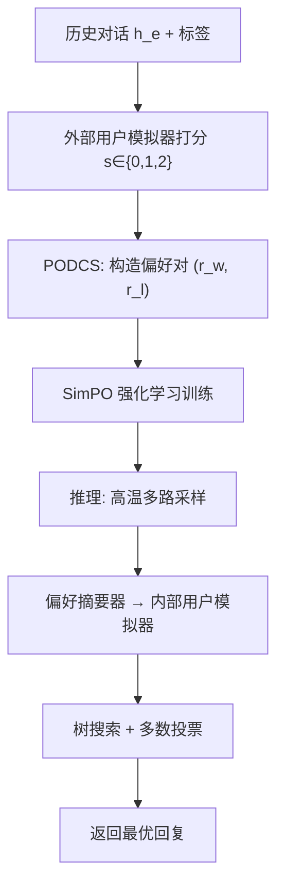
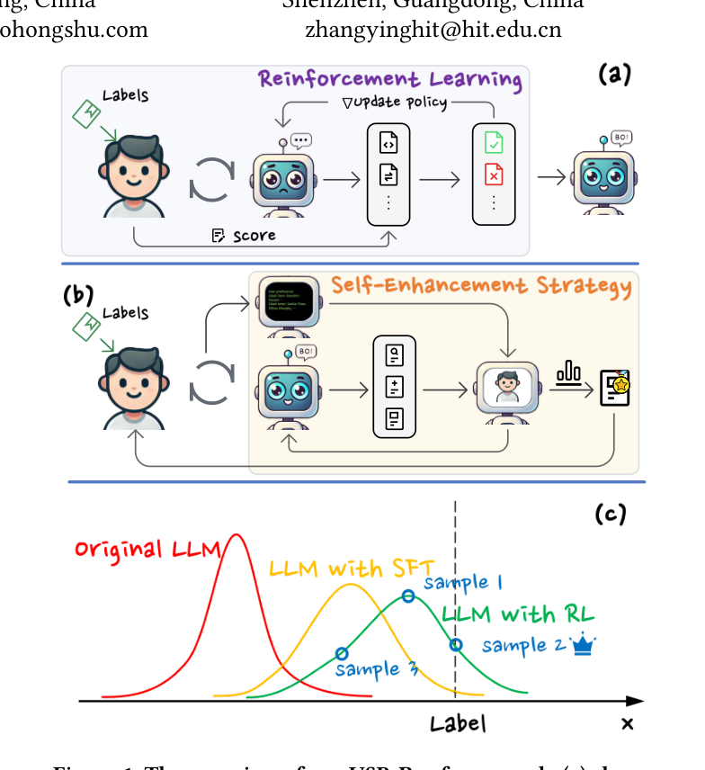

# USB-Rec: An Effective Framework for Improving Conversational Recommendation Capability of Large Language Model (基于用户模拟器的对话推荐能力增强框架)

- **会议/期刊**: RecSys 2025
- **作者与机构**: Jianyu Wen, Ying Zhang (哈工大深圳)；Jingyun Wang (北航)；Cilin Yan, Jiayin Cai, Xiaolong Jiang (小红书)
- **推荐链路定位**: 端到端生成式（多轮对话推荐）
- **研究方向**: 对话推荐与智能体仿真 / 大语言模型推荐
- **论文原文**: [https://arxiv.org/abs/2509.20381v1](https://arxiv.org/abs/2509.20381v1)
- **开源代码**: [https://github.com/John-Wendell/USB_Rec](https://github.com/John-Wendell/USB_Rec)

## TL;DR (1分钟核心速览)

现有 LLM-based CRS 几乎全部围绕 Prompt 工程与复杂 Pipeline 做文章，忽视了"在模型层面训练"这一根本路径；而 SFT 易过拟合噪声数据、RLHF 又依赖昂贵人工打分。USB-Rec 提出训练-推理一体化框架：训练期用**带标签的 LLM 用户模拟器**自动为多轮对话打分，构造偏好对做 SimPO 强化学习；推理期用**内部用户模拟器 + 树搜索 + 多数投票**的自增强策略（SES）把训练中习得但"低概率未表达"的推荐潜力激发出来。在 ReDial / OpenDialkg 上，iEval 分别达 1.29 / 1.40，较最强基线 ReFICR 与 GPT-4 均有稳定提升，且跨 Llama3.1-8B、ChatGLM3-6B、Qwen2.5-7B 三种底座一致有效。

## Background & Motivation (背景与核心矛盾)

- **主流范式**: 当前 LLM-based CRS（Chat-Rec、MemoCRS、ReFICR 等）主流做法是设计精巧 Prompt 或检索增强 Pipeline，把推荐结果塞进上下文让 LLM 生成回复，本质是"用 LLM 的分析总结能力"，而非"训练 LLM 的推荐能力"。
- **前人局限**: 其一，SFT 高度依赖训练集质量，而真实对话数据由不同推荐者采集、风格不一致，噪声极大，直接 SFT 易过拟合；其二，RLHF 虽能提升泛化与风格一致性，但依赖昂贵耗时的人工打分，难以规模化。
- **核心洞察 (Key Insight)**: 作者发现，经过 RL 训练后模型输出分布已向"推荐专家"靠拢，但目标回复处于**低概率区**，单次贪心解码难以表达——即"能力已习得但未被激发"。这解释了为何 RL 单独带来的增益有限（<0.05）。
- **本文切入点**: 用 LLM 用户模拟器替代人工打分，实现无人工、可扩展的偏好数据构造；再在推理期用内部模拟器做多次采样搜索，把低概率优质回复"捞"出来。

## Method (核心方法设计)

### 1. 整体框架 (Overall Architecture)

框架分训练与推理两阶段。训练期（PODCS）：以 SFT 最优模型为推荐者、原始模型为外部用户，带标签的用户模拟器在模拟对话结束后按"预测 vs 标签"给 0/1/2 分；对每条样本高温采样 $k$ 次，高分回复作 chosen、低分回复（或原始标签）作 rejected，经多数投票去噪后构成偏好对，用 SimPO 做 RL。推理期（SES）：用户偏好摘要器把历史对话压缩成结构化画像，据此构建**内部用户模拟器**（无标签），对推荐 LLM 的多路采样回复进行扩展模拟对话打分，配合树搜索与多数投票选出最优回复返回真实用户。

<figure class="paper-figure" markdown="span">
  <figcaption>图1：我们的USB-Rec框架概览。(a)展示了我们设计的强化学习方案，(b)是我们提出的推理搜索策略，(c)说明了上述两个组件结合时为何有效。</figcaption>
</figure>

### 2. 关键设计拆解 (Key Designs)

1. **PODCS 偏好数据构造（无人工 RL 训练）**：痛点是无标签无法自动打分、有标签数据又噪声大。核心是用带标签模拟器给出离散奖励，并按"是否出现满分"决定 chosen/rejected 的取法：

$$r_w=\begin{cases} r \text{ with } s=2, & \exists s=2 \\ \text{label}, & \forall s<2 \end{cases},\quad r_l=\begin{cases} r \text{ with } s<2, & \forall s<2 \\ \text{label}, & \forall s=2 \end{cases}$$

直觉是：简单样本全满分时以原始标签为 rejected（防止模型只学会"复读"），困难样本全低分时以标签为 chosen（用 ground-truth 兜底），从而在两端都保证偏好对可靠。

2. **SES 自增强推理（内部用户 + 树搜索）**：痛点是内部模拟器无标签、单点打分有偏。核心是先用摘要器生成画像 $p=\mathcal{F}_{ups}(h_e)$，内部用户按$r_i=\mathcal{F}_{ius}(h_s,p)$（$h_s=h_e\parallel h_i$）打分；再对首轮回复做树搜索，每个采样回复分支成新模拟对话，取子节点聚合分最高者为最终回复。树搜索引入的随机性叠加多数投票，显著降低内部打分偏差。

3. **训练目标与推理开销**：RL 阶段采用 SimPO，$\beta=0.5$，LoRA rank=8、batch=128；偏好采样$k=2$（因离散分数重复率高，加大$k$ 收益递减）。推理端仅在最后一轮启用 SES，单样本耗时从 2.93s 增至 6.12s（+3s 换 +0.08 iEval）；若开启树搜索则达 27.42s，用 vLLM 并行可压至约 3.67s 增量。

## Experimental Setup & Evaluation Protocol (实验设置与评估协议)

- **数据集与预处理**: 沿用 iEvaLM 的划分方式。

| 数据集 | #Dialogues | #Utterances | 领域 | 说明 |
| :--- | :---: | :---: | :---: | :--- |
| ReDial | 10,006 | 182,150 | 电影 | AMT 众包，51,699 部相关电影 |
| OpenDialkg | 12,320 | 71,873 | 电影+书籍 | 跨域，电影 6,429 / 书籍 5,891 对话 |

- **数据划分与防穿越 (Splitting Strategy)**: 遵循 iEvaLM 的 train/valid/test 划分（对话级切分）。
- **排名评测协议 (Ranking Protocol)**: 双指标——`Recall@1`（全测试集，传统指标，易偏向过拟合物品的传统模型）与 `iEval`（LLM 用户模拟器打分，模拟 3 轮对话，末轮给 0/1/2 分）。iEval 固定用 Llama3.1-8B 作外部评估器，样本数取 512（<200 不稳定，>400 收敛）。
- **对比基线与超参设置**: 传统模型 KBRD / BARCOR / UniCRS；LLM 基线 GPT-3.5-turbo / GPT-4 / ReFICR。底座模型 Llama3.1-8B、ChatGLM3-6B、Qwen2.5-7B，LoRA 微调，学习率 1e-5~1e-8 网格搜索。

## Key Experimental Results (实验关键数据)

### 1. 主实验对比 (Main Results)

| Methods | iEval ReDial | iEval OpenDialkg | Recall@1 ReDial | Recall@1 OpenDialkg |
| :--- | :---: | :---: | :---: | :---: |
| KBRD | 0.79 | 0.91 | 0.028 | 0.231 |
| BARCOR | 0.82 | 1.22 | 0.031 | **0.312** |
| UniCRS | 1.08 | 1.30 | **0.050** | 0.308 |
| GPT-3.5-turbo | 1.15 | 1.29 | 0.037 | 0.156 |
| GPT-4 | 1.20 | 1.33 | 0.043 | 0.277 |
| ReFICR | 1.25 | - | 0.056 | - |
| **USB-Rec** | **1.29** | **1.40** | **0.050** | 0.300 |

跨底座泛化（iEval 平均，B/L→RL+SES）：Llama3.1-8B 1.23→1.35（+0.12）；ChatGLM3-6B 1.06→1.17（+0.11）；Qwen2.5-7B 1.07→1.19（+0.12）。

### 2. 消融实验 (Ablation Study)

| 配置 | ReDial | OpenDialkg | Average |
| :--- | :---: | :---: | :---: |
| 无 SES (B/L+RL) | 1.30 | 1.41 | 1.36 |
| SES 仅末 1 轮 | 1.36 | 1.45 | 1.41 |
| SES 末 2 轮 | 1.40 | 1.48 | 1.44 |
| SES 末 3 轮 | 1.39 | 1.46 | 1.43 |
| SES 末 2 轮 + 树搜索 | **1.43** | **1.50** | **1.47** |
| SES 末 3 轮 + 树搜索 | 1.40 | 1.49 | 1.45 |

### 3. 关键实验发现 (Key Findings)

1. **训练增益小、推理增益大，二者互补**：单独 RL 平均仅 +0.04，单独 SES 平均 +0.09，而 RL+SES 达 +0.12；说明 RL 把输出分布推向专家区、SES 负责把低概率优质回复采样出来，缺一不可。
2. **树搜索与轮次存在最优区间**：末 2 轮 + 树搜索最优（1.47），但末 4 轮反降至 1.42，且从第 1 轮就搜索会因历史过短、摘要器画像失真而误导打分——搜索深度并非越深越好。
3. **采样宽度与投票数均非单调**：首轮采样数 >4 后指标下降（5 次比 3 次低 0.04~0.06），多数投票 >10 次亦回落（1.38→1.37），印证内部模拟器无标签时"选择过多易被误导"。

## Highlights & Limitations (亮点、对比与审稿批判)

- **与代表作对比 (vs. Prior Work)**: 相比 Chat-Rec / MemoCRS 的纯 Prompt 路线，本文首次在模型层面训练 CRS；相比 ReFICR 的检索增强 SFT，本文用 RL + 推理搜索，iEval 显著更高（1.29 vs 1.25）但 Recall@1 略低（0.050 vs 0.056），说明 RAG 提升"命中已有物品"却限制了对更优推荐的探索；相比 Friedman 等的 RLHF，本文用模拟器替代人工，可扩展性大幅提升。
- **可迁移亮点**: ①"带标签模拟器造偏好对 + 无标签内部模拟器做推理搜索"的双模拟器范式，可迁移到任何缺乏人工反馈的生成式推荐任务；②树搜索 + 多数投票的推理期自增强，对低概率优质输出的激发具有通用性。
- **审稿级局限批判**: ①推理开销显著，树搜索单样本 27.42s，即便 vLLM 加速仍有约 3.67s 增量，线上实时对话场景压力大；②iEval 依赖 Llama3.1-8B 作评估器且仅取 512 样本，评估器自身偏差与样本量限制可能影响结论稳健性；③偏好采样 $k=2$ 偏小，离散奖励重复率高，偏好对质量对温度超参较敏感。

## Rating (四维评分)

- **方法创新性 (Novelty)**: ⭐⭐⭐⭐ （首次系统性地在模型层面训练 LLM-based CRS，双模拟器训练-推理一体化设计新颖，但各组件单独看并非全新）
- **评估协议与实验扎实度 (Protocol & Experiments)**: ⭐⭐⭐⭐ （双数据集、三底座、iEval+Recall 双指标、消融充分，但 iEval 样本仅 512 且依赖单一评估器）
- **写作与数学规范度 (Clarity & Rigor)**: ⭐⭐⭐⭐ （PODCS 算法与 SES 流程描述清晰，公式简洁；但部分符号与超参选择缺乏理论推导支撑）
- **工业落地与复现价值 (Industrial & Practical Value)**: ⭐⭐⭐⭐ （代码已开源、LoRA 微调成本可控，但树搜索推理延迟是线上部署的主要瓶颈）

