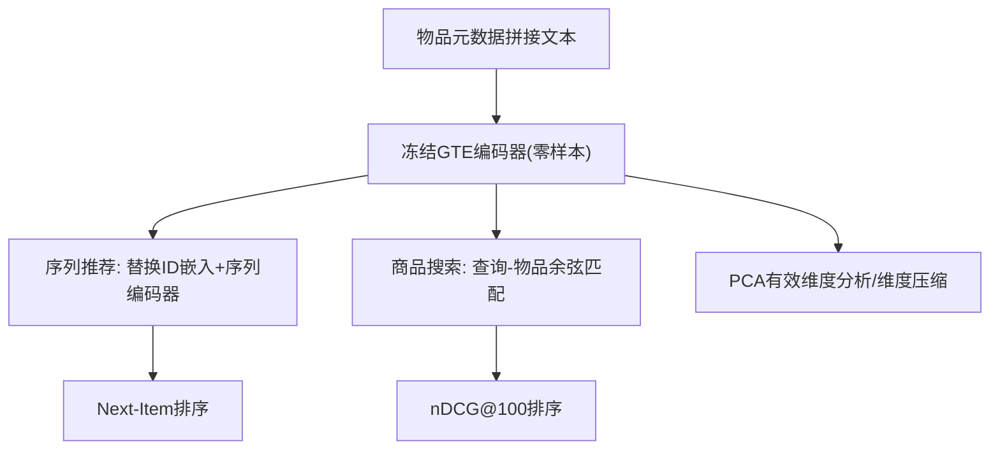
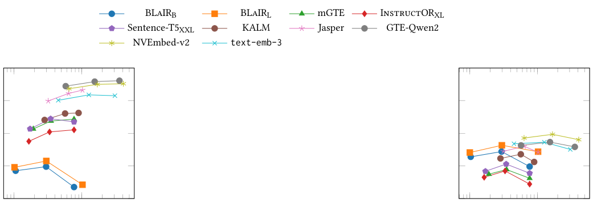

# Do We Really Need Specialization? Evaluating Generalist Text Embeddings for Zero-Shot Recommendation and Search (我们真的需要专门化吗？通用文本嵌入在零样本推荐与搜索中的评估)

- **会议/期刊**: RecSys 2025 (Short Paper)
- **作者与机构**: Matteo Attimonelli, Alessandro De Bellis, Claudio Pomo, Dietmar Jannach, Eugenio Di Sciascio, Tommaso Di Noia (Politecnico di Bari / Sapienza University of Rome / University of Klagenfurt)
- **推荐链路定位**: 召回（语义物品表征与查询-物品匹配）
- **研究方向**: 冷启动与长尾推荐 / 大语言模型推荐
- **论文原文**: [https://arxiv.org/abs/2507.05006v2](https://arxiv.org/abs/2507.05006v2)
- **开源代码**: [https://split.to/gte4ps](https://split.to/gte4ps)

## TL;DR (1分钟核心速览)

本文挑战"推荐/搜索必须做领域微调"的既有假设：在序列推荐与商品搜索两大任务上，直接使用大规模语料预训练的通用文本嵌入模型（GTE，如 NVEmbed-v2、GTE-Qwen2、KALM）做**零样本**物品/查询表征，即可全面超越 ID 模型、领域微调模型 BL!IR 乃至闭源 OpenAI text-embedding-3-large。作者进一步用 PCA 有效维度解释其优势——GTE 把信息更均匀地铺满嵌入空间（各向同性更好），并证明按主成分压缩维度既能降噪又能提升微调模型表现。在 Amazon Reviews 2023 与 ESCI/Amazon-C4 上，最佳 GTE 相对最佳 BL!IR 取得 $p<0.001$ 的显著提升（如 ESCI nDCG@100 从 12.12 升至 28.06）。

## Background & Motivation (背景与核心矛盾)

- **主流范式**: 推荐与搜索普遍用 PLM 从物品元数据抽取语义向量；序列推荐用文本增强 ID 嵌入（UniSRec 路线），商品搜索用稠密查询-物品匹配（BERT/ColBERT 路线）。
- **前人局限**: ①BL!IR 等代表作主张必须用大规模评论做领域/任务微调才能提升表征力，但微调模型在分布偏移的查询上泛化骤降（BL!IR 在 Amazon-C4 尚可，在 ESCI 从 17.18 跌至 12.12）；②多数方案依赖闭源嵌入或昂贵领域适配，冷启动/新品类场景下不可行。
- **核心洞察 (Key Insight)**: MTEB 榜单上涌现的 GTE 已在海量多任务语料上习得可迁移语义，其嵌入空间**各向同性更好、有效维度更高**，因此零样本即可胜任；而微调模型存在维度坍缩（dimensional collapse），方差挤在少数方向上。
- **本文切入点**: 不做任何微调，直接把 GTE 当"即插即用"物品编码器，并用 PCA 有效维度这一几何指标把"性能好"归因到"空间利用率高"。

## Method (核心方法设计)

### 1. 整体框架 (Overall Architecture)

本文是**评估型（evaluation）论文**，方法贡献在于统一的零样本表征协议 + 嵌入几何分析。流程：物品元数据（title/features/categories/description 拼接）→ 冻结的文本编码器 $e_N$输出稠密向量 → 序列推荐侧将文本向量替换/拼接进 GRU4Rec、SASRec、UniSRec 的 item 表征，序列编码器$O_{\text{seq}}$产出$h_t$后与候选做余弦相似度排序；搜索侧查询与物品分别编码后余弦匹配。训练阶段仅更新序列/匹配网络，文本编码器全程冻结（零样本）。分析阶段对 10 万条物品向量做 PCA，计算$U$-有效维度并做维度截断实验。

### 2. 关键设计拆解 (Key Designs)

1. **零样本 GTE 即插即用表征（替代领域微调）**：痛点是 BL!IR 类微调需大量评论监督且跨域泛化差。本文不改任何编码器参数，仅把 $e_N=\text{GTE}(x_{\text{item}})$送入下游，打分仍为$\hat{s}(q,i)=\text{Sim}(e_q,e_i)=\cos(e_q,e_i)$。有效性直觉：GTE 的多任务预训练已把"查询意图-物品属性"对齐内化，冻结反而避免了在小领域数据上的过拟合坍缩。

2. **$U$-有效维度量化空间利用率**：对中心化物品嵌入矩阵$E_{\text{SI}}\in\mathbb{R}^{N\times d}$做 PCA 得奇异值$\{\sigma_k\}$，定义解释方差比与有效维度
$$D(U):=\arg\min_K \left\{\frac{\sum_{k=1}^{K}\sigma_k^2}{\sum_{k=1}^{d}\sigma_k^2}\ge U\right\}$$
其中 $U\in\{0.80,0.95,1.00\}$。直觉：$D(0.80)$越接近全维度$d$，说明信息铺得越开、各向异性越弱；BL!IR 在$U=0.80$ 处维度骤降，正是维度坍缩的直接证据。

3. **主成分截断压缩（降噪 + 扩容）**：将物品与查询向量同时投影到前 $K$个主成分张成的子空间$e'=P_K^{\top}e$，$K=D(U)$。总训练目标沿用各下游模型原损失（序列推荐用交叉熵/BPR，搜索用对比损失），**无额外负采样改造**；推理时维度从 4096 降至数百，ANN 检索内存与延迟同步下降。直觉：低方差方向多为噪声，截断等价于有监督无关的各向异性校正。

## Experimental Setup & Evaluation Protocol (实验设置与评估协议)

- **数据集与预处理**: 沿用 Hou et al. (BL!IR) 的 Amazon Reviews 2023 划分与预处理，物品文本为 title+features+categories+description 拼接。

| 数据集 | #Users/Queries | #Items | 任务 | 说明 |
| :--- | :---: | :---: | :---: | :--- |
| Beauty | — | — | SR | 交互 104,766 起，较稀疏 |
| Games | — | — | SR | 中等规模 |
| Baby | — | — | SR | 交互达 3,583,323，最稠密 |
| ESCI-small | 27,643 | 1,367,729 | PS | 仅取 exact match，真实分级相关性 |
| Amazon-C4 | 21,223 | 1,058,417 | PS | ChatGPT 由 5 星评论合成查询 |

- **数据划分与防穿越 (Splitting Strategy)**: 完全复用 BL!IR 官方 split（序列推荐为按时间留出式划分，搜索为官方 query-item 划分），未引入新切分，保证与基线可比。
- **排名评测协议 (Ranking Protocol)**: 序列推荐用 RecBole 全库排序，报告 Recall@{10,50} 与 nDCG@{10,50}；商品搜索按 BL!IR 协议，每个 `<query,item>` 对与 **50 个随机采样负例** 组成候选池做 Sampled Ranking，报告 nDCG@100。检索用余弦相似度（经验优于欧氏/点积）。
- **对比基线与超参设置**: SR 侧基线 GRU4Rec/SASRec（ID 版）与 UniSRec（文本版），文本编码器含 BL!IR-B/L、text-embedding-3-large、KALM(0.5B, 896 维)、NVEmbed-v2(11B, 4096 维)；PS 侧含 BM25、RoBERTa-B、ColBERTv2、mGTE、E5-Mistral-XL、Sentence-T5-XXL、Jasper、GTE-Qwen2。超参沿用 BL!IR 调优配置，早停 patience=10（nDCG@10），显著性检验 $p<0.001$。

## Key Experimental Results (实验关键数据)

### 1. 主实验对比 (Main Results)

**序列推荐（Recall@10 / nDCG@10，%）**

| 模型 | 编码器 | Beauty R10 | Beauty N10 | Games R10 | Games N10 | Baby R10 | Baby N10 |
| :--- | :--- | :---: | :---: | :---: | :---: | :---: | :---: |
| SASRec | ID | 0.31 | 0.18 | 2.32 | 1.15 | 1.23 | 0.58 |
| UniSRec | BL!IR-L | 2.51 | 1.38 | 2.53 | 1.37 | 1.53 | 0.78 |
| UniSRec | t-emb-3 | **3.60** | **1.86** | 3.05 | 1.64 | 0.44 | 0.24 |
| UniSRec | KALM | 3.45 | 1.84 | 2.75 | 1.47 | 1.55 | 0.78 |
| UniSRec | NVEmbed-v2 | 2.93 | 1.58 | **3.11** | **1.65** | **1.72** | **0.89** |
| SASRec | NVEmbed-v2 | 0.77 | 0.43 | 2.78 | 1.54 | 1.50 | 0.75 |

**商品搜索（nDCG@100，%）**

| 模型 | #Par | #Dim | ESCI All | ESCI Office | Amazon-C4 All | C4 Sports |
| :--- | :---: | :---: | :---: | :---: | :---: | :---: |
| BM25 | — | — | 1.10 | 1.35 | 0.00 | 0.00 |
| ColBERTv2 | 110M | 768 | 1.71 | 1.80 | 0.88 | 0.51 |
| BL!IR-L | 354M | 1024 | 12.12 | 12.81 | 17.18 | 25.68 |
| mGTE | 305M | 768 | 22.17 | 22.32 | 13.11 | 17.38 |
| Jasper | 2B | 1024 | 26.62 | 26.07 | 17.10 | 23.16 |
| NVEmbed-v2 | 11B | 4096 | 27.59 | 27.24 | **19.02** | **25.91** |
| GTE-Qwen2 | 7B | 3584 | **28.06** | **28.09** | 17.92 | 24.03 |
| t-emb-3 | — | 3072 | 25.76 | 24.67 | 17.53 | 25.23 |

GTE-Qwen2 相对 BL!IR-L 在 ESCI 上 nDCG@100 提升 **+15.94 点（+131.5%）**，NVEmbed-v2 在 Amazon-C4 上提升 **+1.84 点（+10.7%）**，均 $p<0.001$。

### 2. 消融实验 (Ablation Study)

| 配置 | ESCI nDCG@100 | Amazon-C4 nDCG@100 | 说明 |
| :--- | :---: | :---: | :--- |
| BL!IR-B 全维 | 11.76 | 14.90 | 微调基线 |
| BL!IR-B + PCA($U$=0.95) | ↑ 明显（倒 U 峰值） | ↑ 明显 | 截断低方差噪声维 |
| GTE-Qwen2 全维 | 28.06 | 17.92 | 零样本上限 |
| GTE-Qwen2 + PCA($U$=0.95) | 基本持平/微升 | 微升 | 大幅降维不掉点 |
| 大 GTE 的 $D(0.80)$ | ≈ BL!IR-B 全维 | 同左 | 空间利用率高 |

### 3. 关键实验发现 (Key Findings)

1. **零样本 > 微调，且微调伤泛化**：BL!IR-L 在 Amazon-C4 达 17.18 却在 ESCI 仅 12.12，而 GTE-Qwen2 在两域分别为 17.92/28.06，说明领域微调把表征锁死在训练分布，GTE 的多任务预训练才具备跨域鲁棒性。
2. **性能与参数量/维度不呈线性**：0.5B 的 KALM 在 Beauty 上超过 11B 的 NVEmbed-v2（3.45 vs 2.93 R@10），1024 维的 Jasper 在 ESCI 上超过 3072 维的 t-emb-3（26.62 vs 25.76），说明"堆容量"不是关键，**空间利用率**才是。
3. **PCA 压缩是双赢**：大 GTE 在 $U=0.95$ 处 nDCG 平台化甚至微升，维度可降一个量级；BL!IR 呈明显倒 U 曲线，截断后显著缩小与 GTE 的差距——证明低方差方向确为噪声，压缩兼具降噪与降本价值。

<figure class="paper-figure" markdown="span">
  <figcaption>图 1. 在两个 PS 数据集 (a) ESCI 和 (b) Amazon-C4 上，各模型的 nDCG 分数随组件数量（对数刻度）的变化。图中各点对应解释方差分别为 80%、95% 和 100% 的组件数量。</figcaption>
</figure>

## Highlights & Limitations (亮点、对比与审稿批判)

- **与代表作对比 (vs. Prior Work)**: 与 BL!IR 的本质区别在于"是否微调"——BL!IR 用评论伪查询做对比微调换取域内精度却牺牲跨域泛化；与 UniSRec 的区别在于本文不训练任何文本适配器，纯冻结表征；与 MTEB 榜单工作相比，本文首次把 GTE 引入推荐/搜索并给出几何归因。
- **可迁移亮点**: ①用 $D(0.80)$ 有效维度作为"嵌入是否适合召回"的廉价体检指标，可在选型阶段替代昂贵 A/B；②PCA 截断作为通用后处理，对任何稠密召回向量（含 ID 嵌入）都可先降噪再建 ANN 索引。
- **审稿级局限批判**: ①搜索侧仅 50 负例采样排序，未做全库 Full-Ranking，绝对数值可能高估，且未报告延迟/吞吐；②11B/7B 级 GTE 的在线编码成本与显存开销未量化，"零样本"省去微调但推理成本可能反超 BL!IR，工业可行性论证不足；③仅覆盖 Amazon 单一生态，跨平台与多语言泛化待验证。

## Rating (四维评分)

- **方法创新性 (Novelty)**: ⭐⭐⭐ （以严谨实证挑战"必须专门化"的共识，并用有效维度给出几何解释，但方法本身为评估框架而非新模型）
- **评估协议与实验扎实度 (Protocol & Experiments)**: ⭐⭐⭐⭐ （双任务五数据集、$p<0.001$ 显著性、PCA 消融完整；扣分在搜索侧仅 50 负例采样排序）
- **写作与数学规范度 (Clarity & Rigor)**: ⭐⭐⭐⭐ （有效维度定义与解释方差公式清晰，任务形式化简洁；部分表格排版与符号在原文中有噪声）
- **工业落地与复现价值 (Industrial & Practical Value)**: ⭐⭐⭐⭐ （代码开源、即插即用零微调、PCA 压缩直接降本；大模型编码开销与线上延迟未评估是主要落地障碍）

