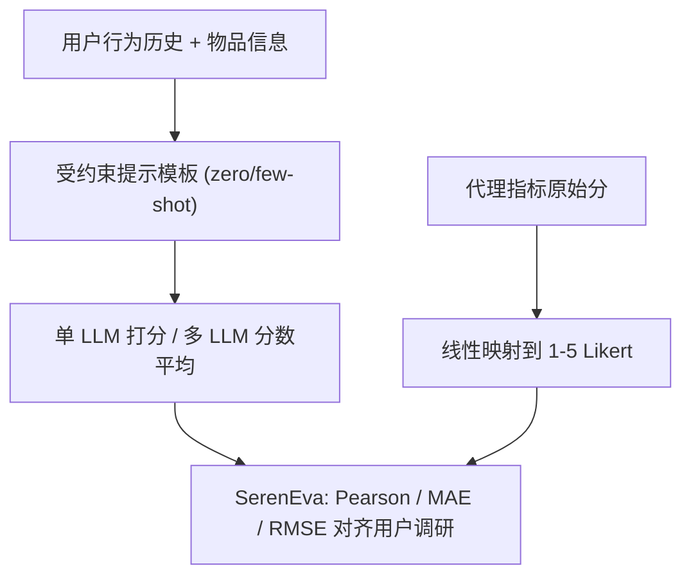

# Exploring the Potential of LLMs for Serendipity Evaluation in Recommender Systems (探索大语言模型在推荐系统惊喜度评估中的潜力)

- **会议/期刊**: RecSys 2025
- **作者与机构**: Li Kang, Yuhan Zhao, Li Chen（香港浸会大学）
- **推荐链路定位**: 评测环节（离线评估 / 用户模拟），不涉及召回-精排链路本身
- **研究方向**: 冷启动与长尾推荐（惊喜度评测）/ 大语言模型推荐
- **论文原文**: [https://arxiv.org/abs/2507.17290v1](https://arxiv.org/abs/2507.17290v1)
- **开源代码**: [https://github.com/Leah-HKBU/SerenEva](https://github.com/Leah-HKBU/SerenEva)

## TL;DR (1分钟核心速览)

惊喜度（serendipity）是缓解信息茧房的关键指标，但其主观性导致现有代理指标（SOG/PURS/DESR/SNPR）与真实用户感知存在系统性偏差。本文提出 SerenEva 元评估框架，把 LLM 当作"用户模拟器"直接对推荐项打 1–5 分，并在淘宝电商与 MovieLens 两个经真实用户调研验证的数据集上，用 Pearson/MAE/RMSE 衡量其与人类判断的一致性。结论：零样本 GPT-4 的 Pearson 已达 10.8%，超过最强代理指标 SOG（4.6%）；叠加辅助数据与多 LLM 集成后最优达 **20.23%（淘宝）/ 21.51%（电影）**，相对 SOG 提升约 3.4–3.8 倍。

## Background & Motivation (背景与核心矛盾)

- **主流范式**: 因用户调研成本高，学界普遍用 relevance-unexpectedness 类代理指标（SOG、PURS、DESR、SNPR）间接计算惊喜度分数，再转成排序/回归任务评估算法。
- **前人局限**: ① 代理指标不含真实用户态度，其固定权重假设（如 SNPR 给 relevance 赋 70% 权重）在"高惊喜=低相关"样本上直接失效，Pearson 甚至接近 0；② 已有 LLM 尝试（SerenPrompt、LLM4Seren）只做零散验证，未系统回答"哪种 LLM 技术、哪类辅助数据、在哪个域有效"。
- **核心洞察 (Key Insight)**: LLM 具备背景知识与用户模拟能力，若其打分能与用户调研结果对齐，就能同时拿到"用户调研的准确性"与"代理指标的低成本"。
- **本文切入点**: 构建统一元评估协议 SerenEva，把 LLM 评测器与代理指标放在同一 5 点 Likert 标尺上横向比较，并系统拆解辅助数据与多模型集成两个增强维度。

## Method (核心方法设计)

### 1. 整体框架 (Overall Architecture)

SerenEva 的闭环是：对每个 (用户, 推荐项) 对，将用户最近 $k$ 条行为历史与物品信息填入受约束的提示模板，要求 LLM 以"平台用户"身份输出 1–5 的惊喜度整数分；代理指标则先算出原始分数，再经线性映射对齐到同一 Likert 标尺；最后在用户集合上聚合与真实调研分数的相关性/误差。整个框架不含任何训练，纯推理式评测，因此可即插即用地替换现有离线评估环节。

### 2. 关键设计拆解 (Key Designs)

1. **SerenEva 统一元评估协议（解决"不可比"问题）**：痛点是代理指标输出连续值、LLM 输出离散分、真值是 Likert 分，三者尺度不一无法公平比较。本文用统一映射把任意评测器输出压到 5 点标尺：
$\text{score} = \mathrm{round}\left(\frac{\text{output}-\min}{\max-\min}\times 4+1\right)$再以$\displaystyle h=\frac{1}{|\mathcal{U}|}\sum_{u\in\mathcal{U}} r(s^{*},s_{real})$ 聚合 Pearson/MAE/RMSE 三指标。Pearson 捕捉线性关系、MAE 抗离群、RMSE 惩罚大偏差，三者互补可诊断"多数准、少数崩"的情形。

2. **辅助数据的结构化注入（解决"LLM 不懂用户"问题）**：把辅助信息分为用户侧（好奇心 CEI-II、大五人格、年龄性别、长/短期画像）、物品侧（流行度、Jaccard 相似度）、交互侧（历史长度、交互类型）三类，通过结构化 prompt 注入。关键发现是**并非越多越好**：好奇心单独注入把 Pearson 从 11.24% 拉到 17.83%，而大五人格与年龄性别反而掉点——说明 LLM 对"与惊喜度因果链短"的属性（好奇心）可有效利用，对复杂隐式特质则无法模拟。

3. **多 LLM 分数平均集成（解决"单模型知识盲区"问题）**：采用算术平均聚合 Qwen2.5-14B/72B 与 GPT-4 的打分，$\hat{s}=\frac{1}{K}\sum_{k=1}^{K}s_k$。集成规模增大时性能单调上升，但同族模型（Qwen 系列）因知识同质化增益有限，跨族组合（Qwen+GPT-4）才带来实质提升——本质是降低单模型评分方差并互补推理偏差。

**训练目标、负采样与推理效率**：本文无训练、无负采样，全部为推理式评测；温度固定 0.00001、五次运行取均值以保证可复现。成本上，单次评测仅需一次前向推理，远低于用户调研，但需对每个 (用户,物品) 对逐一调用，全库评估的 token 开销是主要瓶颈。

## Experimental Setup & Evaluation Protocol (实验设置与评估协议)

- **数据集与预处理**: 两个经真实用户调研采集、带惊喜度真值的数据集：

| 数据集 | #Users | #Items | #Ratings | 稀疏度/密度 | 特征/场景说明 |
| :--- | :---: | :---: | :---: | :---: | :--- |
| Taobao Serendipity | 11,383 | 9,985 | 11,383 | 约 1e-4 | 电商；含人口统计、好奇心、大五人格 |
| Serendipity-2018 | 481 | 1,678 | 2,150 | 约 2.7e-3 | 电影（MovieLens）；8 条陈述 5 点量表，取 3 个 unexpectedness 变量均值 |

- **数据划分与防穿越 (Splitting Strategy)**: 非训练型任务，无 train/test 划分；每个样本固定取目标物品之前最近 $k=10$ 条交互作为历史（交互类型实验扩至 20），属"时间前置截断"式构造，天然避免未来信息泄漏。
- **排名评测协议 (Ranking Protocol)**: 不做 Top-N 排序，而是**逐样本回归式打分对齐**——对每个 (用户,物品) 对比较评测器分数与用户调研真值，报告全用户平均的 Pearson/MAE/RMSE，属 pointwise 元评估而非 Full-Ranking。
- **对比基线与超参设置**: 基线含 Random、4 个代理指标（SOG/PURS/DESR/SNPR）、2 个 LLM 基线（LLM4Seren、SerenPrompt_1/2）、6 个 LLM 零样本/五样本推理器（LLaMA2-7B/13B、Qwen2.5-7B/14B/72B、GPT-4）；显著性用双侧 t 检验 $p<0.05$，Pearson 均通过显著性检验。

## Key Experimental Results (实验关键数据)

### 1. 主实验对比 (Main Results)

| 方法 | Taobao Pearson(%) | Taobao MAE | Taobao RMSE | Seren-2018 Pearson(%) | Seren-2018 MAE | Seren-2018 RMSE |
| :--- | :---: | :---: | :---: | :---: | :---: | :---: |
| Random | -0.58 | 1.6484 | 2.0637 | -0.13 | 1.4400 | 1.7847 |
| SOG（最强代理） | 4.61 | 1.5231 | 1.8736 | 5.72 | 1.2746 | 1.5725 |
| PURS | 2.67 | 1.6540 | 2.0356 | 3.33 | 1.2604 | 1.5608 |
| DESR | 3.85 | 1.6132 | 1.9675 | 3.48 | 1.1170 | 1.4059 |
| SNPR | 0.90 | 1.5969 | 1.9955 | 0.05 | 1.1062 | 1.3824 |
| SerenPrompt_2 | 9.24 | 1.4271 | 1.8103 | 8.33 | 1.0773 | 1.3936 |
| Qwen2.5-72B (0-shot) | 10.52 | 1.3263 | 1.6601 | 10.32 | 1.1885 | 1.4678 |
| GPT-4 (0-shot) | 10.81 | 1.5316 | 1.8631 | 10.89 | 1.0126 | 1.3292 |
| Qwen2.5-14B (5-shot) | 10.27 | 1.4018 | 1.7836 | 11.48 | 0.9742 | 1.2825 |
| GPT-4 (5-shot) | **12.12** | 1.5111 | 1.8405 | **14.55** | 1.0112 | 1.3436 |
| **Multi-LLM + 辅助数据（最优）** | **20.23** | **1.2960** | **1.6238** | **21.51** | **0.7486** | **1.0563** |

相对最强代理 SOG，最优配置 Pearson 提升 **+339%（淘宝）/ +276%（电影）**。

### 2. 消融实验 (Ablation Study)

以 Qwen2.5-14B 五样本为基线（NA），逐项注入辅助数据与集成：

| 配置 | Taobao Pearson(%) | Seren-2018 Pearson(%) | 说明 |
| :--- | :---: | :---: | :--- |
| NA（仅 10 条历史） | 10.27 | 11.48 | 基线 |
| + 好奇心 | 17.83 | — | 用户侧最强单项 |
| + 大五人格 / 年龄性别 | 下降 | — | 复杂特质 LLM 无法模拟 |
| + 短期画像 | 提升 | — | 电商重短期相关性 |
| + 长期画像 | — | 提升 | 电影重长期意外性 |
| + 流行度 | 微弱 | 显著提升 | 电影域探索成本低 |
| + 物品相似度 | 微弱 | 提升 | 电商时效性强、旧相似项失效 |
| + 交互类型（点击/购买） | 下降 | 评分信息提升 | 电商交互类型与惊喜度关系复杂 |
| + 辅助数据（整体） | 18.25 | 20.25 | 单模型上限 |
| + Multi-LLM & 辅助数据 | **20.23** | **21.51** | 最优 |

### 3. 关键实验发现 (Key Findings)

1. **零样本即已超越代理指标**：GPT-4 零样本 Pearson 10.81%/10.89%，约为 SOG 的 2.3/1.9 倍，说明 LLM 的常识推理本身就比人工设计的固定权重公式更贴近用户惊喜感知；而 LLaMA2 系列在中文电商域几乎失效（0.28%），暴露语言域适配是硬约束。
2. **辅助数据收益高度域依赖，盲目全注入反而掉点**：好奇心在淘宝带来 +7.6 个点，但大五人格/年龄性别均掉点；流行度在电影域显著、电商域微弱。这直接反驳了"辅助信息越多越好"的直觉，提示评测器需按域定制数据配方。
3. **历史长度存在"短优于长"的反直觉现象**：随 $k$ 从 10 增至 70，两数据集 Pearson 均下降，说明 LLM 对长序列的推理能力受限，且近期交互与当前意图相关性更强——这与序列推荐中"长历史有益"的常规认知形成对照，是评测场景特有的约束。

## Highlights & Limitations (亮点、对比与审稿批判)

- **与代表作对比 (vs. Prior Work)**: 相比 SOG/PURS/DESR/SNPR 等代理指标，本文首次把"评测器"本身作为被评估对象，用真实调研真值做元评估，而非假设代理指标即真值；相比 SerenPrompt（面向推荐生成、非评测器设计）与 LLM4Seren（prompt 中缺显式惊喜度定义），本文的受约束提示 + 统一标尺映射 + 系统化辅助数据/集成拆解，是首个跨域可复现的 LLM 惊喜度评测基准。
- **可迁移亮点**: ① "统一映射到真值标尺再比相关性"的元评估范式可直接迁移到可解释性、多样性、新颖性等主观指标评测；② "按域筛选辅助数据 + 跨族模型集成"的组合策略，可低成本复用于任何 LLM-as-Judge 场景。
- **审稿级局限批判**: ① 绝对相关性仍偏低（最优仅 21.5%），距可作为生产级评估器尚有距离，且需对每个样本调用 LLM，全库评估的 token 成本与延迟未量化；② 仅两个数据集、且淘宝域为中文电商，跨语言/跨文化泛化性未验证；辅助数据配方依赖网格搜索，存在过拟合测试集的风险，缺少留出验证。

## Rating (四维评分)

- **方法创新性 (Novelty)**: ⭐⭐⭐⭐ （首次系统化提出 LLM-as-Serendipity-Evaluator 并给出统一元评估协议，但方法本体是 prompt 工程 + 集成，缺少理论刻画）
- **评估协议与实验扎实度 (Protocol & Experiments)**: ⭐⭐⭐⭐ （两域真实调研真值、三指标互补、$p<0.05$ 显著性检验与五次重复，但数据集规模与域覆盖偏少）
- **写作与数学规范度 (Clarity & Rigor)**: ⭐⭐⭐⭐ （映射公式与聚合定义清晰、RQ 组织条理分明，但代理指标公式仅作引用式罗列，缺复杂度与成本分析）
- **工业落地与复现价值 (Industrial & Practical Value)**: ⭐⭐⭐⭐ （代码已开源、零训练即插即用，但逐样本 LLM 调用的成本与延迟是上线前必须解决的门槛）

