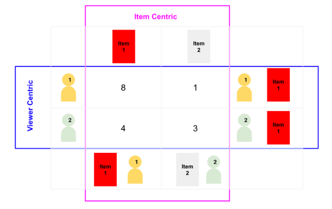
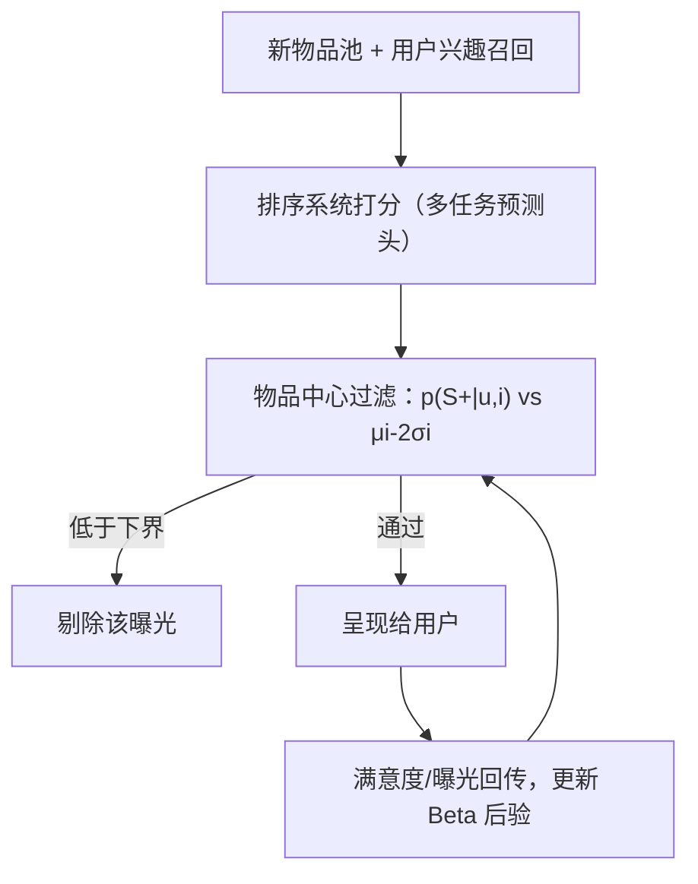

# Item-centric Exploration for Cold Start Problem (面向冷启动的物品中心探索)

- **会议/期刊**: RecSys 2025 (Industry Track)
- **作者与机构**: Dong Wang, Junyi Jiao, Arnab Bhadury, Yaping Zhang, Mingyan Gao, Onkar Dalal (Google LLC / YouTube)
- **推荐链路定位**: 重排（排序后过滤控制，服务于探索/召回语料扩充）
- **研究方向**: 冷启动与长尾推荐 / 强化学习与动态探索推荐
- **论文原文**: [https://arxiv.org/abs/2507.09423v1](https://arxiv.org/abs/2507.09423v1)
- **开源代码**: 暂未开源

## TL;DR (1分钟核心速览)

本文指出物品冷启动的一个被忽视症结：即便已有冷启动机制，**纯用户中心范式**（为每个用户找最优物品）在超大且快速膨胀的物品库中会让新物品找不到“对的初始受众”，长尾物品甚至永远起不来。作者提出**物品中心探索**：在排序阶段之后加一个轻量过滤控制，用 Beta 共轭后验刻画物品内在满意度率，若某用户对该物品的预测满意度显著低于物品自身质量（$\mu_i-2\sigma_i$），则将该曝光剔除。在 YouTube 短视频大规模线上用户-语料联合分流实验中，探索曝光下降 20%，两项满意度指标分别提升 50% 与 40%，可推荐语料规模扩大 10%。

## Background & Motivation (背景与核心矛盾)

- **主流范式**: 冷启动研究长期聚焦“交互数据稀缺”，主流解法是引入物品属性/边信息，或采用元学习、迁移学习等少样本范式来补足新物品表征。
- **前人局限**: 其一，这些方法默认“只要打分够准就能找到受众”，但在物品量级极大、新物品涌入极快的场景下，用户中心排序天然偏向已被验证的热门物品，新物品的**最优受众被系统性遮蔽**；其二，即便新物品被探索曝光，也常被推给“顺手排上”的次优用户，初始受众质量差会拖累其后续被主推荐系统接管的概率。
- **核心洞察 (Key Insight)**: 用户中心与物品中心存在**结构性不对称**——为某用户找最优物品，与为某物品找最优用户，解集并不重合（图 1 的 2×2 打分玩具例）。长尾物品在用户中心视角下可能对任何单用户都不是 top 候选，因而永远拿不到启动流量。
- **本文切入点**: 不做全系统范式迁移（风险高），而是以**最小侵入的排序后过滤控制**实现物品中心探索：只拦“预测满意度显著低于物品自身质量”的错配曝光。

<figure class="paper-figure" markdown="span">
  <figcaption>图1：以用户为中心与以物品为中心的推荐之间的不对称性示意图。一个2x2表格展示了用户-物品正得分。蓝色突出以用户为中心的推荐（对某用户最佳物品）；紫色突出以物品为中心的推荐（对某物品最佳用户）。</figcaption>
</figure>

## Method (核心方法设计)

### 1. 整体框架 (Overall Architecture)

请求到来后，探索系统先从新物品池按用户兴趣召回候选，经排序系统打分排序；随后新增的**物品中心过滤组件**逐个评估候选物品：读取多任务排序模型输出的满意度预测头 $p(S^+|u,i)$，与由该物品历史曝光统计维护的 Beta 后验区间$[\mu_i-2\sigma_i,\ \mu_i+2\sigma_i]$ 比较，若预测值落入下界之外则将该物品从本次候选列表移除，剩余物品再呈现给用户。物品侧后验随曝光实时低延迟聚合更新，形成“曝光—统计—过滤”的闭环。

### 2. 关键设计拆解 (Key Designs)

1. **物品内在满意度率的 Beta 共轭建模**：痛点是要在极少曝光下稳定估计“这个物品本身好不好”，且需极低存储与计算开销。以 Bernoulli 的共轭先验 $B(\alpha_0,\beta_0)$建模满意度率，给定满意数$N^+$与总曝光$N$，后验为$B(\alpha_0+N^+,\ \beta_0+N-N^+)$，其均值与方差闭式可得：

$$\mu_i=\frac{\alpha_0+N^+}{\alpha_0+\beta_0+N},\qquad \sigma_i^2=\frac{(\alpha_0+N^+)(\beta_0+N-N^+)}{(\alpha_0+\beta_0+N)^2(\alpha_0+\beta_0+N+1)}$$

直觉：只需存两个计数即可还原整条分布，$\sigma_i$ 随曝光增加而收缩（图 3），天然实现“新物品宽容、老物品严格”的置信度自适应。

2. **双侧不对称的错配过滤准则**：痛点是“预测低”本身不足以判定错配——低质量物品对谁都低。核心判据为

$$p(S^+|u,i)<\mu_i-2\sigma_i$$

即只有当该用户满意度预测**显著低于物品自身后验质量下界**时才剔除（图 2）。这样高质量物品不会被误伤，而“好物品被推给错的人”这一最浪费的曝光被精准拦截；$2\sigma$ 阈值同时充当对后验估计噪声的缓冲。

3. **训练目标、负采样与推理效率**：本文为工业系统论文，不引入新的训练损失；$p(S^+|u,i)$ 直接复用现有多任务排序模型的满意度预测头，Beta 参数由线上曝光流式聚合。推理开销仅为一次标量比较与两次计数读取，无额外模型前向，因而可安全置于排序之后。

## Experimental Setup & Evaluation Protocol (实验设置与评估协议)

- **数据集与场景**: 大规模短视频推荐系统真实线上流量；物品侧为持续涌入的新内容池，无公开离线数据集，全部结论来自线上实验。

| 场景 | 实验对象 | 评估层级 | 说明 |
| :--- | :---: | :---: | :--- |
| YouTube 短视频线上流量 | 用户 + 物品语料 | 用户级 + 语料级 | 新物品探索系统，用户-语料联合分流 |

- **数据划分与防穿越 (Splitting Strategy)**: 采用**用户-语料联合分流 (user-corpus co-diverted)** 实验框架——传统用户分流无法对不相交物品集施加不同处理，故同时对用户与物品语料分流，才能直接度量语料规模变化。
- **排名评测协议 (Ranking Protocol)**: 线上 A/B 对照，报告相对提升；辅以满意度预测的**校准分析**（分桶对比预测均值与观测均值，图 4），确认打分头可信后再解读过滤效果。
- **对比基线与超参设置**: 基线为未加物品中心过滤的现有探索系统（Treatment vs. Control）；阈值系数固定为 $2\sigma$，先验$\alpha_0,\beta_0$ 未在正文披露。

## Key Experimental Results (实验关键数据)

### 1. 主实验对比 (Main Results)

| 指标 | Control（原系统） | Treatment（+物品中心过滤） | 相对变化 |
| :--- | :---: | :---: | :---: |
| 满意度指标 1 | 基线 | — | **+50%** |
| 满意度指标 2 | 基线 | — | **+40%** |
| 探索曝光量 | 基线 | — | **-20%** |
| 可推荐语料规模 | 基线 | — | **+10%** |

### 2. 消融实验 (Ablation Study)

原文为 4 页工业短文，未提供组件级离线消融；其等效“消融证据”来自校准分析与阈值行为观察：

| 分析项 | 观察结果 | 含义 |
| :--- | :--- | :--- |
| 满意度预测校准 | 整体贴合对角线，仅极低满意度区轻微失准 | 预测头可直接用于过滤判据 |
| $\sigma_i$ 收敛性 | 前数百次曝光内快速收缩 | 新物品冷启动期估计可靠 |
| 过滤强度 | 曝光 -20% | 过滤确有选择性而非随机丢弃 |

### 3. 关键实验发现 (Key Findings)

1. **“少曝光、更满意、语料更大”三者同时成立**：探索曝光减少 20% 的同时满意度提升 40%–50%、可推荐语料扩大 10%，说明被砍掉的 20% 是纯浪费的错配曝光，而非有效探索，系统整体探索效率实质提升。
2. **语料扩张是语料级指标才能捕捉的收益**：用户分流实验无法观测物品集变化，联合分流框架下 +10% 的可推荐语料增量证明物品中心控制真正改善了新物品的“存活率”，而非仅优化单次会话体验。
3. **校准偏差未传导为性能损失**：极低满意度区虽有轻微失准，但由于判据是相对物品自身后验下界而非绝对阈值，偏差被 $\mu_i-2\sigma_i$ 的自适应基线吸收，过滤效率不受影响。

## Highlights & Limitations (亮点、对比与审稿批判)

- **与代表作对比 (vs. Prior Work)**: 与基于边信息/元学习/迁移学习的冷启动方法相比，本文不改进表征与打分，而是改变**受众匹配方向**，与之正交且可叠加；与 Bandit 式探索相比，本文不重做探索策略，仅在排序后加一层过滤，工程风险与改造成本极低。
- **可迁移亮点**: (1) 用 Beta 共轭后验 + 置信区间下界作为“物品质量基线”，可迁移到任何需要“相对而非绝对”判定好坏的过滤/扶持场景；(2) 用户-语料联合分流是评估语料级收益的实用实验设计，值得内容平台复用。
- **审稿级局限批判**: (1) 全文仅线上相对指标，无离线数据集、无基线数值表、无显著性检验与先验/阈值敏感性分析，$2\sigma$ 的选取缺乏依据；(2) 过滤依赖排序模型满意度头的校准质量，且会系统性压低新物品曝光总量，长期是否损害创作者生态与内容多样性未做长周期观测。

## Rating (四维评分)

- **方法创新性 (Novelty)**: ⭐⭐⭐⭐ （“物品中心”视角与 Beta 后验下界过滤判据简洁而切中要害，但技术组件本身较常规）
- **评估协议与实验扎实度 (Protocol & Experiments)**: ⭐⭐⭐ （线上大规模验证与联合分流设计有说服力，但缺离线基准、消融与显著性检验）
- **写作与数学规范度 (Clarity & Rigor)**: ⭐⭐⭐⭐ （Beta 共轭推导与判据公式清晰，4 页短文信息密度高，先验设置等细节略欠）
- **工业落地与复现价值 (Industrial & Practical Value)**: ⭐⭐⭐⭐ （零额外模型前向、仅两次计数读取即可上线，风险低收益明确；但无开源代码，复现依赖自有排序头）

