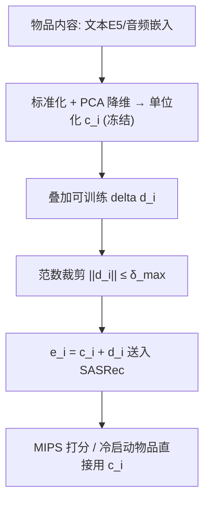
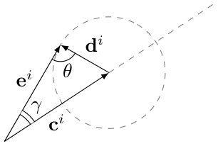

# Let It Go? Not Quite: Addressing Item Cold Start in Sequential Recommendations with Content-Based Initialization (别放手？不完全是：用内容初始化解决序列推荐中的物品冷启动)

- **会议/期刊**: RecSys 2025
- **作者与机构**: Anton Pembek, Artem Fatkulin, Anton Klenitskiy, Alexey Vasilev (Sber AI Lab / MSU / HSE University)
- **推荐链路定位**: 召回（Next-Item 序列召回）
- **研究方向**: 冷启动与长尾推荐 / 序列推荐
- **论文原文**: [https://arxiv.org/abs/2507.19473v1](https://arxiv.org/abs/2507.19473v1)
- **开源代码**: [https://github.com/ArtemF42/let-it-go](https://github.com/ArtemF42/let-it-go)

## TL;DR (1分钟核心速览)

序列推荐（SASRec 类）对无交互的新物品完全失效（冷启动 HR@10 恒为 0）。本文指出内容初始化存在两难：**全冻结**内容嵌入无法适配推荐任务、整体指标掉点；**全微调**则嵌入漂移远离原始语义，冷启动物品反而更差。作者提出在冻结的单位范数内容嵌入上叠加一个**范数被裁剪到 $\delta_{\max}$的可训练 delta**，用几何上界$\sqrt{1-\delta_i^2}$ 保证语义不漂移。在 Amazon-M2 / Beauty / Zvuk 三数据集、全局时间切分 + Full-Ranking 协议下，冷启动 NDCG@10 相对内容初始化基线提升 20.9% / 22.2% / 50.0%，且热物品指标不降反微升。

## Background & Motivation (背景与核心矛盾)

- **主流范式**: 用物品内容特征（文本 E5 嵌入、音频嵌入）初始化 ID-based 序列模型（SASRec/BERT4Rec）的 embedding 层，已被证明能提升整体推荐质量。
- **前人局限**: ① 内容嵌入**全冻结**时无法适配交互数据，整体指标受损；② 内容嵌入**全微调**时，训练后嵌入严重偏离原始语义空间，冷启动物品（推理时只能用未训练的内容向量）与热物品空间产生分布鸿沟，冷启动指标反而劣化。
- **核心洞察 (Key Insight)**: 冷启动物品的可用信息只有内容向量本身，因此"训练后的热物品嵌入"与"内容向量"之间的距离必须被显式约束——这是一个**几何可控性**问题，而非单纯的表征学习问题。
- **本文切入点**: 把物品嵌入拆成"冻结内容锚点 + 有界校正量"，用范数裁剪把语义漂移量化为可调超参 $\delta_{\max}$。

## Method (核心方法设计)

### 1. 整体框架 (Overall Architecture)

物品 $i$的最终表示由两部分构成：单位范数的冻结内容嵌入$\mathbf{c}_i$（文本经 E5 编码后做逐维标准化 + PCA 降至模型维度$m$；音频用预计算嵌入）与可训练校正向量$\mathbf{d}_i$，即$\mathbf{e}_i=\mathbf{c}_i+\mathbf{d}_i$。训练时仅更新$\mathbf{d}_i$与 SASRec 其余参数，并在每步后对$\|\mathbf{d}_i\|$做上限为$\delta_{\max}$的裁剪；推理时热物品用$\mathbf{e}_i$，冷启动物品直接用$\mathbf{c}_i$（因$\|\mathbf{d}_i\|$有界，二者天然处于同一邻域）。打分仍为 MIPS：$r(u,i)=\mathbf{h}_u\cdot\mathbf{e}_i$。

<figure class="paper-figure" markdown="span">
  <figcaption>图2：所提方法的几何表示。c𝑖为冻结的基于内容的物品嵌入，d𝑖为对应的可训练校正向量，e𝑖为最终物品表示。</figcaption>
</figure>

### 2. 关键设计拆解 (Key Designs)

1. **有界 delta 校正（Bounded Delta Correction）**：痛点是"冻结太死、微调太飘"。设 $\|\mathbf{c}_i\|=1$、$\|\mathbf{d}_i\|=\delta_i<1$，由正弦定理$\sin\gamma=\delta_i\sin\theta$（$\gamma$为$\mathbf{c}_i$与$\mathbf{e}_i$ 夹角），得余弦相似度的显式下界：

$$\cos\gamma=\sqrt{1-\delta_i^2\sin^2\theta}\ \ge\ \sqrt{1-\delta_i^2}$$

   当 $\mathbf{d}_i\perp\mathbf{e}_i$时取等。直觉：$\delta_i$直接给出"语义保真度"的可解释刻度，$\delta_{\max}=0.5$ 对应最低余弦相似度 0.87，即嵌入最多偏离内容锚点约 30°。

2. **范数裁剪作为隐式正则**：MIPS 打分对嵌入范数敏感，作者发现不加约束时各物品 $\mathbf{d}_i$范数差异极大，导致打分被少数大范数物品主导。统一裁剪到$\delta_{\max}$ 既控制语义漂移，又抑制范数方差，起到正则化作用。

3. **训练目标、负采样与推理效率**：采用 full cross-entropy（softmax over 全物品）而非 BPR/采样负例，batch size 128，Adam lr=1e-3，2 层 Transformer、单头、dropout 0.3。推理时冷启动物品零成本接入（无需为其训练嵌入），但需为每个物品额外存储一个 $\mathbf{d}_i$，内存开销翻倍。

## Experimental Setup & Evaluation Protocol (实验设置与评估协议)

- **数据集与预处理**（去除连续重复物品；Zvuk 仅保留 >60s 交互并采样 1 万用户；Beauty 过滤评分 <4；Zvuk/Beauty 对 train/val 做 $n{=}3$-core 过滤）：

| 数据集 | #Users | #Items | #Interactions | 平均序列长 | GT 中冷启动物品占比 |
| :--- | :---: | :---: | :---: | :---: | :---: |
| Amazon-M2 (FR) | 129,983 | 44,049 | 566,806 | 4.3 | 7% |
| Beauty | 21,029 | 11,733 | 149,147 | 7.1 | 25% |
| Zvuk | 9,076 | 131,085 | 3,236,653 | 356.6 | 13% |

- **数据划分与防穿越**: Amazon-M2 用官方 2 周训练 / 1 周测试切分；Beauty 与 Zvuk 用**全局时间戳切分**（90% 边界）防泄漏；验证集为随机 10% 用户的序列，取最后一个交互为 GT。
- **排名评测协议**: **Full-Ranking 全库排序**（Replay 库），指标 HR@10 / NDCG@10；并**按 GT 是否为训练集出现过的物品拆分为 Cold GT / Warm GT / Total 三档**分别汇报——这是本文评估的关键设计。
- **对比基线与超参**: Content-based KNN（用序列平均内容嵌入做近邻推荐）、SASRec、SASRec + 内容初始化（全微调）。嵌入维度 $m=128$（Beauty/Zvuk）、$64$（Amazon-M2）；每个实验 5 个随机种子取均值与标准差。

## Key Experimental Results (实验关键数据)

### 1. 主实验对比 (Main Results)

NDCG@10（HR@10 趋势一致，略）：

| 模型 | Amazon-M2 Cold | Amazon-M2 Total | Beauty Cold | Beauty Total | Zvuk Cold | Zvuk Total |
| :--- | :---: | :---: | :---: | :---: | :---: | :---: |
| Content-based KNN | 0.312 | 0.238 | 0.022 | 0.024 | 0.006 | 0.001 |
| SASRec | 0.000 | 0.407 | 0.000 | 0.033 | 0.000 | 0.055 |
| SASRec + c.i. | 0.297 | **0.438** | 0.018 | 0.044 | 0.014 | 0.052 |
| **SASRec + t.d. (ours)** | **0.359** | **0.440** | **0.022** | **0.046** | **0.021** | **0.055** |
| Improv. vs c.i. (Cold) | +20.9% | — | +22.2% | — | +50.0% | — |

HR@10 上 ours 同样全面最优：Amazon-M2 Cold 0.509 vs c.i. 0.435（+17.0%），Beauty Cold 0.038 vs 0.032，Zvuk Cold 0.034 vs 0.023（+47.8%）；Total 分别为 0.609 / 0.078 / 0.087，均不低于 SASRec 与 c.i. 版本。

### 2. 消融实验 (Ablation Study)

| 配置 | 语义 | Cold NDCG@10 | Total NDCG@10 |
| :--- | :--- | :---: | :---: |
| SASRec（无内容） | 冷启动物品不可用 | 0.000 | 0.407 |
| + 内容初始化，全微调 | 嵌入漂移 | 0.297 | 0.438 |
| + 内容初始化，全冻结 | 无法适配任务 | 整体掉点（文中定性） | 显著下降 |
| + 可训练 delta，$\delta_{\max}$ 过小 | 灵活性不足 | 偏高 | 显著下降 |
| + 可训练 delta，$\delta_{\max}$ 过大 | 漂移失控 | 下降 | 下降 |
| **+ 可训练 delta，$\delta_{\max}=0.5$** | 折中最优 | **0.359** | **0.440** |

### 3. 关键实验发现 (Key Findings)

1. **冷启动增益不以热物品为代价**：Amazon-M2 上冷启动 NDCG@10 从 0.297 提到 0.359（+20.9%），同时 Total 从 0.438 微升至 0.440，说明有界 delta 的"锚定 + 微调"确实同时吃到了内容泛化与交互适配两头的收益。
2. **$\delta_{\max}$存在明确的最优区间 0.3–0.6**：过小（如 0.1）时模型缺乏调整自由度、整体质量大幅下滑；过大时冷启动指标回落——这与几何上界$\sqrt{1-\delta_i^2}$ 的单调性预测完全吻合，超参具有可解释的物理含义而非纯调参。
3. **收益集中在低频与含冷启动物品的输入序列**：随 GT 物品在训练集中频率升高，ours 相对 SASRec 的优势单调收敛至 0；而在输入序列中冷启动物品比例越高时，内容初始化带来的增益越显著，delta 在其上再叠加小幅提升——证明方法真正作用于"信息稀缺"区间而非全局均匀提分。

## Highlights & Limitations (亮点、对比与审稿批判)

- **与代表作对比 (vs. Prior Work)**: 与 CLCRec（对比学习对齐冷热空间）、GAR（对抗生成冷嵌入）、ALDI（热教冷蒸馏）等协同过滤冷启动方法不同，本文不引入额外对齐网络或生成器，仅用一次范数裁剪就完成约束，且直接作用于 ID-based 序列模型；与 SimRec 等"长尾即冷"的设定相比，本文严格区分**训练集完全未出现**的真冷启动物品，评估更严苛。
- **可迁移亮点**: ① "冻结锚点 + 有界 delta"可作为任何需要"保留预训练语义 + 任务适配"场景的通用插件（如 LLM 语义 ID 初始化、跨域物品表征迁移）；② 按 GT 物品冷/热分档汇报指标的做法，应成为冷启动论文的标配评估范式。
- **审稿级局限批判**: ① 每个物品需额外存储一份 $\mathbf{d}_i$，物品量极大时内存翻倍，文中亦承认该可扩展性问题；② 仅在 SASRec 单一骨干上验证，未测试 BERT4Rec / 现代序列架构；③ 冷启动物品在推理时完全丢弃$\mathbf{d}_i$，未探索"用内容相似热物品的 delta 做迁移"这一更激进的方案；④ 数据集仅 3 个且 Beauty 冷启动绝对值极低（0.022），统计功效有限。

## Rating (四维评分)

- **方法创新性 (Novelty)**: ⭐⭐⭐⭐ （思路极简但几何推导优雅，$\sqrt{1-\delta_i^2}$ 上界把"语义保真"变成可调刻度，属"一句话能讲清、却少有人做对"的增量）
- **评估协议与实验扎实度 (Protocol & Experiments)**: ⭐⭐⭐⭐ （全局时间切分 + Full-Ranking + 冷/热分档汇报 + 5 种子，协议规范；扣分在仅 3 数据集、单骨干、缺显著性检验）
- **写作与数学规范度 (Clarity & Rigor)**: ⭐⭐⭐⭐ （正弦定理推导简洁自洽，几何图直观；但全冻结基线的具体数值未列表，仅定性描述）
- **工业落地与复现价值 (Industrial & Practical Value)**: ⭐⭐⭐⭐ （代码开源、改动量极小、可直接插入现有 SASRec 管线；内存翻倍与需内容编码器是主要落地成本）

