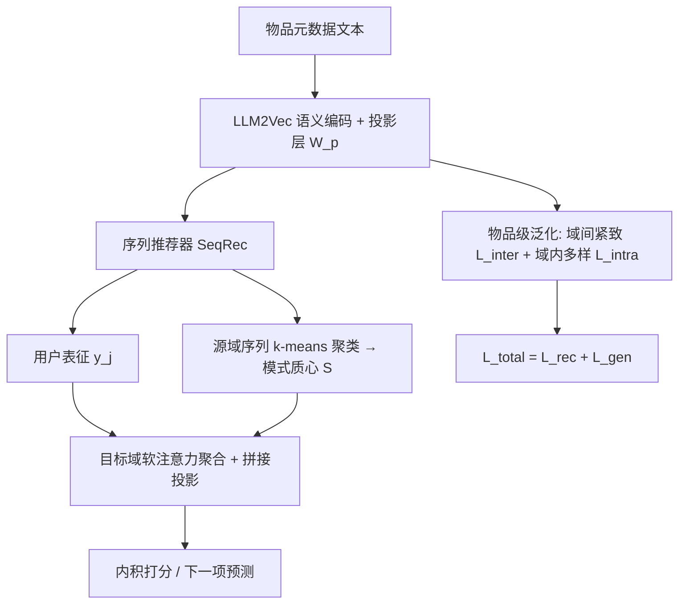

# LLM-RecG: A Semantic Bias-Aware Framework for Zero-Shot Sequential Recommendation (面向零样本序列推荐的语义偏置感知框架)

- **会议/期刊**: RecSys 2025 (Spotlight Oral)
- **作者与机构**: Yunzhe Li, Junting Wang, Hari Sundaram, Zhining Liu (University of Illinois, Urbana-Champaign)
- **推荐链路定位**: 召回（零样本跨域序列下一项预测）
- **研究方向**: 冷启动与长尾推荐 / 序列与会话推荐
- **论文原文**: [https://arxiv.org/abs/2501.19232v2](https://arxiv.org/abs/2501.19232v2)
- **开源代码**: [https://github.com/yunzhel2/LLM-RecG](https://github.com/yunzhel2/LLM-RecG)

## TL;DR (1分钟核心速览)

零样本跨域序列推荐 (ZCDSR) 中，LLM 生成的物品语义嵌入存在**域语义偏置**（词汇与内容焦点错位），直接迁移会导致嵌入失配、泛化崩塌。本文提出模型无关的 LLM-RecG：物品级用「域间紧致 + 域内多样」双熵正则重塑嵌入几何，序列级用源域序列聚类 + 软注意力聚合迁移用户行为模式。在 Amazon 三子域 + Steam 共 12 组跨域对、`Sampled Ranking (1:100)` 协议下，R@10/N@10 相对最强基线平均提升超 10%，跨平台 Steam→IS 场景 N@10 相对提升达 28.9%。

## Background & Motivation (背景与核心矛盾)

- **主流范式**: LLM4Rec 分两支——生成式直接输出推荐、判别式（UniSRec/RecFormer/LLM-ESR）用 LLM 作特征编码器产出语义嵌入喂给下游序列模型；ZCDSR 属后者，源域训练、目标域零微调推理。
- **前人局限**: ① 现有方法默认 LLM 语义嵌入「域无关可迁移」，忽视域语义偏置——IS 域描述聚焦磁力强度/耐用性，VG 域聚焦握持手感/外观定制（原文 Table 1），同一嵌入空间下语义轴错位；② 仅做静态物品嵌入对齐，忽略用户序列中可迁移的行为转移结构，目标域无交互时用户表征无从适配。
- **核心洞察 (Key Insight)**: 泛化与保真是对偶目标——过度对齐会让嵌入塌缩为「通用但无区分度」的均匀球面（原文图 3 的 -RecG 可视化即证），过度保真则无法跨域。必须在**域间紧致**与**域内多样**之间取熵平衡。
- **本文切入点**: 用两个熵型正则项在物品级显式操控嵌入几何，再用源域序列聚类质心作为「行为原型」在目标域做注意力软检索，双层级联合破局。

## Method (核心方法设计)

### 1. 整体框架 (Overall Architecture)

物品元数据（title+features+description 模板拼接）经 LLM2Vec (Llama 3-8B) 编码为 $d_h$维语义向量，再经可学习投影$W_p$压到$d_l$维；该嵌入序列送入任意序列推荐器（GRU4Rec/SASRec/BERT4Rec）得用户表征$y_j$，与物品嵌入内积打分。训练时在 BPR 损失之外叠加物品级泛化损失$\mathcal{L}_{gen}$；推理时目标域物品走同一 LLM+投影（零微调），目标用户序列表征与源域$k$-means 序列模式质心做软注意力聚合后融合打分。

### 2. 关键设计拆解 (Key Designs)

1. **域间紧致损失 $\mathcal{L}_{inter}$（把跨域嵌入拉向对方域心）**：痛点是对齐缺失导致域间语义轴漂移。做法是以域内嵌入均值为域心$c_d=\frac{1}{|V_d|}\sum_{v_i^d\in V_d} e_i^d$，对每个物品计算其相对「异域」域心的余弦相似度分布$Q_{id}=\frac{\exp(\cos(e_i^d,c_d)/\tau)}{\sum_{d'\neq d_i}\exp(\cos(e_i^d,c_{d'})/\tau)}$，最小化交叉熵$\mathcal{L}_{inter}=\sum_{i}\sum_{d\neq d_i}Q_{id}\log Q_{id}$。直觉：迫使每个物品在异域域心方向上获得高归属概率，等价于压缩域间分布距离，使源域学到的打分几何在目标域仍成立。

2. **域内多样损失 $\mathcal{L}_{intra}$（防止对齐塌缩）**：仅做紧致会让所有嵌入挤成一团、丧失细粒度区分。对同域物品对构造相似度分布$P_{ij}=\frac{\exp(\cos(e_i^d,e_j^d)/\tau)}{\sum_{k}\exp(\cos(e_i^d,e_k^d)/\tau)}$，**最大化**其熵$\mathcal{L}_{intra}=-\sum_d\frac{1}{|V_d|}\sum_i\sum_j P_{ij}\log P_{ij}$。直觉：熵最大化等价于把同域嵌入在球面上「推匀」，保留域内变异度，与$\mathcal{L}_{inter}$形成紧致-均匀的张力平衡。二者合成$\mathcal{L}_{gen}=-\alpha\mathcal{L}_{intra}+\beta\mathcal{L}_{inter}$，并按$\beta=\alpha|N|/|\{D_s,D_t\}|^3$ 自动配比量纲。

3. **序列级泛化（源域行为原型软检索）**：物品级只对齐静态嵌入，丢失序列动态。对源域全部用户序列表征做 $k$-means 得模式集$S=\{s_1,\dots,s_k\}$；目标域推理时计算$s_{j,i}^t=\cos(y_j^t,s_i)$，softmax 归一化得$\alpha_{j,i}^t$，聚合$\tilde{s}_j^t=\sum_i\alpha_{j,i}^t s_i$，再与目标用户表征拼接投影$g_j^t=W_f[y_j^t;\tilde{s}_j^t]$ 用于打分。直觉：跨域用户行为的「转移结构」相似，用软注意力而非硬最近邻可避免单模式误配。

4. **训练目标与开销**：$\mathcal{L}_{total}=\mathcal{L}_{rec}+\mathcal{L}_{gen}$，$\mathcal{L}_{rec}$为标准 BPR（正负采样对，负样本随机采样）。为控开销，$\mathcal{L}_{intra}/\mathcal{L}_{inter}$ 均用 batch 内采样近似而非全物品两两计算；LLM 编码离线预计算，在线仅走投影+序列模型，推理成本与原生 SeqRec 同阶。

## Experimental Setup & Evaluation Protocol (实验设置与评估协议)

- **数据集与预处理**: Amazon Review 三子域 + Steam 跨平台，过滤交互数 $<10$ 的用户与物品，剔除无文本特征物品：

| 数据集 | #Users | #Items | #Interactions | 稀疏度/密度 | 特征/场景说明 |
| :--- | :---: | :---: | :---: | :---: | :--- |
| Industrial & Scientific (IS) | 47,905 | 24,315 | ~385k | 平均序列长 8.04 | Amazon 工业科学，技术参数型描述 |
| Video Games (VG) | 89,746 | 24,030 | ~772k | 平均序列长 8.60 | Amazon 游戏，体验/外观型描述 |
| Musical Instruments (MI) | 55,787 | 23,618 | ~495k | 平均序列长 8.88 | Amazon 乐器 |
| Steam | 26,541 | 8,156 | ~522k | 平均序列长 19.68 | 跨平台，长序列、语义差异最大 |

- **数据划分与防穿越 (Splitting Strategy)**: `Leave-One-Out`——每序列最后一项作测试、倒数第二项作验证；ZCDSR 设定下源/目标域物品集与用户集**完全不相交**（$V_t\cap V_s=\varnothing$，$U_t\cap U_s=\varnothing$），目标域零训练零微调。
- **排名评测协议 (Ranking Protocol)**: `Sampled Ranking`——真值物品对 **100 个随机负样本**排序（1:100），报告 R@10 与 N@10（$k\in\{5,10,20\}$，正文仅报$k=10$）。
- **对比基线与超参设置**: 基线含 GRU4Rec/SASRec/BERT4Rec 原生版、其 -Sem 语义增强版、以及 SOTA 文本跨域方法 UniSRec、RecFormer；LLM 编码器为 LLM2Vec+Llama 3-8B；嵌入维度搜索 $\{64,128,256\}$，层数$\{1,2,3\}$，dropout$\{0.2,0.3,0.5\}$，学习率$\{1e\text{-}3,5e\text{-}4,1e\text{-}4\}$，$\alpha\in\{0.05,\dots,1e\text{-}4\}$；5 个随机种子取均值，显著性用$t$-test ($p\le0.05$)。

## Key Experimental Results (实验关键数据)

### 1. 主实验对比 (Main Results)

零样本跨域（节选 4 组代表性源→目标对，完整 12 组见原文 Table 3）：

| 源→目标 | 指标 | GRU4Rec-Sem | SASRec-Sem | BERT4Rec-Sem | UniSRec | RecFormer | SASRec-RecG | BERT4Rec-RecG |
| :--- | :---: | :---: | :---: | :---: | :---: | :---: | :---: | :---: |
| VG→IS | R@10 | 20.02 | 30.27 | 27.22 | 27.29 | 31.38 | **36.94** | 35.23 |
| VG→IS | N@10 | 9.69 | 16.51 | 14.57 | 14.62 | 17.96 | **18.32** | 17.67 |
| IS→VG | R@10 | 17.01 | 32.97 | 31.84 | 30.91 | 31.54 | **37.10** | 35.81 |
| IS→VG | N@10 | 8.13 | 18.68 | 17.78 | 18.14 | 18.70 | **22.59** | 21.53 |
| Steam→IS | R@10 | 16.24 | 21.54 | 19.75 | 20.36 | 21.18 | **23.59** | 22.49 |
| Steam→IS | N@10 | 7.62 | 11.28 | 9.97 | 11.36 | 11.83 | **12.48** | 12.85 |
| MI→VG | R@10 | 20.08 | 27.74 | 25.13 | 26.91 | 28.44 | **34.42** | 32.51 |

域内（非零样本）对照，验证泛化损失不牺牲同域精度：

| 模型 | IS R@10 | IS N@10 | VG R@10 | VG N@10 | MI R@10 | Steam R@10 |
| :--- | :---: | :---: | :---: | :---: | :---: | :---: |
| RecFormer (SOTA) | 42.36 | 25.16 | 61.49 | 40.28 | 51.24 | 58.17 |
| SASRec-Sem | 45.06 | 26.82 | 64.20 | 42.30 | 51.62 | 59.71 |
| SASRec-RecG | **48.57** | **29.11** | **65.92** | **43.74** | 53.47 | 60.39 |
| BERT4Rec-RecG | 47.89 | 28.46 | 64.68 | 42.83 | **53.79** | **61.63** |

### 2. 消融实验 (Ablation Study)

BERT4Rec 在 IS 源域、VG/MI 目标域（原文 Table 5）：

| 变体 | VG R@10 | VG N@10 | MI R@10 | MI N@10 |
| :--- | :---: | :---: | :---: | :---: |
| BERT4Rec-RecG (完整) | **35.81** | **21.53** | **30.10** | **17.06** |
| w/o IG (物品级整体) | 32.49 | 18.36 | 26.49 | 14.83 |
| w/o ID (域内多样) | 28.26 | 16.33 | 20.93 | 12.17 |
| w/o IC (域间紧致) | 32.74 | 19.79 | 27.35 | 15.77 |
| w/o SG (序列级) | 33.17 | 19.22 | 28.63 | 16.52 |
| BERT4Rec-Sem (无语义偏置处理) | 31.84 | 17.78 | 24.82 | 13.28 |

### 3. 关键实验发现 (Key Findings)

1. **域内多样 (ID) 是命门而非锦上添花**：去掉 ID 后 VG R@10 从 35.81% 暴跌至 28.26%，甚至**低于**未做任何处理的 -Sem (31.84%)——说明只做域间紧致会引发表征塌缩，熵正则的「推匀」项才是泛化增益的主来源，这与图 3 中 -RecG 嵌入更均匀的 t-SNE 观察互相印证。
2. **跨平台语义鸿沟越大，收益越显著**：Steam→IS 是语义差异最极端的场景（BERT4Rec-Sem N@10 仅 9.97%，远低于 MI→IS 的 17.06%），而 BERT4Rec-RecG 在该场景 N@10 相对提升 28.9%，证明方法对「词汇/内容焦点严重错位」的偏置具有针对性疗效。
3. **泛化损失不伤同域精度，反而双赢**：域内实验中 SASRec-RecG 相对 SASRec-Sem 在 IS 上 R@10 提升 3.51%、N@10 提升 2.91%，且全面超越 RecFormer（MI R@10 53.79% vs 51.24%），说明 $\mathcal{L}_{gen}$ 缓解的是 LLM 语义空间与下游推荐模型之间的「预训练-任务鸿沟」，而非单纯跨域正则。

## Highlights & Limitations (亮点、对比与审稿批判)

- **与代表作对比 (vs. Prior Work)**: UniSRec 用 BERT 微调做域无关表征但无显式偏置建模；RecFormer 走纯文本结构化编码，跨平台迁移时语义错位明显（Steam→IS N@10 仅 11.83%）；LLM-ESR 靠检索增强自蒸馏但依赖目标域样本。本文本质区别在于**首次把「域语义偏置」显式参数化为可优化的熵平衡目标**，且模型无关（可插拔 GRU4Rec/SASRec/BERT4Rec）。
- **可迁移亮点**: ① 「域间紧致 + 域内多样」双熵正则可直接移植到多场景/跨域 CTR 的嵌入对齐层；② 源域序列聚类质心 + 软注意力聚合，是零样本冷启动用户表征的一种轻量「行为原型检索」范式，无需目标域任何交互。
- **审稿级局限批判**: ① 评测采用 1:100 `Sampled Ranking` 而非 `Full-Ranking`，负样本随机采样可能高估绝对性能，且未报告全库排序下的表现；② 序列模式数 $k$与温度$\tau$未做敏感性分析，$\alpha=0.001$ 的最优值在 6 个数量级网格中取得，暗示超参较敏感；③ LLM2Vec+Llama 3-8B 离线编码 2.4 万物品的预计算成本与存储未量化，工业部署的冷启动物品增量编码延迟存疑。

## Rating (四维评分)

- **方法创新性 (Novelty)**: ⭐⭐⭐⭐ （首次显式定义并建模 ZCDSR 的域语义偏置，双熵正则的紧致-均匀张力设计有清晰几何直觉，但单项技术均为已有工具的组合）
- **评估协议与实验扎实度 (Protocol & Experiments)**: ⭐⭐⭐⭐ （12 组跨域对 + 4 域域内 + 消融 + 可视化 + 超参分析齐全，5 种子 $t$-test 规范；扣分在仅用 1:100 采样排序、缺 Full-Ranking）
- **写作与数学规范度 (Clarity & Rigor)**: ⭐⭐⭐⭐ （问题定义、损失推导与 $\beta$自动配比公式清晰，Table 1 的偏置示例极具说服力；$\mathcal{L}_{inter}$ 的交叉熵方向与「最小化」表述略绕）
- **工业落地与复现价值 (Industrial & Practical Value)**: ⭐⭐⭐⭐ （代码开源、模型无关可插拔、在线仅增投影层开销；但 LLM 离线编码成本与 $k$/$\tau$ 调参负担需工程侧额外评估）

