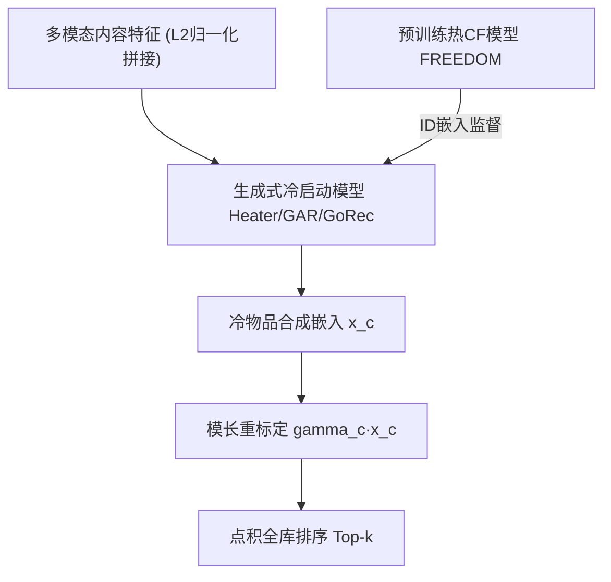

# On Inherited Popularity Bias in Cold-Start Item Recommendation (论冷启动物品推荐中继承的流行度偏置)

- **会议/期刊**: ACM RecSys 2025
- **作者与机构**: Gregor Meehan, Johan Pauwels (Queen Mary University of London)
- **推荐链路定位**: 召回（冷启动物品表征生成与打分）
- **研究方向**: 冷启动与长尾推荐 / 去偏公平
- **论文原文**: [https://arxiv.org/abs/2510.11402v1](https://arxiv.org/abs/2510.11402v1)
- **开源代码**: [https://github.com/gmeehan96/Cold-PopBias](https://github.com/gmeehan96/Cold-PopBias)

## TL;DR (1分钟核心速览)

生成式冷启动推荐器（Heater/GAR/GoRec）以热 CF 模型为监督信号，会**继承甚至放大**热模型的流行度偏置：由于冷物品无交互数据，模型只能靠内容特征"猜"流行度，导致与热门热物品内容相似的冷物品被严重过度曝光（GoRec 在 Electronics 上 top-50 物品占据 27.6% 的 top-20 曝光位，1326 个冷物品零曝光）。作者提出免训练后处理**模长重标定 (Magnitude Scaling, MS)**，以向量模长作为"预测流行度"代理，将模长分布标准差线性压缩、均值保持。在 Clothing/Electronics/Microlens 三数据集、$k=20/50$ 全排序协议下，Gini 多样性提升 30%–130%，MDG-Min80% 提升 10%–20%+，用户精度损失普遍 <10%。

## Background & Motivation (背景与核心矛盾)

- **主流范式**: 冷启动物品推荐采用"生成式"路线——用预训练热 CF 模型（本文为多模态 FREEDOM）作监督，训练内容编码器把物品内容特征映射为合成 ID 嵌入（Heater 用 MoE 变换、GAR 用 GAN、GoRec 用 CVAE 重建），从而在不牺牲热物品性能的前提下为冷物品打分。
- **前人局限**: ① 现有流行度去偏研究几乎全部聚焦热物品，冷启动物品公平性仅有个别工作（如 [53] 的自编码器后处理）触及，且其需预先计算全用户打分向量、无法直接服务新用户；② 生成式冷启动模型以"复刻热模型排序行为"为训练目标，天然会把热模型的偏置一并学走。
- **核心洞察 (Key Insight)**: 冷模型无法从交互数据推断流行度，只能**以内容相似度替代**——与热门热物品内容近邻的冷物品被赋予高曝光（图 2 显示过度曝光的冷物品其 top-10 内容近邻最大流行度常落在全体前 1%），但这一假设在真实留出集上频繁失效（图 1 冷物品图中大量高预测计数点对应极少目标用户）。同时，被过度曝光的物品其输出向量**模长显著偏大**（图 3），因为点积打分下模长直接抬升排名。
- **本文切入点**: 既然模长是"预测流行度"的可观测代理，就在推理后直接压缩模长分布的离散度，从两端同时拉向均值，实现免训练、可服务新用户的公平性后处理。

## Method (核心方法设计)

### 1. 整体框架 (Overall Architecture)

流程为：多模态内容特征 L2 归一化拼接 $\to$预训练 FREEDOM 提供热物品 ID 嵌入监督$\to$生成式冷启动模型（Heater/GAR/GoRec）输出冷物品合成嵌入$x_c$ $\to$推理阶段对$x_c$施加模长重标定得到$\gamma_c x_c$ $\to$ 与用户嵌入点积全库排序。核心创新仅在最后一步的后处理，不触碰任何训练过程，因此对任意生成式冷启动模型即插即用。

### 2. 关键设计拆解 (Key Designs)

1. **模长重标定 (Magnitude Scaling, MS)**：痛点在于冷模型把"内容像热门"误判为"本身热门"，而模长恰是这一误判的可观测痕迹。作者要求缩放后模长与热物品均值 $\mu_w$的偏差按$1+\alpha$ 倍线性压缩、均值不变：
$$\|\gamma_c x_c\|-\mu_w=\frac{\|x_c\|-\mu_w}{1+\alpha}$$
解得缩放因子
$$\gamma_c=\frac{\|x_c\|+\alpha\mu_w}{\|x_c\|(1+\alpha)}$$
直觉：$\|x_c\|$偏离$\mu_w$越远，缩放力度越大；$\alpha\to\infty$时退化为全体模长归一化到$\mu_w$。与以往热物品场景的全局归一化 [19] 或依赖真实流行度动态调权 [22] 不同，本文**从分布两端同时向均值收敛**（小模长被抬升、大离群被压低），因此在中等$\alpha$ 下即可同时实现"长尾提曝光"与"头部降曝光"，且无需任何流行度先验。
2. **公平性评估体系（MDG 系列 + Gini-Div）**：冷物品真实流行度对模型不可见，故不能沿用"长尾物品是否进 top-k"的传统曝光公平度量。作者改用 Max-Min Opportunity 视角的物品级 MDG@k，并因数据极稀疏（Electronics 密度 0.014%）取 **MDG-Min80%**（底部 80% 物品均值）保证指标有信息量，辅以 MDG-Max5% 与 MDG-All；曝光公平用预测计数的 **Gini-Diversity**（越高越均衡）。该体系把"用户侧精度"与"物品侧机会"解耦，是本文分析成立的方法论基础。
3. **训练目标、负采样与推理效率**：本文不提出新训练损失，三个基座模型沿用各自原目标（Heater 的 MoE 回归、GAR 的对抗生成、GoRec 的 CVAE 重建），超参按"最大化冷验证集精度、不考虑偏置"的典型调参方式确定，以还原真实工业实践。推理侧 MS 仅需一次标量乘，复杂度 $O(|\mathcal{C}|)$，无训练、无全用户打分矩阵，可直接服务新用户——这正是相对 [53] 的核心工程优势。

## Experimental Setup & Evaluation Protocol (实验设置与评估协议)

- **数据集与预处理**: 来自 MMRec 工具箱的三个多媒体数据集，各模态内容向量先 L2 归一化再拼接；Clothing 剔除图像模态（已有工作报告其降低性能）。

| 数据集 | #Users | #Items | #Interactions | 密度 | 模态 (维度) |
| :--- | :---: | :---: | :---: | :---: | :--- |
| Clothing | 39,387 | 23,033 | 278,677 | 0.031% | Text (384) |
| Electronics | 192,403 | 63,001 | 1,689,188 | 0.014% | Image (4096), Text (384) |
| Microlens | 98,129 | 17,228 | 705,174 | 0.042% | Image (1024), Text (1024), Video (768) |

- **数据划分与防穿越 (Splitting Strategy)**: **双重划分**——物品按 80:20 分为热/冷，冷集再 50:50 分验证/测试；热物品交互按 80:10:10 分训练/验证/测试。冷物品在训练期完全不可见，属严格冷启动设定。
- **排名评测协议 (Ranking Protocol)**: 冷测试集上 **Full-Ranking 全库排序**（对全部冷物品打分排序），$k\in\{20,50\}$；用户侧 NDCG@k / Recall@k，物品侧 MDG-Min80% / Max5% / All，曝光侧 Gini-Diversity。结果为 5 次运行均值，验证集选超参，$\alpha\in\{0.5,1,1.5,2,2.5,3,4,5\}$。
- **对比基线与超参设置**: 非参数基线 KNN（内容相似度打分）+ 三个生成式冷启动模型 Heater、GAR、GoRec，监督模型为多模态 CF 模型 FREEDOM；显著性检验 $p<0.01$（∗ 表示 MS 显著提升，† 表示显著下降）。

## Key Experimental Results (实验关键数据)

### 1. 主实验对比 (Main Results)

下表摘取 $k=20$的核心列（完整$k=50$见原文表 2），MS 采用验证集选出的平衡$\alpha$：

| 数据集 | 方法 | NDCG | Recall | MDG-Min80% | MDG-All | Gini-Div. |
| :--- | :--- | :---: | :---: | :---: | :---: | :---: |
| Clothing | KNN | **0.0738** | **0.1429** | **0.0270** | **0.0604** | **0.6090** |
| | Heater | 0.0549 | 0.1216 | 0.0095 | 0.0389 | 0.3612 |
| | Heater+MS | 0.0554 | 0.1210 | 0.0127∗ | 0.0412∗ | 0.5225∗ |
| | GAR | 0.0539 | 0.1145 | 0.0075 | 0.0366 | 0.3573 |
| | GAR+MS | 0.0541 | 0.1148 | 0.0117∗ | 0.0402∗ | 0.5930∗ |
| | GoRec | 0.0640 | 0.1394 | 0.0177 | 0.0499 | 0.4832 |
| | GoRec+MS | 0.0639 | 0.1371 | 0.0205∗ | 0.0520∗ | **0.6431∗** |
| Electronics | KNN | **0.0188** | **0.0362** | **0.0030** | **0.0179** | **0.4313** |
| | Heater | 0.0144 | 0.0324 | 0.0000 | 0.0070 | 0.1355 |
| | Heater+MS | 0.0132† | 0.0298† | 0.0003∗ | 0.0092∗ | 0.4821∗ |
| | GAR | 0.0150 | 0.0326 | 0.0000 | 0.0074 | 0.2460 |
| | GAR+MS | 0.0131† | 0.0289† | 0.0001∗ | 0.0084∗ | 0.5030∗ |
| | GoRec | 0.0175 | 0.0377 | 0.0000 | 0.0092 | 0.1496 |
| | GoRec+MS | 0.0166† | 0.0359† | 0.0004∗ | 0.0110∗ | 0.3254∗ |
| Microlens | KNN | **0.0567** | 0.1143 | **0.0171** | **0.0511** | **0.5340** |
| | Heater | 0.0500 | 0.1186 | 0.0073 | 0.0386 | 0.3255 |
| | Heater+MS | 0.0517 | **0.1202** | 0.0113∗ | 0.0420∗ | 0.5711∗ |
| | GAR | 0.0470 | 0.1124 | 0.0069 | 0.0356 | 0.4160 |
| | GAR+MS | 0.0473 | 0.1114 | 0.0092∗ | 0.0369∗ | 0.6223∗ |
| | GoRec | 0.0564 | 0.1284 | 0.0084 | 0.0445 | 0.3208 |
| | GoRec+MS | 0.0574∗ | 0.1302 | 0.0119∗ | 0.0470∗ | 0.4936∗ |

### 2. 消融实验 (Ablation Study)

本文无传统模块消融，核心"消融"即 MS 的开关与强度 $\alpha$扫描（Electronics, GoRec,$k=20$）：

| 配置 | NDCG | MDG-Min80% | Gini-Div. | 零曝光物品数 |
| :--- | :---: | :---: | :---: | :---: |
| GoRec ($\alpha=0$，无 MS) | 0.0175 | 0.0000 | 0.1496 | 1,326 |
| GoRec+MS ($\alpha$ 小) | ≈0.017 | 小幅↑ | 明显↑ | 显著↓ |
| GoRec+MS ($\alpha$ 大，趋归一化) | 0.0166 | 0.0004 | 0.3254 | 6 |

### 3. 关键实验发现 (Key Findings)

1. **偏置被继承且被放大**：热模型 FREEDOM 已呈流行度偏置，而冷模型在冷集上更极端——GoRec 的 top-50 物品占全部 top-20 曝光的 27.6%，1326 个冷物品零曝光；MS 后该比例降至 13.6%、零曝光物品仅剩 6 个，Gini-Div. 从 0.1496 升至 0.3254（+117%）。
2. **公平性提升几乎"免费"**：MDG-Min80% 在 $k=20$普遍提升 ≥20%、$k=50$ 提升 ≥10%，MDG-All 净增；用户精度在 Clothing/Microlens 持平或微升（Microlens GoRec NDCG 0.0564→0.0574∗），仅 Electronics 下降且通常 <10%。原因在于冷模型被压制的"高曝光"并非真实热门，去掉的是错误而非"容易的正确预测"。
3. **内容相似度基线意外强势**：KNN 在多数配置的用户精度与公平性上反超三个生成式模型（如 Electronics NDCG 0.0188 vs. GoRec 0.0175），说明仅凭内容近邻即可获得更均衡的曝光，也侧面印证"用内容直接回归协同行为"存在系统性困难。

## Highlights & Limitations (亮点、对比与审稿批判)

- **与代表作对比 (vs. Prior Work)**: 相对 [53] 的公平性后处理，本文①聚焦流行度维度并给出偏置形成机理的实证链条（内容近邻→高曝光→模长偏大）；②方法免训练、仅依赖生成嵌入统计量，可直接服务新用户，而 [53] 需全用户打分向量且新用户需重训；③相对热物品模长归一化 [19, 22]，本文从分布双端向均值收敛且不依赖真实流行度，适配冷启动。
- **可迁移亮点**: ①"模长即预测流行度"的代理思想可迁移到任何点积打分的双塔/生成式召回，作为零成本曝光调控旋钮；②MDG-Min80% + Gini-Div. 的"精度–机会–曝光"三视角评估组合，适合稀疏场景下的公平性基准建设。
- **审稿级局限批判**: ①属症状级后处理，未触及偏置成因，作者亦承认需未来在训练期加模长正则；②$\alpha$ 需在验证集上按公平–精度权衡人工选取，缺乏自适应机制，且 Electronics 上用户精度出现显著下降（†），跨数据集鲁棒性存疑；③仅覆盖三个多媒体数据集与三个生成式模型，未验证纯 ID-CF 监督或 LLM 生成式召回场景。

## Rating (四维评分)

- **方法创新性 (Novelty)**: ⭐⭐⭐ （模长重标定本身简洁甚至朴素，但"继承偏置"的问题提出与双端收敛缩放设计具有清晰的新意与实证支撑）
- **评估协议与实验扎实度 (Protocol & Experiments)**: ⭐⭐⭐⭐ （三数据集 × 三模型 × 双 k 值全排序，$p<0.01$ 显著性标注与 MDG/Gini 多视角评估完整，唯缺更大规模与更多模型族验证）
- **写作与数学规范度 (Clarity & Rigor)**: ⭐⭐⭐⭐ （缩放因子推导仅两行但直觉交代充分，图表与结论对应紧密；理论分析主要引用前人模长增长结论，未自证）
- **工业落地与复现价值 (Industrial & Practical Value)**: ⭐⭐⭐⭐⭐ （免训练、$O(|\mathcal{C}|)$ 标量缩放、支持新用户，代码开源，是极少见的"一行后处理即可上线"的去偏方案）

