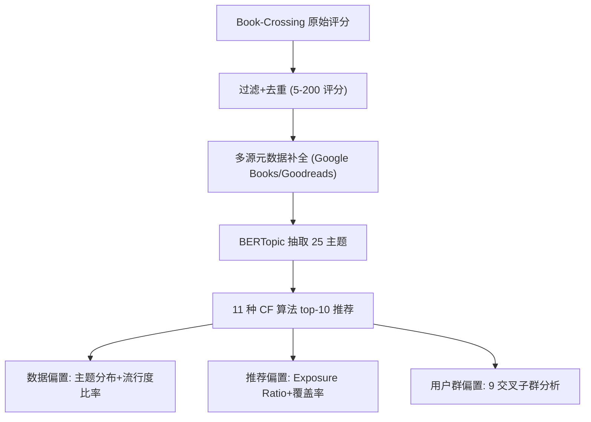

# Reading Between the Lines: A Study of Thematic Bias in Book Recommender Systems (字里行间：图书推荐系统中的主题偏置研究)

- **会议/期刊**: FAccTRec Workshop @ RecSys 2025
- **作者与机构**: Nityaa Kalra (Radboud University)、Savvina Daniil (CWI Amsterdam)
- **推荐链路定位**: 重排 / 推荐输出评估（非模型创新，属诊断性分析）
- **研究方向**: 冷启动与长尾推荐 / 去偏公平与可信推荐
- **论文原文**: [https://arxiv.org/abs/2508.15643v1](https://arxiv.org/abs/2508.15643v1)
- **开源代码**: [https://github.com/nityaak5/Bias-Book-Recommendation](https://github.com/nityaak5/Bias-Book-Recommendation)

## TL;DR (1分钟核心速览)

本文首次系统定义并量化图书推荐中的**主题偏置 (Thematic Bias)**——某些书籍主题被不成比例地放大、另一些被系统性忽视。作者用 BERTopic 从 5,229 本书的描述中抽取 25 个主题，在 Book-Crossing 上跑 11 种 CF 算法，构建「数据偏置 → 推荐偏置 → 用户群偏置」三阶段评估框架。核心发现：约 20% 的主题占据 52% 的书籍；WMF 覆盖率最高（91.11%）却仍放大高互动主题；**专精型与通才型读者的推荐主题数被算法"归一化"到约 7 个**，小众+长尾交叉子群受损最重。

## Background & Motivation (背景与核心矛盾)

- **主流范式**: 图书推荐偏置研究长期聚焦**流行度偏置**（Naghiaei et al. 指出 CF 系统性冷落多样化口味用户）与**人口统计偏置**（Daniil et al. 发现 CF 偏好美国作者），二者均以"物品热度/作者身份"为分析轴。
- **前人局限**: ① 现有工作缺少**内容语义层**的偏置视角——主题（如"吸血鬼奇幻"vs"温馨推理"）既非热度也非身份，而是叙事与意识形态的框架，被放大即意味着文化话语权被重塑；② 传统 genre 标签过粗（大量书仅标 "Fiction"）且长尾书元数据缺失，无法支撑细粒度偏置分析。
- **核心洞察 (Key Insight)**: 主题偏置是**双层叠加**现象——数据端主题分布本身失衡（20% 主题占 52% 书籍），用户互动端进一步放大（如 Wizarding World 主题书籍数量中等但平均流行度比率极高），二者复合形成对弱势主题的"复利式劣势"。
- **本文切入点**: 用 BERTopic 从书籍描述中抽取可扩展的细粒度主题，再以**交叉性 (intersectionality)** 视角把用户按"主题多样性 × 流行度倾向"切成 9 个子群，逐层追踪偏置的传导路径。

## Method (核心方法设计)

### 1. 整体框架 (Overall Architecture)

流程为：Book-Crossing 原始数据 → 严格过滤（用户评分数 5–200、书籍 ≥5 评分、剔除隐式 0 分、title+author 去重）→ 通过 Google Books API / Goodreads 爬取数据 / Amazon / Wikipedia / DBpedia 补全书籍描述 → BERTopic 主题建模（min_cluster_size=10，余弦相似度 0.8 合并，65 主题初筛后保留 25 个）→ 11 种推荐算法生成 top-10 → 三阶段偏置度量（数据偏置 / 推荐偏置 / 用户群偏置）。

### 2. 关键设计拆解 (Key Designs)

1. **主题建模替代粗粒度 Genre（内容层偏置的可度量基础）**：痛点在于 genre 标签覆盖不全且语义过粗，无法区分"心理惊悚"与"犯罪惊悚"。本文用 BERTopic 的上下文嵌入聚类，将 5,229 条描述压缩为 25 个主题，并用内部校验（人工审阅、多次运行稳定性、主题一致性均值 0.52）与外部校验（对照 2000 年代初 NYT / Publishers Weekly 畅销榜趋势）双重验证。直觉：语义聚类能在元数据缺失的长尾书上仍给出统一主题表示，使偏置统计不被"标签缺失"污染。

2. **Exposure Ratio 与平均流行度比率（量化"放大"而非仅"存在"）**：仅看推荐中主题占比无法区分"数据本来就这样"与"算法额外放大"。本文定义
$$\text{Exposure Ratio}(t)=\frac{\%\ \text{Theme } t\ \text{in Recommendation}}{\%\ \text{Theme } t\ \text{in Training Data}}$$
并辅以主题内书籍的平均流行度比率。直觉：比值 >1 即算法在数据分布之上额外倾斜；Wizarding World 在所有算法下 Exposure Ratio 均居高，而其书籍数量仅中等，直接证明"高互动驱动放大"独立于"数量驱动放大"。

3. **交叉性用户分群（定位受损最重的子群）**：单维分群会掩盖复合劣势。本文先按流行度倾向分 Mainstream（>70% 流行书）/ Mixed（30–70%）/ Long-Tail（<30%），再按历史主题数与 Gini 分 Specialist（主题数 <P25 且 Gini >P75）/ Moderate / Generalist，交叉得 9 个子群。直觉：只有交叉视角才能暴露"小众主题偏好 + 长尾消费"这一双重边缘群体的推荐错配。

## Experimental Setup & Evaluation Protocol (实验设置与评估协议)

- **数据集与预处理**:

| 数据集 | #Users | #Items | #Interactions | 稀疏度 | 特征/场景说明 |
| :--- | :---: | :---: | :---: | :---: | :--- |
| Book-Crossing (Raw) | 68,091 | 149,836 | 383,842 | 99.90% | 原始含隐式 0 分 |
| Book-Crossing (Post-Enrichment) | 5,424 | 5,229 (含描述) / 4,984 (含类目) | 70,622 | 99.75% | 人均 13.02 评分，书均 13.51 评分 |

- **数据划分与防穿越 (Splitting Strategy)**: 采用 **80-10-10 比例划分**（train-validation-test），超参按 NDCG@10 在验证集调优；未采用全局时间戳切分，存在轻度未来信息泄漏风险（论文未讨论）。
- **排名评测协议 (Ranking Protocol)**: 生成 **top-10 列表**做偏置分析；准确率侧报告 Precision/Recall/F1/NDCG@10，但**未说明是 Full-Ranking 还是 Sampled Ranking**，亦未报告负采样策略——这是评估严谨性的明显缺口。
- **对比基线与超参设置**: 11 种算法，含 2 个朴素基线（Random、MostPop）、6 种矩阵分解（MF、WMF、NMF、PMF、HPF、BPR）、User-kNN、NeuMF、VAE-CF；实现基于 Cornac 库，算法选择对齐 Naghiaei et al. 与 Daniil et al. 以保证可比性。未报告嵌入维度与显著性检验（仅数据偏置处做了卡方检验 $p<0.05$）。

## Key Experimental Results (实验关键数据)

### 1. 主实验对比 (Main Results)

原文主表以准确率与覆盖率为主，此处摘取最具诊断价值的指标（top-10）：

| 算法 | NDCG@10 表现 | Item Coverage | 主题分布特征 |
| :--- | :---: | :---: | :--- |
| MostPop | 低 | **0.19%** | 极端集中于头部主题 |
| BPR | 中（Recall/F1 较优） | <15% | 流行度驱动，小众主题几乎缺席 |
| NeuMF | 较高 | <15% | 主题池狭窄 |
| VAE-CF | 高 | <15% | 高准确率但放大既有热门主题 |
| PMF | 低 | 42.47% | 覆盖中等 |
| **WMF** | **最优（P/R/F1/NDCG 全面领先）** | **91.11%** | 覆盖最广，但仍向高互动主题倾斜 |

> 说明：原文未给出统一的数值型主表（完整指标置于 GitHub），上表按文中定性描述与覆盖率数字整理；主题层面以 Exposure Ratio 图（图 4）呈现，Wizarding World 在所有算法下 Exposure Ratio 最高。

### 2. 消融实验 (Ablation Study)

本文为分析型工作，无模型消融；其"消融"等价物是**用户分群维度的拆解**：

| 配置 | 平均主题数 | Gini 比率 | 观察 |
| :--- | :---: | :---: | :--- |
| Specialist（数据 / 推荐） | 3.4 → 6.8 | 0.361 → 0.218 | 多样性上升但伴随**主题置换** |
| Moderate（数据 / 推荐） | 6.8 → 7.1 | 0.226 → 0.204 | 变化最小，最"稳定" |
| Generalist（数据 / 推荐） | 10.2 → 7.2 | 0.183 → 0.194 | 多样性被**压缩** |
| 单维 vs. 交叉分群 | — | — | 仅交叉分群能识别"小众+长尾"最受损子群 |

### 3. 关键实验发现 (Key Findings)

1. **偏置源于数据、被互动放大**：25 个主题中约 20% 覆盖 52% 的书籍；卡方检验显示 8/25 个主题在流行子集中的分布差异显著（$p<0.05$）；Wizarding World、Holiday Classics 书籍数量中等却拥有极高平均流行度比率，证明"互动驱动放大"独立于"数量驱动放大"。
2. **高准确率 ≠ 低偏置，高覆盖率也 ≠ 主题均衡**：WMF 覆盖率高达 91.11% 且准确率全面最优，却依然系统性放大高互动主题；而 NeuMF/BPR/VAE-CF 覆盖率不足 15%，主题池更窄。说明覆盖率与主题公平性是两个正交维度。
3. **算法对读者主题多样性存在"归一化"效应**：专精读者主题数从 3.4 被拉到 6.8、通才读者从 10.2 被压到 7.2，两类人最终都收敛到约 7 个主题，且被推向 Vampire/Paranormal Fantasy 或 American Literature Classics 等主导主题——这是一种**同质化 (homogenization)**，而非个性化。交叉分析进一步显示"专精 + 长尾"子群推荐与历史偏好偏离最大，而"Moderate + Mixed"子群几乎不受影响。

## Highlights & Limitations (亮点、对比与审稿批判)

- **与代表作对比 (vs. Prior Work)**: 相较 Naghiaei et al.（流行度偏置、单维用户分群）与 Daniil et al.（作者国别人口统计偏置），本文把分析轴从"热度/身份"推进到**内容语义主题**，并首次引入交叉性分群；相较 Ziegler et al. 用 Book-Crossing 研究 topical diversity 但目标是提升个性化，本文目标反转为**诊断公平性**。
- **可迁移亮点**: ① "Exposure Ratio + 主题内平均流行度比率"这对指标可直接移植到短视频、音乐等任何有内容标签的域，用于区分"数据失衡"与"算法放大"；② 交叉性分群（消费倾向 × 兴趣广度）是定位长尾受损用户群的低成本通用手段。
- **审稿级局限批判**: ① **主题单标签化**——每本书仅分配一个主题，而文学作品天然多主题（如《傲慢与偏见》同时含爱情、阶级、成长），这会系统性低估主题覆盖、扭曲 Exposure Ratio；② **评估协议不透明**——未说明 Full-Ranking 还是采样排序、未报告负采样与嵌入维度、未做推荐偏置侧的显著性检验，且 80-10-10 随机划分对时序性阅读行为存在泄漏；③ 仅评估 top-10 且未做任何去偏干预实验，"如何缓解"完全留白，实践指导价值受限。

## Rating (四维评分)

- **方法创新性 (Novelty)**: ⭐⭐⭐ （首次将主题偏置形式化并给出可扩展的 BERTopic 度量管线，但方法本身是成熟工具的组装，无算法层创新）
- **评估协议与实验扎实度 (Protocol & Experiments)**: ⭐⭐⭐ （11 种算法 + 交叉分群较全面，但划分方式、排序协议、负采样与显著性检验披露不足，主表数值不完整）
- **写作与数学规范度 (Clarity & Rigor)**: ⭐⭐⭐⭐ （问题定义清晰、RQ 与结论一一对应、指标定义简洁，但公式极少、缺复杂度与统计细节）
- **工业落地与复现价值 (Industrial & Practical Value)**: ⭐⭐⭐⭐ （代码数据全开源、管线可直接复用为内容平台的主题公平性审计工具，但无干预方案，落地需自行补足去偏模块）

