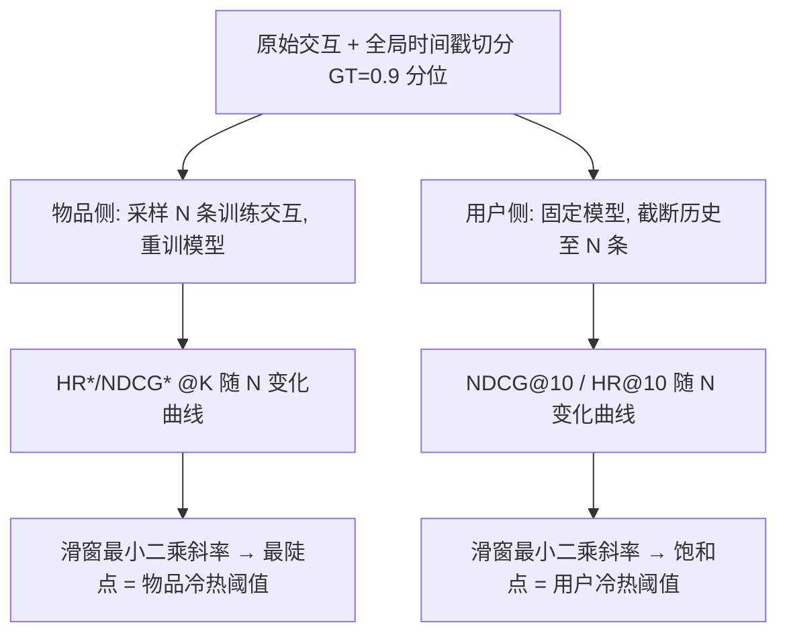

# Recommendation Is a Dish Better Served Warm (推荐这道菜还是热着端上更好)

- **会议/期刊**: RecSys 2025 (Prague)
- **作者与机构**: Danil Gusak, Nikita Sukhorukov, Evgeny Frolov (AIRI / Skoltech / HSE University)
- **推荐链路定位**: 召回（数据预处理与评估协议层，模型无关）
- **研究方向**: 冷启动与长尾推荐 / 去偏与工业评测基准
- **论文原文**: [https://arxiv.org/abs/2508.07856v1](https://arxiv.org/abs/2508.07856v1)
- **开源代码**: [https://github.com/dalibra/recommendation-dish-better-served-warm](https://github.com/dalibra/recommendation-dish-better-served-warm)

## TL;DR (1分钟核心速览)

本文是一篇**方法论批判 + 实证标定**论文，而非新模型论文。作者先统计 RecSys'22–24 的 65 篇提及过滤的论文，发现**无一篇解释阈值取值**、仅 9% 解释过滤动机（图 1）；随后提出模型无关的双侧阈值标定流程：物品侧在训练集上把每个物品的交互随机截断到 $N$条并重训，用滑窗最小二乘斜率定位 HR\*/NDCG\* 的"性能跃迁点"；用户侧固定模型、在推理时把测试用户历史均匀截断到$N$ 条，定位指标饱和点。在 ML-1M / BeerAdvocate / Behance / Amazon Beauty 四个数据集与 EASER、PureSVD、ItemKNN、SASRec-CE 四个模型上，得到物品阈值 6–15、用户阈值 4–12 的区间，证明常用 `5-core` 既可能误删有效数据、也可能把冷实体误判为热。

## Background & Motivation (背景与核心矛盾)

- **主流范式**: 协同过滤/序列推荐论文几乎默认使用 `p-core` 迭代过滤（常用 $p=5$）剔除冷用户与冷物品，以降低稀疏噪声与训练开销。
- **前人局限**: 其一，$p$ 的取值纯属启发式，跨论文从 3 到 20 不等，导致同一数据集上的指标不可比；其二，过滤是"一刀切"的——被删的实体彻底退出训练与评估，而保留下来的实体中仍混有大量实际处于冷启动区间的样本，把噪声带进了"热"集合。
- **核心洞察 (Key Insight)**: 冷/热不是二值属性，而是随交互数 $N$ 连续变化的**相变现象**：物品侧存在指标陡升的"性能跃迁点"，用户侧存在指标饱和平台。阈值应由数据与模型共同决定，而非拍脑袋。
- **本文切入点**: 用"扫描 $N$ + 定位曲线拐点"这一模型无关的可复现流程，把阈值从超参变成可观测量。

## Method (核心方法设计)

### 1. 整体框架 (Overall Architecture)

论文不设计新网络，而是设计两套**受控实验协议**。物品侧（训练期干预）：对候选物品 $i$，从其训练交互集$M(i)$中随机采样$N$条构造修改训练集$\tau_N$，重训模型后用 successive evaluation 观察$i$在 top-K 列表中的出现频率与位次；对 1000 个均匀采样物品重复并取均值，得到 HR\*@K–$N$曲线。用户侧（推理期干预）：模型只训一次，对测试用户历史$L(u_t)$均匀采样$N$条并按时间戳重排，喂入模型预测 GT，得到 NDCG@10–$N$ 曲线。两条曲线分别用滑窗线性回归取斜率最陡处作为阈值。

### 2. 关键设计拆解 (Key Designs)

1. **物品侧随机采样而非取最近 $N$条**：若取最近$N$条，会系统性高估近期热门物品、并受流行度漂移与偏好漂移污染。作者改为在$M(i)$内**均匀随机采样**$N$条、删除其余$|M(i)|-N$条，使$N$成为唯一自变量。配套的 successive evaluation（图 2a）把 holdout 交互逐条加入当前历史、每步生成 top-K 并与下一条比对，用$n$条 holdout 廉价换取$n$ 次评估，显著收窄置信区间。评估指标被改写为"被调查物品是否上榜"：

$$\mathrm{HR}^{*}@K(i)=\frac{1}{|U|}\sum_{u\in U}\mathbb{I}\left[i\in R_K^u\right],\quad \mathrm{NDCG}^{*}@K(i)=\frac{1}{|U|}\sum_{u\in U}\frac{\mathbb{I}\left[i\in R_K^u\right]}{\log_2\left(\mathrm{rank}_u(i)+1\right)}$$

直觉：传统 HR 衡量"GT 是否被召回"，而这里要问的是"**这个物品本身**在多稀疏时还能被召回"，因此把 GT 换成被调查物品 $i$，从而把物品热度与用户偏好解耦。

2. **用户侧固定模型 + 时间戳重排**：用户侧若也重训，成本为 $|N_j|\times|U|$ 量级不可行，故固定单一模型只改推理输入。均匀采样保留原始流行度分布（热门物品更易被抽中），但对 SASRec 这类序列模型，乱序会破坏消费语义，因此采样后**按时间戳升序重排**，保证至少捕获用户全局意图。同时只保留 GT 之后的第一条交互作为 ground truth、丢弃其余，避免预测越走越远带来的指标衰减污染（图 2c）。

3. **阈值定位算子与训练/推理开销**：对曲线做宽度为 $w$的滑动窗口，每窗解最小二乘拟合斜率，取斜率最大处对应的$N$为阈值。物品侧总重训次数上界为$|\{N_j\}|\times|I|\times\#\text{models}$，故只对$S=1000$ 个采样物品执行；用户侧零重训。全流程无额外损失函数，属于纯评估协议改造。

## Experimental Setup & Evaluation Protocol (实验设置与评估协议)

- **数据集与预处理**: 四个数据集**均未做 p-core 过滤**（这正是本文的立场），保留原始长尾：

| 数据集 | #Users | #Items | #Interactions | 密度 | 人均/物均交互 |
| :--- | :---: | :---: | :---: | :---: | :--- |
| ML-1M | 6,040 | 3,706 | 1,000,209 | 4.47% | 166 / 270 |
| BeerAdvocate | 7,606 | 22,307 | 1,409,494 | 0.83% | 185 / 63.2 |
| Behance | 8,097 | 32,434 | 546,284 | 0.21% | 67.4 / 16.8 |
| Amazon Beauty | 26,116 | 17,037 | 230,481 | 0.05% | 8.83 / 13.5 |

- **数据划分与防穿越 (Splitting Strategy)**: 明确弃用 `Leave-One-Out`（作者指出其造成数据泄漏），改用**全局时间戳切分**：GT 取全体交互的 0.9 分位，之前交互按用户随机划为 train/valid，valid 用每用户最后一条交互做早停与 20 点随机超参搜索；GT 之后有交互的用户为测试用户，其 GT 前历史为输入序列。
- **排名评测协议 (Ranking Protocol)**: 用户侧采用**无偏 Full-Ranking**（未采样负例）的 NDCG@10 与 HR@10；物品侧为自定义 HR\*/NDCG\*@K，$K\in\{1,5,10,50,100\}$。物品侧额外做隔离：从 train/valid/test 中移除被调查物品$i$的交互，并剔除测试用户在训练集中的交互，保证不同$i$下训练集基本一致（漂移上限$|M_i|-\max(N)$）；报告 recommendation stability 在 1% 内。
- **对比基线与超参设置**: EASER（闭式线性）、PureSVD（SVD 隐因子）、ItemKNN（邻域）、SASRec-CE（全交叉熵序列模型）；95% 置信区间由 1000 物品采样 + successive evaluation 共同给出。

## Key Experimental Results (实验关键数据)

### 1. 主实验对比 (Main Results)

本文主结果是**阈值标定表**（原文 Table 2），而非传统精度对比表。下表汇总各 (数据集, 模型) 组合下估计出的冷→热阈值 $N$：

| Setup | Model | ML-1M | BeerAdvocate | Behance | Amazon Beauty |
| :--- | :--- | :---: | :---: | :---: | :---: |
| Item-Based | SASRec-CE | 9 ±1.1 | 10 ±1.5 | **15 ±1.7** | 10 ±2.1 |
| Item-Based | ItemKNN | 9 ±1.8 | 6 ±1.2 | 12 ±1.3 | 6 ±1.1 |
| Item-Based | PureSVD | 9 ±1.4 | 6 ±1.2 | 6 ±1.0 | 6 ±0.9 |
| Item-Based | EASER | **10 ±1.0** | 8 ±1.1 | 6 ±1.1 | 8 ±1.1 |
| User-Based | SASRec-CE | 6 ±0.8 | **10 ±2.1** | 10 ±1.9 | **12 ±1.8** |
| User-Based | ItemKNN | 4 ±1.4 | 8 ±1.3 | 10 ±2.3 | 4 ±1.2 |
| User-Based | PureSVD | 4 ±1.3 | 8 ±1.2 | 6 ±1.4 | 4 ±1.1 |
| User-Based | EASER | 5 ±1.1 | 8 ±1.6 | 10 ±1.7 | 4 ±1.1 |

对照常用 `5-core`：物品侧阈值普遍落在 6–15，**`5-core` 系统性偏低**；用户侧阈值 4–12，在 Beauty 上 SASRec-CE 需 12 条历史才饱和，`5-core` 严重不足。

### 2. 消融实验 (Ablation Study)

本文无传统模块消融，其"消融"体现为对协议关键选择的敏感性检验：

| 协议变体 | 观察结果 | 结论 |
| :--- | :--- | :--- |
| 去掉 successive evaluation（单点评估） | 置信区间显著变宽 | 逐条扩展是低成本降方差的关键 |
| 应用 `filter seen` 步骤 vs. 不应用 | 结果保持一致 | 阈值结论对常见后处理不敏感 |
| 物品侧 $K$从 1 增至 100 | 曲线更平滑、方差更小，但跃迁点变模糊 | 小$K$更利于定位相变，大$K$ 更稳健 |
| 物品侧采样策略（随机 vs. 最近 $N$） | 随机采样避免流行度/偏好漂移偏差 | 随机采样是必要设计而非细节 |
| 训练集扰动幅度 $|M_i|-\max(N)$ | recommendation stability 波动 < 1% | 截断操作未破坏数据语义 |

### 3. 关键实验发现 (Key Findings)

1. **物品侧是"相变"，用户侧是"饱和"**：物品侧 HR\*/NDCG\* 在阈值处出现陡升（图 3 红色竖线），说明低于该点物品根本无法进入有效表征；用户侧则是指标平台（图 4），超过阈值后继续加长历史反而因信息稀释导致停滞甚至轻微下降——两者物理机制完全不同，不能用同一套过滤逻辑处理。
2. **序列模型比非序列模型更"吃"历史**：用户侧 SASRec-CE 在四个数据集上阈值分别为 6/10/10/12，一致高于 EASER、PureSVD、ItemKNN 的 4–10，说明注意力式序列建模需要更长历史才能稳定捕获消费模式；因此**跨模型比较时应取各模型阈值的最大值**作为统一评估下限，否则序列模型的劣势部分来自数据供给不足而非架构。
3. **数据集异质性远大于模型异质性**：ML-1M 上四个模型物品阈值几乎重合（9–10），而 Behance 上跨度达 6–15；Beauty 密度仅 0.05%、物均 13.5 条交互，却仍需 6–10 条才算热。这说明阈值主要由数据分布（密度、长尾形状）决定，跨数据集照搬 `5-core` 缺乏依据。

## Highlights & Limitations (亮点、对比与审稿批判)

- **与代表作对比 (vs. Prior Work)**: 与 Visnovsky et al. 用 K-means + Davies-Bouldin 指数估计用户冷启动阈值相比，本文把适用范围从"仅用户侧、仅两个 TV 数据集"扩展到用户/物品双侧、四域数据集、四类模型，且不依赖聚类假设；与所有使用 `p-core` 的 CF 论文相比，本文的核心差异是把过滤从"预处理惯例"重构为"需要被测量和报告的实验变量"。
- **可迁移亮点**: ①"固定模型 + 截断推理输入 + 滑窗斜率找拐点"这套流程可直接迁移到 LLM4Rec 的上下文长度标定、序列推荐的最大历史窗口选择；②物品侧"随机采样 $N$ 条 + 隔离测试用户"的受控重训范式，可用于诊断任意新模型对长尾物品的数据需求量。
- **审稿级局限批判**: ①物品侧重训成本为 $O(|\{N_j\}|\cdot S\cdot\#\text{models})$，$S=1000$的采样虽给出 CI，但对超大工业目录的可扩展性与采样偏差未讨论；②仅覆盖 next-item prediction 与四个 CF/序列模型，未涉及图模型、生成式推荐与内容特征场景，且"阈值"以单一标量给出，未建模物品类别/时效性带来的阈值异质性；③斜率最陡点的判定依赖滑窗宽度$w$ 这一未充分敏感性分析的超参，拐点定位本身带有主观性。

## Rating (四维评分)

- **方法创新性 (Novelty)**: ⭐⭐⭐ （不提出新模型，但把"冷启动阈值"从惯例提升为可测量对象，视角新颖、技术增量有限）
- **评估协议与实验扎实度 (Protocol & Experiments)**: ⭐⭐⭐⭐ （全局时间戳切分规避泄漏、Full-Ranking、1000 物品采样 + 95% CI、四域四模型，协议严谨；缺少数值型主实验对比表）
- **写作与数学规范度 (Clarity & Rigor)**: ⭐⭐⭐⭐ （HR\*/NDCG\* 定义清晰、实验隔离设计交代到位，但阈值定位算子仅有文字描述、缺形式化）
- **工业落地与复现价值 (Industrial & Practical Value)**: ⭐⭐⭐⭐⭐ （代码开源、模型无关、零额外训练成本即可复用，可直接改写工业数据管线的过滤策略与评估基线）

