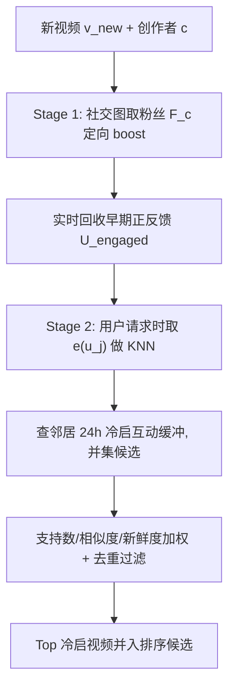
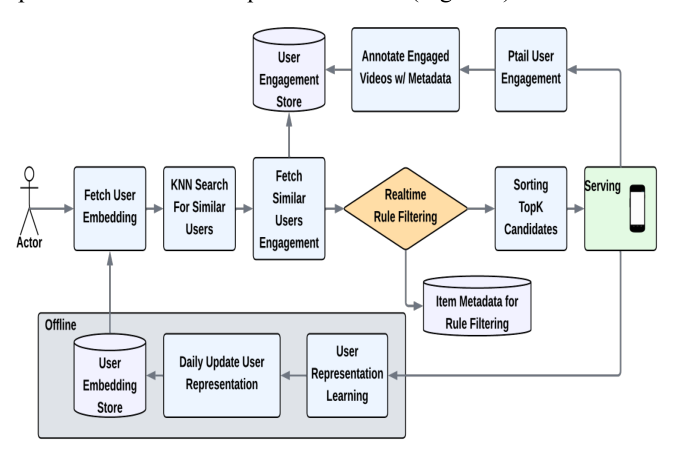
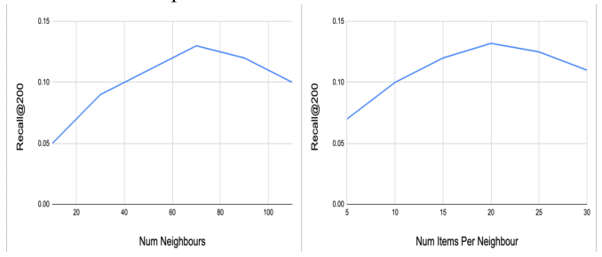

# SocRipple: A Two-Stage Framework for Cold-Start Video Recommendations (社交涟漪：面向冷启视频推荐的两阶段框架)

- **会议/期刊**: RecSys 2025 (Industry Track, 4 pages)
- **作者与机构**: Amit Jaspal, Kapil Dalwani, Ajantha Ramineni (Meta Platforms, Inc.)
- **推荐链路定位**: 召回 (Candidate Retrieval / 候选生成)
- **研究方向**: 冷启动与长尾推荐 / 社交与群组推荐
- **论文原文**: [https://arxiv.org/abs/2508.07241v1](https://arxiv.org/abs/2508.07241v1)
- **开源代码**: 暂未开源

## TL;DR (1分钟核心速览)

针对工业级视频平台新视频零交互、CF 模型无法个性化分发、纯内容方案又缺乏用户相关性的痛点，本文提出 SocRipple 两阶段召回框架：Stage 1 用创作者社交关注图做高精度种子曝光并实时回收早期正反馈，Stage 2 以稳定的双塔用户嵌入 + FAISS KNN 检索"涟漪式"扩散到兴趣近邻。在 6/12/24 小时冷启分桶上 Recall@200 达 12.8%/13.1%/13.2%（对比最强基线 DropoutNet 的 5.8%/7.2%/8.8%，相对提升约 +120%/+82%/+50%），线上两周 A/B 冷启内容曝光份额 +36%，主互动指标 +0.22% 且冷启内容互动率持平。

## Background & Motivation (背景与核心矛盾)

- **主流范式**: 工业推荐依赖 Embedding+MLP 双塔召回，靠海量交互日志学习物品表征；冷启动侧的代表作是 DropoutNet（训练时随机丢弃 CF 特征以模拟冷启）、CLCRec（内容对比学习表征）以及 Item-KNN / Content-KNN 等近邻召回。
- **前人局限**: 其一，CF 类方法对零交互新物品完全失效，且帕累托效应使头部物品垄断曝光、加剧流行度偏置；其二，内容类方法只依赖静态元数据，无法刻画用户特定相关性，也不随实时行为与社交影响自适应。
- **前人局限（结构性）**: 已有的"早期种子"思路（把新内容推给创作者粉丝）只做了高精度 bootstrap，缺乏系统化的大规模扩散与评估；图方法（GNN / 好友正则）虽能传播信号，却未把"社交种子"与"嵌入近邻扩散"串成一条级联链路。
- **核心洞察 (Key Insight)**: 创作者的直接社交连接天然是新内容的最高精度初始受众；而一旦拿到这批早期正反馈，就可以借由历史交互学到的**稳定用户嵌入**把信号沿兴趣空间向外扩散——精度与召回被拆到两个阶段分别解决。
- **本文切入点**: 用"社交种子 → 嵌入 KNN 涟漪"的级联两阶段设计，在探索（新内容发现）与利用（个性化相关性）之间取得平衡。

## Method (核心方法设计)

### 1. 整体框架 (Overall Architecture)

给定创作者 $c$上传的新视频$v_{new}$，Stage 1 立即从社交关注图$G$中取出粉丝集合$F_c=\{u\mid(u,c)\in G\}$，在推荐流中定向 boost 并实时记录正反馈用户集$U_{engaged}\subseteq F_c$；Stage 2 在用户$u_j$请求 feed 时触发：从内存索引取出其离线预计算的稳定嵌入$e(u_j)$，做 KNN 得到邻居集$N(u_j)$，对每个邻居查询其近 24 小时正反馈的冷启视频缓冲，取并集构成候选，再按"邻居支持数、邻居相似度、新鲜度"加权打分、过滤已曝光项后送入下游排序。用户嵌入由双塔模型在历史交互上训练、每日离线批量刷新并写入 FAISS ANN 索引，从而把"新内容"的传播成本从物品侧转移到用户侧。

<figure class="paper-figure" markdown="span">
  <figcaption>图1：SocRipple端到端系统概览</figcaption>
</figure>

### 2. 关键设计拆解 (Key Designs)

1. **Stage 1 社交种子 (Social Boost)**：冷启最冷阶段没有任何物品侧信号，任何基于物品嵌入的召回都退化为随机。本文直接把分发对象换成"人"——以关注边 $(u,c)\in G$定义种子集$F_c$，用社交邻近性换取最高精度的初始曝光，同时把曝光转化为可实时消费的反馈流$U_{engaged}$。其有效性直觉在于：粉丝对创作者存在已声明的偏好先验，正反馈率远高于全库随机曝光，因此这批信号噪声低、可用于后续扩散的"锚点"质量高。

2. **Stage 2 嵌入近邻涟漪 (Neighbor Expansion)**：纯社交图传播（SGE）只能覆盖已声明关系，召回天花板低。本文改为在**行为兴趣空间**扩散：对邻居 $u_k\in N(u_j)$收集其近 24h 正反馈冷启视频集$V_{new}(u_k)$，候选并集后按加权分排序
$$s(v)=\alpha\cdot\frac{|\{u_k\in N(u_j): v\in V_{new}(u_k)\}|}{|N(u_j)|}+\beta\cdot \mathrm{sim}(u_j,u_k)+\gamma\cdot \mathrm{fresh}(v)$$
其中 $\mathrm{fresh}(v)$为距创建时间的衰减项，$\alpha,\beta,\gamma$ 由线上 A/B 调优。关键直觉是：嵌入相似度捕捉的是**共享行为偏好**这一与社交边正交的信号，因此能在社交图之外打开大量高相关的新受众。

3. **训练目标、负采样与推理效率**：双塔以点积 $s(u,i)=e_u^{\top}e_i$ 建模亲和度，采用 in-batch 负采样的 sampled softmax：
$$P(y_{u,i}=1\mid u,i)=\frac{\exp(s(u,i))}{\exp(s(u,i))+\sum_{i'\in \mathcal{B}^{-}}\exp(s(u,i'))},\quad \mathcal{L}=-\sum_{(u,i)\in\mathcal{B}}\log P(y_{u,i}=1\mid u,i)$$
仅用正反馈（如点赞）训练，无需显式硬负采样挖掘。推理侧的关键工程取舍是：用户塔每日离线批量产出嵌入并建 FAISS ANN 索引，物品侧零训练成本；Stage 2 的在线开销仅为一次 KNN 查询 + 邻居互动缓冲的哈希查找 + 轻量加权排序，作者称经过系统优化后可满足高吞吐候选生成的严格延迟约束。

## Experimental Setup & Evaluation Protocol (实验设置与评估协议)

- **数据集与预处理**: 来自某大型视频平台的大规模工业交互日志（未公开具体规模），冷启定义按物品创建时间分桶为 $\le 6$h、$\le 12$h、$\le 24$h 三档；正反馈以点赞等显式互动为准。

| 数据集 | #Users | #Items | #Interactions | 稀疏度/密度 | 特征/场景说明 |
| :--- | :---: | :---: | :---: | :---: | :--- |
| 工业视频平台日志 | 未披露（十亿级） | 未披露 | 未披露 | 未披露 | 社交关注图 $G$ + 视频互动日志，冷启按 6/12/24h 分桶 |

- **数据划分与防穿越 (Splitting Strategy)**: 原文未明确说明划分方式；从"按物品年龄分桶 + 近 24h 互动缓冲"的设计推断为**时间切分**语义（仅使用请求时刻之前的互动），但论文未给出形式化的防穿越描述，属评估披露不足。
- **排名评测协议 (Ranking Protocol)**: 采用 `Recall@200` 作为召回阶段指标，未说明是 Full-Ranking 还是采样排序，亦未报告 NDCG/HR 等排序质量指标；线上部分以两周 A/B 测试的主互动指标、冷启曝光份额、冷启互动率为准，并声明统计显著。
- **对比基线与超参设置**: 离线基线为 DropoutNet、Content-KNN、Item-KNN 三类；消融基线为 Stage 1 Only 与 Stage 1+SGE。嵌入维度 $d$与训练超参未披露；Stage 2 关键超参为邻居数$K$（扫描 10–70，峰值$K=70$）与每邻居冷启视频数$M$（取$M=20$）。

## Key Experimental Results (实验关键数据)

### 1. 主实验对比 (Main Results)

| 方法 | Recall@200 ($\le$6h) | Recall@200 ($\le$12h) | Recall@200 ($\le$24h) |
| :--- | :---: | :---: | :---: |
| Item-KNN | 3.2% | 5.4% | 7.5% |
| Content-KNN | 4.5% | 5.2% | 4.8% |
| DropoutNet | 5.8% | 7.2% | 8.8% |
| **SocRipple** | **12.8%** | **13.1%** | **13.2%** |
| Improv. vs 最强基线 | **+120.7%** | **+81.9%** | **+50.0%** |

线上 A/B（两周）：主互动指标 **+0.22%**；$\le$24h 冷启内容曝光份额 **+36%**；冷启内容互动率与对照组**持平**。

### 2. 消融实验 (Ablation Study)

| 邻居扩展策略 ($\le$24h) | Recall@200 | 相对 Stage 1 |
| :--- | :---: | :---: |
| Stage 1 Only（仅社交种子） | 4.8% | — |
| Stage 1 + SGE（社交图扩展） | 6.7% | +39.6% |
| **Stage 1 + Stage 2（嵌入 KNN）** | **13.2%** | **+175.0%** |

### 3. 关键实验发现 (Key Findings)

1. **越冷收益越大，且随物品变老而收敛**：$\le$6h 桶相对提升 +120.7%，$\le$24h 桶降至 +50.0%，而 SocRipple 自身三桶几乎持平（12.8%→13.2%），说明其性能不依赖物品级交互累积，恰好补在 CF 最失效的区间；随年龄增长 CF 基线回升（Item-KNN 3.2%→7.5%）也印证了这一点。
2. **扩散信号的正交性是可量化的**：Stage 1 单独仅 4.8%，换成社交图扩展只到 6.7%（+1.9pt），而换成嵌入 KNN 直接到 13.2%（+8.4pt），后者增益是前者的约 4.4 倍——行为兴趣相似度携带了社交边之外的大量增量信息，这是全文最有说服力的一组数字。
3. **扩散存在明确的精度-召回拐点**：$K$从 10 增至 70 时 Recall 单调升至 0.13，超过 70 后因远邻噪声回落；$M$ 增至 20 后收益饱和并转负。这说明涟漪半径必须受限，否则"邻居支持数"这一聚合信号会被稀释。

<figure class="paper-figure" markdown="span">
  <figcaption>图2：Recall@200与邻居扩展宽度和深度的关系</figcaption>
</figure>

## Highlights & Limitations (亮点、对比与审稿批判)

- **与代表作对比 (vs. Prior Work)**: 与 DropoutNet 的本质区别是后者在**训练期模拟**冷启、推理时仍依赖物品侧表征，而 SocRipple 彻底绕开物品嵌入，把冷启分发转化为"用户侧检索"问题；与 CLCRec 等内容对比方法相比，它引入实时反馈与社交结构，具备在线自适应能力；与早期种子/粉丝推送类工作相比，它补上了系统化的第二阶段扩散与大规模离线+线上双重评估。
- **可迁移亮点**: ①"物品冷启 → 用户侧 KNN 检索"的问题重写，可迁移到任何已有稳定用户嵌入的推荐场景（如新商品、新广告主冷启）；②用"邻居支持数 / 邻居相似度 / 新鲜度"三元加权做候选聚合，是一个极轻量、易上线、易调参的扩散打分模板。
- **审稿级局限批判**: ①评估披露严重不足——数据集规模、划分方式、Full-Ranking 与否、嵌入维度、显著性检验方法均未交代，Recall@200 单一指标也无法反映排序质量，4 页短文难以支撑可复现性；②方法强依赖社交关注图与"粉丝即高精度种子"的假设，在无社交图的平台（如纯电商）上 Stage 1 直接失效，且 Stage 2 的 24h 缓冲窗口与 $K,M$ 阈值对内容更新速率高度敏感，跨场景迁移需重新调参；③线上仅报告 +0.22% 主指标提升，未给出置信区间与长期留存观测，冷启曝光 +36% 是否以牺牲成熟内容生态为代价亦未讨论。

## Rating (四维评分)

- **方法创新性 (Novelty)**: ⭐⭐⭐ （两阶段级联思路朴素但工程直觉准确，"社交种子 + 嵌入涟漪"的组合此前未被系统化串联，属组合式创新而非机制突破）
- **评估协议与实验扎实度 (Protocol & Experiments)**: ⭐⭐⭐ （有离线分桶 + 消融 + 两周线上 A/B 三层验证，但数据集与划分协议披露缺失、指标单一、无显著性检验细节）
- **写作与数学规范度 (Clarity & Rigor)**: ⭐⭐⭐⭐ （4 页短文结构紧凑、公式仅保留必要的双塔与 sampled softmax，符号干净；但超参与系统细节留白较多）
- **工业落地与复现价值 (Industrial & Practical Value)**: ⭐⭐⭐⭐ （物品侧零训练成本、用户嵌入日更 + FAISS 索引、在线仅一次 KNN 与轻量聚合，落地路径清晰；但无开源代码且强绑定社交图，复现门槛高）

