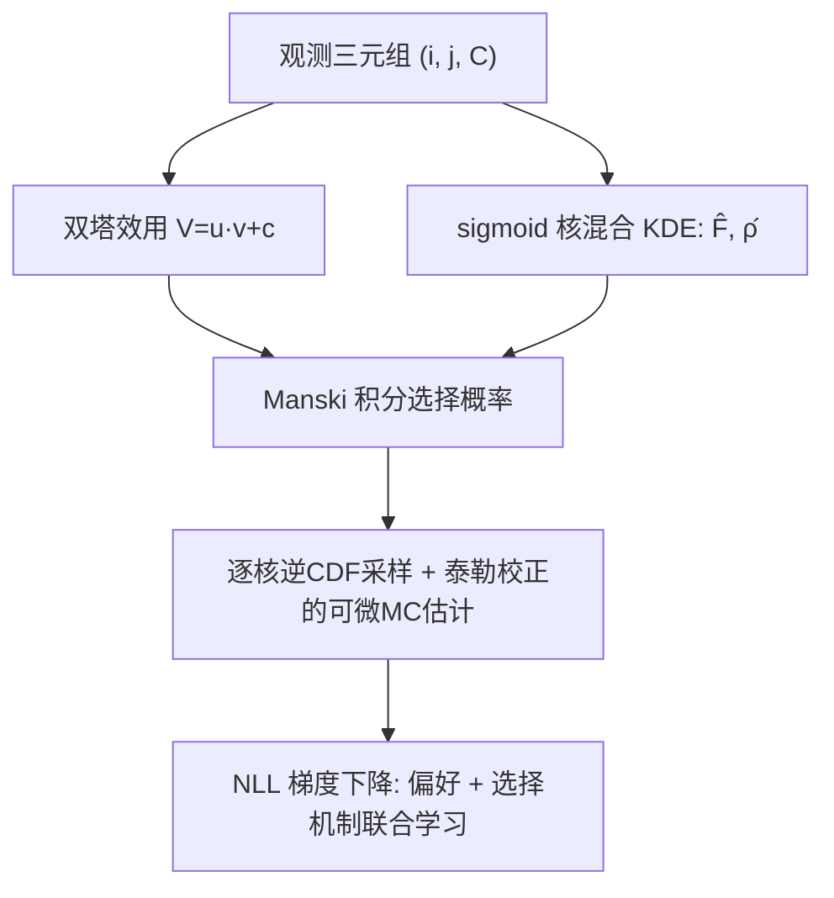

# A Non-Parametric Choice Model That Learns How Users Choose Between Recommended Options (一种学习用户如何在推荐选项中做选择的非参数选择模型)

- **会议/期刊**: RecSys 2025
- **作者与机构**: Thorsten Krause, Harrie Oosterhuis (Radboud University, 荷兰)
- **推荐链路定位**: 召回/偏好推断（选择概率建模，服务于排序与曝光去偏）
- **研究方向**: 协同过滤与双塔召回 / 去偏公平与可信推荐
- **论文原文**: [https://arxiv.org/abs/2507.20035v1](https://arxiv.org/abs/2507.20035v1)
- **开源代码**: [https://github.com/krauthor/LCM4Rec_RecSys2025](https://github.com/krauthor/LCM4Rec_RecSys2025)

## TL;DR (1分钟核心速览)

传统隐式 CF 假设物品被独立选择，忽略了同一曝光集合内物品的"自相残杀 (cannibalization)"；离散选择模型（MNL/ENL）虽能建模竞争，但必须**先验假设**误差分布，假设错误则选择概率失真、曝光偏差鲁棒性丧失。本文提出 LCM4Rec：用 **sigmoid 核密度估计 (KDE)** 参数化误差 CDF，通过 Monte Carlo 积分近似 NLL 并用梯度下降联合学习"用户偏好 + 选择机制"。在 3 种真实误差分布（Gumbel / 符号指数 / 高斯混合）的合成数据上，LCM4Rec 是唯一在全部分布下 KLD/NLL/nDCG/Acc 均保持竞争力的模型，且在竞争型曝光偏差下排名漂移最小（如 Gumbel 下 -0.000 vs MNL -1.314）。

## Background & Motivation (背景与核心矛盾)

- **主流范式**: 隐式 CF（BPR/BCE/gBCE）把每个 (用户, 物品) 交互独立打分；离散选择模型（MNL=softmax、ENL=exponomial）则建模"从选择集 $C$中选效用最高者"，效用$U_{ij}=V_{ij}+\epsilon_{ij}$，竞争效应完全由误差分布$\epsilon$ 的形状决定。
- **前人局限**: (i) 每个参数化选择模型都硬编码一种误差分布，MNL 的 IIA 假设在实证中常被证伪，而 ENL 的保守型 cannibalization 又只适配另一类行为；(ii) 真实场景下最优选择模型未知且无穷多（probit 甚至无闭式解），靠 benchmark 逐一试错不可行；(iii) 已有非参数估计器（Cosslett、Klein-Spady 等）要么不可微、要么仅限二元选择、要么维度随选择集大小爆炸，无法用于 20+ 候选的推荐场景。
- **核心洞察 (Key Insight)**: 选择概率只依赖误差的 CDF $F_\epsilon$与 PDF$\rho_\epsilon$（Manski 积分形式），因此**只要能把$F_\epsilon$ 参数化成可微、可逼近任意分布的函数族，就能用观测选择数据反推选择模型本身**——"学习选择模型"而非"假设选择模型"。
- **本文切入点**: 用加权 sigmoid 核的混合作为 $F_\epsilon$ 的函数族，配合可微 Monte Carlo 积分，使任意 IID 误差选择模型都能端到端梯度优化。

## Method (核心方法设计)

### 1. 整体框架 (Overall Architecture)

输入为观测三元组 $\{(i_n, j_n, C_n)\}$（用户、被选物品、曝光选择集）。模型由两部分组成：效用侧用双塔内积$V_{ij}=\boldsymbol{u}_i\cdot\boldsymbol{v}_j+c_j$建模确定性偏好；误差侧用$K$个 sigmoid 核的加权混合逼近$F_\epsilon$与$\rho_\epsilon$。选择概率由 Manski 积分给出，因无闭式解，采用"逐核逆 CDF 采样 + 泰勒偏差校正"的可微 Monte Carlo 估计，最终对 NLL 做梯度下降，同时更新嵌入、物品常数与核参数。推理时直接代入学到的$F_\epsilon$ 计算任意选择集上的选择概率。

### 2. 关键设计拆解 (Key Designs)

1. **sigmoid 核混合的误差分布族（让"任意选择模型"可微可学）**：痛点是非参数估计器不可微或维度爆炸。本文将 CDF 参数化为
$\hat{F}_K(x)=\sum_{k=1}^{K}w_k\,\sigma\!\left(\frac{x-x_k}{h_k}\right)$，
其导数 $\hat{\rho}_K(x)=\sum_k \frac{w_k}{h_k}\sigma(\cdot)(1-\sigma(\cdot))$数值稳定且对参数与$V_{ij}$均连续可微。设计点$x_k$均匀铺在$[-l,l]$上（仅$l$可学），$w_k=\mathrm{softmax}(\alpha_k)$、$h_k=\frac{l}{K}\mathrm{softplus}(\beta_k)$ 保证正性与归一。作者证明该函数族对任意连续严格单调 CDF 可任意逼近（Theorem 1），直觉是"足够密的 sigmoid 台阶可拟合任意单调曲线"。

2. **可微 Monte Carlo 选择概率估计（打通梯度通路）**：Manski 积分无闭式解且 $\hat{F}_K$逆 CDF 不可解，但每个 sigmoid 核的逆 CDF 有闭式。于是对观测$n$、核$k$采样$\tilde{e}_{n,k,s}=x_k+h_k\log\frac{u}{1-u}$，得
$\hat{P}_n\approx\frac{1}{S}\sum_{s=1}^{S}\sum_{k=1}^{K}w_k\prod_{j'\in C_n\setminus j_n}\hat{F}_K\!\left(V_{ij_n}+\tilde{e}_{n,k,s}-V_{ij'}\right)$。
由于 Jensen 不等式，对 $\log\hat{P}_n$ 取期望有偏，用三阶泰勒展开校正（式 17），保证 NLL 估计近似无偏。物理直觉：每个核贡献一组"候选误差样本"，乘积项刻画该误差下被选物品击败所有竞争者的概率。

3. **训练目标、正则与推理效率**：总损失为校正后的负对数似然 $\hat{\mathcal{L}}$（式 17），无负采样（选择集内竞争项天然充当负例）。关键正则是**每步梯度更新后将$c_j$缩放回$[0,1]$**——否则$l,h_k,c_j$的尺度自由度会让 L2 正则失效并导致$\hat{\rho}_K$塌缩。复杂度$O(K^2NS|C|)$，但实践中$K=5,S=5$ 已足够，二次项不构成瓶颈；推理仅需一次前向积分近似，开销与选择集大小线性相关。

## Experimental Setup & Evaluation Protocol (实验设置与评估协议)

- **数据集与预处理**: 全部为**合成数据**（无真实数据集），500 用户 × 500 物品，每用户至多 500 次选择，每次从 4 个物品的均匀随机子集中选 1；嵌入 $u_i,v_j\in\mathbb{R}^3$采自半径$\sqrt{2}$的单位球面，$c_j\sim U(0,1)$。三种真实误差分布：Gumbel(0,0.75)（非保守）、符号指数（保守）、高斯混合$\frac{1}{3}N_1+\frac{2}{3}N_2$（无对应参数模型）。

| 数据集 | #Users | #Items | #Interactions | 稀疏度/密度 | 特征/场景说明 |
| :--- | :---: | :---: | :---: | :---: | :--- |
| Synthetic-Gumbel | 500 | 500 | ≤250k | 每用户≤500次选择 | 非保守选择行为 |
| Synthetic-SignExp | 500 | 500 | ≤250k | 同上 | 保守选择行为 |
| Synthetic-GaussMix | 500 | 500 | ≤250k | 同上 | 双峰误差，无参数对应 |

- **数据划分与防穿越 (Splitting Strategy)**: 用户级切分——训练集用 $U_{Train}$用户对全部物品的交互；验证/测试用$U_{Eval}$用户分别对一半物品$J_{Train}$与另一半$J_{Eval}$ 的交互，**严格保证训练集不含任何评测用 user-item 对（含负例）**，避免信息泄漏。
- **排名评测协议 (Ranking Protocol)**: 选择集内**全候选排序**（非采样），指标为 KLD（全库 $J_{Eval}$上的偏好分布散度）、NLL、nDCG、Accuracy；结果取 100 次模拟重复的均值，用 bootstrap 单侧 t 检验（$p<0.1/0.05/0.01$）判定显著性。
- **对比基线与超参设置**: BL（二元 logit）、BCE（负采样矩阵分解）、gBCE、MNL、ENL 与 LCM4Rec；嵌入维度与生成过程一致（$d=3$），学习率/优化器在 Gumbel 数据上网格搜索后固定；LCM4Rec 取$K=5,S=5$，gBCE 取$t=1$。

## Key Experimental Results (实验关键数据)

### 1. 主实验对比 (Main Results)

| 真实分布 | 模型 | KLD ↓ | NLL ↓ | nDCG ↑ | Acc ↑ |
| :--- | :--- | :---: | :---: | :---: | :---: |
| Gumbel | BL | 0.028 | 1.184 | 0.996 | 0.477 |
| Gumbel | MNL† | **0.028** | **1.184** | **0.996** | **0.477** |
| Gumbel | ENL | 7.952 | 1.188 | 0.996 | 0.475 |
| Gumbel | LCM4Rec | 0.085 | **1.184** | **0.996** | **0.477** |
| Sign.Exp | MNL | 1.491 | 1.062 | 0.997 | 0.539 |
| Sign.Exp | ENL† | **0.345** | **1.056** | **0.997** | **0.539** |
| Sign.Exp | LCM4Rec | 0.459 | **1.056** | **0.997** | **0.539** |
| Gauss.Mix | MNL | 1.108 | 1.126 | 0.997 | 0.515 |
| Gauss.Mix | ENL | 0.625 | 1.130 | 0.997 | 0.514 |
| Gauss.Mix | LCM4Rec | **0.337** | **1.123** | **0.997** | **0.516** |

（† 表示假设与真实分布匹配的"正确指定"模型；BCE/gBCE 在所有分布下均显著最差，此处略。）

### 2. 消融/机制验证实验 (Ablation & Mechanism)

| 配置 | Gumbel | Sign.Exp | Gauss.Mix | 说明 |
| :--- | :---: | :---: | :---: | :--- |
| MNL（假设误差 vs 真实） | 0.00† | 1.25 | 0.43 | 假设错则 KLD 飙升 |
| ENL（假设误差 vs 真实） | 1.19 | 0.00† | 0.87 | 同上 |
| LCM4Rec（估计误差 vs 真实） | 0.13±0.07 | 0.26±0.05 | 0.31±0.18 | 全分布低且稳定 |

| 曝光偏差场景 | MNL | ENL | LCM4Rec |
| :--- | :---: | :---: | :---: |
| Gumbel / 过度曝光 | -0.427 | -0.418 | **-0.258** |
| Gumbel / 竞争偏差 | -1.314 | 1.701 | **-0.000** |
| Sign.Exp / 竞争偏差 | -6.423 | -2.021 | **-1.571** |
| Gauss.Mix / 竞争偏差 | -2.856 | 0.294 | **0.118** |

（数值为物品因偏差被抬高/压低的平均名次数，绝对值越小越鲁棒。）

### 3. 关键实验发现 (Key Findings)

1. **参数模型的"指标补偿"是假象**：MNL/ENL 在假设错误时 nDCG 仍接近最优（差距 <0.001）、NLL 差距 <0.08，但 KLD 从 0.00 恶化到 1.25/0.43——说明排序指标掩盖了偏好推断的系统性失真，只有 KLD 能暴露假设错误。
2. **LCM4Rec 是唯一全分布鲁棒的模型**：在无参数对应的 Gaussian Mixture 上 KLD 0.337 显著优于 MNL 1.108 与 ENL 0.625；在 Gumbel/SignExp 上仅略逊于"正确指定"的参数模型（0.085 vs 0.028、0.459 vs 0.345），即"学习选择模型"的代价极小。
3. **竞争型曝光偏差是参数模型的软肋**：Gumbel 下 MNL 竞争偏差达 -1.314 名、SignExp 下高达 -6.423 名，而 LCM4Rec 分别为 -0.000 与 -1.571；过度曝光偏差三者差异在置信区间内不显著，说明鲁棒性收益主要来自对 cannibalization 模式的正确刻画。

## Highlights & Limitations (亮点、对比与审稿批判)

- **与代表作对比 (vs. Prior Work)**: 相比 MNL/ENL（Krause et al. 已证明选择模型抗曝光偏差，但前提是假设正确），本文去掉"假设正确"这一前提；相比 Cosslett/Klein-Spady 等非参数估计器（不可微、仅二元、维度爆炸），本文首次给出适配 20+ 候选集、可端到端梯度优化的多元非参数选择模型。
- **可迁移亮点**: (i) "sigmoid 核混合 + 逐核逆 CDF 采样 + 泰勒偏差校正"是一套通用的可微分布学习模板，可迁移到延迟反馈、位置偏差等需要估计未知噪声分布的推荐任务；(ii) 用 $c_j$ 缩放约束替代失效的 L2 正则，是处理尺度不可辨识参数化的实用技巧。
- **审稿级局限批判**: (i) **全部实验基于合成数据**，且选择集均匀采样、每用户 500 次选择，与真实长尾曝光、稀疏交互差距大，非参数估计收敛慢的问题未被检验；(ii) 复杂度 $O(K^2NS|C|)$ 随选择集大小线性增长，且 IID 误差假设排除了 nested logit 等非 IID 模型，真实场景的 item 间相关性可能破坏该假设。

## Rating (四维评分)

- **方法创新性 (Novelty)**: ⭐⭐⭐⭐ （首次将可微 KDE 引入多元离散选择模型并给出逼近性定理，问题切口精准）
- **评估协议与实验扎实度 (Protocol & Experiments)**: ⭐⭐⭐ （防泄漏切分与 100 次重复+显著性检验规范，但纯合成数据、无真实 benchmark 是硬伤）
- **写作与数学规范度 (Clarity & Rigor)**: ⭐⭐⭐⭐ （Manski 积分到 MC 校正的推导链条完整，Theorem 1 证明清晰，复杂度分析到位）
- **工业落地与复现价值 (Industrial & Practical Value)**: ⭐⭐⭐ （代码已开源、$K=5$ 开销可控，但合成验证到线上部署之间仍缺真实数据桥接）

