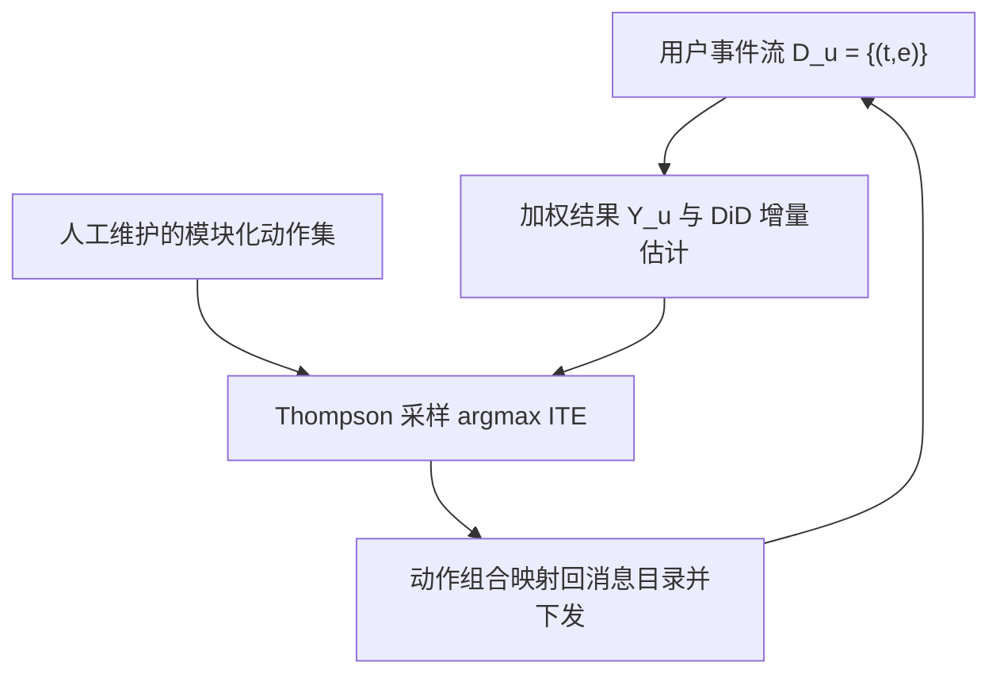
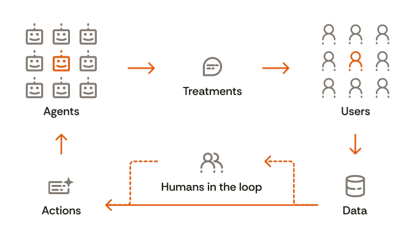

# Agentic Personalisation of Cross-Channel Marketing Experiences (跨渠道营销体验的智能体化个性化)

- **会议/期刊**: RecSys 2025
- **作者与机构**: Sami Abboud, Eleanor Hanna, Olivier Jeunen, Vineesha Raheja, Schaun Wheeler (aampe)
- **推荐链路定位**: 重排 / 触达决策（消息编排层）
- **研究方向**: 协同过滤与双塔召回 / 强化学习与动态探索推荐
- **论文原文**: [https://arxiv.org/abs/2506.16429v1](https://arxiv.org/abs/2506.16429v1)
- **开源代码**: 暂未开源

## TL;DR (1分钟核心速览)

针对 CRM 营销长期依赖人工规则、粗粒度分群、无法做用户级个性化的痛点，本文把"发什么、何时发、怎么发"建模为模块化动作空间上的序贯决策问题：用稀疏中断时间序列（DiD 设计）从高维事件流中估计个体处理效应（ITE），再用 Thompson 采样平衡探索-利用，并以经验贝叶斯先验（借鉴 user-based CF）冷启动新上下文。在 640 万用户、三周线上随机对照实验中，四个产品功能的 Intent/Conversion 均显著提升，GMV 相对提升达 +14%~+43%，系统已服务 1.5 亿用户。

## Background & Motivation (背景与核心矛盾)

- **主流范式**: 营销触达编排由 CRM 团队人工完成，依赖规则系统 + 粗粒度用户分群，消息变体通过迭代 A/B 测试筛选，时间/频次/文案均按人群级启发式设定。
- **前人局限**: 其一，规则与分群无法刻画用户间异质性，用户级个性化被人工编排成本锁死；其二，用户偏好随心理漂移与历史交互动态变化，重复与频次效应甚至反直觉，静态规则无法适应。
- **核心洞察 (Key Insight)**: 自然语言消息构成不可处理的巨大离散动作空间，但可分解为语气、表情、价值主张、推荐、促销激励等**模块化动作集**；同时营销真正关心的是**增量（incrementality）**而非相关性，因此奖励必须用因果效应而非原始事件频次度量。
- **本文切入点**: 将动作空间模块化 + 用 DiD 估计 ITE 作为奖励 + Thompson 采样做决策，三者拼成一个可保留人类控制权（human-in-the-loop）的营销智能体。

## Method (核心方法设计)

### 1. 整体框架 (Overall Architecture)

系统闭环为：营销人员维护模块化动作集（语气、价值主张、CTA、渠道、时机等）→ 智能体对每个动作集用 Thompson 采样抽取 ITE 估计并取 argmax → 动作组合映射回候选消息目录，选最佳匹配消息下发 → 记录用户事件流 → 用 DiD 从事件流估计该次干预的增量奖励 → 更新各上下文-动作的后验分布。整个过程中营销人员只定义动作空间边界，不介入个体决策，从而在保留业务护栏的同时实现规模化用户级个性化。

<figure class="paper-figure" markdown="span">
  <figcaption>图1：我们设置中反馈回路的示意图。记录的用户行为及其对干预的响应，连同“人在回路”的营销专业人员，共同为未来潜在的消息传递策略提供依据，并分解为模块化的动作空间。智能体在这些动作上进行个性化决策，在探索与利用之间取得平衡。</figcaption>
</figure>

### 2. 关键设计拆解 (Key Designs)

1. **加权事件流结果与 DiD 增量奖励**：原始事件频次只是相关性，且高维稀疏。本文将用户结果定义为事件加权和 $Y_u[t_i,t_j]=\sum_{(t,e)\in\mathcal{D}_u} w_e\cdot w_t$，其中事件权重取对数似然比$w_e=\ln\frac{P(e|\text{Goal})}{P(e|\neg\text{Goal})}$（近似 Granger 因果直觉，衡量事件对目标事件的信息量），时间权重用可调半衰期的指数衰减。再将结果转为 ITE：$\Delta Y=(\bar{Y}^{T}_{post}-\bar{Y}^{T}_{pre})-(\bar{Y}^{C}_{post}-\bar{Y}^{C}_{pre})$，pre/post 窗口由超参$t_\Delta$ 控制。这样奖励直接度量"因干预而多发生的行为"，天然抵消季节性等有机波动。
2. **对照组近邻选择与经验贝叶斯先验**：DiD 的对照组 $C\subseteq\mathcal{U}$ 存在偏差-方差权衡——只用最近邻则低偏差高方差，用全体用户则高偏差低方差，本文取受处理用户的近邻集合折中。对上下文-动作对无数据的情形，用经验贝叶斯先验从相似用户的行为中插补后验参数，本质是 user-based 协同过滤思想在 bandit 冷启动上的复用。
3. **Thompson 采样与模块化动作合成**：对上下文 $x$，每个动作采样$\Delta\tilde{Y}|a\sim\hat{P}(\Delta Y|A=a;X=x)$并取$\arg\max_{a\in\mathcal{A}}$。本文将$\Delta Y$ 二值化后用 Beta-Bernoulli 模型以获得可解释性（亦可用高斯闭式更新或神经网络估计器）。模块化动作组合映射回消息目录的做法对应 Wolpertinger 架构，避免对全部动作组合的指数级建模。

## Experimental Setup & Evaluation Protocol (实验设置与评估协议)

- **数据集与场景**: 某多服务应用（网约车 + 外卖），渠道覆盖 push、in-app 卡片、WhatsApp、邮件、短信；实验聚焦 push 与 in-app 的产品营销场景。实验期三周，覆盖 **640 万用户**，系统整体已部署服务 1.5 亿用户。

| 场景 | 用户规模 | 实验周期 | 渠道 | 目标事件 |
| :--- | :---: | :---: | :---: | :--- |
| 多服务应用线上 RCT | 6.4M | 3 周 | Push / In-app | Intent、Conversion、GMV |

- **数据划分与防穿越**: 线上随机对照实验（RCT），处理组在规则基线消息之上叠加智能体编排消息，对照组仅收规则消息；分析阶段用**倾向得分匹配**配对"至少收到一条消息"的处理组用户与未收消息的对照组用户。
- **评估协议**: 报告各产品功能上 Intent（上层漏斗：浏览/点击）、Conversion（转化）、GMV（相对提升）三类指标的 **99% 置信区间**，而非单点均值，统计严谨度高于常规离线评测。
- **对比基线**: 人群级启发式优化的规则消息系统（传统 CRM 做法），无离线采样排序环节。

## Key Experimental Results (实验关键数据)

### 1. 主实验对比 (Main Results)

下表为相对对照组、四个产品功能（PF）的绝对提升百分比（99% CI），GMV 为相对提升：

| 指标 | Transactional PF 1 | Transactional PF 2 | Transactional PF 3 | Account Creation PF |
| :--- | :---: | :---: | :---: | :---: |
| Intent | [+0.70%, +0.83%] | [+1.76%, +1.92%] | [+1.30%, +1.44%] | [+2.37%, +2.45%] |
| Conversion | [+0.42%, +0.48%] | [+0.30%, +0.36%] | [+0.07%, +0.13%] | [+0.21%, +0.25%] |
| GMV | [+14.12%, +22.62%] | [+25.35%, +43.39%] | [–0.31%, +22.55%] | N/A |

### 2. 消融实验 (Ablation Study)

本文为线上系统论文，未提供组件级离线消融；其"消融"以对照实验形式体现：

| 配置 | Intent | Conversion | GMV |
| :--- | :---: | :---: | :---: |
| 规则基线（对照组） | 基准 | 基准 | 基准 |
| + 智能体编排（处理组） | 全部显著正提升 | 全部显著正提升 | 多数显著正提升 |

### 3. 关键实验发现 (Key Findings)

1. **上层漏斗增益大于底层漏斗**：Intent 提升幅度（最高 +2.45%）普遍高于 Conversion（最高 +0.48%），说明智能体主要扩大了兴趣触达面，转化环节仍受产品本身约束，提示后续应在转化路径上做更细的动作分解。
2. **GMV 增益呈双位数相对提升但方差大**：PF2 达 [+25.35%, +43.39%]，而 PF3 区间跨零 [–0.31%, +22.55%]，表明高客单低频场景下 DiD 估计的方差仍是瓶颈，需更长窗口或更强先验收缩。
3. **模块化动作空间是规模化的关键前提**：作者指出智能体让营销人员可部署的消息变体数量远超人工可管理范围，运营开销显著下降——这解释了为何在 1.5 亿用户规模上仍能维持用户级个性化。

## Highlights & Limitations (亮点、对比与审稿批判)

- **与代表作对比 (vs. Prior Work)**: 相较传统 CRM 规则系统与人群级 A/B 测试，本文把决策粒度下沉到个体并显式优化增量；相较标准 contextual bandit 推荐（如 LinUCB/TS 直接以点击为奖励），本文的关键差异是用 DiD 因果估计替代原始事件频次作为奖励，避免"相关性冒充因果"；相较 Wolpertinger 类大动作空间方法，本文进一步把动作空间交给人类维护以获得业务可控性。
- **可迁移亮点**: (1) 用对数似然比加权事件流构造稠密奖励，可迁移到任何以多类行为为信号的推荐场景；(2) 经验贝叶斯 + user-based CF 先验插补 bandit 冷启动后验，工程上极轻量。
- **审稿级局限批判**: 其一，仅报告线上 RCT 结果，缺少离线可复现实验与组件级消融，DiD 的平行趋势假设与近邻对照组选择对结论的影响未被量化；其二，Beta-Bernoulli 二值化损失了增量幅度信息，且 GMV 区间跨零说明估计方差在高价值低频事件上仍不可忽视。

## Rating (四维评分)

- **方法创新性 (Novelty)**: ⭐⭐⭐⭐ （DiD 因果奖励 + 模块化动作空间 + TS 的组合在营销编排场景属务实创新，但各组件均为已有方法的工程拼装）
- **评估协议与实验扎实度 (Protocol & Experiments)**: ⭐⭐⭐⭐ （640 万用户线上 RCT + 99% CI + 倾向得分匹配，工业证据强；但缺离线消融与平行趋势检验）
- **写作与数学规范度 (Clarity & Rigor)**: ⭐⭐⭐⭐ （公式简洁、动机链条清晰，但关键超参 $t_\Delta$、半衰期与近邻规模未给取值与敏感度分析）
- **工业落地与复现价值 (Industrial & Practical Value)**: ⭐⭐⭐⭐⭐ （已服务 1.5 亿用户，架构轻量、human-in-the-loop 设计贴合业务合规，落地价值极高；可惜未开源）

