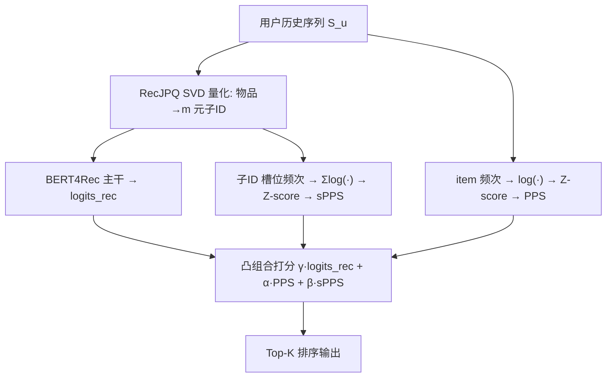

# Balancing Accuracy and Novelty with Sub-Item Popularity (以子物品流行度平衡准确率与新颖度)

- **会议/期刊**: RecSys 2025
- **作者与机构**: Chiara Mallamaci, Alberto Carlo Maria Mancino, Vito Walter Anelli, Tommaso Di Noia (Politecnico di Bari)；Aleksandr V. Petrov, Craig Macdonald (University of Glasgow / Viator, TripAdvisor)
- **推荐链路定位**: 精排（序列打分层的后置信号融合）
- **研究方向**: 协同过滤与双塔召回 / 序列与会话推荐
- **论文原文**: [https://arxiv.org/abs/2508.05198v1](https://arxiv.org/abs/2508.05198v1)
- **开源代码**: [https://github.com/sisinflab/Sub-id-Popularity](https://github.com/sisinflab/Sub-id-Popularity)

## TL;DR (1分钟核心速览)

音乐推荐中重复收听极强，item 级个性化流行度 PPS 能提准确率却把用户锁死在已听曲目上，新颖度骤降。本文复用 RecJPQ 的子 ID 分解，把流行度统计下沉到子码本粒度得到 sPPS，并以凸组合 $\gamma\cdot\text{logits}_{rec}+\alpha\cdot\text{PPS}+\beta\cdot\text{sPPS}$ 在打分层融合。在 Yandex 与 Last.fm-1K 上采用全局时间戳切分 + NDCG@40 评估，在同等准确率下个性化新颖度相对提升约 20%，在固定新颖度阈值 12 时 NDCG 分别提升 9.7% 与 8.0%。

## Background & Motivation (背景与核心矛盾)

- **主流范式**: 以 BERT4Rec/SASRec 为代表的 Transformer 序列推荐把物品当 token 做掩码/下一项预测；针对音乐重复消费，PPS 在打分层叠加用户历史频次信号，显著提升命中率。
- **前人局限**: 其一，PPS 是 item-ID 级原子统计，只会强化"已听过的整首歌"，无法表达"用户偏爱某类风格/艺术家"这类跨物品的潜在重复；其二，$\alpha$ 增大时准确率单调上升但新颖度断崖式下跌（Last.fm 上从 14.62 掉到 7.85），长期探索能力被牺牲。
- **核心洞察 (Key Insight)**: RecJPQ 用 SVD 量化把物品编码为 $m$ 元子 ID 元组，共享子码本天然聚类了相似风格/艺术家的物品；因此子 ID 在用户历史中的重复出现，正是"细粒度偏好"的可观测代理。
- **本文切入点**: 不改模型结构、不重训，仅在输出打分层把流行度信号从 item 粒度下沉到 sub-ID 粒度，用两个标量旋钮显式调节准确率-新颖度权衡。

## Method (核心方法设计)

### 1. 整体框架 (Overall Architecture)

物品经 RecJPQ 的 SVD 量化得到 $m$元子 ID 编码$\text{code}(i)=[z^{(i)}_1,\dots,z^{(i)}_m]$，推理时按码本拼接重建$d$维嵌入送入 BERT4Rec 主干得到$\text{logits}_{rec}$；同时从用户历史序列分别统计 item 级频次与各子码本槽位的子 ID 频次，经对数平滑与 Z-score 标准化得到 PPS 与 sPPS 两路信号；三者在最终打分处做凸组合，训练时固定$\alpha=\beta=0.4$，推理时扫描$\alpha,\beta$ 即可在无需重训的前提下遍历整条准确率-新颖度帕累托前沿。

### 2. 关键设计拆解 (Key Designs)

1. **子 ID 级个性化流行度 sPPS（把"重复"从整曲下沉到风格片段）**：item 级 PPS 只统计 $c_i$无法刻画跨物品共性。本文对每个量化槽位$j$统计用户$u$的子 ID 计数$c^{(u)}_j[k]=\sum_{i\in S_u}\mathbb{I}[z^{(i)}_j=k]$，候选物品$i$ 的得分为各槽位计数对数之和：
$$\text{sPPS}_i=\sum_{j=1}^{m}\log\!\left(c^{(u)}_j[z^{(i)}_j]+\epsilon\right)$$
直觉是：即使两首歌 ID 不同，只要共享多个子 ID（同风格/同艺术家），sPPS 就会同时抬高它们，从而把"记忆"泛化为"结构相似性偏好"，这是 item 级统计在原理上无法触达的信号。

2. **打分层凸组合与显式权衡旋钮（免重训的帕累托控制）**：将三路信号线性融合并约束凸性：
$$\text{logits}^{\text{final}}_i=\gamma\cdot\text{logits}^{\text{rec}}_i+\alpha\cdot\text{PPS}^{\text{std}}_i+\beta\cdot\text{sPPS}^{\text{std}}_i,\quad \gamma=1-\alpha-\beta$$
由于融合发生在输出层且与主干解耦，方法对任意序列推荐器 model-agnostic；$\alpha$控制"记忆/复听"，$\beta$ 控制"泛化/探索"，线上可按用户画像动态调参而无需重新训练。

3. **训练目标、负采样与推理效率**：训练沿用 BERT4Rec 的掩码语言建模交叉熵（全库 softmax，不做负采样），PPS/sPPS 仅作为打分偏置不参与梯度回传主干；子 ID 分解使嵌入表从 $|\mathcal{I}|\times d$压缩为$m\times V\times d/m$，参数量与显存显著下降，推理时重建嵌入为$O(m)$ 拼接，额外开销仅为两次查表求和。

## Experimental Setup & Evaluation Protocol (实验设置与评估协议)

- **数据集与预处理**: 沿用 PPS 原文协议，按流行度采样保留 30,000 个物品：

| 数据集 | #Users | #Items | #Interactions | 稀疏度/密度 | 特征/场景说明 |
| :--- | :---: | :---: | :---: | :---: | :--- |
| Yandex | 20,862 | 30,000 | 28,408,152 | 平均序列长 1362 / 中位 1275 | 音乐流媒体事件，含 like/play/skip/dislike 反馈 |
| Last.fm-1K | 990 | 30,000 | 4,990,042 | 平均序列长 5040 / 中位 2605 | 重度听歌用户，重复收听极强 |

- **数据划分与防穿越 (Splitting Strategy)**: 采用 `全局时间戳切分`，按时间排序后最后 10% 交互作测试集；验证集从用户中抽 10%（Yandex 2,048 人、Last.fm 128 人）同法构造，严格防穿越。
- **排名评测协议 (Ranking Protocol)**: 采用 `Full-Ranking (全库未交互排序)`，指标 NDCG@40（音乐场景用户消费列表长，取 K=40）。Yandex 相关性映射 like=2/play=1/skip=-1/dislike=-2，同一曲目多次交互取绝对值最大标签，负标签统一置零。新颖度用 $\text{Novelty@K}_u=\frac{1}{K}\sum_{i\in R_u@K}-\log_2 p(i|u)$，$p(i|u)$为用户历史相对频率（$\epsilon=10^{-8}$）。
- **对比基线与超参设置**: 主干为 BERT4Rec + RecJPQ（$d=256$，$m=32$码本切分，与 RecJPQ 原文一致）；对照为 item 级 PPS 与 sPPS 两条曲线及二者融合；训练时$\alpha=\beta=0.4$，推理时扫描$\alpha,\beta\in\{0,0.02,0.04,0.1,0.2,\dots,0.9\}$。

## Key Experimental Results (实验关键数据)

### 1. 主实验对比 (Main Results)

原文以"新颖度阈值下的 NDCG@40"作为核心对照表（Novelty ≥ 0 即纯准确率场景）：

| 数据集 | 方法 | Nov. ≥ 0 | Nov. ≥ 10 | Nov. ≥ 12 | Nov. ≥ 14 |
| :--- | :--- | :---: | :---: | :---: | :---: |
| Last.fm | PPS | **0.4159** | 0.3248 | 0.2749 | 0.2749 |
| Last.fm | sPPS | 0.3296 | **0.3296** | **0.3016** (+9.7%) | **0.2846** (+3.5%) |
| Yandex | PPS | **0.1566** | 0.1233 | 0.1150 | 0.0983 |
| Yandex | sPPS | 0.1298 | **0.1298** | **0.1242** (+8.0%) | **0.1149** (+16.9%) |

### 2. 消融实验 (Ablation Study)

原文未设传统"移除模块"式消融，而以信号开关（$\alpha,\beta$ 置零）构成等价消融：

| 配置 | 信号构成 | Last.fm NDCG@40 | Last.fm Nov. | Yandex NDCG@40 | Yandex Nov. |
| :--- | :--- | :---: | :---: | :---: | :---: |
| $\alpha=0,\beta=0$ | 仅主干 | 基线最低 | 最高 | 基线最低 | 最高 |
| $\alpha\uparrow,\beta=0$ | 仅 PPS | 单调升至 0.4159 | 14.62→7.85 | 单调升至 0.1566 | 明显下降 |
| $\alpha=0,\beta\uparrow$ | 仅 sPPS | 0.3296 | 约 12（同精度下 +20%） | 0.1298 | 同精度下更优 |
| $\beta=0.9,\alpha\uparrow$ | 融合 | 稳步上升 | 下降幅度小于纯 PPS | 稳步上升 | 下降幅度小于纯 PPS |

### 3. 关键实验发现 (Key Findings)

1. **纯准确率场景 PPS 仍占优，但代价是新颖度崩塌**：Last.fm 上 PPS 的 NDCG@40 达 0.4159 高于 sPPS 的 0.3296，然而 $\alpha$ 从 0.1 增至 0.9 时新颖度从 14.62 跌至 7.85，说明 item 级信号本质是"复读机"，只适合短期命中不适合长期留存。
2. **同等准确率下 sPPS 的新颖度相对提升约 20%**：Last.fm 在 NDCG@40≈0.32 处，PPS 新颖度约 10 而 sPPS 约 12；固定新颖度阈值 12 时 NDCG 从 0.2749 升至 0.3016（+9.7%），Yandex 从 0.1150 升至 0.1242（+8.0%），证明子 ID 共享结构确实把"记忆"转化为了"可泛化的偏好"。
3. **融合曲线整体位于两条单信号曲线右上方**：固定 $\beta=0.9$再递增$\alpha$，两数据集上 NDCG 单调上升而新颖度下降斜率明显缓于纯 PPS，说明 sPPS 提供了稳健底座，使 item 级信号可以在"低新颖度损失"下换取准确率，构成更优的帕累托前沿。

## Highlights & Limitations (亮点、对比与审稿批判)

- **与代表作对比 (vs. Prior Work)**: 与 PPS 原文相比，本文不改主干、不重训，仅把统计粒度从 item-ID 下沉到 RecJPQ 子 ID，就把单点权衡升级为可调前沿；与 RecJPQ 原文相比，本文把其"为可扩展性服务的压缩结构"反用为"为个性化服务的语义结构"，属于对既有架构的巧妙再利用；与 TIGER 等语义 ID 生成式检索相比，本文不做自回归生成，仅在打分层注入子 ID 统计，工程成本极低。
- **可迁移亮点**: 其一，"子码本频次统计 + Z-score + 凸组合"这一套后置信号注入范式可零成本迁移到任何使用 RQ-VAE/VQ 语义 ID 的生成式推荐或双塔召回打分层；其二，推理期扫描 $\alpha,\beta$ 免重训绘制帕累托前沿的做法，可直接用于线上多目标调参与用户分群策略。
- **审稿级局限批判**: 其一，实验仅在 BERT4Rec+RecJPQ 单一主干与两个音乐数据集上验证，未覆盖电商/短视频等重复性较弱的域，泛化性证据偏薄；其二，sPPS 依赖 SVD 量化码本质量，$m$与$V$ 的选取对子 ID 语义一致性影响大，原文未给出码本质量敏感性分析，且新颖度指标基于用户历史频率估计，对长尾用户估计方差较大。

## Rating (四维评分)

- **方法创新性 (Novelty)**: ⭐⭐⭐ （思路是"旧结构新用途"的巧妙复用而非全新架构，但子 ID 粒度流行度这一视角确有新意且直觉清晰）
- **评估协议与实验扎实度 (Protocol & Experiments)**: ⭐⭐⭐ （全局时间戳切分与 Full-Ranking 规范，但仅两个音乐数据集、单一主干，缺少码本超参敏感性与跨域验证）
- **写作与数学规范度 (Clarity & Rigor)**: ⭐⭐⭐⭐ （公式简洁、符号一致，sPPS 与 PPS 的对照定义清晰，凸组合约束交代明确）
- **工业落地与复现价值 (Industrial & Practical Value)**: ⭐⭐⭐⭐ （打分层后置融合、免重训调参、子 ID 压缩降参，代码与数据全开源，落地门槛极低）

