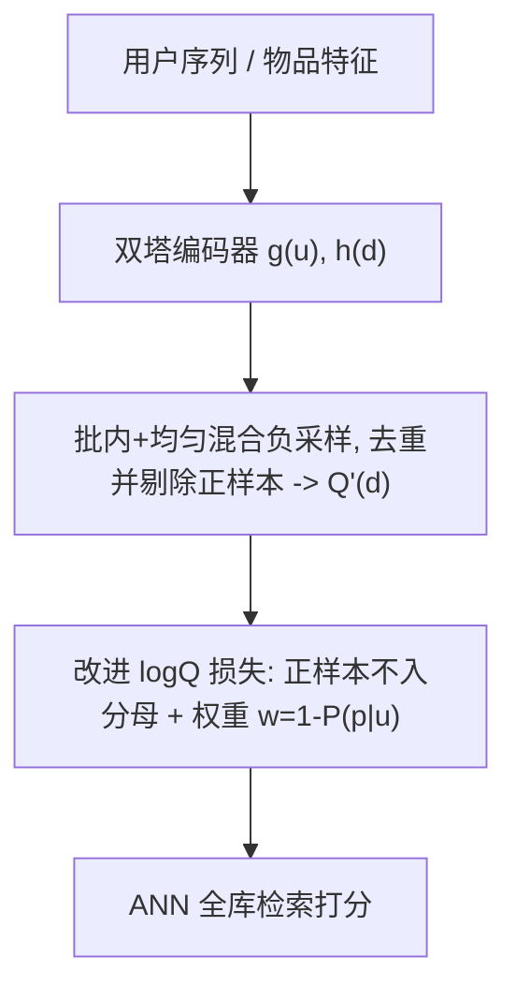

# Correcting the LogQ Correction: Revisiting Sampled Softmax for Large-Scale Retrieval (修正 LogQ 修正：重访大规模召回中的采样 Softmax)

- **会议/期刊**: ACM RecSys 2025
- **作者与机构**: Kirill Khrylchenko, Vladimir Baikalov, Sergei Makeev, Artem Matveev, Sergei Liamaev（Yandex）
- **推荐链路定位**: 召回（双塔检索）
- **研究方向**: 协同过滤与双塔召回 / 自监督与负采样理论
- **论文原文**: [https://arxiv.org/abs/2507.09331v2](https://arxiv.org/abs/2507.09331v2)
- **开源代码**: [https://github.com/NonameUntitled/logq](https://github.com/NonameUntitled/logq)

## TL;DR (1分钟核心速览)

双塔召回用批内负采样近似全库 Softmax 时，热门物品被过度惩罚，工业界普遍用 logQ 修正缓解。本文指出标准 logQ 推导有一个被忽视的细节：**正样本并非从提议分布采样，而是以概率 1 确定性出现**，因此分母中不应包含正样本项。作者据此推出带可解释样本权重 $w_{up}=1-P_\theta(p|u)$ 的改进损失。在 MovieLens-1M / Steam 的 LOO 与时间切分协议、以及 3000 亿交互的工业数据上，改进版在 Recall@1000 上把消费侧从 0.4308 提升到 0.4616（相对 +7.1%），参与侧从 0.4036 提升到 0.4345（相对 +7.7%）。

## Background & Motivation (背景与核心矛盾)

- **主流范式**: 双塔召回以全库 Softmax 为理想目标，但百万级物品目录使全 Softmax 不可行，工业界普遍采用批内负采样 + logQ 修正（Yi et al.、Yang et al. 的 MNS）来近似。
- **前人局限**: 批内负采样隐式服从物品单频分布 $Q(d)$，热门物品被反复当作负样本而过度惩罚；标准 logQ 虽用重要性采样缓解，但推导中把正样本与负样本一视同仁地视为从$Q$ 采样，导致梯度估计仍存在系统性偏差。
- **核心洞察 (Key Insight)**: 对任一训练样本，正样本 $p$是确定性插入的，出现概率恒为 1，而非从$Q(d)$中抽取。因此全 Softmax 梯度可精确分解为$(1-P_\theta(p|u))\cdot[-\nabla f(p)+\mathbb{E}_{d\sim P_\theta(\cdot|u,d\neq p)}\nabla f(d)]$，其中期望已排除正样本。
- **本文切入点**: 在排除正样本的提议分布 $Q'(d)$ 上做加权重要性采样，得到"正样本不进分母 + 置信度加权"的修正损失，把标准 logQ 当作其近似特例。

## Method (核心方法设计)

### 1. 整体框架 (Overall Architecture)

模型骨架不变（用户塔/物品塔 + 内积打分），改动完全落在损失层：训练时从批内池与均匀池混合采样负样本，先去重并剔除与正样本重合的项得到 $Q'(d)$；用同一批负样本同时计算改进损失的归一化项与样本权重$w_{up}$（权重走 stop-gradient，不反传）；推理阶段与标准双塔完全一致，仅做 ANN 全库检索，无任何架构或数据管线改动。

### 2. 关键设计拆解 (Key Designs)

1. **正样本不入分母的修正损失**：标准 logQ 把正样本也塞进 Softmax 分母并用 $\log Q(p)$校正，但正样本根本不来自$Q$。本文从全 Softmax 梯度出发，把正样本项单独提出，得到
$$\mathcal{L}_{\text{ours}}(u,p)=-w_{up}\log\frac{e^{f_\theta(u,p)}}{\sum_{i=1}^{n}e^{f_\theta(u,d_i)-\log Q'(d_i)}},\quad d_i\sim Q'(d)$$
直觉上，这等价于在"仅含负样本"的归一化器上做一次干净的重要性采样，消除了正样本被重复计入分母带来的偏置。

2. **置信度样本权重 $w_{up}=\mathrm{sg}(1-P_\theta(p|u))$**：权重刻画模型当前把正样本与负样本区分开的能力——模型越确信$p$是正例，权重越小，梯度越弱；模型越困惑，权重越大，梯度越强。$P_\theta(p|u)$ 再用同一批负样本做一次重要性采样估计：
$$P_\theta(p|u)\approx\frac{e^{f_\theta(u,p)}}{e^{f_\theta(u,p)}+\frac{1}{n}\sum_{i=1}^{n}e^{f_\theta(u,d_i)-\log Q'(d_i)}}$$
这带来"难例自适应"效果：训练早期/难样本获得更大更新，收敛后自动降权，避免对已学会的样本过拟合。

3. **训练目标、负采样与推理效率**：总损失即上述 $\mathcal{L}_{\text{ours}}$，负采样采用批内 + 均匀混合（学术实验 256 个负样本，MNS 为 128 均匀 + 128 批内；工业为 8192 均匀 + 8192 批内去重）。学术场景可精确计算$Q(d)=\#d/N$、$Q'(d)=\frac{N}{N-\#p}Q(d)$；工业场景用 count-min sketch 估计频率，并以$\log Q$近似$\log Q'$（实测差异可忽略）。额外开销仅为损失层几次标量运算，推理零成本。

## Experimental Setup & Evaluation Protocol (实验设置与评估协议)

- **数据集与预处理**: 公开数据沿用 gSASRec 协议（未显式声明 k-core 过滤），工业数据为某大型音乐流媒体平台一年内 3000 亿级用户-物品交互。

| 数据集 | #Users | #Items | #Interactions | 稀疏度/密度 | 特征/场景说明 |
| :--- | :---: | :---: | :---: | :---: | :--- |
| MovieLens-1M | ~6.0K | ~3.7K | ~1.0M | 稀疏 | 电影评分，学术基准 |
| Steam | ~28K | ~11K | ~3.0M | 稀疏 | 游戏购买，学术基准 |
| 工业音乐平台 | 未披露 | 百万级索引 | >300B | 极稀疏 | 音乐流媒体，双塔召回 |

- **数据划分与防穿越 (Splitting Strategy)**: 同时报告 `Leave-One-Out`（最后一条测试、倒数第二条验证）与 `全局时间戳切分`（MovieLens 取末 10%、Steam 取末 1% 作测试，前一段作验证，全局而非按用户切分）。
- **排名评测协议 (Ranking Protocol)**: 学术实验为无偏 `Full-Ranking`（所有非正样本参与排序），报告 Recall@20 / NDCG@20，5 次独立运行取均值；工业实验为 200 万热门物品 + 测试日全部正交互构成的索引，报告 Recall@{10,100,1000}。
- **对比基线与超参设置**: 基线含 BCE（SASRec 原版单负样本）、gBCE（gSASRec）、全 Softmax、均匀/批内/混合负采样下的无修正、标准 logQ 与改进 logQ；骨干为 SASRec，沿用 gSASRec 默认超参，采样 256 负样本。

## Key Experimental Results (实验关键数据)

### 1. 主实验对比 (Main Results)

学术主实验（节选核心列，加粗为该列最优）：

| Loss | ML-1M LOO NDCG@20 | ML-1M LOO R@20 | Steam LOO NDCG@20 | ML-1M Temporal NDCG@20 | ML-1M Temporal R@20 | Steam Temporal NDCG@20 | Steam Temporal R@20 |
| :--- | :---: | :---: | :---: | :---: | :---: | :---: | :---: |
| BCE | 0.1564 | 0.3468 | 0.0640 | 0.0997 | 0.2318 | 0.0663 | 0.1472 |
| gBCE | 0.1964 | 0.3949 | 0.0813 | 0.1210 | 0.2632 | 0.0777 | 0.1701 |
| 均匀负采样 | 0.1921 | 0.3889 | 0.0811 | 0.1186 | 0.2609 | **0.0801** | **0.1768** |
| 批内·无修正 | 0.1868 | 0.3838 | 0.0394 | 0.1117 | 0.2481 | 0.0432 | 0.0990 |
| 批内·标准 logQ | 0.1942 | 0.3889 | 0.0727 | **0.1270** | 0.2762 | 0.0632 | 0.1483 |
| 批内·改进 logQ | **0.1969** | **0.3947** | 0.0719 | 0.1269 | **0.2766** | 0.0693 | 0.1588 |
| 混合·标准 logQ | 0.1952 | 0.3893 | 0.0729 | 0.1292 | **0.2800** | 0.0639 | 0.1485 |
| 混合·改进 logQ | 0.1972 | 0.3937 | **0.0748** | 0.1281 | 0.2792 | 0.0701 | 0.1609 |
| 全 Softmax | 0.1937 | 0.3911 | 0.0822 | 0.1205 | 0.2640 | 0.0770 | 0.1688 |

工业主实验（Recall@k）：

| LogQ 修正 | 消费@10 | 消费@100 | 消费@1000 | 参与@10 | 参与@100 | 参与@1000 |
| :--- | :---: | :---: | :---: | :---: | :---: | :---: |
| 无修正 | 0.0679 | 0.0866 | 0.3133 | 0.0280 | 0.0990 | 0.2992 |
| 标准 logQ | **0.0756** | 0.1140 | 0.4308 | **0.0304** | 0.1211 | 0.4036 |
| 改进 logQ | 0.0700 | **0.1157** | **0.4616** | 0.0279 | **0.1222** | **0.4345** |

### 2. 消融实验 (Ablation Study)

论文未设独立消融表，其"消融"体现为负采样策略 × 修正方式的交叉对比（以 ML-1M LOO 与 Steam 时间切分为例）：

| 配置 | ML-1M LOO NDCG@20 | Steam Temporal R@20 | 说明 |
| :--- | :---: | :---: | :--- |
| 批内·无修正 | 0.1868 | 0.0990 | 偏置最严重，性能崩塌 |
| 批内·标准 logQ | 0.1942 | 0.1483 | 修正恢复大部分差距 |
| 批内·改进 logQ | 0.1969 | 0.1588 | 进一步 +1.4% / +7.1% |
| 混合·标准 logQ | 0.1952 | 0.1485 | MNS 略优于纯批内 |
| 混合·改进 logQ | 0.1972 | 0.1609 | 组合最优（ML-1M LOO） |

### 3. 关键实验发现 (Key Findings)

1. **修正的收益随候选池规模放大**：工业场景下改进版在 Recall@1000 上相对标准 logQ 提升 +7.1%（消费）与 +7.7%（参与），而 Recall@10 反而略逊（0.0700 vs 0.0756），说明改进修正主要优化长尾召回覆盖，对头部精度影响中性甚至轻微负面。
2. **批内负采样必须配修正**：无修正的批内负采样在 Steam 时间切分上 Recall@20 仅 0.0990，远低于均匀采样的 0.1768；加上改进 logQ 后回升至 0.1588，验证了热门物品过度惩罚是主要失效来源。
3. **评估协议会改变结论**：全 Softmax 仅在 Steam LOO 上最优（0.0822），在 Steam 时间切分上却被均匀采样反超（0.0770 vs 0.0801）；logQ 系列在时间切分下普遍更强，提示 LOO 结论未必能迁移到真实时间感知场景。

## Highlights & Limitations (亮点、对比与审稿批判)

- **与代表作对比 (vs. Prior Work)**: 相比 Yi et al. 的标准 logQ，本文纠正了"正样本被当作采样项"的推导瑕疵，并给出正样本不入分母的理论依据（Yang et al. 的该变体此前缺乏解释）；相比 gSASRec 的 gBCE，本文在 ML-1M LOO 的 NDCG@20 上以 0.1972 略胜 0.1964，且天然兼容工业混合负采样管线。
- **可迁移亮点**: ①"确定性项不应进入蒙特卡洛分母"这一视角可直接迁移到对比学习 InfoNCE、难负采样去偏等场景；②用 stop-gradient 的 $1-P_\theta(p|u)$ 做难例自适应加权，是一种零额外前向开销的课程式训练技巧。
- **审稿级局限批判**: ①工业实验因保密未披露数据与架构细节，且以 $\log Q$近似$\log Q'$，削弱了可复现性；②改进版在 Recall@10 上不及标准 logQ，头部与长尾的权衡机制未做深入分析；③Gowalla 结果无法复现而被剔除，学术结论的外部有效性存疑。

## Rating (四维评分)

- **方法创新性 (Novelty)**: ⭐⭐⭐⭐ （推导层面的精细纠错，虽非架构创新，但"正样本确定性"洞察简洁且有理论闭环）
- **评估协议与实验扎实度 (Protocol & Experiments)**: ⭐⭐⭐⭐ （LOO 与时间切分双协议 + 3000 亿级工业验证，但缺独立消融表与 Gowalla 复现）
- **写作与数学规范度 (Clarity & Rigor)**: ⭐⭐⭐⭐⭐ （梯度分解与重要性采样推导清晰，权重物理含义解释到位）
- **工业落地与复现价值 (Industrial & Practical Value)**: ⭐⭐⭐⭐⭐ （仅改损失层、推理零开销、代码开源，可直接嵌入现有双塔召回管线）

