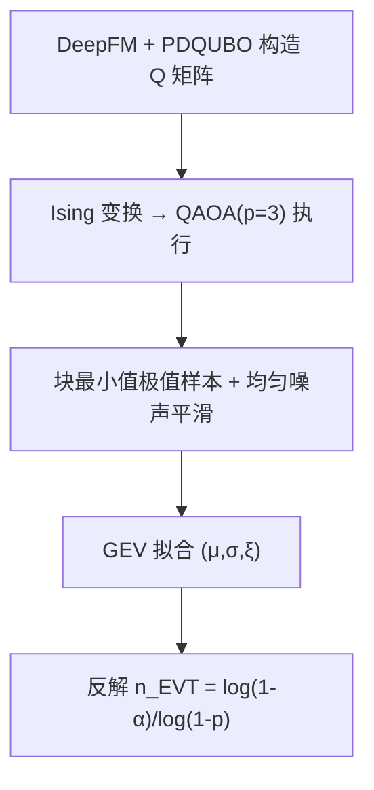
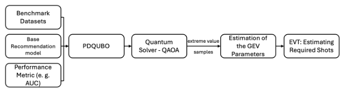

# Estimating Quantum Execution Requirements for Feature Selection in Recommender Systems Using Extreme Value Theory (基于极值理论估计推荐系统特征选择的量子执行需求)

- **会议/期刊**: RecSys 2025 (Short Paper Track)
- **作者与机构**: Jiayang Niu, Qihan Zou, Jie Li, Ke Deng, Mark Sanderson, Yongli Ren (RMIT University / University of Melbourne)
- **推荐链路定位**: 召回（特征选择阶段，服务于 CTR 预估前端）
- **研究方向**: 协同过滤与双塔召回 / 工业架构与可信评测
- **论文原文**: [https://arxiv.org/abs/2507.03229v2](https://arxiv.org/abs/2507.03229v2)
- **开源代码**: [https://github.com/jiayangniu/Recsys25_QEVT](https://github.com/jiayangniu/Recsys25_QEVT)

## TL;DR (1分钟核心速览)

现有量子辅助推荐的特征选择工作（CQFS/PDQUBO 等）只报告"效果与效率"，却回避了量子测量本质上是概率采样这一事实：固定问题规模下究竟要跑多少次（shots）才能稳定拿到不劣于经典基线的解，无人回答。本文提出 Q-EVT，把 QAOA 求解 QUBO 的重复执行输出视为极值样本，用 GEV 分布拟合最低能量，再反解出达到 95%/90% 置信度所需的执行次数。在 Avazu/Criteo 上，模拟器与两块真实 QPU（Ankaa-3、Forte）的估计值与 1000 次独立实测的交叉点几乎重合于 $\delta\approx 0$，验证了估计的准确性。

## Background & Motivation (背景与核心矛盾)

- **主流范式**: 将推荐特征选择写成带基数约束的 QUBO，交由量子退火器（D-Wave）或门控量子设备上的 QAOA 求解，以能量 $Y=\mathbf{x}^\top Q\mathbf{x}+(\sum_i x_i-k)^2$ 作为特征子集质量的代理。
- **前人局限**: 其一，量子测量天然概率化，单次 shot 只吐一个候选解，但既有工作从不回答"要跑多少次"；其二，PDQUBO 已观察到退火器随问题规模增大而性能退化，硬件噪声（如新一代 D-Wave 噪声更高）被系统性忽略。
- **核心洞察 (Key Insight)**: 我们真正关心的是"多次执行中的最低能量"这一极端统计量，而极值理论（EVT）恰好为块最小值提供了收敛到 GEV 分布的理论保证，因此执行次数可以被"算"出来而非"试"出来。
- **本文切入点**: 用 GEV 拟合量子能量下尾，给定经典 SA 参考能量 $y_{\text{ideal}}$，反解满足置信度$\alpha$ 的最小执行次数。

## Method (核心方法设计)

### 1. 整体框架 (Overall Architecture)

Q-EVT 的闭环为：先用 DeepFM 的 AUC 变化按 PDQUBO 方式构造 QUBO 矩阵 $Q$（对角为单特征移除损失、非对角为成对移除损失），经 Ising 变换后交由$p=3$层 QAOA + COBYLA 优化；每次执行取块内最小能量作为一个极值样本，累积足够样本后拟合 GEV，再由拟合分布算出单次执行达标概率$p$，最终输出置信度化的执行次数估计。整个流程的关键在于"样本量够不够"与"离散能量能否喂给连续分布假设"两个工程障碍，分别由 4.2 与 4.3 解决。

<figure class="paper-figure" markdown="span">
  <figcaption>图1：Q-EVT 概览</figcaption>
</figure>

### 2. 关键设计拆解 (Key Designs)

1. **最小充分极值样本量估计（Algorithm 1）**：GEV 参数估计需要足量极值样本，但量子执行昂贵，样本量本身是个待定超参。作者从大规模模拟池 $Y_{\text{sim}}$中自助重采样，对候选样本量$n$重复估计 GEV 参数，用 Hotelling's$T^2$检验参数均值一致性与多元 Shapiro-Wilk 检验正态性，取两个$p$值均超过 0.05 的最小$n$作为$n_{\text{estimate}}$（实测阈值 70–80，保守取 200）。直觉是：参数估计进入"稳定平台"的最早点即为性价比最优点。
2. **离散能量到连续分布的平滑**：QAOA 能量取值离散，而 EVT 假设连续分布，直接拟合会导致分布塌缩为点质量。作者对每个能量加均匀噪声 $\tilde{y}_i=y_i+\epsilon_i,\ \epsilon_i\sim\mathcal{U}(-\delta/2,\delta/2)$，其中$\delta$ 取排序后相邻唯一能量的最小非零差。这一步等价于用核密度式的抖动把离散原子"抹开"，使 GEV 的尾部拟合在数学上成立。
3. **执行次数反解与训练/推理开销**：设单次执行达标概率 $p=\mathbb{P}(y\le y_{\text{ideal}})$由拟合 GEV 给出，则$1-(1-p)^{n_{\text{EVT}}}\ge\alpha$给出$n_{\text{EVT}}\ge\log(1-\alpha)/\log(1-p)$，总 shot 数为$n_{\text{EVT}}\times s$。该式无需额外训练，仅需一次 GEV 拟合（200 个极值样本），推理侧开销可忽略；真正的成本在采集极值样本的量子执行本身。

## Experimental Setup & Evaluation Protocol (实验设置与评估协议)

- **数据集与预处理**: 两个标准 CTR 数据集，特征子集规模受硬件比特数限制取 10/13/15/18；特征按 XGBoost 重要性保留 top-3 与 bottom-2，其余按重要性分组采样以保证多样性；基数约束 $k$ 对应设为 8/11/12/14。

| 数据集 | 特征子集规模 | 基数约束 k | 场景说明 |
| :--- | :---: | :---: | :--- |
| Avazu | 10 / 13 / 15 / 18 | 8 / 11 / 12 / 14 | CTR 预估，Q 矩阵由 DeepFM 构造 |
| Criteo | 10 / 13 / 15 / 18 | 8 / 11 / 12 / 14 | 同上 |

- **数据划分与防穿越**: 本文不涉及序列/时间切分，评估对象是 QUBO 求解质量而非推荐精度；Q 矩阵由 DeepFM 在训练集上训练后计算 AUC 变化得到。
- **排名评测协议**: 非排名评测。核心指标为**能量值**（越低越好），以经典模拟退火 SA 的能量作为参考基线 $y_{\text{ideal}}$，统计"最小能量 ≤ SA"的经验比例。
- **对比基线与超参设置**: 基线为经典 SA；量子侧为 AWS Braket 上的理想模拟器、超导 QPU Ankaa-3、离子阱 QPU Forte Enterprise 1；QAOA 深度 $p=3$，COBYLA 优化，参数先在模拟器上调优再迁移至真机；真机统一 2000 shots，模拟器扫描 500/1000/2000 shots。

## Key Experimental Results (实验关键数据)

### 1. 主实验对比 (Main Results)

下表为达到/超越经典 SA 所需的执行次数 $n_{\text{EVT}}$（95%/90% 置信度），括号内为对应平台：

| 平台 | 规模 | Avazu (500 shots) | Criteo (500 shots) |
| :--- | :---: | :---: | :---: |
| Ankaa-3 模拟器 | 10 | **7 / 6** | **6 / 5** |
| Ankaa-3 模拟器 | 13 | **23 / 16** | **15 / 12** |
| Ankaa-3 模拟器 | 15 | **62 / 47** | **62 / 48** |
| Forte 模拟器 | 15 | 103 / 80 | 70 / 54 |
| Ankaa-3 真机 | 10 | 16 / 13 | 23 / 17 |
| Ankaa-3 真机 | 15 | 76 / 58 | 114 / 88 |
| Forte 真机 | 15 | 111 / 87 | 209 / 161 |

shot 预算对执行次数的影响（Avazu, 规模 13, Ankaa-3 模拟器）：500/1000/2000 shots 分别需 23/13/8 次执行，呈单调下降。

### 2. 消融实验 (Ablation Study)

本文为短论文，未设传统模块消融，但通过"估计值 vs 实测值"的校准实验构成等价验证：

| 验证设置 | 观测交叉点 $\delta$ | 结论 |
| :--- | :---: | :--- |
| Avazu, 500 shots | $\approx 0$ | 估计精准 |
| Avazu, 2000 shots | $\approx 0$ | 估计精准 |
| Criteo, 500 shots | $\approx 0$ | 估计精准 |
| Criteo, 1000 shots | 略偏离 0（散布稍大） | 仍稳健 |
| 真机 Ankaa-3, 规模 13/15 | shot 增至 ~10000 后收敛至 SA | 趋势一致 |

### 3. 关键实验发现 (Key Findings)

1. **规模是主导成本因子**：Avazu 上 Ankaa-3 模拟器从规模 10 到 15，95% 置信所需执行次数由 7 增至 62（近 9 倍），说明 QUBO 规模扩张带来的不仅是比特数压力，更是采样成本的指数式抬升。
2. **真机噪声代价可量化**：Criteo 规模 15、500 shots 下，模拟器需 62 次而物理 Ankaa-3 需 114 次，约 1.8 倍差距，直接量化了硬件不完美性对采样预算的侵蚀。
3. **shot 预算与执行次数可互换**：Avazu 规模 13 上 500→2000 shots 使执行次数从 23 降到 8，且各配置独立采样仍保持单调，说明 EVT 估计在不同 shot 预算下自洽，可作为调度量子资源的可靠依据。

## Highlights & Limitations (亮点、对比与审稿批判)

- **与代表作对比 (vs. Prior Work)**: CQFS/MIQUBO/QUBO-Boosting 关注如何构造 $Q$ 矩阵，PDQUBO 引入反事实分析但仅定性指出退火器规模退化；本文首次把"要跑多少次"从经验试错升级为带置信度的统计推断，且首次将门控量子设备（QAOA）而非退火器用于推荐特征选择。
- **可迁移亮点**: ①"块极值 + GEV 反解样本量"的范式可迁移到任何高方差、单次采样昂贵的评估场景（如大规模在线 A/B 的最小样本量预估、LLM 采样的置信度控制）；②自助重采样 + 双统计检验确定最小充分样本量的流程，是超参选择的一个通用模板。
- **审稿级局限批判**: ①实验仅覆盖至 18 个特征、$p=3$ 的浅层 QAOA，规模外推性存疑，且作者自承在"输出恒定最优"或"长期次优"两种情形下 EVT 会失效；②全文以能量对齐 SA 为唯一成功判据，缺少下游 CTR/AUC 的端到端验证，量子解相对经典解的实际推荐收益未被量化。

## Rating (四维评分)

- **方法创新性 (Novelty)**: ⭐⭐⭐⭐ （首次将 EVT 引入量子推荐特征选择的资源估计，问题提法本身比解法更有价值）
- **评估协议与实验扎实度 (Protocol & Experiments)**: ⭐⭐⭐ （模拟器+两块真机+1000 次独立校准较扎实，但规模小、缺下游指标）
- **写作与数学规范度 (Clarity & Rigor)**: ⭐⭐⭐⭐ （GEV 与反解公式推导清晰，Algorithm 1 完整，短论文篇幅内信息密度高）
- **工业落地与复现价值 (Industrial & Practical Value)**: ⭐⭐⭐ （代码开源，但当前量子硬件规模与成本离工业推荐特征选择仍有距离）

