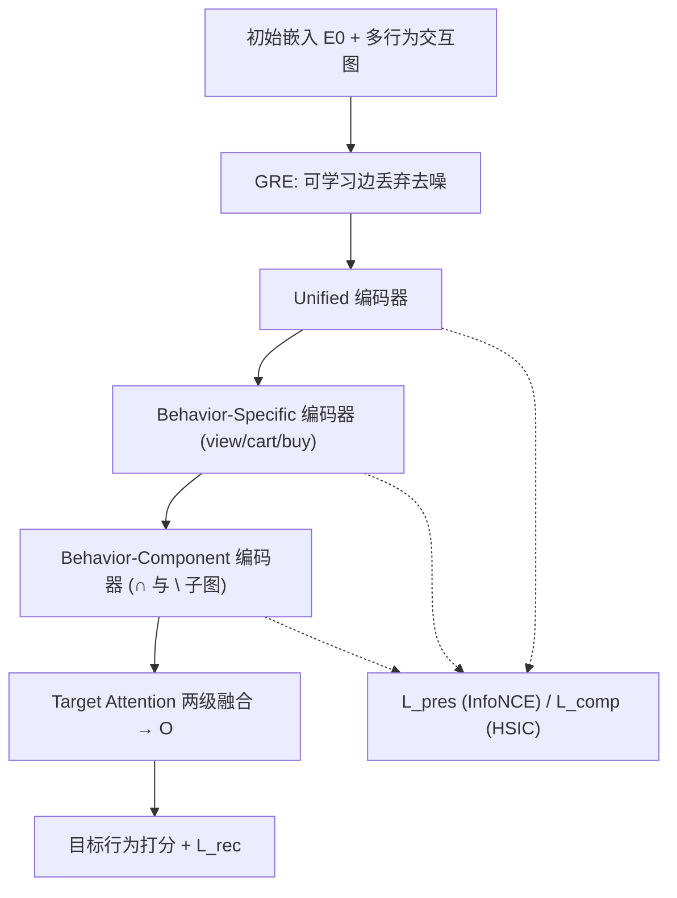
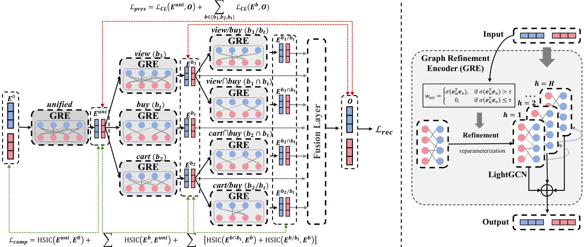

# Hierarchical Graph Information Bottleneck for Multi-Behavior Recommendation (多行为推荐的分层图信息瓶颈)

- **会议/期刊**: RecSys 2025
- **作者与机构**: Hengyu Zhang, Chunxu Shen, Xiangguo Sun, Jie Tan, Yanchao Tan, Yu Rong, Hong Cheng, Lingling Yi（香港中文大学、腾讯微信、福州大学）
- **推荐链路定位**: 召回（多行为图召回/表征学习）
- **研究方向**: 协同过滤与双塔召回 / 图神经网络与知识图谱推荐
- **论文原文**: [https://arxiv.org/abs/2507.15395v1](https://arxiv.org/abs/2507.15395v1)
- **开源代码**: [https://github.com/zhy99426/HGIB](https://github.com/zhy99426/HGIB)

## TL;DR (1分钟核心速览)

多行为推荐中辅助行为（浏览/加购）与目标行为（购买）分布严重失衡，且辅助行为噪声引发负迁移。本文提出模型无关的 HGIB 框架：把层次化多行为模型的优化目标从信息论视角重写为信息瓶颈，推导出「保真项（InfoNCE）+ 压缩项（HSIC）」的损失下界，并配一个可学习边丢弃的图精炼编码器 GRE 显式去噪。在 Taobao/Tmall/Jdata 三数据集 Full-Ranking 协议下，HR@10 相对最强基线 MULE 提升 13.62%/15.08%/6.12%，微信新闻场景线上 A/B 的 CTR 提升 0.32%（p<0.05）。

## Background & Motivation (背景与核心矛盾)

- **主流范式**: 当前 SOTA 采用层次化设计，分级联范式（view→cart→buy 逐级编码，如 MB-CGCN、AutoDCS）与并行范式（unified→behavior→behavior-component，如 MULE），通过分层编码器刻画行为间关系。
- **前人局限**: 其一，行为分布差异巨大——辅助行为交互量远超目标行为（Taobao 上浏览 87 万 vs 购买 9 万），数值主导引入流行度偏置，而目标行为长尾又加剧过拟合；其二，辅助行为多为隐式反馈（误点、随手浏览），噪声经层次编码逐级放大，造成负迁移。
- **核心洞察 (Key Insight)**: 作者用信息图（图 2b）指出理想表征应是「最小且充分」的圆——既覆盖用户真实兴趣，又不被辅助行为偏置撑大；而现有层次模型只做「保真」不做「压缩」，浅层编码器学到的信息丰度不足（图 6），后续编码器无从提炼。
- **本文切入点**: 将信息瓶颈（IB）原理注入层次化设计，对每一层编码器同时施加「保留任务相关信息」与「压缩层间冗余」两个约束，并用可学习边丢弃在输入端先做一次显式去噪。

## Method (核心方法设计)

### 1. 整体框架 (Overall Architecture)

模型把用户/物品 ID 映射为初始嵌入 $\boldsymbol{E}^0$，随后经$L$级层次编码器逐层变换$\boldsymbol{E}^{l+1}=\text{Encoder}_{l+1}(\boldsymbol{E}^l)$。实例化采用并行范式：unified 编码器融合全部行为图，behavior-specific 编码器按行为分图编码，behavior-component 编码器进一步拆分「view∩buy / view\buy」等交集与差集子图，最后用 Target Attention 两级融合得到最终表征$\boldsymbol{O}$。每一级编码器均替换为 GRE（可学习边丢弃 + LightGCN 聚合）。训练时除目标行为交叉熵外，额外对每层输出施加保真损失$\mathcal{L}_{pres}$与压缩损失$\mathcal{L}_{comp}$，形成「逐层漏斗式」的信息筛选。

<figure class="paper-figure" markdown="span">
  <figcaption>图3：所提出HGIB的示意图，以三种行为为例（浏览为𝑏1，加购为𝑏2，购买为𝑏𝑡）。(a) HGIB在并行范式下的实例化，其中红色虚线表示用于保留的L𝑝𝑟𝑒𝑠，绿色虚线表示用于压缩的L𝑐𝑜𝑚𝑝。(b) 图精炼编码器（GRE）的示意图，其通过可学习策略对噪声交互进行去噪。</figcaption>
</figure>

### 2. 关键设计拆解 (Key Designs)

1. **层次化信息瓶颈目标（把 IB 拆到每一层）**：常规 IB 只约束输入与最终表征，层次模型中间层无人监管。本文将目标写为逐层求和 $\max\sum_{l=1}^{L}\left[I(\boldsymbol{E}^l;\boldsymbol{Y})-\beta I(\boldsymbol{E}^l;\boldsymbol{E}^{l-1})\right]$，并对第一项推导下界：利用互信息链式法则与熵的非负性，得到$I(\boldsymbol{E}^l;\boldsymbol{Y})\ge -H(\boldsymbol{Y}|\boldsymbol{E}^L)+I(\boldsymbol{E}^L;\boldsymbol{E}^l)-H(\boldsymbol{E}^L)$，其中$-H(\boldsymbol{Y}|\boldsymbol{E}^L)$由交叉熵$\mathcal{L}_{rec}$下界、$I(\boldsymbol{E}^L;\boldsymbol{E}^l)$由 InfoNCE 下界、$-H(\boldsymbol{E}^L)$视为$L_2$ 正则。直觉是：让每一层中间表征都与最终表征「对齐」，等价于把监督信号回传到每一层，避免浅层学不到东西。

2. **HSIC 压缩项（绕开互信息上界不可算）**：最小化 $I(\boldsymbol{E}^l;\boldsymbol{E}^{l-1})$需要互信息上界，难以直接估计。本文借用 HSIC 作为独立性度量的近似：$\text{HSIC}(\boldsymbol{A},\boldsymbol{B})=\frac{1}{(n-1)^2}\text{tr}(\boldsymbol{K}_A\boldsymbol{H}\boldsymbol{K}_B\boldsymbol{H})$，令$\mathcal{L}_{comp}=\sum_l \text{HSIC}(\boldsymbol{E}^l,\boldsymbol{E}^{l-1})$。HSIC 为零当且仅当两变量独立，因此最小化它即强迫相邻层表征「去相关」，把上一层中与任务无关的成分压掉——这正是「压缩」的可计算替身。

3. **图精炼编码器 GRE（输入端显式去噪）**：IB 损失是隐式正则，无法直接删边。GRE 用可学习边权 $w_{uv}=\sigma(\boldsymbol{e}_u^\top\boldsymbol{e}_v)$，当权值低于阈值$\tau$时置零剪枝，再用 Gumbel-softmax 重参数化使离散剪枝可端到端求导，剪枝后接 LightGCN 聚合。总损失为$\mathcal{L}=\mathcal{L}_{rec}+\alpha\mathcal{L}_{pres}+\beta\mathcal{L}_{comp}+\gamma\|\Theta\|_2^2$。训练负采样沿用骨干的 BPR/交叉熵式负例；额外开销为$O((B^2+|\mathcal{E}|)Ld+B^3L)$，因$|\mathcal{E}|\gg B$，相对 LightGCN 主干不构成显著负担。

## Experimental Setup & Evaluation Protocol (实验设置与评估协议)

- **数据集与预处理**: 三个电商公开数据集，沿用前人（MB-CGCN/MULE）的过滤与划分设置，buy 为目标行为：

| 数据集 | #Users | #Items | #Views | #Collects | #Carts | #Buys |
| :--- | :---: | :---: | :---: | :---: | :---: | :---: |
| Taobao | 15,449 | 11,953 | 873,954 | - | 195,476 | 92,180 |
| Tmall | 41,738 | 11,953 | 1,813,498 | 221,514 | 1,996 | 255,586 |
| Jdata | 93,334 | 24,624 | 1,681,430 | 45,613 | 49,891 | 321,883 |

- **数据划分与防穿越 (Splitting Strategy)**: 严格遵循 MB-CGCN/MULE 的训练-测试划分协议（按用户留出目标行为交互），工业数据采用 `Leave-One-Out`。
- **排名评测协议 (Ranking Protocol)**: 无偏 `Full-Ranking`（对全物品集排序取 Top-10），指标 HR@10 与 NDCG@10；显著性检验 $p<0.05$（表中 `*` 标注）。
- **对比基线与超参设置**: 13 个基线分三类——单行为（MF-BPR、NCF、LightGCN）、无层次多行为（RGCN、GNMR、NMTR、MBGCN）、层次化多行为（CRGCN、MB-CGCN、HPMR、PKEF、AutoDCS、COPF、MULE）。嵌入维度 $d=64$，batch size 1024，Adam 学习率$5\times10^{-4}$，$\alpha\in\{0.5,1.0\}$、$\beta=50$、$\tau=0.05$、$\lambda=0.1$。

## Key Experimental Results (实验关键数据)

### 1. 主实验对比 (Main Results)

| 方法 | Taobao HR | Taobao NDCG | Tmall HR | Tmall NDCG | Jdata HR | Jdata NDCG |
| :--- | :---: | :---: | :---: | :---: | :---: | :---: |
| LightGCN | 0.0411 | 0.0240 | 0.0393 | 0.0209 | 0.2252 | 0.1436 |
| MBGCN | 0.0509 | 0.0294 | 0.0549 | 0.0285 | 0.2803 | 0.1572 |
| CRGCN | 0.0855 | 0.0439 | 0.0840 | 0.0442 | 0.5001 | 0.2914 |
| MB-CGCN | 0.1233 | 0.0677 | 0.0984 | 0.0558 | 0.4349 | 0.2758 |
| PKEF | 0.1385 | 0.0785 | 0.1277 | 0.0721 | 0.4334 | 0.2615 |
| AutoDCS | 0.1522 | 0.0813 | 0.1432 | 0.0743 | 0.6174 | 0.4559 |
| COPF | 0.1552 | 0.0838 | 0.1755 | 0.0967 | 0.5338 | 0.3692 |
| MULE | 0.1939 | 0.1109 | 0.2109 | 0.1165 | 0.5820 | 0.4147 |
| **HGIB** | **0.2203\*** | **0.1214\*** | **0.2427\*** | **0.1287\*** | **0.6552\*** | **0.4747\*** |
| Rel Impr. | +13.62% | +9.47% | +15.08% | +10.47% | +6.12% | +4.12% |

### 2. 消融实验 (Ablation Study)

| 变体 | Taobao HR | Taobao NDCG | Tmall HR | Tmall NDCG | Jdata HR | Jdata NDCG |
| :--- | :---: | :---: | :---: | :---: | :---: | :---: |
| HGIB 完整 | 0.2203 | 0.1214 | 0.2427 | 0.1287 | 0.6552 | 0.4747 |
| w/o $\mathcal{L}_{pres}$ | 0.1870 | 0.1034 | 0.1799 | 0.0980 | 0.6172 | 0.4551 |
| w/o $\mathcal{L}_{comp}$ | 0.2188 | 0.1204 | 0.2322 | 0.1222 | 0.6397 | 0.4534 |
| w/o GRE | 0.2110 | 0.1167 | 0.2200 | 0.1164 | 0.6319 | 0.4491 |

### 3. 关键实验发现 (Key Findings)

1. **保真项是命门，压缩项是增益**：去掉 $\mathcal{L}_{pres}$后 Tmall HR 从 0.2427 暴跌至 0.1799（-25.9%），远超去掉$\mathcal{L}_{comp}$（-4.3%）与 GRE（-9.4%），说明「让每层中间表征对齐最终监督」是层次化 IB 的主要收益来源，压缩与去噪是在此基础上的精修。
2. **GRE 的显式去噪与 IB 隐式正则互补而非冗余**：单独去掉 GRE 的降幅（Taobao -4.2%）大于单独去掉 $\mathcal{L}_{comp}$（-0.7%），表明在噪声密集的辅助行为图上，输入端硬剪枝比层间去相关更直接有效；两者叠加才达到最优。
3. **框架可插拔且工业可迁移**：将 HGIB 套到 AutoDCS 与 MULE 上分别再涨 9.99%/12.58%（Taobao HR），说明收益不依赖特定骨干；微信新闻/直播两个十亿级工业数据集上相对 MULE 提升 14.85%/5.51%（HR@10），15 天线上 A/B 的 CTR +0.32%（p<0.05）、分享率 +1.65%（p<0.01），验证了大规模场景的落地价值。

## Highlights & Limitations (亮点、对比与审稿批判)

- **与代表作对比 (vs. Prior Work)**: 相比 MULE 仅靠并行层次结构隐式缓解行为干扰，HGIB 首次给出层次化多行为模型的 IB 理论刻画，把「保真/压缩」变成可优化的两项损失；相比 CGI/GBSR 等把 IB 用于单行为图去噪的工作，本文的关键增量是把 IB 拆解到**每一层编码器**并配 HSIC 近似，使层次漏斗的每一级都受约束。
- **可迁移亮点**: 其一，「InfoNCE 做保真 + HSIC 做压缩」这套可计算替代方案可直接移植到任何多层图编码器（如跨域、多场景堆叠网络）；其二，Gumbel-softmax 边剪枝 + 阈值 $\tau$ 的轻量去噪模块可低成本插入现有 GCN 召回链路。
- **审稿级局限批判**: 其一，HSIC 需构造 $n\times n$核矩阵，复杂度含$O(B^3L)$项，batch 增大时开销上升明显，论文仅以$|\mathcal{E}|\gg B$论证「不显著」，缺乏大 batch 实测；其二，$\beta=50$、$\tau=0.05$在三个数据集上取同一默认值，但 Jdata 因转化率高导致最优$\alpha$ 偏移至 0.5，说明超参对行为分布敏感，跨场景迁移仍需调参；其三，公开数据集仅三个且均为电商，工业验证虽强但不可复现。

## Rating (四维评分)

- **方法创新性 (Novelty)**: ⭐⭐⭐⭐ （首次将 IB 逐层拆解并给出 InfoNCE/HSIC 可计算下界，理论刻画扎实，但 IB+对比学习+边剪枝的组合本身并非全新范式）
- **评估协议与实验扎实度 (Protocol & Experiments)**: ⭐⭐⭐⭐⭐ （三公开集 Full-Ranking + 13 基线 + 消融 + 兼容性 + 超参 + 两工业集 + 15 天线上 A/B，证据链完整）
- **写作与数学规范度 (Clarity & Rigor)**: ⭐⭐⭐⭐ （下界推导链条清晰、复杂度分析到位，但 HSIC 近似互信息的理论误差未讨论）
- **工业落地与复现价值 (Industrial & Practical Value)**: ⭐⭐⭐⭐⭐ （代码开源、模块可插拔、十亿级工业验证与线上显著收益，落地说服力强）

