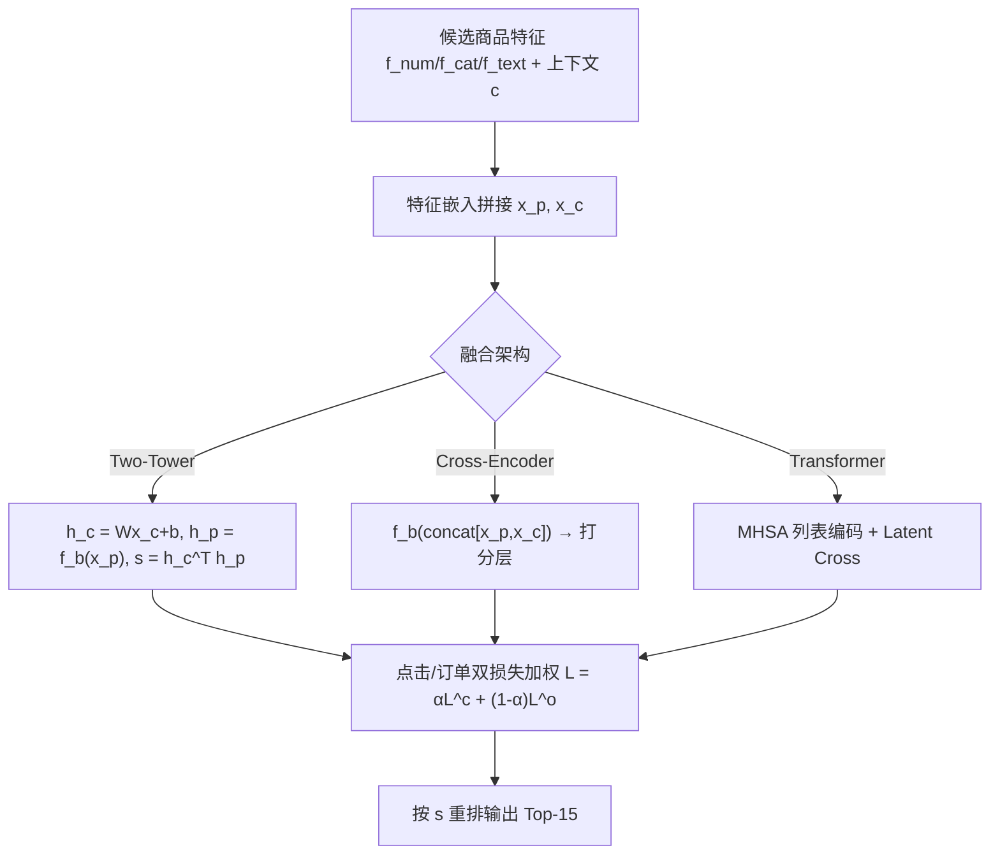
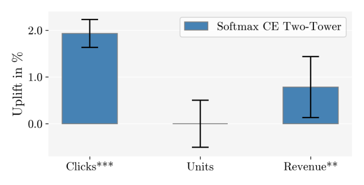

# Industry Insights from Comparing Deep Learning and GBDT Models for E-Commerce Learning-to-Rank (电商 Learning-to-Rank 中深度学习与 GBDT 模型的工业对比洞察)

- **会议/期刊**: RecSys 2025 (19th ACM Conference on Recommender Systems)
- **作者与机构**: Yunus Lutz, Timo Wilm, Philipp Duwe（OTTO (GmbH & Co. KGaA), Hamburg, Germany）
- **推荐链路定位**: 精排（候选召回后的上下文 LTR 重排序）
- **研究方向**: 协同过滤与双塔召回 / CTR 预估与特征交叉
- **论文原文**: [https://arxiv.org/abs/2507.20753v1](https://arxiv.org/abs/2507.20753v1)
- **开源代码**: 暂未开源（使用 OTTO 私有交互日志，无法公开）

## TL;DR (1分钟核心速览)

针对"电商 LTR 中 DNN 能否真正打败生产级 GBDT"这一长期悬而未决的工业争议，本文在 OTTO 搜索日志（43M 训练 / 700k 测试）上系统对比 3 种 DNN 架构（Two-Tower / Cross-Encoder / Transformer）× 2 种损失（Softmax CE / RankNet）与生产级 LGBM LambdaMART。离线结果显示所有 DNN 在 $NDCG_c$与 AIV 上均超越基线，其中最简单的 Two-Tower + Softmax CE 取得$NDCG_c$+4.32%、AIV +2.28% 且$NDCG_o$不降；8 周线上 A/B 进一步验证总点击 +1.86%（$p<0.0001$）、营收 +0.56%（$p<0.01$）、销量持平。

## Background & Motivation (背景与核心矛盾)

- **主流范式**: 工业界 LTR 长期以 GBDT（LambdaMART/LightGBM）为骨干，因其对表格型特征鲁棒、调参成本低、开源实现成熟；学术界则报告 Transformer 类 DNN 在 LTR 上优于 GBDT。
- **前人局限**: ①学术结论多基于 Web30K / Yahoo! LTR 等人工标注数据集，与工业交互日志的隐式标签分布差异巨大；②工业侧研究虽用私有日志验证 DNN 优势，却普遍因可扩展性问题**缺失线上 A/B 证据**，无法回答"离线涨点是否等于线上收益"。
- **核心洞察 (Key Insight)**: 已有"单层 32 维前馈网络即可追平 GBDT"的报告，暗示此前 GBDT 基线可能未被充分调优，或复杂 DNN 的收益被架构复杂度掩盖——真正需要的是**同口径、强基线、带线上验证**的对照实验。
- **本文切入点**: 以 OTTO 生产级 LambdaMART 为强基线，在统一特征与调参预算下横向扫描 DNN 架构与损失组合，并用 8 周线上实验闭环验证。

## Method (核心方法设计)

### 1. 整体框架 (Overall Architecture)

输入为上游召回给出的 $n$个候选商品$\mathbf{p}=[p_1,\dots,p_n]$与上下文$c$（用户行为、查询意图、设备信息）。每个商品由数值特征$\mathbf{f}^{num}_i$、类别特征$\mathbf{f}^{cat}_i$、文本特征$\mathbf{f}^{text}_i$三路编码后拼接为$\mathbf{x}_{p_i}\in\mathbb{R}^D$；上下文同构编码为$\mathbf{x}_c$（不含数值特征）。三套架构共享同一残差骨干$B^{(k)}$，分别以双塔点积、拼接交叉、列表级自注意力三种方式融合，输出相关性分数$s_i$后重排候选列表。训练侧对点击/订单两路标签分别计算损失并按$\alpha$ 加权，推理侧双塔可预计算商品向量。

### 2. 关键设计拆解 (Key Designs)

1. **多正例归一化的 RankNet 与 Softmax CE（针对隐式反馈一对多标签的损失修正）**：电商一次请求中用户可点击/下单多个商品，原始 RankNet 的成对比较会因正例多的样本产生更多有效对而**主导梯度**。本文按样本正例数 $P_n=\sum_i y_i$归一化：$\mathcal{L}_{RN}(\mathbf{s},\mathbf{y})=\frac{1}{P_n}\tilde{\mathcal{L}}_{RN}(\mathbf{s},\mathbf{y})$；CE 侧则将标签归一化为概率分布$\tilde{y}_i=y_i/P_n$后计算$\mathcal{L}_{CE}(\mathbf{s}|\tilde{\mathbf{y}})$。直觉上这是把"多正例列表"从成对排序问题转化为**列表级分布拟合**，避免长列表样本的梯度爆炸。
2. **点击/订单双目标加权（缓解点击-下单标签极度不均衡）**：数据集天然偏向点击，若单用点击训练会牺牲转化。总损失为 $\mathcal{L}_{type}(\mathbf{s},\mathbf{y}^c,\mathbf{y}^o)=\alpha\cdot\mathcal{L}^c_{type}(\mathbf{s},\mathbf{y}^c)+(1-\alpha)\cdot\mathcal{L}^o_{type}(\mathbf{s},\mathbf{y}^o)$，$\alpha=0.5$固定。该设计让模型在$NDCG_c$与$NDCG_o$之间取得折中，也是后文解释"多数 DNN 在$NDCG_o$ 上掉点"的关键归因。
3. **训练目标、负采样与推理效率**：损失为上述双目标加权组合，**无显式负采样**（LTR 列表内全候选参与排序，属 listwise 监督）。骨干统一为 $k=3$层、隐层$h=1024$、$d_{cat}=128$、$d_{text}=512$、Adam、batch=1000；Two-Tower/Cross-Encoder 学习率 0.001，Transformer 0.0001，Dropout 分别 0.0/0.3/0.5。推理侧 Two-Tower 可离线预计算$\mathbf{h}_p$，仅在线算上下文向量与点积，是三者中服务成本最低的方案。

## Experimental Setup & Evaluation Protocol (实验设置与评估协议)

- **数据集与预处理**: OTTO 搜索引擎匿名化交互日志，**时间切分**为 43M 训练样本与 700k 测试样本；数值特征右偏者做幂律归一化、轻尾者做 z-score 标准化；文本特征用词袋 + 词嵌入求和。

| 数据集 | #Train Samples | #Test Samples | 标签形式 | 特征/场景说明 |
| :--- | :---: | :---: | :---: | :--- |
| OTTO Search Logs (私有) | 43M | 700k | 隐式点击 $\mathbf{y}^c$+ 下单$\mathbf{y}^o$ 二值向量 | 数值+类别+文本三路特征，上下文含用户行为/查询意图/设备 |

- **数据划分与防穿越 (Splitting Strategy)**: **全局时间戳切分**（temporal train-test split），训练集早于测试集，避免未来交互泄漏。
- **排名评测协议 (Ranking Protocol)**: 列表级 **Full-List 排序**（每个请求的完整候选列表参与重排，非采样负例），指标在 cutoff=15 处计算（对应 OTTO 搜索结果页用户滚动深度中位数），报告 $NDCG_c$、$NDCG_o$ 与 AIV（Average Item Value，营收代理指标）。
- **对比基线与超参设置**: 基线为生产级 LGBM LambdaMART（LambdaRank 目标，lr=0.1，max_depth=12，num_leaves=25，400 棵树）；DNN 侧 3 架构 × 2 损失共 6 组，均经充分超参搜索。线上采用 8 周 A/B 测试 + t 检验（95% 置信区间）。

## Key Experimental Results (实验关键数据)

### 1. 主实验对比 (Main Results)

下表为各 DNN 相对生产级 LGBM 基线的**相对提升**（正为优于基线）：

| 指标 | Two-Tower (CE) | Cross-Enc (CE) | Transformer (CE) | Two-Tower (RN) | Cross-Enc (RN) | Transformer (RN) |
| :--- | :---: | :---: | :---: | :---: | :---: | :---: |
| $NDCG_c$ | **+4.32%** | +4.32% | +2.16% | +3.70% | **+4.63%** | +3.09% |
| $NDCG_o$ | **0.00%** | -0.30% | -1.48% | -1.48% | -0.59% | -1.78% |
| AIV | +2.28% | +2.28% | +2.89% | +2.28% | +2.37% | **+3.16%** |

线上 A/B（Two-Tower + Softmax CE vs. LGBM 基线，8 周）：

| 业务指标 | 相对提升 | 显著性 |
| :--- | :---: | :---: |
| 总点击量 (Total Clicks) | **+1.86%** | $p<0.0001$ |
| 营收 (Revenue) | **+0.56%** | $p<0.01$ |
| 销量 (Units Sold) | 持平 | 不显著 |

<figure class="paper-figure" markdown="span">
  <figcaption>图1：Two-Tower 架构使用 Softmax CE 损失与我们的 LGBM 基线相比的在线 A/B 测试结果。黑色条表示 95% t 检验置信区间。</figcaption>
</figure>

### 2. 消融实验 (Ablation Study)

原文未设传统"逐模块移除"消融，其等价对照为**架构 × 损失的 2×3 因子扫描**，可视为对"融合方式"与"损失形式"两个设计维度的消融：

| 变量维度 | 设置 | $NDCG_c$|$NDCG_o$ | AIV | 结论 |
| :--- | :--- | :---: | :---: | :---: | :--- |
| 融合方式 | Two-Tower | +4.32% | 0.00% | +2.28% | 点击最优且转化不降 |
| 融合方式 | Cross-Encoder | +4.32% | -0.30% | +2.28% | 与双塔持平 |
| 融合方式 | Transformer | +2.16% | -1.48% | +2.89% | 点击与转化双降 |
| 损失 | Softmax CE (TT) | +4.32% | 0.00% | +2.28% | 双塔最佳搭配 |
| 损失 | RankNet (TT) | +3.70% | -1.48% | +2.28% | 转化受损 |
| 损失 | RankNet (CR/TR) | +4.63%/+3.09% | -0.59%/-1.78% | +2.37%/+3.16% | 复杂架构偏好 RN |

### 3. 关键实验发现 (Key Findings)

1. **架构复杂度与收益呈负相关**：最简单的 Two-Tower 在 $NDCG_c$上追平 Cross-Encoder（均 +4.32%）并显著优于 Transformer（+2.16%），且是唯一$NDCG_o$零损失的架构；Transformer 在本文数据上$NDCG_o$ 掉 1.48%，**直接反驳了前人"Transformer 必然优于 GBDT"的结论**，说明列表级自注意力在点击主导的强不均衡数据上易过拟合点击信号。
2. **损失与架构存在强耦合**：双塔偏好 Softmax CE（$NDCG_c$ +4.32% vs RN +3.70%），而 Cross-Encoder/Transformer 偏好 RankNet（+4.63%/+3.09%）。作者归因于 CE 的分布归一化更适合低容量点积结构，而高容量交叉结构需要成对监督来约束排序边界。
3. **离线涨点可被线上复现但幅度衰减**：离线 $NDCG_c$ +4.32% 对应线上点击 +1.86%（约 43% 的传导率），营收 +0.56% 而销量持平，说明 DNN 的增益主要来自**点击层面的相关性提升而非客单价或转化结构改变**；DNN 训练与服务成本更高，但相对收益可忽略。

## Highlights & Limitations (亮点、对比与审稿批判)

- **与代表作对比 (vs. Prior Work)**: 相较学术侧基于 Web30K/Yahoo! 人工标注数据得出"Transformer 胜 GBDT"的结论，本文用真实交互日志 + 强调优 LGBM 基线 + 8 周线上 A/B 形成完整证据链；相较工业侧仅离线对比、缺线上验证的工作，本文补上了最关键的线上闭环；相较"32 维单层网络追平 GBDT"的报告，本文表明**充分调优后的双塔可稳定超越基线**，而非仅追平。
- **可迁移亮点**: ①多正例列表的 $1/P_n$ 归一化 RankNet 与标签归一化 CE，可直接迁移到任何"一次曝光多次转化"的推荐场景（如短视频多完播、广告多商品点击）；②以 cutoff=15（用户滚动深度中位数）对齐离线指标与线上曝光分布，是提升离线-线上一致性的低成本技巧。
- **审稿级局限批判**: ①仅使用 OTTO 单一私有数据集，结论对品类结构、流量规模不同的平台外推性存疑，且数据不可公开复现；②$\alpha=0.5$固定未做敏感性分析，作者自己也承认多数 DNN 在$NDCG_o$掉点"可能归因于$\alpha$选择与数据点击偏斜"，缺少对$\alpha$ 网格的验证；③线上仅验证了最优单组（Two-Tower+CE），其余 5 组架构/损失组合无线上证据，离线排名与线上排名的一致性仅在单点上被检验。

## Rating (四维评分)

- **方法创新性 (Novelty)**: ⭐⭐ （架构与损失均为成熟组件的组合，创新在于多正例归一化损失与系统性工业对照设计，而非新模型）
- **评估协议与实验扎实度 (Protocol & Experiments)**: ⭐⭐⭐⭐ （时间切分防穿越、Full-List 排序、6 组架构×损失扫描 + 8 周线上 A/B 与 t 检验，工业证据链完整；扣分于单数据集与 $\alpha$ 未做敏感性分析）
- **写作与数学规范度 (Clarity & Rigor)**: ⭐⭐⭐⭐ （公式简洁、符号统一、超参与基线配置交代清楚，相对提升表格一目了然；理论分析较浅，未深入解释 Transformer 失效机理）
- **工业落地与复现价值 (Industrial & Practical Value)**: ⭐⭐⭐⭐ （直接回答"是否该从 GBDT 迁移到 DNN"的工程决策问题，双塔可预计算、服务成本可控；但数据私有、代码未开源，复现需自建同构日志）

