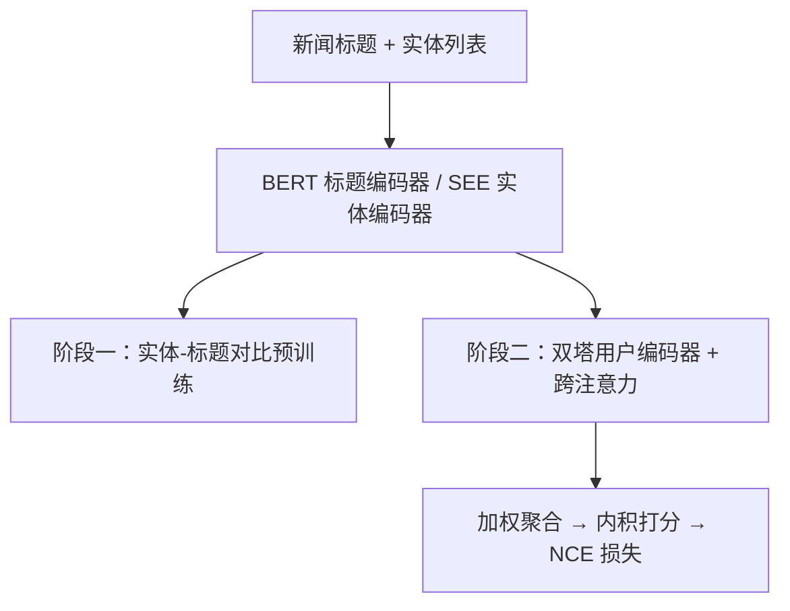
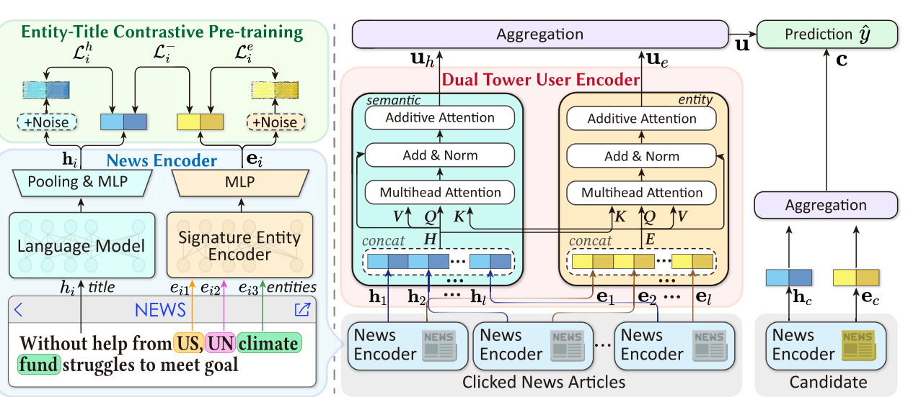

# IP2: Entity-Guided Interest Probing for Personalized News Recommendation (实体引导兴趣探测的个性化新闻推荐)

- **会议/期刊**: RecSys 2025
- **作者与机构**: Youlin Wu, Yuanyuan Sun, Xiaokun Zhang, Haoxi Zhan, Bo Xu, Liang Yang, Hongfei Lin（大连理工大学、香港城市大学）
- **推荐链路定位**: 召回（候选新闻点击打分）
- **研究方向**: 协同过滤与双塔召回 / 大语言模型推荐（PLM 语义编码）
- **论文原文**: [https://arxiv.org/abs/2507.13622v1](https://arxiv.org/abs/2507.13622v1)
- **开源代码**: [https://github.com/microsoft/recommenders](https://github.com/microsoft/recommenders)

## TL;DR (1分钟核心速览)

现有新闻推荐把实体当作语义特征的补充，忽略了行为科学中"扫视→读标题→点击"三步链路里实体在扫视阶段的主导作用。IP2 提出两级实体引导：新闻内用签名实体编码器（SEE）+ 实体-标题对比预训练探测"领衔实体"，新闻间用跨注意力双塔用户编码器校准标题阅读兴趣。在 MIND-small/large 与 Adressa-1week 上，AUC 分别达 69.69/72.06/83.16，全面超越 NRMS、GLORY、PUNR 等 SOTA，且不依赖知识图谱。

## Background & Motivation (背景与核心矛盾)

- **主流范式**: 神经新闻推荐以 BERT 编码标题、注意力聚合历史序列，用向量内积打分；知识感知方法（DKN、KRED、GLORY）额外引入 KG 实体嵌入增强新闻或用户表征。
- **前人局限**: 其一，KG 存在实体缺失与信息过期问题，新涌现实体无法链接，Adressa 等挪威语场景甚至无可用 KG；其二，现有方法把实体当作语义的"附属品"，未区分新闻内"领衔实体 vs 辅助实体"，也未建模新闻间实体兴趣流对标题阅读的引导。
- **核心洞察 (Key Insight)**: 扫视阶段由单一领衔实体（如 Musk）触发注意，辅助实体（如 DOGE）放大该兴趣；跨新闻的实体链（Trump→Musk）决定用户是否愿意精读标题并点击。实体兴趣是点击决策的前置门控信号。
- **本文切入点**: 用新闻自身上下文（标题）作为监督信号，通过对比预训练自监督地"探测"实体重要性，摆脱对 KG 的依赖。

## Method (核心方法设计)

### 1. 整体框架 (Overall Architecture)

IP2 采用两阶段训练：第一阶段在无交互日志的新闻语料上做签名实体-标题对比预训练，初始化实体记忆 $\mathbf{M}$并让 SEE 学会分配实体注意力；第二阶段冻结共享的新闻编码器输出二元组$(\mathbf{h}, \mathbf{e})$，经实体/语义双塔用户编码器与跨注意力链接得到$\mathbf{u}_h, \mathbf{u}_e$，加权聚合为用户与候选新闻向量后做内积打分，以 NCE 损失优化。

<figure class="paper-figure" markdown="span">
  <figcaption>图2：IP2 的框架。IP2 遵循两阶段训练范式。在第一阶段，我们进行签名实体-标题对比预训练，以在新闻内层面探测实体兴趣。在第二阶段，我们采用实体与语义双塔用户编码器，以在新闻间层面捕获实体引导的兴趣。这两个阶段共享相同的新闻编码器。</figcaption>
</figure>

### 2. 关键设计拆解 (Key Designs)

1. **签名实体编码器 SEE + 实体-标题对比预训练**：痛点是从零构建的实体记忆缺乏语义。SEE 在实体序列前拼接可学习 `[ent]` 句柄，经 $L=2$层 Transformer 输出签名实体$\mathbf{e}=\mathbf{E}'_{[\text{ent}]}$，将一条新闻的多个实体压缩为单一"领衔实体"表征。预训练损失为三项对比之和：
$$\mathcal{L}_i=\alpha\mathcal{L}^{-}_i+\beta\mathcal{L}^{h}_i+\delta\mathcal{L}^{e}_i,\quad \mathcal{L}^{-}_i=-\log\frac{\exp(\text{sim}(\mathbf{e}_i,\mathbf{h}_i)/\tau)}{\sum_{j}\exp(\text{sim}(\mathbf{e}_i,\mathbf{h}_j)/\tau)}$$
其中 $\mathcal{L}^{h},\mathcal{L}^{e}$ 为 dropout 镜像正例的自对比项，防止实体与标题表征同质化。直觉：标题本身隐含实体相对重要性，让签名实体去"猜"自己的标题，等价于学习扫视阶段的注意力分配。

2. **跨注意力双塔用户编码器**：痛点是单塔编码器存在跷跷板效应，难以兼顾语义与实体两路兴趣。两塔分别以 $(\mathbf{H},\mathbf{E},\mathbf{H})$与$(\mathbf{E},\mathbf{H},\mathbf{E})$为 Q/K/V 做多头跨注意力，即$\mathbf{U}_h=\text{MHAttention}(\mathbf{H},\mathbf{E},\mathbf{H})$、$\mathbf{U}_e=\text{MHAttention}(\mathbf{E},\mathbf{H},\mathbf{E})$，再经残差+加性注意力池化。跨塔链接使实体兴趣流校准标题阅读兴趣，对齐"实体先导、标题确认"的真实行为链。

3. **个性化聚合与训练目标**：不同用户对两路兴趣的依赖不同，用可学习门控 $\eta_h=\sigma([\mathbf{u}_h;\mathbf{u}_e]\mathbf{W}_a+\mathbf{b}_a)$加权，$\mathbf{u}=\eta_h\mathbf{u}_h+(1-\eta_h)\mathbf{u}_e$，候选侧同理。第二阶段每正例采$r=4$个同会话负例，以 NCE 损失$\mathcal{L}_{\text{NCE}}=-\sum_i\log\frac{\exp(\hat{y}^+_i)}{\exp(\hat{y}^+_i)+\sum_{j=1}^{r}\exp(\hat{y}^-_j)}$ 优化；推理仅需一次前向内积，无额外在线开销。

## Experimental Setup & Evaluation Protocol (实验设置与评估协议)

- **数据集与预处理**: 过滤阅读日志长度 $<5$，截断至 50，标题限 20 词；Adressa 用前 6 天训练、最后 1 天测试。

| 数据集 | #Users | #Items | #Interactions | 稀疏度/密度 | 特征/场景说明 |
| :--- | :---: | :---: | :---: | :---: | :--- |
| MIND-small | 94,057 | 65,238 | 347,727 | 极稀疏 | 英文 MSN 日志，31,451 实体 |
| MIND-large | 1,000,000 | 161,013 | 24,155,470 | 稀疏 | 英文，42,628 实体 |
| Adressa-1week | 640,503 | 20,428 | 3,101,991 | 稀疏 | 挪威语，98,596 实体，无 KG |

- **数据划分与防穿越 (Splitting Strategy)**: MIND 沿用官方 impression 日志划分；Adressa 采用**全局时间戳切分**（前 6 天/最后 1 天），严格防穿越。
- **排名评测协议 (Ranking Protocol)**: MIND 使用官方 impression 列表（含真实负例）做**列表内排序**；Adressa 无曝光负例，对每次点击**随机采样 20 条负例**构成候选集，属 Sampled Ranking。
- **对比基线与超参设置**: 基线含 NRMS、HieRec、PLM-NR、UNBERT、DIGAT、PUNR、TDNR-C2 及知识感知的 DKN、KRED、UaG、GREP、FUM、PerCoNet、GLORY；BERT-Base 标题编码器，SEE 为 2 层，预训练 $\tau=0.1$、$\alpha/\beta/\delta=0.3/0.2/0.2$，下游$r=4$，5 次随机种子取均值，配对 t 检验$p<0.05$。

## Key Experimental Results (实验关键数据)

### 1. 主实验对比 (Main Results)

| Method | MIND-small AUC | MIND-small nDCG@5 | MIND-large AUC | MIND-large nDCG@5 | Adressa AUC | Adressa nDCG@5 |
| :--- | :---: | :---: | :---: | :---: | :---: | :---: |
| NRMS | 65.63 | 34.13 | 68.24 | 36.56 | 75.31 | 44.66 |
| HieRec | 67.95 | 36.36 | 69.03 | 37.08 | 78.67 | 48.72 |
| PLM-NR | 68.60 | 36.55 | 69.50 | 37.99 | 78.20 | 48.41 |
| UNBERT | 67.92 | 34.75 | 70.68 | 39.13 | - | - |
| PUNR | 68.89 | 36.94 | 71.03 | 39.04 | 78.32 | 49.32 |
| GREP | 68.12 | 37.25 | 69.44 | 37.54 | - | - |
| GLORY | 68.15 | 36.47 | 69.45 | 37.92 | - | - |
| **IP2** | **69.69** | **38.30** | **72.06** | **40.09** | **83.16** | **54.05** |
| Improv.% | +1.16% | +2.82% | +1.45% | +2.69% | +5.71% | +9.59% |

（Improv. 相对最强基线；Adressa 上知识感知方法因无挪威语 KG 全部不可用。）

### 2. 消融实验 (Ablation Study)

| 变体 (MIND-small) | AUC | MRR | nDCG@5 | nDCG@10 |
| :--- | :---: | :---: | :---: | :---: |
| IP2 (完整) | **69.69** | **34.51** | **38.30** | **44.42** |
| w/o Intra（去对比预训练） | 68.69 | 33.52 | 36.98 | 43.29 |
| w/o CL$_{e\text{-}t}$（去实体-标题对比） | 68.63 | 33.70 | 37.16 | 43.37 |
| w/o CL$_{t\text{-}t\&e\text{-}e}$（去镜像自对比） | 69.03 | 34.01 | 37.58 | 43.80 |
| w/o Inter（去跨注意力） | 68.66 | 33.28 | 36.65 | 43.04 |
| w/o Agg（去门控聚合） | 68.44 | 33.38 | 36.87 | 43.12 |

### 3. 关键实验发现 (Key Findings)

1. **跨塔链接贡献最大**：`w/o Inter` 使 AUC 掉 1.03、nDCG@5 掉 1.65，为所有消融中最大跌幅，证明新闻间实体兴趣对标题阅读的校准是点击决策的核心信号，而非可有可无的辅助。
2. **实体-标题对比是预训练的关键项**：`w/o CL$_{e\text{-}t}$`（68.63）比 `w/o CL$_{t\text{-}t\&e\text{-}e}$`（69.03）掉得更多，说明实体记忆$\mathbf{M}$ 能否被正确初始化直接决定 SEE 能否探测领衔实体；随机初始化 + CP 优于 TransE 预训练嵌入，KG 噪声反而有害。
3. **实体引导在弱语义场景收益更大**：Adressa 平均标题仅 6.57 词（MIND 为 10.79），纯语义方法 PLM-NR/PUNR 反而不如 HieRec，而 IP2 取得 +5.71% AUC 的最大提升，验证实体信号可补偿标题语义不足；SEE 层数 $L=2$ 最优，加深至 5 层即过拟合。

## Highlights & Limitations (亮点、对比与审稿批判)

- **与代表作对比 (vs. Prior Work)**: 相比 GLORY/GREP 依赖 KG 图卷积，IP2 用新闻内上下文自监督获取实体语义，规避 KG 稀疏与过期；相比 UNBERT 在词级单塔建模两级兴趣，IP2 用双塔+跨注意力避免跷跷板效应与无关词噪声；相比 FUM 仅建模新闻间实体线索，IP2 补齐了新闻内扫视阶段的领衔实体探测。
- **可迁移亮点**: ①"签名实体-标题对比预训练"可迁移到任何带实体标注的短文本推荐（电商标题、短视频标签），无需 KG；②跨注意力双塔 + 可学习门控的"双流兴趣校准"范式可复用于多模态或多场景兴趣融合。
- **审稿级局限批判**: ①实体标注直接沿用数据集给定标签，未做 NER，真实工业场景需额外识别管线，且案例中"Black Friday"漏标已暴露该脆弱性；②Adressa 采用 20 负例采样排序而非全库排序，指标可能高估；预训练需 2 epoch 全量语料前向，冷启动新站点的预训练成本未评估。

## Rating (四维评分)

- **方法创新性 (Novelty)**: ⭐⭐⭐⭐ （首次将实体-标题对比预训练引入推荐，两级实体兴趣建模贴合行为科学链路，但各组件本身较常规）
- **评估协议与实验扎实度 (Protocol & Experiments)**: ⭐⭐⭐⭐ （三数据集、5 种子、配对 t 检验、消融与案例齐全，但 Adressa 为采样排序且缺全库排序验证）
- **写作与数学规范度 (Clarity & Rigor)**: ⭐⭐⭐⭐ （行为动机与公式推导清晰，SEE 与对比损失定义完整，复杂度分析略缺）
- **工业落地与复现价值 (Industrial & Practical Value)**: ⭐⭐⭐⭐ （推理仅内积无额外开销、不依赖 KG 易部署，但依赖实体标注质量与预训练算力）

