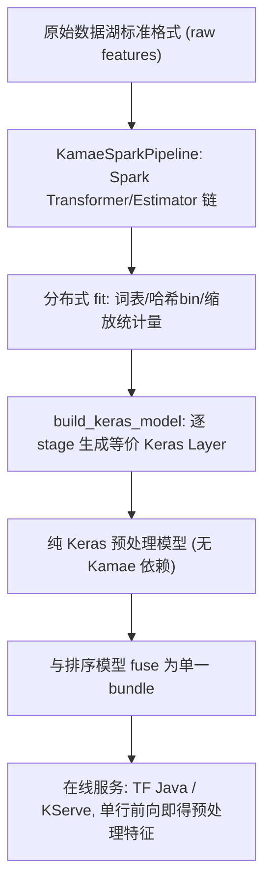

# Kamae: Bridging Spark and Keras for Seamless ML Preprocessing (打通 Spark 与 Keras 的无缝 ML 预处理)

- **会议/期刊**: RecSys 2025 (19th ACM Conference on Recommender Systems, Prague)
- **作者与机构**: George Barrowclough, Marian Andrecki, James Shinner, Daniele Donghi（Expedia Group Relevance/Ranking 团队）
- **推荐链路定位**: 特征工程层（横跨离线训练与在线推理，服务于召回/精排模型）
- **研究方向**: 协同过滤与双塔召回 / 工业架构与训练-服务一致性
- **论文原文**: [https://arxiv.org/abs/2507.06021v1](https://arxiv.org/abs/2507.06021v1)
- **开源代码**: [https://github.com/ExpediaGroup/kamae](https://github.com/ExpediaGroup/kamae)（Apache License 2.0）

## TL;DR (1分钟核心速览)

推荐系统生产环境的核心痛点是**训练-服务偏斜 (training-serving skew)**：离线用 Spark 做分布式特征工程，在线却要用另一套语言/框架重写同样的变换逻辑，导致代码重复、维护成本高、且极易产生 dataset shift。Kamae 提出一套与 Spark Transformer/Estimator 一一对应的 Keras Layer，把已 fit 的 Spark 管线**无损翻译**为纯 Keras 模型（可再与打分模型融合成单一 bundle），从而在推理端用同一份计算图复现离线预处理。在 Expedia 搜索过滤器 Learning-to-Rank 生产管线（约 60 个链式变换、200 QPS）上替换 MLeap 后，服务延迟降低 **61%**、服务成本降低 **58%**，并彻底移除 Scala 依赖。

## Background & Motivation (背景与核心矛盾)

- **主流范式**: 大数据场景下离线特征工程几乎必然依赖 Spark 分布式管线（`StringIndexer`、`OneHotEncoder`、`StandardScaler` 等），模型训练则在 Python/Keras 侧完成；在线推理通常通过 API 接收原始特征，需在服务环境内重新生成预处理后特征。
- **前人局限**: 现有两条路各有硬伤——(1) **手工重写变换**：推理时通常只有单行数据，列级变换尚可复刻，但依赖全局统计量（词表、均值方差、分位数）的 estimator 类变换难以正确重建，且常由不熟悉模型的工程师用另一门语言实现，重复代码 + 偏差风险；(2) **Feature Store 回查**：需额外基础设施与更新调度，并引入检索延迟惩罚。
- **核心洞察 (Key Insight)**: 预处理本质上是**一张确定性的计算图**——Spark 管线 fit 之后，其变换语义（词表映射、哈希分桶、缩放参数）完全固化，因此理论上可以被等价表达为另一套前向计算图，而 Keras Layer 正是最自然的载体。
- **本文切入点**: 不做"重新实现"，而做"**结构化翻译**"：让每个 Spark 变换自带一个 `build_keras_layer()`，把 fit 得到的参数（词表、bin 边界、OOV 索引）注入对应 Keras 层，实现离线/在线同一份逻辑。

## Method (核心方法设计)

### 1. 整体框架 (Overall Architecture)

用户以 Spark API 风格声明 `KamaeSparkPipeline(stages=[...])`，每个 stage 是 Kamae 提供的 Transformer（数学/字符串/日期/地理/逻辑/数组/列表/条件运算）或 Estimator（String/Hash/Bloom/Shared 索引、Standard Scaling、Imputation）。管线在 Spark 上分布式 `fit` 得到全局统计量，随后 `build_keras_model(tf_input_schema)` 依据输入 schema 逐 stage 生成等价 Keras 层并串联为 `tf.keras.Model`；该模型可独立导出（不依赖 Kamae 包），也可与下游排序网络**融合为单一 bundle**，在 TensorFlow Java / KServe 等标准服务栈中执行。所有变换均用 Spark 原生 transformation 而非 UDF 实现，以保留 Catalyst 优化器对执行计划的优化能力。

### 2. 关键设计拆解 (Key Designs)

1. **Spark↔Keras 一对一算子映射（核心贡献）**：痛点是 estimator 类变换的全局状态无法在推理端重建。Kamae 让每个 stage 在 fit 后把状态固化为常量张量注入 Keras 层，例如字符串索引层的前向即查表：
$\mathbf{z} = \mathbf{E}_{\text{vocab}}[\mathbf{x}],\quad \mathbf{E}_{\text{vocab}}[i]=\begin{cases}\text{idx}(w_i), & w_i\in\mathcal{V}\\ \text{OOV}, & \text{otherwise}\end{cases}$其中$\mathcal{V}$ 按 `frequencyDesc` 排序、`numOOVIndices` 控制未登录词槽位。由于映射表是常量，离线与在线对同一原始输入必然产出同一索引，**从机制上消除 skew**，而非靠测试去"发现" skew。

2. **高基数类目的多级索引策略**：痛点是真实业务中 UserID/Query 类特征基数可达千万级，完整词表既占内存又难维护。Kamae 提供三档方案：`HashIndexTransformer` 用 $h(w)=\text{hash}(w)\boldsymbol{o}d B$映射到$B$个 bin（示例取$B=10^4$，以可控碰撞换内存）；`BloomEncoder` 对同一 key 施加多次哈希，实现高基数类目的内存高效编码；`SharedStringIndexer` 让多特征共享同一词表。三者均为纯确定性函数，天然可在 Keras 侧复现。

3. **嵌套序列原生支持与超参联合调优**：Expedia 的 LTR 场景中，一个 query 对应一个候选列表，每个候选又携带列表型特征（如 amenities）。Kamae 支持 element-wise（保维）与 sequence-level（聚合）两种作用粒度，例如先 `StringToStringListTransformer` 按分隔符切分并 pad 到固定长度 6，再对每个元素独立做 `StringIndexEstimator`，得到 padded 整数序列。此外，导出的预处理层可与主模型 fuse 后用 **Keras Tuner** 联合搜索哈希 bin 数、embedding 维度、分桶阈值等预处理超参，把特征工程从"人工拍脑袋"变为可优化对象。

## Experimental Setup & Evaluation Protocol (实验设置与评估协议)

本文是 **RecSys 2025 系统/资源类短文（4 页）**，定位为开源工具论文，**不含传统推荐精度 benchmark**（无 NDCG/HR 主表、无数据划分与负采样协议），评估以**功能等价性验证 + 生产环境量化收益**为主：

- **等价性验证协议**: 以 MovieLens 数据集构建最小管线（Hash 索引 UserID、String 索引 MovieID、Occupation 的 One-Hot、Genres 切分+索引），对 Spark 输出与 Keras 输出做逐元素比对；库内以**大量单元测试**保证每个变换的 Spark/Keras 数值一致性（parity）。
- **生产评估场景**: Expedia 酒店搜索的**搜索过滤器排序 (Learning-to-Rank)** 模型，管线含约 **60 个链式变换**（日期拆解、时长相减、对数变换、分隔符切分、数组组装→Standard Scaling→拆回、类目索引等），线上以 Java chassis 加载融合 bundle，平均 **200 QPS**。
- **对比基线**: 迁移前的 **MLeap**（Scala 实现、UDF 为主、需 JVM Runtime 执行 `Bundle.ML`）。
- **评估指标**: 服务延迟（latency）与服务成本（cost），以及代码库复杂度（是否保留 Scala 依赖）。

| 维度 | MLeap（迁移前） | Kamae + TF Java（迁移后） | 变化 |
| :--- | :---: | :---: | :---: |
| 实现语言 | Scala（UDF 为主，绕过 Catalyst） | Python（原生 transformation） | 移除 Scala 依赖 |
| 推理运行时 | JVM + MLeap Runtime | TensorFlow Java（后续迁 KServe） | 标准化服务栈 |
| 序列化格式 | 自定义 `Bundle.ML` | 标准 Keras bundle | 生态兼容性提升 |
| 服务延迟 | 基线 | — | **↓ 61%** |
| 服务成本 | 基线 | — | **↓ 58%** |
| 吞吐 | — | 200 QPS | 生产可承载 |

### 消融/对比分析

由于是系统论文，无组件消融表；其"消融"体现为**与最接近方案的定性对比**：

| 方案 | 分布式计算 | 推理需 JVM | 嵌套数组特征 | 预处理超参可调 |
| :--- | :---: | :---: | :---: | :---: |
| Scikit-learn Pipeline | ✗ | ✗ | 有限 | ✓ |
| MLeap | ✓ | ✓ | 有限 | ✗ |
| **Kamae** | ✓ | ✗ | ✓ | ✓（Keras Tuner） |

### 关键实验发现 (Key Findings)

1. **延迟与成本的双降来自"运行时替换"而非"算子优化"**：61% 延迟下降与 58% 成本下降是在同一份预处理语义下、仅把执行栈从 MLeap/JVM 换成 Keras/TF Java 得到的，说明**统一到主流 DL 服务栈**本身即带来显著工程红利，且迁移到 KServe 后预期还有进一步收益。
2. **等价性由构造保证，而非由测试兜底**：因为 Keras 层直接消费 Spark fit 出的常量状态（词表、bin 边界、缩放参数），离线/在线对同一原始输入的计算路径完全一致，这比"写两套代码 + 单元测试比对"在根本上更可靠——后者只能发现偏差，前者从机制上不产生偏差。
3. **嵌套序列支持是 LTR 场景的刚需**：Expedia 管线中列表型特征（候选列表 × 每项的 amenities 列表）若无法 element-wise 索引与 padding，则约 60 个变换中的序列部分必须回退到手写逻辑，Kamae 的 sequence-native 设计是该管线能被完整翻译的前提。

## Highlights & Limitations (亮点、对比与审稿批判)

- **与代表作对比 (vs. Prior Work)**: 与 **MLeap** 的本质区别在于——MLeap 用 Scala UDF 实现变换（阻断 Catalyst 优化）、推理必须拖一个 JVM 与私有 `Bundle.ML` 格式；Kamae 用 Python 原生 transformation、导出标准 Keras bundle、推理零 JVM 依赖。与 **Scikit-learn Pipeline** 的区别在于后者不支持分布式计算，无法处理大数据湖级别的特征工程。
- **可迁移亮点**: (1) "**fit 状态固化为常量张量**"这一思路可推广到任何跨引擎特征一致性场景（如 Flink→ONNX、SQL→TorchScript）；(2) 把预处理层纳入 **Keras Tuner** 搜索空间，使哈希 bin 数、OOV 槽位等原本靠经验的超参变为可端到端优化，这一"预处理即模型层"的视角对工业特征平台设计有直接借鉴价值。
- **审稿级局限批判**: (1) **评估偏薄**：全文无推荐精度指标，无法回答"预处理等价性是否真的改善了模型效果"，61%/58% 的收益是纯工程指标且缺少方差/多次测量与基线配置细节；(2) **生态覆盖有限**：当前仅支持 TensorFlow 后端，JAX/PyTorch 尚在 future work，变换库对 tokenization、分位数分桶等常用算子仍缺失，且 Keras 侧对 Spark 复杂类型（MapType、嵌套 Struct）的覆盖度未讨论；(3) 作为 4 页短文，缺少与 MLeap 在**同等变换集**下的公平 micro-benchmark。

## Rating (四维评分)

- **方法创新性 (Novelty)**: ⭐⭐⭐ （"管线翻译"思路朴素但工程价值明确，一对一算子映射 + 状态固化是扎实的系统贡献，非算法层面创新）
- **评估协议与实验扎实度 (Protocol & Experiments)**: ⭐⭐⭐ （有真实生产 200 QPS 与双位数收益，但无精度实验、无统计显著性、无公平 micro-benchmark）
- **写作与数学规范度 (Clarity & Rigor)**: ⭐⭐⭐⭐ （4 页短文结构清晰、代码清单直观、与 MLeap/sklearn 的差异对比到位，公式极少但表述准确）
- **工业落地与复现价值 (Industrial & Practical Value)**: ⭐⭐⭐⭐⭐ （Apache 2.0 开源、pip 可装、已在 Expedia 生产验证，直接解决训练-服务偏斜这一普遍痛点，复现与落地门槛极低）

