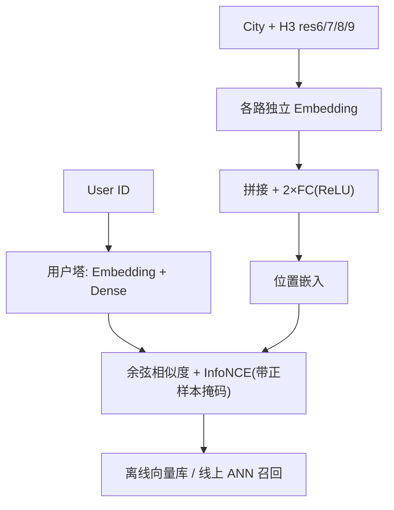
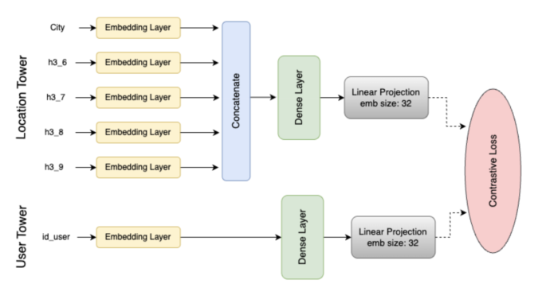

# Location Matters: Leveraging Multi-Resolution Geo-Embeddings for Housing Search (位置至关重要：面向房源搜索的多分辨率地理嵌入)

- **会议/期刊**: RecSys 2025 (Industry Track)
- **作者与机构**: Ivo Silva, Pedro Nogueira, Guilherme Bonaldo（QuintoAndar，拉美最大房产平台）
- **推荐链路定位**: 召回（item-item 相似房源模块）
- **研究方向**: 协同过滤与双塔召回 / 冷启动与长尾推荐（地理稀疏）
- **论文原文**: [https://arxiv.org/abs/2510.01196v1](https://arxiv.org/abs/2510.01196v1)
- **开源代码**: 暂未开源

## TL;DR (1分钟核心速览)

房产推荐中单一细粒度地理单元（H3 res-9）导致严重物品稀疏，且用户搜索常跨街区、按"海滩/地铁/安全"等属性而非邻接关系选房。本文在双塔架构中把城市名与 H3 res 6–9 四级六边形网格分别嵌入后拼接，经两层 MLP 融合为位置向量，用带正样本掩码的 InfoNCE 训练。在 QuintoAndar 真实高意向交互（预约看房/出价）上，嵌入信息丰度 IA 从 6.0 升至 21.7，离线重排模拟的租金转化率从 3.2% 提升至 10.9%（相对 +241%），较单分辨率双塔再提升 85%。

## Background & Motivation (背景与核心矛盾)

- **主流范式**: 工业房源推荐普遍用 ID 类特征（用户 ID、城市、最细粒度地理格）喂入 MF 或双塔，地理信息完全交由隐向量自行涌现。
- **前人局限**: ① 任一窄地理边界内房源数量天然有限且分布极不均，细粒度格上物品稀疏到无法学到可靠向量；② 用户搜索行为跨越相邻街区，按"近海滩、近医院、近公交、安全、价位"等属性选房，纯邻接/纯 ID 表征无法表达这种"非邻接但同质"的空间语义。
- **核心洞察 (Key Insight)**: 对近 800 名用户的调研显示 **超过 50% 将位置列为租房决策第一要素**，但现有推荐器即便拿到多个地理特征也未能有效利用；作者进一步用嵌入协方差矩阵的奇异值谱诊断，发现单分辨率模型的谱衰减过快（少数维度垄断方差），即表征塌缩。
- **本文切入点**: 用 H3 六边形层级网格的**多分辨率**结构天然对应"城市—大区—街区—门牌"的语义层级，把粗粒度格的统计共享能力与细粒度格的定位精度同时注入同一位置向量。

## Method (核心方法设计)

### 1. 整体框架 (Overall Architecture)

模型为双塔结构：用户塔仅输入 User ID，经嵌入层与若干稠密层得到用户向量；位置塔（item 侧）接收 City 与 H3 res 6/7/8/9 共 5 路离散 ID，各自过独立嵌入层后拼接，再经两层带 ReLU 的全连接层压缩为最终位置嵌入。两塔向量做内积/余弦相似度，以 InfoNCE 对比损失训练，batch 内负采样并施加正样本掩码。推理时位置向量离线预计算入向量库，线上仅需用户塔前向 + ANN 检索，与标准双塔召回开销一致。

<figure class="paper-figure" markdown="span">
  <figcaption>图1：双塔多分辨率模型架构。</figcaption>
</figure>

### 2. 关键设计拆解 (Key Designs)

1. **多分辨率 H3 层级嵌入（Multi-Resolution H3 Embedding）**：痛点是最细格 res-9（约 0.01 km²）样本极稀、粗格又丢失定位精度。做法是对同一经纬度同时取 res 6（约 43 km²）至 res 9 的 64-bit 六边形 ID，各设独立嵌入表 $\mathbf{e}_{r}=\mathrm{Emb}_{r}(\text{h3}_{r}),\ r\in\{6,7,8,9\}$，与城市嵌入拼接：
   $$\mathbf{z}_{\text{loc}}=\mathrm{MLP}\big([\mathbf{e}_{\text{city}};\mathbf{e}_{6};\mathbf{e}_{7};\mathbf{e}_{8};\mathbf{e}_{9}]\big)$$
   直觉上，粗粒度格在大量房源间共享统计量，为稀疏细格提供"父级先验"；细格则保留精确定位，二者互补直接缓解冷启动稀疏。H3 的六边形结构还保证邻接一致性（每个格有 6 个等距邻居），优于经纬度网格的角点歧义。
2. **带正样本掩码的 InfoNCE 对比损失**：痛点在于 batch 内负采样会把"用户已交互过的其他房源"误当负样本，污染梯度。做法是在相似度矩阵上构造掩码 $\mathbf{M}$，对已知正样本对（含非对角项）置零梯度：
   $$\mathcal{L}=-\log\frac{\exp(s(u,i^{+})/\tau)}{\sum_{j}\mathbb{I}\big[\mathbf{M}_{uj}=0\big]\exp(s(u,j)/\tau)}$$
   其中 $s(\cdot)$为余弦相似度，$\tau$ 为温度。该掩码使模型只对"真未交互"位置施加排斥，避免假阴性，是双塔对比召回在小 batch 场景下的必要修正。
3. **训练配置与推理效率**：嵌入维度 $d=32$，Xavier 均匀初始化，Adam（lr=0.001），batch=512，训练 15 epoch，PyTorch Lightning 实现。位置塔完全离线可预计算，线上无额外延迟；对比基线 MF 用 ALS 求解隐反馈，仅输入 res-9 格 ID。

## Experimental Setup & Evaluation Protocol (实验设置与评估协议)

- **数据集与预处理**: 取自平台 2022-01-01 至 2024-12-31 的真实交互，**仅保留高意向事件**（预约看房、提交租赁报价），剔除点击等低意向噪声信号。特征集为 User ID、City、H3 res 6–9 格索引。

| 数据集 | #Users | #Items | #Interactions | 稀疏度/密度 | 特征/场景说明 |
| :--- | :---: | :---: | :---: | :---: | :--- |
| QuintoAndar 生产日志 | 未披露 | 未披露（按 H3 格计） | 未披露（高意向事件） | 极稀疏（窄地理边界内房源有限） | 巴西多城市房源；User ID + City + H3 res6–9 |

- **数据划分与防穿越 (Splitting Strategy)**: 原文未明确给出训练/验证/测试比例与时间切分细节（工业短文，4 页），仅说明训练集覆盖 2022–2024 交互；外延评估另取 **2025 年 3 月**一个月生产日志，与训练期不重叠，属时间外推评估。
- **排名评测协议 (Ranking Protocol)**: 非传统 Full-Ranking 指标，而是**内在 + 外延双轨**：内在用信息丰度 IA（Guo et al.）与归一化嵌入协方差矩阵的奇异值谱衰减速度；外延在"相似房源"item-item 模块上，对基线原始 top-$N$结果按锚点与候选的地理嵌入余弦相似度设阈值$\tau$ 逐级剪枝，统计**租金转化率**（产生看房/报价的推荐数 ÷ 总推荐数）。
- **对比基线与超参设置**: 三类模型——隐反馈 MF（ALS，仅 res-9）、单分辨率双塔（仅 res-9）、多分辨率双塔（City + res 6–9）；嵌入维度统一 $d=32$。原文未报告显著性检验。

## Key Experimental Results (实验关键数据)

### 1. 主实验对比 (Main Results)

| 模型 | 信息丰度 IA ↑ | 平均租金转化率 uplift (%) ↑ | 相对 MF 提升 |
| :--- | :---: | :---: | :---: |
| Matrix Factorization (ALS, res-9) | 6.0 | 3.2 | — |
| Two-tower (H3 res-9) | 15.5 | 5.9 | IA +158%，转化 +84% |
| **Two-tower Multi-Resolution** | **21.7** | **10.9** | **IA +262%，转化 +241%** |
| Improv.（多分辨率 vs 单分辨率） | +40% | **+85%** | — |

### 2. 消融实验 (Ablation Study)

原文未设标准消融表，但通过"单分辨率 vs 多分辨率"与"相似度阈值 $\tau$ 逐级剪枝"构成等价消融：

| 配置 | IA | 转化率 (%) | 说明 |
| :--- | :---: | :---: | :--- |
| MF（无神经塔，仅 res-9） | 6.0 | 3.2 | 地理信息全靠隐因子涌现 |
| 双塔 w/o 多分辨率（仅 res-9） | 15.5 | 5.9 | 换架构的增益 |
| 双塔 w/o 城市嵌入（隐含对比） | — | — | 原文未单列，属局限 |
| **双塔 + City + res6–9（完整）** | **21.7** | **10.9** | 完整模型 |
| 按 $\tau$ 剪枝（图 3 曲线） | — | 随保留率下降而单调上升 | 验证嵌入相似度可作相关性代理 |

### 3. 关键实验发现 (Key Findings)

1. **架构与地理粒度各自贡献可分离**：从 MF 到单分辨率双塔，IA 涨 158%、转化涨 84%，说明对比学习双塔本身已显著优于 ALS；而多分辨率再带来 IA +40%、转化 +85%，证明**地理层级信息是独立于架构的第二增长源**，且对业务指标的边际收益甚至高于换架构。
2. **谱衰减变缓 = 表征更均衡**：图 2 显示多分辨率模型的 $\log(\sigma_i)$ 衰减最平缓，方差在 32 维上分布更均匀，直接对应"塌缩检测"指标改善——这解释了为何下游重排更稳，而非单纯维度膨胀。
3. **嵌入相似度可作线上剪枝信号**：图 3 中随保留率下降，多分辨率曲线始终最高，说明按地理嵌入余弦相似度剔除低相关候选能在牺牲少量曝光的同时显著抬升转化，为线上重排提供低成本可解释的过滤算子。

## Highlights & Limitations (亮点、对比与审稿批判)

- **与代表作对比 (vs. Prior Work)**: 相较经典 MF（BPR/ALS 隐反馈），本文不改协同过滤内核，而是**重构 item 侧特征工程**，用层级网格替代单一 ID；相较常规双塔召回（如 YouTube DNN 式 ID 嵌入），本文的关键差异是把"空间层级先验"显式编码进位置塔，而非依赖模型自行从稀疏交互中涌现地理结构。
- **可迁移亮点**: ① H3 多分辨率拼接是**零额外线上开销**的通用技巧，可直接迁移到 POI、本地生活、外卖等任何带经纬度的召回场景；② 用"嵌入协方差奇异值谱 + 信息丰度"做内在质量诊断，比只看离线 AUC 更能提前发现表征塌缩。
- **审稿级局限批判**: ① **评估偏弱**——全文仅 3 个模型、无标准 ranking 指标（Recall/NDCG）、无显著性检验，且"租金转化 uplift"来自离线重排模拟而非在线 A/B，结论强度有限；② **消融不完整**——未单独剥离城市嵌入与各分辨率层的贡献，也未报告不同 $\tau$ 下的曝光损失权衡；③ 数据集规模与稀疏度统计未披露，复现性受限。

## Rating (四维评分)

- **方法创新性 (Novelty)**: ⭐⭐⭐ （多分辨率 H3 拼接思路朴素但贴合房产场景，缺乏理论推导，胜在工程直觉清晰）
- **评估协议与实验扎实度 (Protocol & Experiments)**: ⭐⭐ （仅 3 模型对比、无标准 ranking 指标与显著性检验，外延评估为离线模拟，在线 A/B 留作未来工作）
- **写作与数学规范度 (Clarity & Rigor)**: ⭐⭐⭐ （4 页工业短文结构清楚、公式简洁，但数据统计与超参敏感性披露不足）
- **工业落地与复现价值 (Industrial & Practical Value)**: ⭐⭐⭐⭐ （位置塔离线预计算、线上零额外延迟，已在拉美最大房产平台验证，迁移成本极低）

