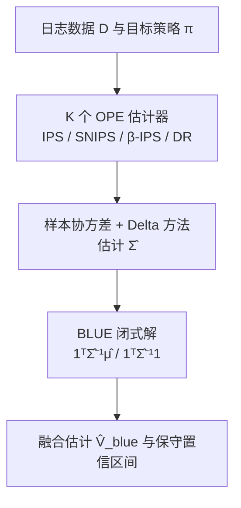

# Meta Off-Policy Estimation (元离策略估计)

- **会议/期刊**: RecSys 2025
- **作者与机构**: Olivier Jeunen (aampe, Antwerp, Belgium)
- **推荐链路定位**: 离线评估（Off-Policy Evaluation，服务于召回/排序策略的线上价值预估）
- **研究方向**: 协同过滤与双塔召回 / 去偏公平与工业架构
- **论文原文**: [https://arxiv.org/abs/2508.07914v1](https://arxiv.org/abs/2508.07914v1)
- **开源代码**: [https://github.com/olivierjeunen/meta-ope-recsys-2025](https://github.com/olivierjeunen/meta-ope-recsys-2025)

## TL;DR (1分钟核心速览)

离策略估计（OPE）领域已有 IPS、SNIPS、$\beta$-IPS、DR 等众多估计器，但实践中缺乏选择依据，且各自方差偏高。本文跳出"改进单个估计器"的思路，把$K$个估计器及其置信区间视为共享同一日志数据的**相关研究**，用固定效应元分析框架求最佳线性无偏估计（BLUE），并借助 Delta 方法给出比值型估计器（SNIPS）的协方差闭式解。在 Open Bandit Dataset 上，融合估计的置信区间宽度降至最优单估计器（DR）的 47%，等价于日志数据量扩大 4 倍，额外计算仅为一次$K\times K$ 矩阵求逆。

## Background & Motivation (背景与核心矛盾)

- **主流范式**: 将推荐视为决策问题，用 IPS 类加权或 DM/DR 类价值模型，从日志数据 $\mathcal{D}=\{(x_i,a_i,r_i)\}_{i=1}^N$无偏估计目标策略价值$V(\pi)=\mathbb{E}_{a\sim\pi(\cdot|x)}[r]$。
- **前人局限**: 其一，IPS 无偏但方差爆炸，SNIPS/$\beta$-IPS 用控制变量降方差却仍受有效样本量制约；其二，DM 低方差但几乎必然有偏，DR 的实用增益并不稳定（文献已报告 DR 未必优于 IPS）；其三，面对众多估计器，从业者**缺乏选择准则**，只能凭经验挑一个。
- **核心洞察 (Key Insight)**: 不同估计器利用日志数据中**互补的信号**（IPS 的权重结构、DM 的奖励外推、SNIPS 的自归一化），且它们的误差因共享数据而**相关**——这正是元分析中"相关观测线性组合"的经典设定，可被显式建模而非回避。
- **本文切入点**: 不发明新估计器，而是把已有估计器当作"研究结果"做固定效应元分析，求方差最小的线性无偏组合。

## Method (核心方法设计)

### 1. 整体框架 (Overall Architecture)

输入是一组在**同一份日志数据**上计算出的 $K$个 OPE 估计值$\hat{\boldsymbol{\mu}}=(\hat{V}_1(\pi),\dots,\hat{V}_K(\pi))^\top$及其$K\times K$协方差矩阵$\hat{\boldsymbol{\Sigma}}$；核心模块是 BLUE 闭式解，输出单一融合估计$\hat{V}_{\text{blue}}$ 与反映估计器间相关性的高斯置信区间；训练/推理无需任何超参数，仅需一次矩阵求逆。对 SNIPS 这类比值估计器，额外用 Delta 方法补全其与其余估计器的协方差项，使其可被纳入融合。

### 2. 关键设计拆解 (Key Designs)

1. **BLUE 融合算子（把"选估计器"变成"加权组合"）**：痛点是单估计器方差高、选择无依据。本文在权重和为一的约束下最小化组合方差，得到闭式解

$$\hat{V}_{\text{blue}}(\pi)=\frac{\mathbf{1}^\top\hat{\boldsymbol{\Sigma}}^{-1}\hat{\boldsymbol{\mu}}}{\mathbf{1}^\top\hat{\boldsymbol{\Sigma}}^{-1}\mathbf{1}},\qquad \widehat{\mathrm{Var}}\big(\hat{V}_{\text{blue}}(\pi)\big)=\frac{1}{\mathbf{1}^\top\hat{\boldsymbol{\Sigma}}^{-1}\mathbf{1}}.$$

直觉：$\hat{\boldsymbol{\Sigma}}^{-1}$自动给高方差、高相关的估计器降权，给信息独立且低方差的估计器升权；由期望线性性，输入无偏则输出无偏，且方差上界不超过最低方差的输入估计器。置信区间为$\hat{V}_{\text{blue}}\pm z_{1-\alpha/2}\sqrt{\widehat{\mathrm{Var}}(\hat{V}_{\text{blue}})}$。

2. **比值估计器的协方差（Delta 方法补全 $\hat{\boldsymbol{\Sigma}}$）**：SNIPS 是$\hat{V}_{\text{IPS}}/\hat{V}_{\text{SN}}$的比值，无法直接用样本协方差。本文对$V_{\text{SNIPS}}$做一阶泰勒展开，梯度为$\nabla V_{\text{SNIPS}}=[1/\hat{V}_{\text{SN}},\ -\hat{V}_{\text{IPS}}/\hat{V}_{\text{SN}}^2]^\top$，从而得到渐近无偏协方差

$$\mathrm{Cov}\big(\hat{V}_{\text{SNIPS}},\hat{V}\big)\approx\frac{1}{\hat{V}_{\text{SN}}}\mathrm{Cov}\big(\hat{V}_{\text{IPS}},\hat{V}\big)-\frac{\hat{V}_{\text{IPS}}}{\hat{V}_{\text{SN}}^2}\mathrm{Cov}\big(\hat{V}_{\text{SN}},\hat{V}\big).$$

这一步是让 SNIPS 能进入 BLUE 融合的关键——否则只能融合 IPS/$\beta$-IPS/DR 这类样本均值型估计器。

3. **训练目标、负采样与推理效率**：本文无训练损失、无负采样（纯统计估计框架）。计算开销为一次 $K\times K$矩阵求逆加若干矩阵-向量乘，$K$ 通常为 3–5，相对 OPE 本身的数据扫描可忽略；且运算全可微，为未来扩展到离策略**学习**目标（直接优化方差）留出接口。

## Experimental Setup & Evaluation Protocol (实验设置与评估协议)

- **数据集与预处理**: 采用两类评估环境——(i) 可复现合成模拟（高斯策略 $\pi_0=\mathcal{N}(0,1)$、$\pi=\mathcal{N}(\Delta\mu,1)$，奖励$\mathcal{N}(a,1)$，奖励模型$\hat{r}(a)\sim\mathcal{N}(a+0.0025,2)$ 注入噪声以产生非退化区间，28 个随机种子）；(ii) 真实日志数据 Open Bandit Dataset（ZOZOTOWN，top-3 推荐列表，随机策略记录、Bernoulli Thompson Sampling 为目标策略，倾向分由蒙特卡洛估计）。

| 数据集 | #Users | #Items | #Interactions | 稀疏度/密度 | 特征/场景说明 |
| :--- | :---: | :---: | :---: | :---: | :--- |
| Synthetic | — | — | $10^4\sim10^6$ 可调 | — | 非上下文高斯 bandit，可干预样本量与策略散度 |
| Open Bandit (Men's) | — | — | ZOZOTOWN 真实日志 | — | 上下文特征、动作、倾向分、奖励齐备 |

- **数据划分与防穿越 (Splitting Strategy)**: 非传统训练/测试划分；采用**日志策略 $\pi_0$数据估计、目标策略$\pi$数据做蒙特卡洛真值**的离策略协议，真值$V(\pi)$由$\pi$ 下采集的数据独立估计，避免信息泄漏。
- **排名评测协议 (Ranking Protocol)**: 非 Full-Ranking / Sampled Ranking 排序指标，而是**估计精度协议**：以真值 $V(\pi)$为基准，报告估计误差$|\hat{V}-V|$、方差、置信区间覆盖率，并统一为单一指标——真值在估计器高斯区间下的对数似然$\mathrm{LL}(V(\pi))$；真实数据上报告 99% 置信区间宽度。
- **对比基线与超参设置**: 基线为 IPS、SNIPS、$\beta$-IPS、DM、DR 五类经典估计器；DM/DR 的奖励模型用随机森林分类器；无学习率等超参，BLUE 无任何可调超参。

## Key Experimental Results (实验关键数据)

### 1. 主实验对比 (Main Results)

Open Bandit Dataset（Men's campaign）上各估计器的 99% 置信区间与真值对比（数值为区间宽度相对量级，原文以图 3 呈现）：

| 估计器 | 偏差性质 | 99% CI 宽度（相对） | 是否覆盖真值 $V(\pi)$ | 备注 |
| :--- | :--- | :---: | :---: | :--- |
| IPS | 无偏 | 宽 | 是 | 方差最大 |
| SNIPS | 渐近无偏 | 较宽 | 是 | 乘性控制变量 |
| $\beta$-IPS | 无偏 | 较宽 | 是 | 加性控制变量 |
| DM | 有偏 | 窄 | 否（系统性偏移） | 区间过度自信 |
| DR | 无偏 | 基准（最低方差输入） | 是 | 随机森林奖励模型 |
| **BLUE (本文)** | **无偏** | **47%（相对 DR）** | **是** | **误差最小、区间最紧** |

合成模拟中，BLUE 在 $\Delta\mu\in\{0.25,\dots,1.50\}$六档散度、$10^4\sim10^6$样本量下**多数设置取得最高$\mathrm{LL}(V(\pi))$**：低散度时逼近最优的$\beta$-IPS，高散度小样本时逼近最优的 DM，体现"自动识别最优成分"的能力。

### 2. 消融实验 (Ablation Study)

在 Open Bandit 上从 BLUE 的输入集合中逐一剔除估计器（图 4）：

| 配置 | 区间紧致度 | 估计误差 | 说明 |
| :--- | :---: | :---: | :--- |
| BLUE{SNIPS, $\beta$-IPS, DR} | **最优** | **最低** | 完整配置 |
| w/o $\beta$-IPS | 变差 | 上升 | 影响最大 |
| w/o DR | 略变差 | 略上升 | 影响最小 |
| w/o SNIPS | 变差 | 上升 | 有限样本下波动增大 |

### 3. 关键实验发现 (Key Findings)

1. **方差收益等价于 4 倍数据**: 真实数据上 BLUE 区间宽度降至最低方差输入（DR）的 47%，作者指出这相当于日志数据量扩大 4 倍，而额外开销仅一次 $K$ 维矩阵求逆——对日志稀缺的工业场景价值极高。
2. **融合不是简单插值**: BLUE 的均值并非输入的凸组合插值，而是借助协方差结构 $\hat{\boldsymbol{\Sigma}}$ 把估计推向真值，说明"相关性建模"本身携带了超出各估计器均值的信息。
3. **有偏输入会传染**: 当 DM 的偏差主导误差（约 $10^6$样本处的拐点），其过度自信的窄区间会拖累 BLUE——因为 BLUE 方差上界由最低方差输入决定；这提示实践中应优先纳入渐近无偏的互补估计器（$\beta$-IPS、SNIPS、DR），谨慎纳入 DM。

## Highlights & Limitations (亮点、对比与审稿批判)

- **与代表作对比 (vs. Prior Work)**: 与 IPS/SNIPS/$\beta$-IPS/DR 等**单估计器**路线不同，本文不改进任何单个估计器，而是在其上层做元融合；与同期工作 OPERA 用迭代 bootstrap 近似优化 MSE 不同，本文给出**无超参数的闭式解**并用 Delta 方法精确导出协方差，具备频率学派的覆盖率保证。
- **可迁移亮点**: (i) "把多个评估指标/多个离线模型当作相关研究做 BLUE 融合"可直接迁移到 A/B 实验多指标联合判定与多模型离线评测聚合；(ii) Delta 方法处理比值型指标的协方差，可复用于 CTR/CVR 等比率型业务指标的置信区间构造。
- **审稿级局限批判**: (i) 合成实验为非上下文高斯 bandit，估计器间信息异质性有限，BLUE 相对 $\beta$-IPS 的增益在该设定下并不显著，真实场景的收益幅度仍待更多数据集验证；(ii) 方法依赖输入估计器（渐近）无偏，一旦混入 DM 这类有偏且过度自信的估计器，融合结果的覆盖率保证即失效，而实践中如何自动甄别"可信输入"并未给出准则。

## Rating (四维评分)

- **方法创新性 (Novelty)**: ⭐⭐⭐⭐ （跨领域借用元分析 + BLUE 闭式解，思路简洁但非全新算子，胜在视角转换与 Delta 协方差的严谨补全）
- **评估协议与实验扎实度 (Protocol & Experiments)**: ⭐⭐⭐⭐ （合成 + 真实 OBD 双环境、28 种子、含消融，但真实数据仅一个 campaign 详细展示，基线数量有限）
- **写作与数学规范度 (Clarity & Rigor)**: ⭐⭐⭐⭐⭐ （6 页短文，公式推导从约束优化到 Delta 方法一气呵成，符号统一、无冗余）
- **工业落地与复现价值 (Industrial & Practical Value)**: ⭐⭐⭐⭐⭐ （无超参、开销可忽略、代码全开源，可直接嵌入现有 OPE 流水线，对日志稀缺场景收益显著）

