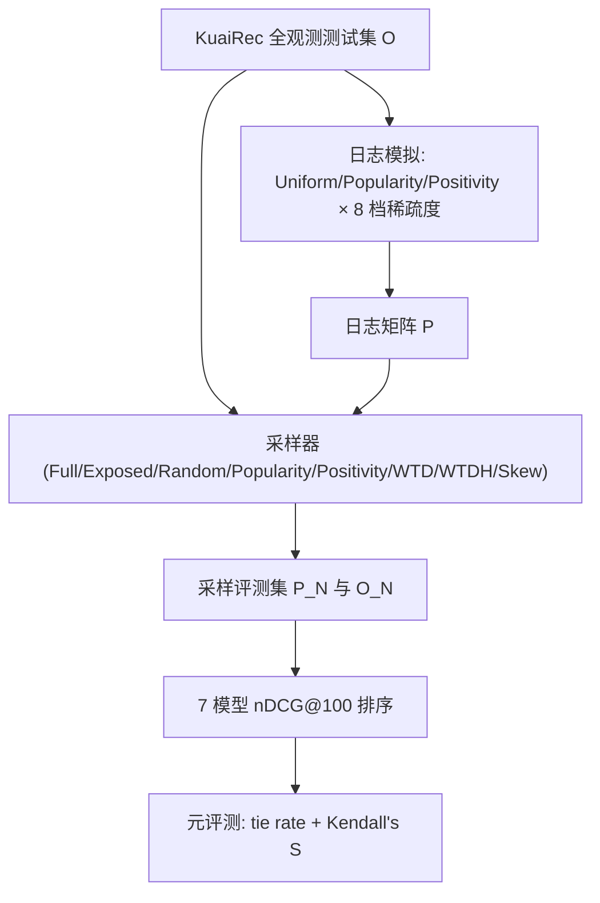

# On the Reliability of Sampling Strategies in Offline Recommender Evaluation (离线推荐评测中采样策略的可靠性研究)

- **会议/期刊**: RecSys 2025
- **作者与机构**: Bruno L. Pereira, Rodrygo L. T. Santos (UFMG), Alan Said (University of Gothenburg)
- **推荐链路定位**: 离线评测协议（服务于召回/排序模型的模型选择与对比）
- **研究方向**: 协同过滤与双塔召回 / 去偏公平与工业架构
- **论文原文**: [https://arxiv.org/abs/2508.05398v2](https://arxiv.org/abs/2508.05398v2)
- **开源代码**: [https://github.com/LatinUFMG/recommenders-sampling](https://github.com/LatinUFMG/recommenders-sampling)

## TL;DR (1分钟核心速览)

离线评测同时受**曝光偏差**（用户只与曝光物品交互）与**采样偏差**（top-L 指标只在负样本子集上计算）双重污染，但既有工作多在固定日志上孤立评估采样器，且把日志本身当真值。本文以 KuaiRec 全观测测试集构造真值偏好矩阵 $O$，模拟 3 种日志策略 × 8 档稀疏度 × 63 种采样器共 1,512 个评测场景，沿分辨率、保真度、鲁棒性、预测力四维做元评测。结论：采样器表现高度依赖与曝光过程的交互，WTD/WTDH/Skew 等偏差感知策略在$R\approx200$时 Kendall's$S$ 可超 0.7，而 Full 采样在高稀疏下反而分辨率最差。

## Background & Motivation (背景与核心矛盾)

- **主流范式**: 离线评测用"每个正样本 + 采样若干负样本"近似 top-L 指标，采样器分均匀、流行度、正例性、曝光加权（WTD）、Skew 等族；曝光偏差侧则有 IPS、反事实估计器等去偏手段。
- **前人局限**: ① 采样策略研究几乎都在**固定日志**上做，把日志当参考真值，无法区分"采样引入的失真"与"日志本身已偏"；② 曝光偏差与采样偏差被**分开研究**，二者交互（同一采样器在有偏/无偏数据上是否给出同一模型排序）从未被系统量化。
- **核心洞察 (Key Insight)**: 只有全观测偏好矩阵才能充当"我们想要的数据"，而日志 $P$与采样集$P_N$都是它的退化投影；把三者分层（$O \to P \to P_N$）即可把两类偏差逐层剥离。
- **本文切入点**: 借 KuaiRec 测试集近 100% 密度的特性构造真值 $O$，在其上模拟日志与采样，用"模型排序一致性"而非"指标绝对值"作为可靠性度量。

## Method (核心方法设计)

### 1. 整体框架 (Overall Architecture)

框架是一条"真值—日志—采样"的三级流水线：以全观测二值偏好矩阵 $O$为起点，按 Uniform / Popularity-biased / Positivity-biased 三种日志策略在 8 档稀疏度（0%–95%）下抽取曝光子集得到$P$；再对$P$（或作为对照的$O$）施加 63 种采样器得到$P_N$/$O_N$；最后用 7 个推荐模型在 1,512 个场景上算 nDCG@100，并以 tie rate 与 Kendall's$S$做元评测。关键在于**同一采样器同时作用于$O$与$P$**，从而把"采样效应"与"曝光效应"在排序层面正交分解。

### 2. 关键设计拆解 (Key Designs)

1. **四维可靠性分解（Resolution / Fidelity / Robustness / Predictive Power）**：痛点在于"采样好不好"缺乏可操作定义。本文用 tie rate 度量分辨率（模型对取得相同 nDCG@100 的用户比例，越低越好），再用 Kendall's $S$分别对齐$P_N$vs$P$（保真度）、$P_N$vs$O_N$（鲁棒性）、$P_N$vs$O$（预测力）。直觉是：一个采样器若连"同一数据源下的全量评测"都无法复现，其结论必然不可信；而只有对齐$O$ 才谈得上"预测真实偏好"。

2. **偏差感知采样器的统一参数化**：将 Popularity@R、Positivity@R、Skew@R 统一为按 Zipf 律加权的无放回抽样，权重分别取自全局流行度、估计相关性与经验流行度分布；WTD@R 则用留出的 10% 无偏数据估计曝光倾向 $\pi_i$做加权采样，WTDH@R 退化为均匀曝光假设下的启发式版本。核心是让采样分布$q(i)$显式逼近或对抗日志曝光分布$p(i)$，从而在候选集层面预补偿曝光偏差。

3. **训练目标、负采样与推理效率**：本文不训练新模型，7 个基线（ALS、BPR、LightFM×2、SAR-Cosine、SAR-Jaccard、Popularity、Random）均用 Hyperopt 随机搜索 128 次 + 5 折交叉验证调参；评测侧负采样即上述 9 族采样器，$R\in\{1,2,\dots,1000\}$。计算开销集中在 1,512 个场景 × 7 模型的重复排序，作者以 nDCG@100 替代短截断以获得更高区分度。

## Experimental Setup & Evaluation Protocol (实验设置与评估协议)

- **数据集与预处理**: KuaiRec 短视频隐式反馈，正反馈定义为累计观看时长 > 2× 视频时长；测试集近全观测，是构造真值的唯一公开选择。

| 数据集 | #Users | #Items | #Interactions | 密度 | 说明 |
| :--- | :---: | :---: | :---: | :---: | :--- |
| KuaiRec-Train | 7,176 | 10,728 | 936,390 | 16.3% | 训练用，稀疏 |
| KuaiRec-Test | 1,411 | 3,327 | 217,175 | 99.6% | 全观测，作真值 $O$ |

- **数据划分与防穿越 (Splitting Strategy)**: 沿用原作者的 train/test 划分；日志模拟前先随机留出 $O$ 的 10% 作为无偏倾向估计集，仅供给 WTD 使用，其余按目标稀疏度抽曝光子集，保证每个测试用户至少一个正例。
- **排名评测协议 (Ranking Protocol)**: 采样排序（Sampled Ranking），正样本全保留、负样本按各采样器抽 $R$ 个；主指标 nDCG@100，辅以 precision/recall@5/10/50/100，结论方向一致。
- **对比基线与超参设置**: 7 个模型覆盖矩阵分解、pairwise 排序、混合内容、item-CF 与非个性化基线；超参经 128 次随机搜索 + 5 折 CV 确定；元评测指标为 tie rate 与 Kendall's $S$，置信区间由 1,000 次 bootstrap 重采样给出（95%）。

## Key Experimental Results (实验关键数据)

### 1. 主实验对比 (Main Results)

原文以四张图（图 2–5）呈现 1,512 场景的曲线族，而非单表；下表抽取**中等稀疏（30%）+ Positivity-biased 日志**这一代表性切片，汇总 $R=200$时各采样器在四维上的表现（数值为从图中读取的近似 Kendall's$S$ / tie rate 量级）：

| 采样器 | 分辨率 tie rate↓ | 保真度 $S(P_N,P)$↑ | 鲁棒性$S(P_N,O_N)$↑ | 预测力$S(P_N,O)$↑ |
| :--- | :---: | :---: | :---: | :---: |
| Full | 高（稀疏下最差） | 1.00（参考） | 中 | 中 |
| Exposed | 中 | 中偏低 | 低（受日志偏差拖累） | 低 |
| Random@Q | 中 | 中 | 中 | 中 |
| Random@R | 中 | **高（≈0.9）** | 中高 | **高（≈0.75）** |
| Popularity@R | **低** | 中（收敛慢） | 低 | 低 |
| Positivity@R | **低** | 中（收敛慢） | 低 | 低 |
| WTD@R | 中 | **高（≈0.9）** | **高** | **高（>0.7）** |
| WTDH@R | 中 | **高** | **高** | **高** |
| Skew@R | **低** | 高（低稀疏）/ 降（高稀疏） | 中高 | **高（>0.7）** |

### 2. 消融实验 (Ablation Study)

本文为分析型工作，其"消融"体现为对采样规模 $R$ 与稀疏度的扫描：

| 配置变化 | 分辨率 | 保真度 | 鲁棒性 | 预测力 |
| :--- | :---: | :---: | :---: | :---: |
| $R$: 1→10 | 极差（大量并列） | 低 | 低 | 低 |
| $R$: 10→200 | 显著改善 | 快速上升 | 上升 | 上升 |
| $R$: 200→1000 | 边际收益递减、过大反而并列增多 | 饱和 | 饱和 | 饱和 |
| 稀疏度 0%→50% | 基本稳定 | 稳定 | 稳定 | 稳定 |
| 稀疏度 50%→95% | 明显恶化 | 下降 | 下降 | 下降 |
| 移除偏差感知权重（WTD→Random） | 略降 | 略降 | 降 | 降 |

### 3. 关键实验发现 (Key Findings)

1. **采样规模存在"甜点区"而非越大越好**：$R$从 10 增至 200 时保真度与预测力快速攀升（WTD/Skew 在 10%–50% 稀疏下$R\approx200$即达$S>0.7$），但$R$ 过大时模型在极高/极低 nDCG 处重新并列，tie rate 回升，分辨率反降。
2. **Full 采样并非安全默认**：在高稀疏（90%/95%）下 Full 的分辨率最差，因为大量未曝光物品稀释了模型差异；相反 Skew/Popularity/Positivity 在小到中等 $R$ 下 tie rate 最低，说明"少而精"的候选集更能拉开模型差距。
3. **Exposed 被日志偏差系统性拖累**：在低稀疏时 Exposed 与 Random@Q 表现接近，但随稀疏度上升 Random@Q 稳定胜出，表明仅用曝光未交互物品作负样本会把日志策略的偏置直接注入评测；而 WTD/WTDH 借助倾向估计在 Uniform 日志下鲁棒性最高，验证了"采样器必须与曝光过程联合设计"。

## Highlights & Limitations (亮点、对比与审稿批判)

- **与代表作对比 (vs. Prior Work)**: Krichene & Rendle 证明采样 recall 是不忠实估计量，但只在固定日志上比较采样 vs 全量；Cañamares & Castells 用 tie rate 讨论采样一致性，未引入真值；Ihemelandu & Ekstrand 在已知曝光下分析候选集，但未系统扫描日志策略。本文首次把"日志策略 × 稀疏度 × 采样器 × 样本量"四者联合，并以全观测 $O$ 作为外部锚点。
- **可迁移亮点**: ① 用 tie rate + Kendall's $S$ 双指标做模型选择协议的"元评测"，可直接移植到任何新评测流程上线前的验收；② 留出 10% 无偏数据估计倾向、再驱动 WTD 采样的做法，在工业界有小流量随机曝光时即可落地。
- **审稿级局限批判**: ① 结论仅基于 KuaiRec 单一短视频域，全观测数据集稀缺使跨域泛化性存疑，作者亦在结论中承认；② 只考察 7 个传统 CF 模型与 nDCG 族指标，未覆盖神经排序/生成式推荐与 fairness、多样性等目标，且 $R$ 扫描带来的 1,512 场景计算成本较高，实际调参时难以照搬。

## Rating (四维评分)

- **方法创新性 (Novelty)**: ⭐⭐⭐⭐ （非新模型而是新评测框架，四维分解与 $O/P/P_N$ 分层形式化清晰，但本质是系统性实证而非理论突破）
- **评估协议与实验扎实度 (Protocol & Experiments)**: ⭐⭐⭐⭐⭐ （1,512 场景、1,000 次 bootstrap 置信区间、7 模型 9 采样器 3 日志策略全覆盖，元评测设计严谨）
- **写作与数学规范度 (Clarity & Rigor)**: ⭐⭐⭐⭐ （三级矩阵记号与四问对应关系清楚，公式克制；但主结果全以曲线呈现，缺少可直接引用的数值表）
- **工业落地与复现价值 (Industrial & Practical Value)**: ⭐⭐⭐⭐ （代码与场景生成脚本全开源，结论对评测流水线选型有直接指导；但依赖全观测数据做真值，纯工业日志下只能部分复用）

