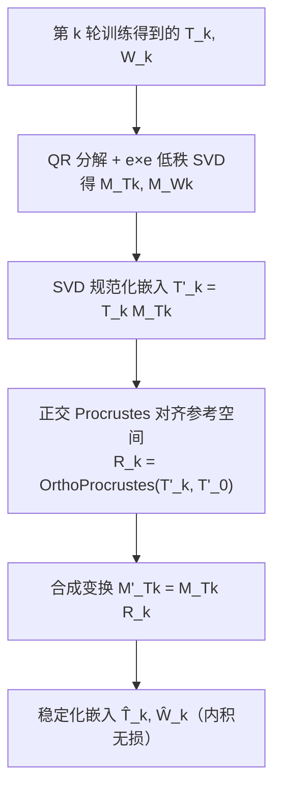

# Orthogonal Low Rank Embedding Stabilization (正交低秩嵌入稳定化)

- **会议/期刊**: RecSys 2025
- **作者与机构**: Kevin Zielnicki, Ko-Jen Hsiao（Netflix）
- **推荐链路定位**: 召回（嵌入后处理层，服务于下游特征消费）
- **研究方向**: 协同过滤与双塔召回 / 工业架构
- **论文原文**: [https://arxiv.org/abs/2508.07574v1](https://arxiv.org/abs/2508.07574v1)
- **开源代码**: 暂未开源

## TL;DR (1分钟核心速览)

工业推荐模型每次重训后，用户/物品嵌入空间的基向量完全漂移，导致下游模型无法复用历史嵌入（文中场景：日更基座模型需回填 9 亿条用户嵌入，成本不可行）。本文提出一个**纯后处理**的正交低秩变换：先用 QR 加速的低秩 SVD 消除嵌入维度的任意排序退化，再用正交 Procrustes 把每次重训的嵌入对齐到固定参考空间。变换为 $e\times e$ 小矩阵、保内积无损、无需改训练目标。在 Netflix 私有 Transformer 推荐模型上，跨 4 周的用户/物品余弦相似度从 0.013/0.042 提升至 0.75/0.82，跨期打分秩相关从 0.035 升至 0.53–0.62。

## Background & Motivation (背景与核心矛盾)

- **主流范式**: 双塔/softmax 类模型以用户嵌入与物品嵌入的内积定义打分，嵌入同时被下游模型当作输入特征、语义相似度与 RAG 检索的载体。
- **前人局限**: 其一，嵌入维度本身是任意排列、不可解释的，初始条件的微小扰动即导致完全不同的低秩分解，跨训练轮次**基不兼容**；其二，靠正则化强制嵌入相似会拖慢训练且仍不保证维度语义一致，靠降低重训频率则随行为漂移而劣化嵌入质量。
- **核心洞察 (Key Insight)**: 嵌入空间的不稳定根源是低秩分解的**退化性（degeneracy）**——SVD 在符号翻转意义下唯一，天然比任意梯度下降解更"规范"；而两次训练之间的差异可归结为一个近似正交的旋转。
- **本文切入点**: 不改模型、不加训练，仅用「低秩 SVD 规范化 + 正交 Procrustes 对齐参考空间」两步线性代数后处理，把任意一轮嵌入映射进统一坐标系。

## Method (核心方法设计)

### 1. 整体框架 (Overall Architecture)

设物品嵌入 $T\in\mathbb{R}^{n\times e}$、用户嵌入$W\in\mathbb{R}^{m\times e}$，打分$X\approx TW^{T}$。对每一轮训练$k$：先做低秩 SVD 变换得到规范化的$T'_k=T_kM_{T_k}$；再以第 0 轮（或上一轮已稳定化的嵌入）为参考，用正交 Procrustes 求旋转$R_k$使$R_kT'_k\approx T'_0$；最终变换为$M'_{T_k}=M_{T_k}R_k$、$M'_{W_k}=M_{W_k}R_k$，稳定化嵌入为$\hat{T}_k=T_kM'_{T_k}$、$\hat{W}_k=W_kM'_{W_k}$。由于$R_k$ 正交，打分矩阵严格不变，推理结果无损。

### 2. 关键设计拆解 (Key Designs)

1. **QR 加速的低秩 SVD（把 $O(mn^2)$降到线性）**：直接对$n\times m$打分矩阵做 SVD 在工业规模不可行，且 softmax 网络根本不显式构造$X$。本文利用已有的低秩分解$TW^T$，先对$T,W$做 QR 得$R_T,R_W$，只对$e\times e$小矩阵$R_TR_W^T$做 SVD：$R_TR_W^T=U_RSV_R^T$，再取$M_T=R_WV_RS^{-1/2}$、$M_W=R_TU_RS^{-1/2}$。计算量随$m,n$**线性**增长，且通过矩阵恒等式避免求$R$ 的逆，数值稳定。其物理直觉是：SVD 把嵌入转到主成分坐标，消除维度排列的任意性，使不同轮次"可比"。

2. **正交 Procrustes 跨轮对齐（把旋转差异吸收掉）**：SVD 只解决单轮内的退化，不同轮次的方差结构仍不同。给定参考 $B=T'_0$与当前$A=T'_k$，求正交$R$最小化$\|RA-B\|_F$，闭式解为对$M=B^TA$做 SVD 得$M=USV^T$，取$R=UV^T$。正交约束保证$R$是 Lipschitz 连续的，对输入小扰动稳定；同时$\hat{T}\hat{W}^T=T R R^T W^T=TW^T$，**打分严格保持**。作者仅用物品嵌入估计$R$（物品比用户更稳定），用户侧复用同一旋转。

3. **训练目标、参考轮次与推理开销**：本方法**无训练损失、无负采样**，全部由少量高度优化的线性代数调用完成。工程上采用链式参考：第 $k$轮只需对齐到第$k-1$轮的已稳定化嵌入$\hat{W}_{k-1}$，在固定词表下由正交性可证与对齐第 0 轮等价，从而避免长期保存"特殊轮次"的脆弱依赖。推理时仅多一次$e\times e$ 矩阵乘，可直接作为网络末端的额外全连接层内嵌进基座模型，开销相对主干网络可忽略。

## Experimental Setup & Evaluation Protocol (实验设置与评估协议)

- **数据集与预处理**: 使用 Netflix **私有** Transformer 推荐模型数据，按时间切出三个快照：(A) $T=0$、(B)$T=+2$周、(C)$T=+4$ 周。论文未披露用户/物品规模与过滤规则（无 5-core 等公开预处理），这是评估可复现性的主要短板。

| 数据集 | #Users | #Items | #Interactions | 稀疏度/密度 | 特征/场景说明 |
| :--- | :---: | :---: | :---: | :---: | :--- |
| Netflix-A ($T=0$) | 未披露 | 未披露 | 未披露 | 未披露 | 私有 Transformer 推荐模型，基准期 |
| Netflix-B ($T=+2$w) | 同上 | 同上 | 同上 | 未披露 | 重训后 2 周快照 |
| Netflix-C ($T=+4$w) | 同上 | 同上 | 同上 | 未披露 | 重训后 4 周快照 |

- **数据划分与防穿越 (Splitting Strategy)**: 采用**全局时间戳切分**（按训练周期自然切分为 A/B/C 三个时间快照），而非 Leave-One-Out 或比例划分；评估的是跨快照嵌入一致性，不涉及未来信息泄漏问题。
- **排名评测协议 (Ranking Protocol)**: 非传统 Top-N 排序指标，而是三类一致性度量：① 同用户平均余弦相似度（A vs B、A vs C）；② 同物品平均余弦相似度；③ 用户-物品打分的**秩相关**（Rank-Biased Overlap），对比"同日表示打分"与"跨期表示打分"的排序一致性。
- **对比基线与超参设置**: 仅对比 **Unstabilized vs Stabilized** 两组（无外部 SOTA 基线），嵌入维度 $e$ 与显著性检验均未报告，属于工业验证型而非基准竞赛型实验。

## Key Experimental Results (实验关键数据)

### 1. 主实验对比 (Main Results)

| 度量 | 周期 | Unstabilized | Stabilized | 绝对提升 |
| :--- | :---: | :---: | :---: | :---: |
| 用户余弦相似度 | A vs B | 0.013 | **0.82** | +0.807 |
| 用户余弦相似度 | A vs C | 0.014 | **0.75** | +0.736 |
| 物品余弦相似度 | A vs B | 0.042 | **0.82** | +0.778 |
| 物品余弦相似度 | A vs C | 0.095 | **0.82** | +0.725 |
| 打分秩相关 | A vs B | 0.035 | **0.62** | +0.585 |
| 打分秩相关 | A vs C | 0.041 | **0.53** | +0.489 |

### 2. 消融实验 (Ablation Study)

原文未提供逐组件消融表（无 `w/o LowRankSVD`、`w/o Procrustes` 的分离实验），仅给出完整管线与"无稳定化"的端到端对比。可归纳的隐式消融如下：

| 配置 | 用户相似度 (A vs C) | 物品相似度 (A vs C) | 秩相关 (A vs C) |
| :--- | :---: | :---: | :---: |
| w/o 全部（原始嵌入） | 0.014 | 0.095 | 0.041 |
| w/ 完整管线（SVD + Procrustes） | **0.75** | **0.82** | **0.53** |

### 3. 关键实验发现 (Key Findings)

1. **稳定化把"几乎正交"的跨期嵌入拉回同一坐标系**：无稳定化时跨期余弦相似度仅 0.013–0.095（接近随机），稳定化后全部 ≥0.75，说明基漂移是主导误差源而非嵌入本身信息丢失。
2. **物品侧比用户侧更稳定且更易对齐**：物品相似度在 A vs C 仍保持 0.82，而用户侧从 0.82 衰减到 0.75，印证作者"以物品估计旋转 $R$"的设计选择合理。
3. **排序一致性提升幅度小于向量相似度**：秩相关仅 0.53–0.62，说明即便向量高度对齐，跨期打分的相对次序仍有可观偏差——下游若依赖排序而非向量本身，需额外校准。

## Highlights & Limitations (亮点、对比与审稿批判)

- **与代表作对比 (vs. Prior Work)**: 相比**学习式后向兼容嵌入/变换**（需额外训练过程、会扭曲主模型），本文是零训练的后处理；相比**正则化强制嵌入相似**（拖慢训练且不保证维度语义一致），本文不触碰训练目标；相比**降低重训频率**（嵌入质量随时间劣化），本文允许日更基座模型。核心差异在于本文**冻结了每一维的语义**，而不仅是保持内积或排序不变。
- **可迁移亮点**: ① "QR + $e\times e$ 小矩阵 SVD"的加速技巧可迁移到任何需要在大规模双塔嵌入上做谱分解的场景（如白化、去流行度偏置）；② 链式参考（对齐上一轮已稳定化嵌入）避免了长期保存基准快照的工程脆弱性，适合流式重训管线。
- **审稿级局限批判**: ① **评估极弱**——仅私有数据、无公开基准、无外部基线、无显著性检验、无逐组件消融，难以判断 SVD 与 Procrustes 各自贡献；② **秩相关仅 0.53–0.62** 表明对齐并不彻底，且方法假设两次训练间差异近似正交旋转，若模型结构或词表发生变化（物品增删）该假设失效，论文未讨论冷启动物品的对齐处理。

## Rating (四维评分)

- **方法创新性 (Novelty)**: ⭐⭐⭐⭐ （把 SVD 退化性与 Procrustes 正交性组合成无损后处理，思路简洁且有清晰代数依据，但两个组件均为经典工具）
- **评估协议与实验扎实度 (Protocol & Experiments)**: ⭐⭐ （仅私有数据、单一对比、无消融无显著性检验，工业验证性质强于学术严谨性）
- **写作与数学规范度 (Clarity & Rigor)**: ⭐⭐⭐⭐ （算法伪代码与矩阵恒等式推导干净，内积保持性证明一句话到位，工程落地讨论充分）
- **工业落地与复现价值 (Industrial & Practical Value)**: ⭐⭐⭐⭐ （$e\times e$ 变换、可内嵌为网络层、链式参考设计极具工程价值，但无开源代码且依赖私有数据，复现受限）

