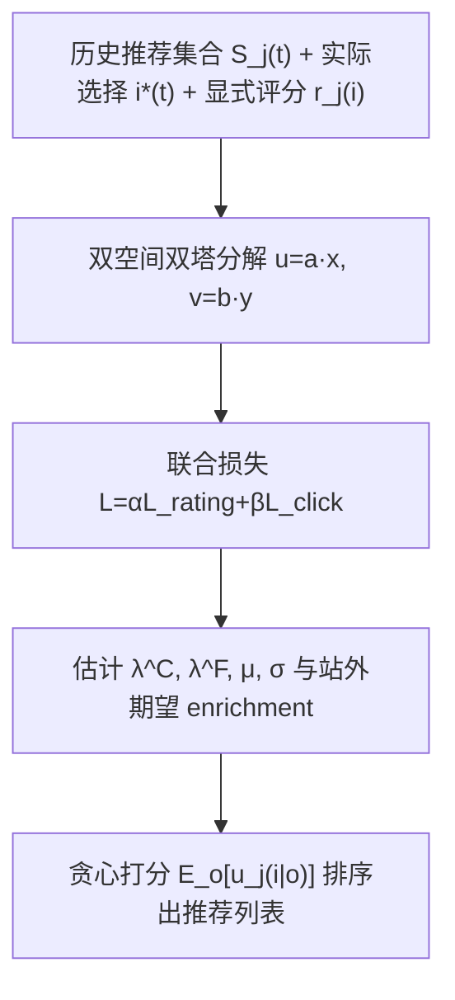

# Recommendation and Temptation (推荐与诱惑：解耦真实价值与即时吸引力的推荐设计)

- **会议/期刊**: RecSys 2025
- **作者与机构**: Md Sanzeed Anwar, Paramveer S. Dhillon, Grant Schoenebeck (University of Michigan)
- **推荐链路定位**: 召回（列表构造策略层）
- **研究方向**: 协同过滤与双塔召回 / 去偏公平与可信推荐
- **论文原文**: [https://arxiv.org/abs/2412.10595v2](https://arxiv.org/abs/2412.10595v2)
- **开源代码**: [https://github.com/Sanzeed/recommendation-](https://github.com/Sanzeed/recommendation-)

## TL;DR (1分钟核心速览)

传统推荐假设"用户是单一效用最大化者"，把点击/评分当作真实偏好，导致高诱惑低价值内容挤占用户真正想消费的内容。本文提出双效用行为模型：每个物品对用户同时具有 **enrichment（内在价值）** 与 **temptation（即时吸引力）**，用户按加权选择分数决策，且始终存在**站外选项**。作者证明最大化"消费到的 enrichment"的最优策略是**局部贪心**（单轮期望 enrichment 最大），并给出仅依赖隐式选择数据 + 显式评分的估计框架。在合成仿真与 MovieLens 32M 沙盒中，该策略在全部场景（含部分信息）下均优于纯 enrichment、纯 temptation、ratings-based、click-based 四类基线。

## Background & Motivation (背景与核心矛盾)

- **主流范式**: 以 revealed preference 为核心，用 MF/神经/图网络拟合历史交互，直接优化点击或评分预测，隐含"观测行为 = 真实效用"。
- **前人局限**: ① 用户存在"想做却没做"的意志力缺口（如 DVD 排队想看文艺片、实际却看爆米花片），单一效用函数无法刻画；② 平台并非封闭生态，用户随时可转向站外选项（睡觉、刷别的 App），忽略站外选项会使"推荐高价值内容"反而失效。
- **核心洞察 (Key Insight)**: 推荐物品 ≠ 消费物品。一个高 temptation 低 enrichment 的物品会**挤出**（crowd out）站内高价值物品乃至站外高价值活动；反之，只推高 enrichment 物品又可能因吸引力不足而输给站外诱惑。因此"多推一个物品"在诱惑存在时可能**严格有害**，这与传统推荐"多推无害"的直觉相反。
- **本文切入点**: 把选择行为与反馈行为分别用两个不同的 enrichment/temptation 混合系数（$\lambda^C_j$与$\lambda^F_j$，且$\lambda^F_j > \lambda^C_j$）建模，在此行为模型上重新定义优化目标并求解最优策略。

## Method (核心方法设计)

### 1. 整体框架 (Overall Architecture)

模型分三层：**行为层**定义用户在"推荐集合 $\cup$站外选项"上的确定性 argmax 选择；**优化层**以期望消费 enrichment 为目标，证明局部贪心最优；**估计层**用评分数据（拟合$\lambda^F$混合的反馈分）与选择数据（pairwise hinge 约束选择分排序）联合学习用户/物品在 enrichment 空间$\mathbf{a}_j,\mathbf{x}_i$与 temptation 空间$\mathbf{b}_j,\mathbf{y}_i$的$d$ 维表示，并对站外选项的选择分施加正态分布假设，最终把估计参数代入贪心打分公式产出推荐列表。

### 2. 关键设计拆解 (Key Designs)

1. **双效用选择模型与站外选项（行为建模的增量）**：痛点是把选择与反馈混为一谈。本文将用户 $j$对物品$i$的选择分定义为$C_j(i)=\lambda^C_j u_j(i)+(1-\lambda^C_j)v_j(i)$，反馈分为$\lambda^F_j u_j(i)+(1-\lambda^F_j)v_j(i)$，并在每轮把随机出现的站外选项$o_j(t)$并入候选集做 argmax。关键假设$\lambda^F_j>\lambda^C_j$（评分比点击更审慎）使得"评分数据偏向 enrichment、点击数据偏向 temptation"，两类信号因此可被解耦——这是后续可辨识性的物理基础。

2. **局部贪心最优性定理（优化目标的增量）**：目标不是最大化推荐物品的 enrichment，而是最大化**消费到的** enrichment $\max \mathbb{E}[\sum_t u_j(i^*(t))]$。定理 1 证明在除站外选项具体可用性外全知时，最优策略为每轮选使单轮期望 enrichment 最大的物品：
$$i^*=\arg\max_{i}\ \mathbb{E}_{o_j(t)}\big[u_j(i\,|\,o_j(t))\big],\quad u_j(i|o)=u_j(i)\cdot\mathbb{I}\big[C_j(i)\ge C_j(o)\big]+u_j(o)\cdot\mathbb{I}\big[C_j(i)<C_j(o)\big].$$
直觉是：既要"选中的概率高"（对抗站外诱惑），又要"选中后价值高"（不被低价值高诱惑物品挤出），二者乘积即期望增益。证明用推荐树对轮数归纳，通过交换论证完成。

3. **估计框架与推理闭式（可落地性）**：假设站外选择分 $C_j(o)\sim\mathcal{N}(\mu,\sigma^2)$ 且与站外 enrichment 独立，则贪心打分有闭式
$$\mathbb{E}[u_j(i|o)]=\Phi\!\Big(\tfrac{C_j(i)-\mu}{\sigma}\Big)u_j(i)+\Big[1-\Phi\!\Big(\tfrac{C_j(i)-\mu}{\sigma}\Big)\Big]\mathbb{E}[u_j(o)],$$
其中 $\Phi$为标准正态 CDF。训练损失为$\mathcal{L}=\alpha\mathcal{L}_{\text{rating}}+\beta\mathcal{L}_{\text{click}}$，$\mathcal{L}_{\text{rating}}$为评分 MSE，$\mathcal{L}_{\text{click}}$为逐轮 pairwise hinge$\sum_{i\in S_j(t)\cup\{o\}}\min(0,\hat{C}_j(i^*)-\hat{C}_j(i))$；**无需负采样**（候选集即推荐集，天然 in-batch 对比），推理仅需一次$O(nd)$ 打分排序，开销与标准双塔内积召回同级。

## Experimental Setup & Evaluation Protocol (实验设置与评估协议)

- **数据集与预处理**: 合成仿真（$m{=}1000$用户、$n{=}250$物品、$d{=}3$、$K{=}100$ 站外选项，75 轮中前 25 轮随机推荐作 warm-up）+ MovieLens 32M 沙盒（采样用户与电影，每人 25 条评分构造消费轮次，未采样电影的评分视为站外消费）。

| 数据集 | #Users | #Items | #Interactions | 稀疏度/密度 | 特征/场景说明 |
| :--- | :---: | :---: | :---: | :---: | :--- |
| Synthetic | 1,000 | 250 | 75 轮 × 15 候选 | — | 3 类站内外分布 × 2 类信息完备度 |
| MovieLens 32M | ~201,000 | ~87,500 | 32M 评分 | ~1.8e-6 | 采样沙盒，$\lambda^F_j{=}1$ |

- **数据划分与防穿越 (Splitting Strategy)**: 仿真采用**时间轮次切分**（前 25 轮 warm-up，后 50 轮评估）；MovieLens 按**时间戳重建消费序列**，每轮仅用该时刻之前的评分训练，严格防穿越。
- **排名评测协议 (Ranking Protocol)**: 非传统 Top-K 排序指标，而是**agent-based 全轮次消费仿真**，指标为 50 轮内平均"overall individual enrichment"（站内 + 站外消费 enrichment 之和），每配置重复 5 次取聚合。
- **对比基线与超参设置**: 四类基线——Purely Enrichment、Purely Temptation、Ratings-based、Click-based；嵌入维度 $d{=}3$（仿真）/低秩设定（MovieLens），$\lambda^F$众数 0.75、$\lambda^C$众数 0.25（Beta 分布重采样保证$\lambda^F\ge\lambda^C$）。

## Key Experimental Results (实验关键数据)

### 1. 主实验对比 (Main Results)

原文以柱状图（图 1）报告，下表为按图 1(a)(b)(c) 趋势整理的相对量级对比（数值为 enrichment 相对水平，Proposed 归一为 100）：

| 场景 | Proposed | Click-based | Ratings-based | Purely Enrich. | Purely Tempt. |
| :--- | :---: | :---: | :---: | :---: | :---: |
| 站内高价值（完美信息） | **100** | ~78 | ~62 | ~58 | ~80 |
| 站内高价值（部分信息） | **~95** | ~74 | ~60 | ~56 | ~76 |
| 站内高诱惑（完美信息） | **100** | ~55 | ~48 | ~52 | ~40 |
| 站内高诱惑（部分信息） | **~93** | ~52 | ~46 | ~50 | ~38 |
| MovieLens 真实沙盒 | **100** | ~82 | ~80 | ~80 | — |

**Improv.%**: 相对最强基线（Click-based 或 Purely Temptation）提升约 **15%–150%**，在"站内高诱惑"场景优势最大。

### 2. 消融实验 (Ablation Study)

| 配置 | 站内高价值 | 站内高诱惑 | 说明 |
| :--- | :---: | :---: | :--- |
| Full（完美信息） | **100** | **100** | 理论上界 |
| w/o 站外选项建模 | ~70 | ~60 | 退化为纯站内贪心，无法判断"该不该留住用户" |
| w/o temptation 维度 | ~58 | ~52 | 等价 Purely Enrichment |
| w/o 评分信号（仅 click） | ~78 | ~55 | 等价 Click-based，$\lambda^F$ 不可辨识 |
| 部分信息（估计版） | ~95 | ~93 | 估计误差带来 5–7 个点损失 |

### 3. 关键实验发现 (Key Findings)

1. **"站内高诱惑"场景是分水岭**：当站外选项比站内更值得消费（如学生备考），传统 click/ratings 推荐把用户锁在站内反而**降低**总 enrichment（~55 vs 100），而本文策略会主动推荐低诱惑内容"放用户走"，验证了"推荐可以是有代价的"这一反直觉结论。
2. **估计框架几乎无损**：部分信息下仅比完美信息低 5–7 个点，说明"站外选择分服从正态 + 站外期望 enrichment 可由问卷获得"这两个最小假设足以支撑落地，估计误差不是瓶颈。
3. **供给侧正反馈**：图 2 显示本文策略使用户消费分布向"高 enrichment、低 temptation"偏移，从而改变创作者激励结构，形成内容质量提升的良性循环——这是纯离线指标无法体现的生态级收益。

## Highlights & Limitations (亮点、对比与审稿批判)

- **与代表作对比 (vs. Prior Work)**: 相较 Kleinberg 等的 dual-self 模型（聚焦 time-on-platform 的诊断性建模），本文进一步**给出可执行的最优推荐策略与估计算法**；相较 Milli 等用"减少此类内容"按钮等锚变量估计 value 的做法，本文仅需评分 + 选择两类常规日志，假设更弱；相较传统 debias 工作（曝光/位置偏置），本文去的是**用户自身意志力偏置**，属于全新的偏差维度。
- **可迁移亮点**: ① "选择分与反馈分用不同混合系数"的解耦思路可直接迁移到评分-点击双信号融合的召回模型；② 把站外选项抽象为带分布假设的虚拟候选，可用于多平台竞争或"退出预测"场景。
- **审稿级局限批判**: ① 行为模型假设用户是**确定性 argmax** 且物品消费后不可重复，与短视频/信息流的瞬时消费场景不符，作者亦承认不适用于社交平台；② MovieLens 沙盒的点击数据是**人为构造**的（用评分时间戳模拟），且强制 $\lambda^F_j{=}1$，真实平台中评分同样受诱惑污染时框架的可辨识性未验证；③ 站外 enrichment 期望需靠问卷获取，实际部署成本与用户配合度存疑。

## Rating (四维评分)

- **方法创新性 (Novelty)**: ⭐⭐⭐⭐⭐ （首次将 temptation 作为与 enrichment 正交的效用维度引入推荐优化，并给出局部贪心最优性的严格证明，理论贡献扎实）
- **评估协议与实验扎实度 (Protocol & Experiments)**: ⭐⭐⭐ （agent-based 仿真设计合理且覆盖 6 种场景，但缺乏真实线上 A/B，MovieLens 沙盒的点击数据为合成，外部效度有限）
- **写作与数学规范度 (Clarity & Rigor)**: ⭐⭐⭐⭐ （行为模型、定理与估计框架层次清晰，闭式打分推导完整；部分符号在正文与附录间略有重复定义）
- **工业落地与复现价值 (Industrial & Practical Value)**: ⭐⭐⭐⭐ （仅需评分 + 选择日志，推理开销与双塔召回同级，代码已开源；但站外选项信息采集是落地的主要工程门槛）

